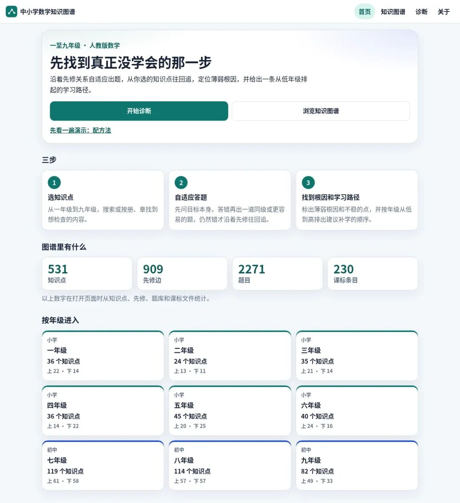
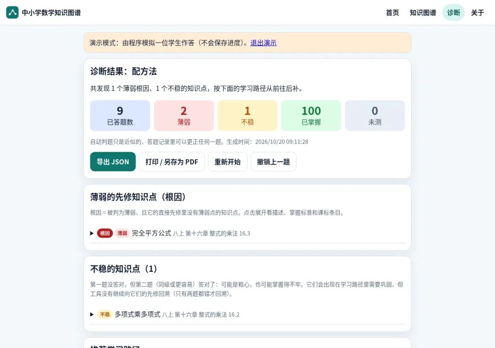
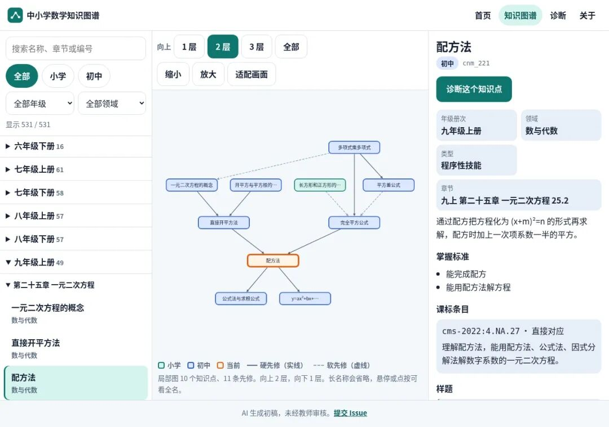

# 把中小学一到九年级 531 个数学知识点串成先修网，答错题能一路回溯找到小学薄弱点的开源工具
> 💡 备注属性未写入，可能是备注属性名称或者类型被修改了，建议将字段类型设置为 rich_text，可以在小程序-操作-修改文章数据库页面进行调整
> 💡 原文链接:[https://mp.weixin.qq.com/s?__biz=MzkwODQzNzk1OQ==&mid=2247503012&idx=1&sn=c396e89ef0dee2fdd051c641cdb7336b&chksm=c1a9d638744359a234b81e2cca827109ba8393ee9d8198e78b4e7feacbef347102b9a1759c16#rd](https://mp.weixin.qq.com/s?__biz=MzkwODQzNzk1OQ%3D%3D&mid=2247503012&idx=1&sn=c396e89ef0dee2fdd051c641cdb7336b&chksm=c1a9d638744359a234b81e2cca827109ba8393ee9d8198e78b4e7feacbef347102b9a1759c16#rd)
**cn-math-taxonomy**（中小学数学知识图谱）是一个纯静态网页形态的开源中小学数学知识图谱与自适应前置诊断工具。
它把义务教育一至九年级的 531 个数学知识点整理成一张带先修关系的有向无环图（DAG），学生选定目标知识点或章节答题时，一旦答错就会沿着先修依赖链从初中一路回溯到具体的小学知识点，找出薄弱根因并给出按年级从低到高排列的学习路径。

#### 要点
- **覆盖范围**：531 个知识点（小学 216、初中 315），对齐《义务教育数学课程标准（2022 年版）》230 条内容要求（529 个知识点已完成课标映射）与人教版一至九年级教材，按年级、册次、章节挂载。
- **先修网络**：909 条先修边（小学内部 311 条、初中指向小学 35 条、初中内部 563 条），分 `hard`（788 条，不会就基本学不下去）与 `soft`（121 条，有帮助但非硬门槛），并做了传递约简；全图只有一个根节点——一年级的“1 到 5 各数的认识”。
- **诊断机制**：支持按单个知识点或整章开始诊断，单次诊断默认上限 16 题（可在 8–30 题间调整），每个知识点最多问 2 题。第一题答对即判掌握、跳过全部祖先；答错再出一道同级或更简单的题，第二题仍错才算“薄弱”并优先沿 `hard` 先修边回溯，第二题答对则标为“不稳”但不回溯。
- **结果产出**：薄弱根因、不稳知识点、按年级从低到高排列的学习路径、相关课标条文原文，加一张可缩放拖动的路径图，支持导出 JSON、逐题手动改判重算与打印。
- **题库规模**：共 2271 题（小学 864、初中 1407）。小学每点 4 题，100% 为数字题或选择题；初中每点 4–5 题，数字题与选择题合计占 97.9%。全库自动核验 1739 题、不一致 0 条，另有独立第二遍盲解复核。本地判题用精确有理数比较（如 `1/2`、`0.5`、`50%` 均判等价，代数式与文字题若非字面相同则交给用户自评）。
- **纯静态页**：首页、知识图谱、诊断三个页面直接读取本地 JSON，绘图库（`Cytoscape 3.30.4`、`dagre 0.8.5`、`cytoscape-dagre 2.5.0`）随仓库分发、不连外部 CDN，断网也能用；答题进度与已出题记录存在浏览器的 `localStorage` 中。
- **局部展示**：图谱不会“糊成一团”，默认只画当前知识点附近的先修（上 2 层、下 1 层），选“全部祖先”且超过 40 个点时先按年级收起，展开后自动对准当前点。
- **初稿声明**：作者明确标注这是 AI 生成的初稿，未经任何教师审核；九年级下册及多册小学目录来自第三方，标为“非官方、待核”，二年级下册目录属推定。

#### 上手
- **获取与运行**：无需注册账号、不用安装客户端，任何电脑或手机浏览器打开在线站点（`math.pansgo.com`）即可直接使用。项目没有打包的安装包或便携版，若想本地离线运行，需下载仓库源码并自备 Python 3 环境（脚本仅依赖 Python 标准库，无需 `pip` 安装第三方包）。**本地防拦截**：下载源码后**严禁直接双击 `index.html`**，因为页面通过 `fetch` 读取本地 JSON 数据，直接双击会被浏览器安全机制（跨域）拦截导致页面空白；必须在仓库根目录执行 `python3 -m http.server 8000`，再访问 `http://localhost:8000`。**诊断题量限制**：单次诊断默认上限为 16 题，如果选中的初中知识点先修链很长，一次测试可能在半路达到上限而无法追溯到小学一年级，实操时需在设置里将题量上限调大（支持 8~30 题），或对结果里的“未测先修”做二次针对性诊断。**商业授权红线**：采用 CC BY-NC 4.0 协议（内置绘图库保留 MIT 协议），仅供个人学习、教学与研究免费使用；严禁用于付费课程、机构收费服务或打包售卖题库，商业使用必须单独联系作者获取授权。
项目由 xiaoyang111222 开发，当前 989 Stars。
> ❝
> **项目地址：https://github.com/xiaoyang111222/cn-math-taxonomy
> **
