# 把元素周期表玩成游戏式集卡：118个元素3D电子云，点开就有登场动画
> 💡 备注属性未写入，可能是备注属性名称或者类型被修改了，建议将字段类型设置为 rich_text，可以在小程序-操作-修改文章数据库页面进行调整
> 💡 原文链接:[https://mp.weixin.qq.com/s?__biz=Mzg4Njg3OTg2NQ==&mid=2247486230&idx=1&sn=cacb685d377fe172ca4769b99453938f&chksm=ce5a402dc0f6ff88941a0f267777998db0910af509b924f54a9369dcaebde0ce08bed52a31e6#rd](https://mp.weixin.qq.com/s?__biz=Mzg4Njg3OTg2NQ%3D%3D&mid=2247486230&idx=1&sn=cacb685d377fe172ca4769b99453938f&chksm=ce5a402dc0f6ff88941a0f267777998db0910af509b924f54a9369dcaebde0ce08bed52a31e6#rd)
#### 把元素周期表玩成了游戏式集卡，118 个元素等你来收
兄弟们，我发现一个把化学玩出花来的网站。
把 118 个元素做成了能收集的卡片。点开有卡片登场动画，还能旋转电子云、观察化学反应。你能把这些卡集齐吗？
来玩哈哈！
🔗 体验地址：**https://shapeof.world/explore/periodic-table**
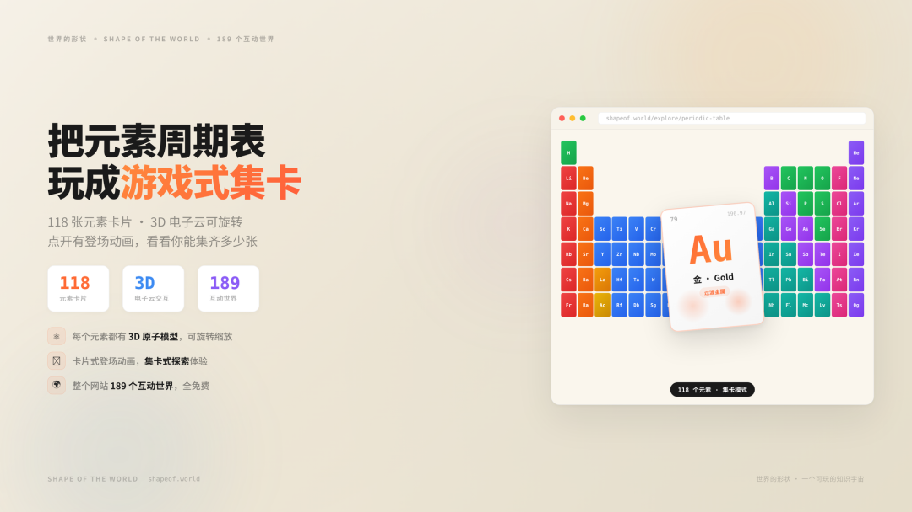
---
#### 这不是普通的元素周期表
先说结论：**这不是一张静态的周期表图片，这是一个可以玩的 3D 互动世界。**
它来自一个叫「**世界的形状**」（Shape of the World）的项目，一个把知识变成可以探索的世界的网站。目前已经有 **189 个互动世界**，覆盖宇宙、生命、数学、AI、人类等领域，元素周期表是其中最受欢迎的之一。
整个项目还是**开源**的，GitHub 仓库地址在文末。
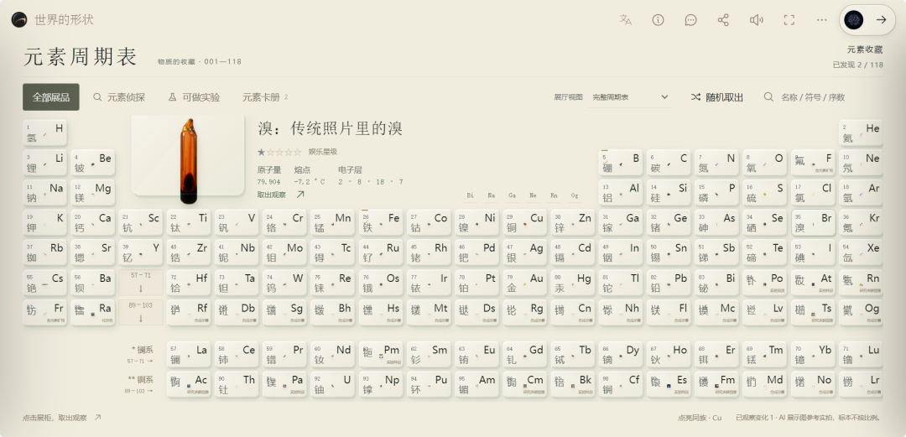
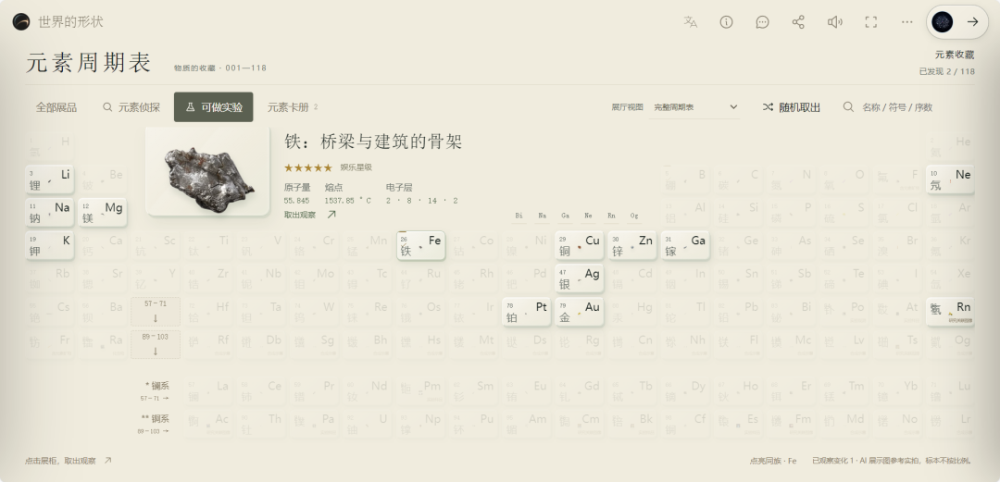
---
#### 元素周期表怎么玩
**1. 118 张元素卡片，点开有登场动画**
不是冷冰冰的表格。每个元素都是一张独立的卡片，点开会有卡片翻转登场的动画，仪式感拉满。
就像集卡游戏一样，每点开一个新元素，就像拆开一包新卡。
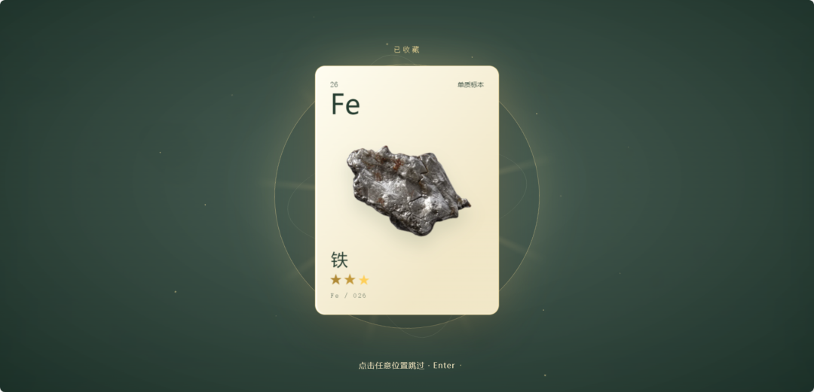
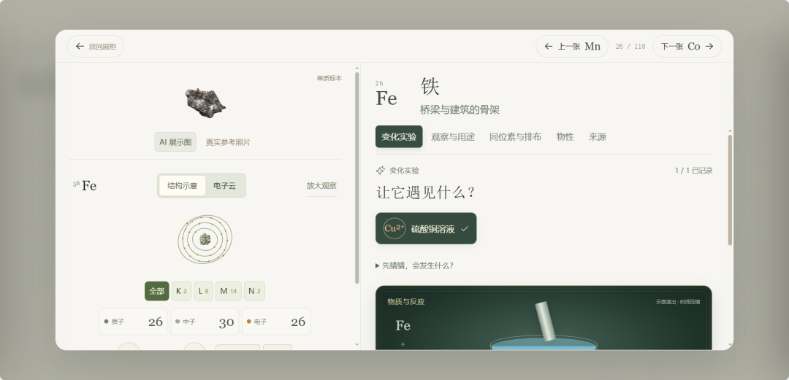
**2. 3D 电子云，可旋转可缩放**
最酷的是这个——每个元素都有**实时 3D 渲染的原子模型**，电子以概率云的形式分布在原子核周围。
•
**鼠标拖拽**：自由旋转，从各个角度观察电子轨道
•
**滚轮缩放**：放大看细节，缩小看整体
•
**真实模拟**：基于电子排布算法实时生成，不是预渲染的视频
氢是一朵小小的球形云，铁的轨道复杂得像一朵花，铀的电子层数多得让人眼花缭乱——每个元素都有自己独特的"形状"。
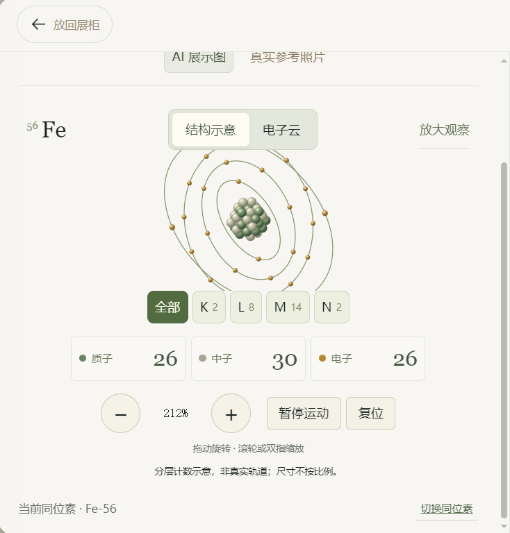
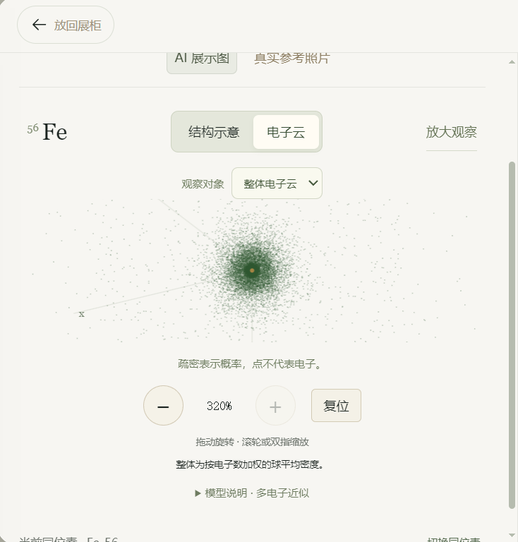
**3. 元素信息一目了然**
每张卡片上都有：
•
元素符号和原子序数
•
元素名称（中文 + 英文）
•
原子量
•
元素分类（金属、非金属、惰性气体等）
•
电子排布
•
发现历史
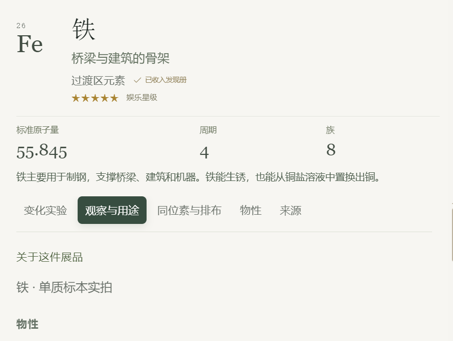
**4. 分类着色，一目了然**
周期表按元素类型用不同颜色区分：碱金属、碱土金属、过渡金属、镧系、锕系、非金属、卤素、惰性气体……一眼就能看出规律。
**5. 收集进度**
网站有「**我的图鉴**」功能，你看过的元素会被记录下来。118 个元素，你能集齐多少？
有一种小时候集水浒卡的感觉，只不过这次集的是元素周期表。
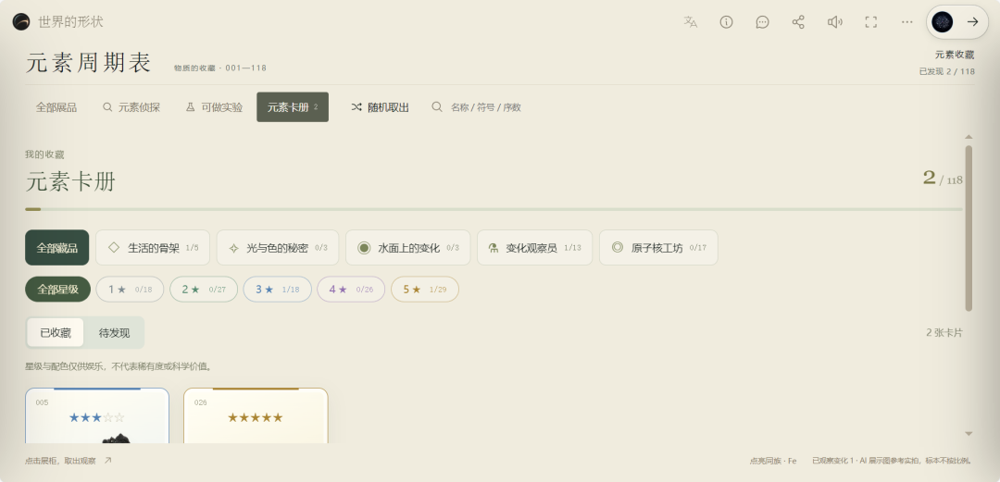
---
#### 不止元素周期表：189 个互动世界
#### 
元素周期表只是「世界的形状」里的一个世界。整个网站有 **189 个互动世界**，个个都很惊艳：
**🌌 宇宙与物理**
•
**掠过黑洞边缘的星空**：第一视角穿越黑洞引力透镜
•
**四天抵达月球**：模拟地月旅行
•
**太阳的葬礼**：恒星演化的一生
•
**极光**：太阳粒子如何在两极变成光帘
•
**银河系与仙女座碰撞**：40 亿年后会发生什么
**🧮 数学**
•
**公式虫洞**：钻进一条由公式铺成的隧道
•
**分形里，还有分形**：曼德博集合无限缩放
•
**素数，藏着怎样的节奏？**：黎曼猜想可视化
•
**傅里叶级数**：周期信号如何分解为正弦波
•
**蝴蝶效应：吸引子的美妙**：混沌理论可视化
**🧬 生命科学**
•
**同一头牛的不同部位**：牛肉部位口感科普
•
**心脏电信号**：心脏的电信号按固定路线传导
•
**搅动流体时形成的涡旋**：流体力学模拟
**🤖 AI 与科技**
•
**一朵花，穿过潜空间与噪声**：扩散模型去噪过程
•
等等等等……
189 个世界，每个都值得单独玩半小时。
---
#### 为什么这个网站做得这么好
**1. 不只是展示，是"体验"**
普通科普网站是给你看图片、读文字。这个网站是**让你亲手去摸、去转、去探索**。
你可以亲自旋转一个原子，看看电子云到底长什么样； 你可以放大黑洞，看看引力透镜如何扭曲星光； 你可以拨动公式，看看参数变化会产生什么效果。
**知识不是看会的，是玩会的。**
**2. 审美在线**
界面设计非常克制和高级，米白色调 + 细腻的 3D 渲染 + 流畅的动画，整体质感像一款独立游戏，而不是一个教育网站。
背景音乐也很加分，沉浸式体验拉满。
**3. 完全免费，开箱即用**
•
不用注册登录
•
不用下载 App
•
打开浏览器就能玩
•
支持手机和电脑
**4. 开源项目**
整个项目在 GitHub 上开源（makerjackie/shapeof.world），任何人都可以查看源码、提交贡献。
---
#### 怎么玩
1.
打开网址：**https://shapeof.world/explore/periodic-table**
2.
点击任意元素，查看它的 3D 原子模型
3.
鼠标拖拽旋转、滚轮缩放
4.
探索更多世界：点击顶部的「全部世界」浏览 189 个互动世界
5.
收藏你喜欢的世界，慢慢集齐图鉴
**手机用户注意**：如果从公众号或微博打开看不到 3D 效果，用手机自带浏览器（Safari、Chrome、Edge）打开就正常了。
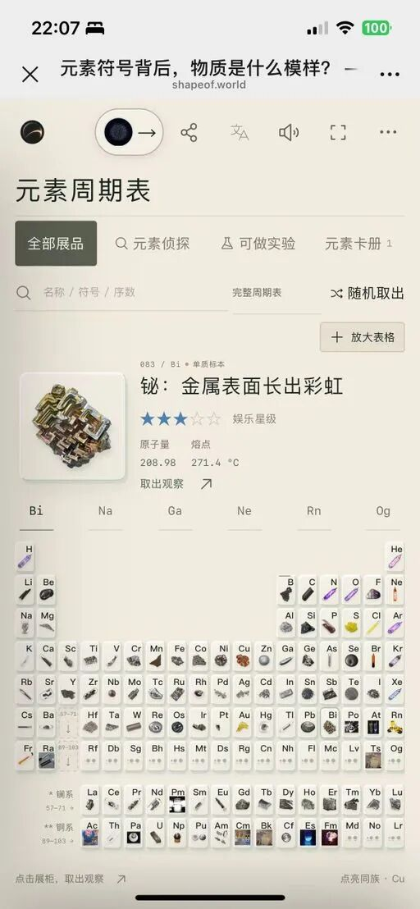
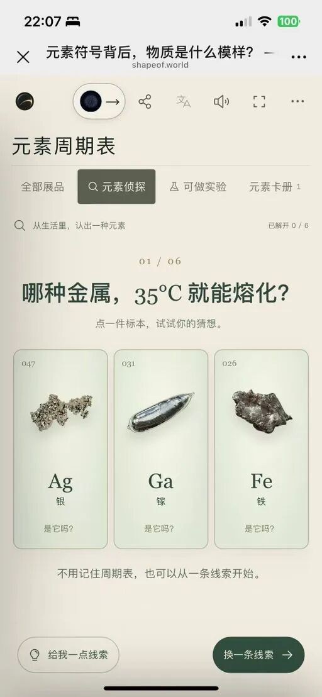
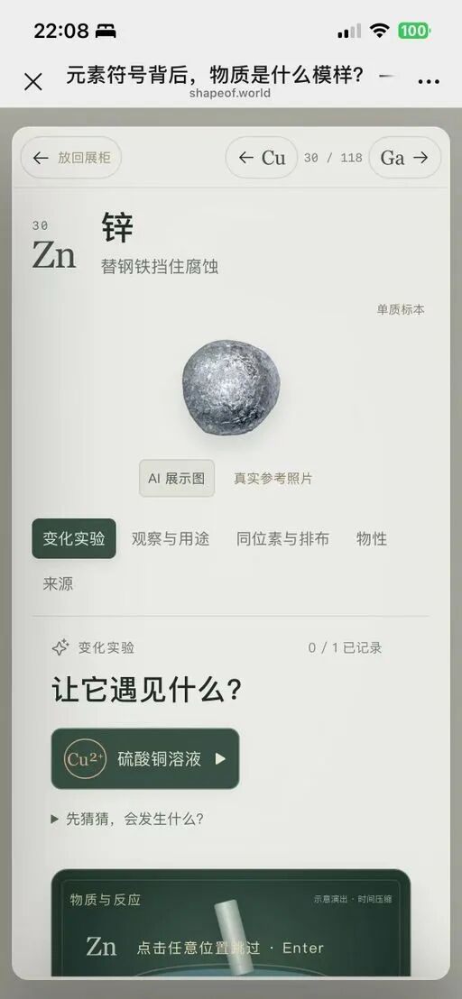
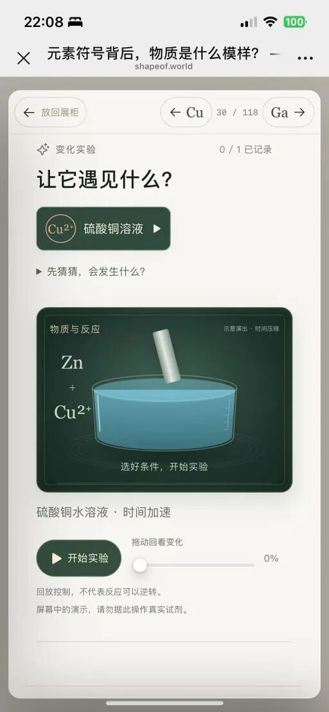
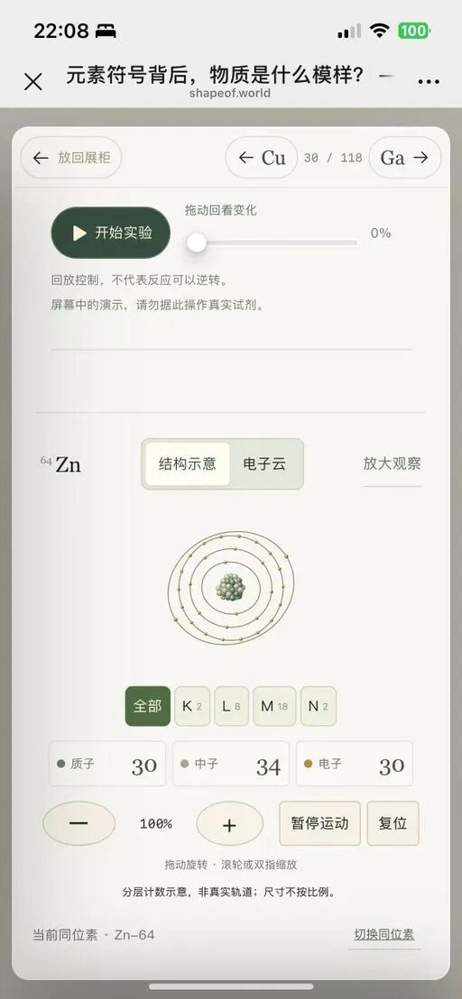
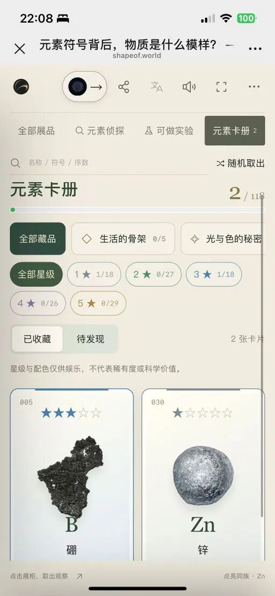
---
#### 写在最后
我们上学的时候，元素周期表是课本上一张死气沉沉的表格，要背的是氢氦锂铍硼、碳氮氧氟氖。
但在这个网站里，每个元素都有了形状、有了颜色、有了自己的"性格"。氢是最简单的一朵云，金是沉甸甸的过渡金属，氙是安安静静的惰性气体……
你不需要背任何东西，只要点开、旋转、观察。看着看着，就记住了。
**好的教育不是灌输知识，而是让你想去探索。**
这个网站做到了。
🔗 元素周期表：**https://shapeof.world/explore/periodic-table**
🔗 全部 189 个世界：**https://shapeof.world**
🔗 GitHub 开源：**https://github.com/makerjackie/shapeof.world**
快去试试，看看你能集齐多少张元素卡。

## 摘要

（待补充）

## 我的笔记

（待补充）
