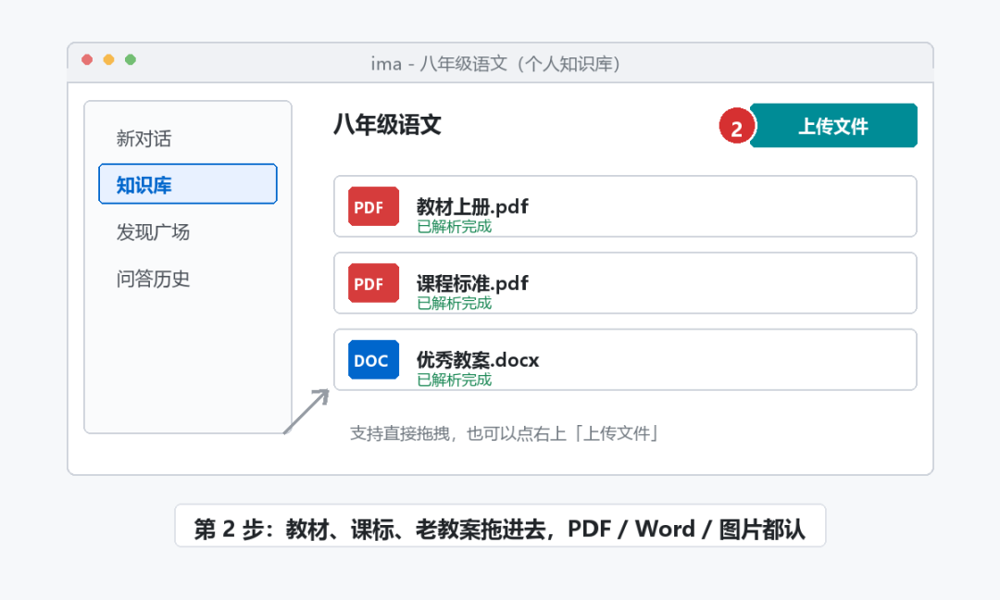
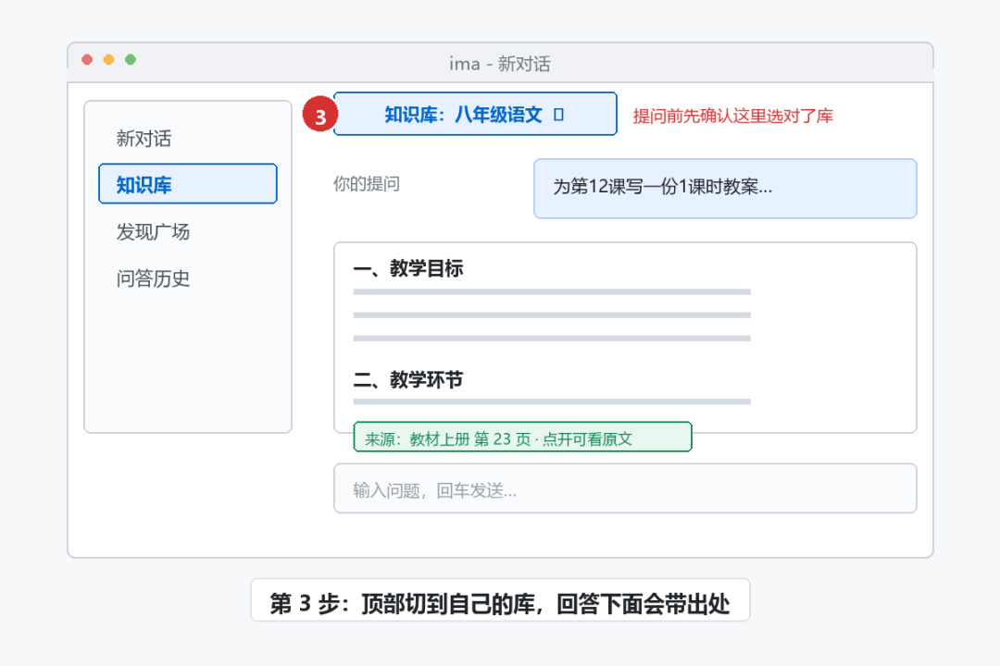

# 把教材丢进知识库，AI 写教案不再瞎编（免费）
> 💡 备注属性未写入，可能是备注属性名称或者类型被修改了，建议将字段类型设置为 rich_text，可以在小程序-操作-修改文章数据库页面进行调整
> 💡 原文链接:[https://mp.weixin.qq.com/s?__biz=MzkwODgxNzY1MA==&mid=2247484258&idx=1&sn=30c6c1f2f104ae4c3063dcbeb9c2be3b&chksm=c1716303227d742bf7083b5d9d900622e4d0455458ebbcd0a275907623ccb60ae008849a22ac#rd](https://mp.weixin.qq.com/s?__biz=MzkwODgxNzY1MA%3D%3D&mid=2247484258&idx=1&sn=30c6c1f2f104ae4c3063dcbeb9c2be3b&chksm=c1716303227d742bf7083b5d9d900622e4d0455458ebbcd0a275907623ccb60ae008849a22ac#rd)
### 把教材丢进知识库，AI 写教案不再瞎编（免费）
只适用于电脑备课，Windows 和 Mac 都行。手机也可以使用。工具叫 ima（腾讯的 AI 知识管家），ima.qq.com 下载，微信扫码登录，基础功能免费。先说不管什么：它不会凭空给你想出一节课，只做一件事——只按你给它的资料回答，不去网上现编。
请看步骤：
**1**打开后点左侧"知识库"，点"新建知识库"。名字按学科起，比如"八年级语文"。

**2**把教材 PDF、课程标准、往年写得顺手的教案直接拖进去。PDF、Word、图片都认。一次别拖几百份，一学期一学期加，解析更快。

**3**回到对话框，先把顶上的"知识库"切到你刚建的库，再提问。

提示词照这段改，方括号换成你自己的：
●只基于我上传的知识库内容回答。为【八年级上册第三单元第12课】写一份 1 课时教案，含教学目标、重难点、教学环节（标时间）、课堂提问 3 个、作业设计。库里没有的直接写"资料中没有"，不要自己编。
◆能够一次成功的关键是：提问前先看顶上的库有没有切对。
没切库，它就是个普通大模型，照样编。切对了，回答下面会带出处，点开能看到原文在第几页，对不对一眼能查。
存储免费 30G 起步，教师认证能到 100G。教案出来自己过一遍再交。
▼ 关注「科技小砖头」，每天一个小技巧
科技小砖头
