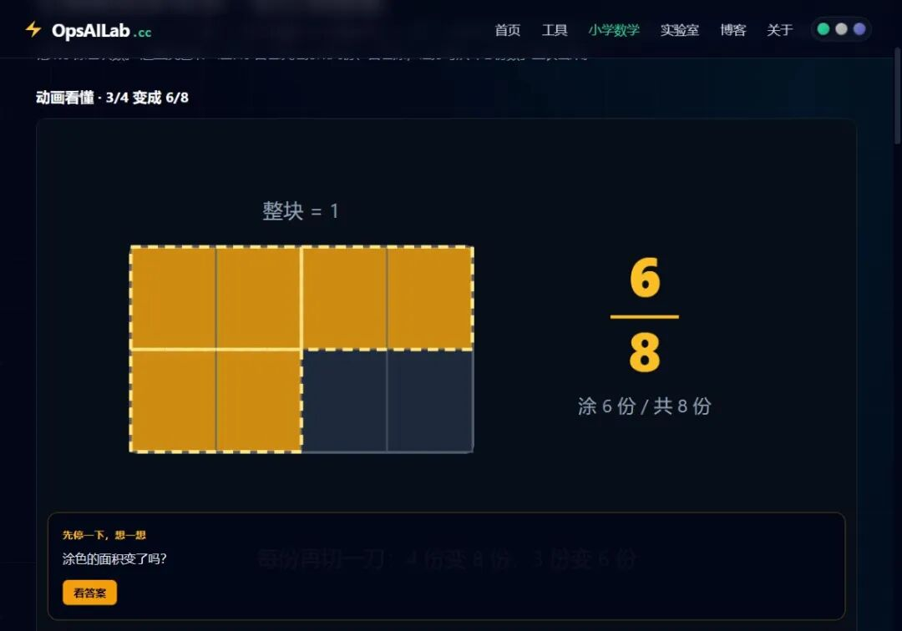
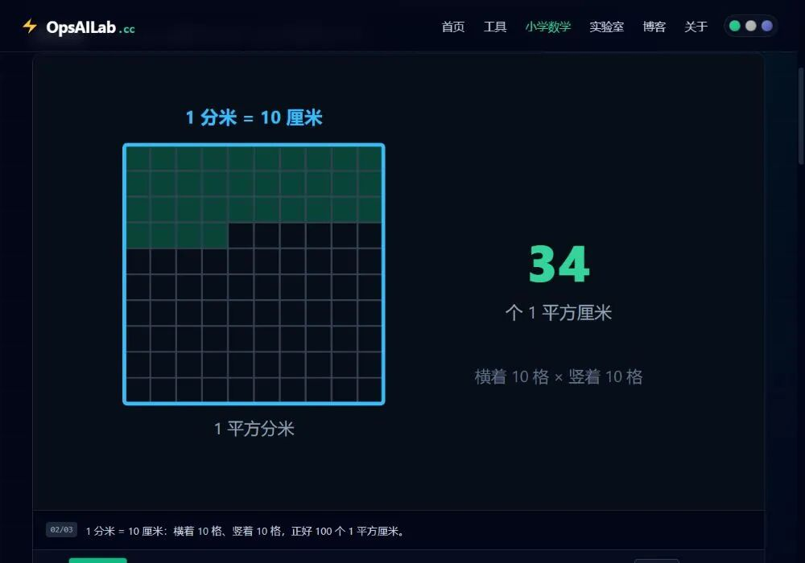
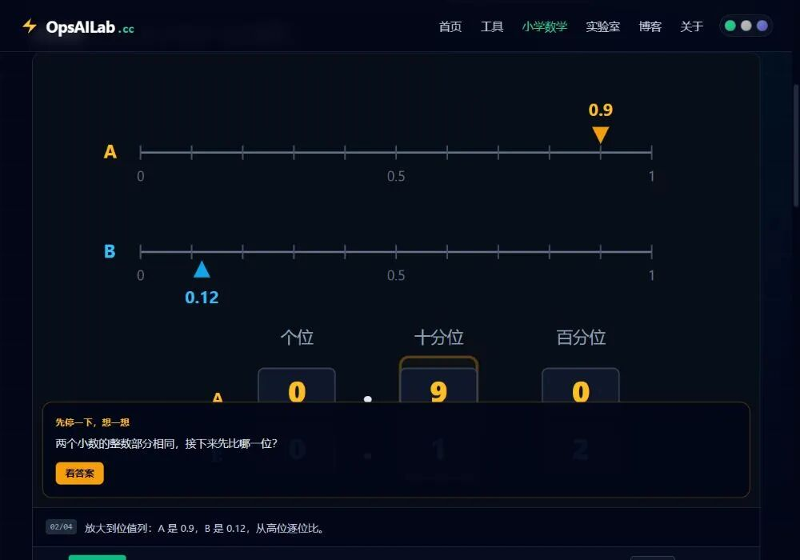
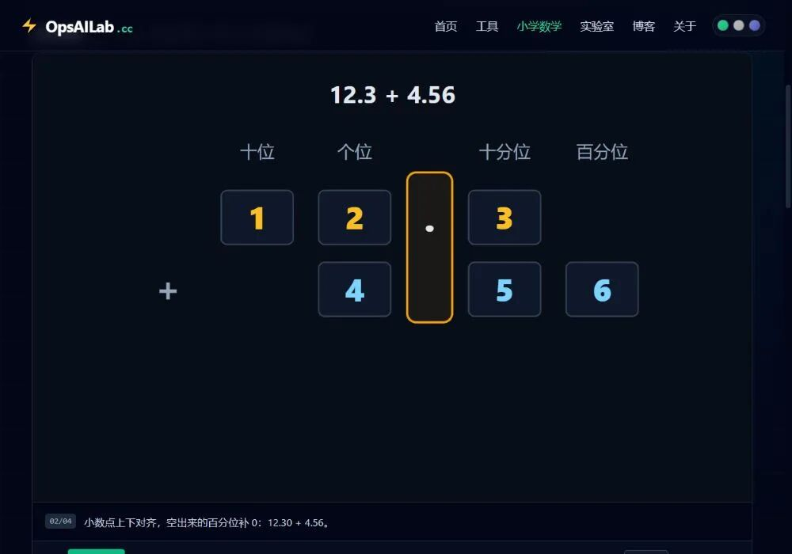
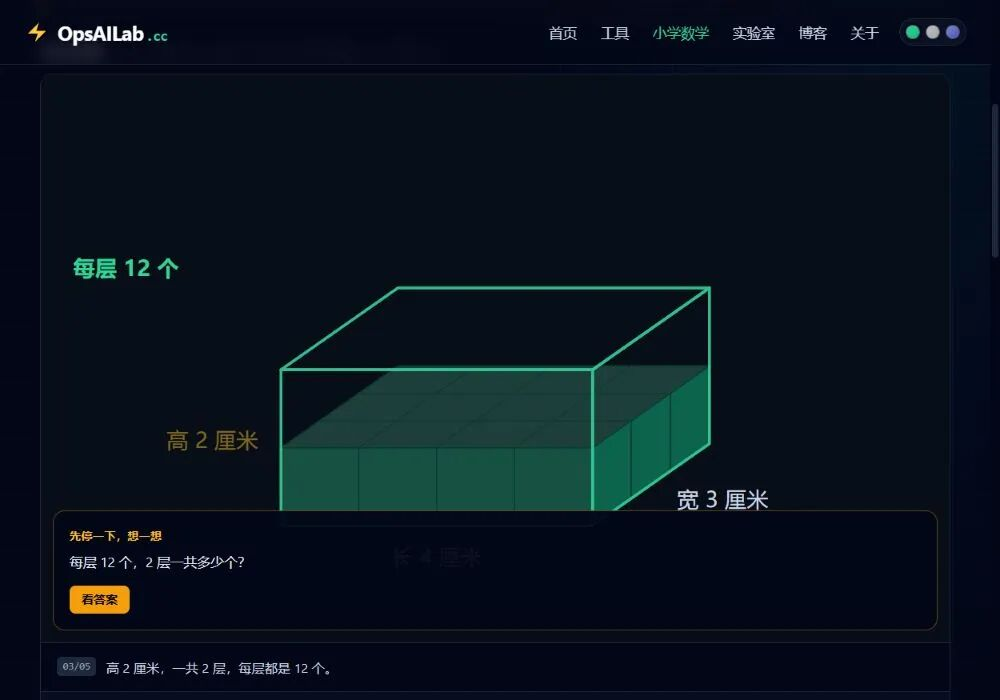
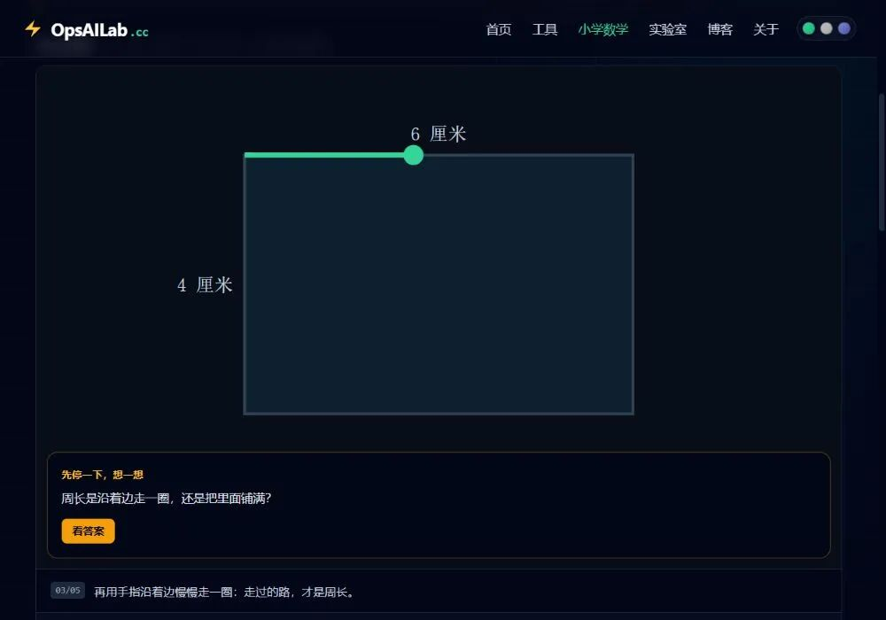

# 把数学「演」给孩子看： 154 个知识点全部配动画，免费、不登录
> 💡 备注属性未写入，可能是备注属性名称或者类型被修改了，建议将字段类型设置为 rich_text，可以在小程序-操作-修改文章数据库页面进行调整
> 💡 原文链接:[https://mp.weixin.qq.com/s?__biz=MzI4NDAyNTY0Mg==&mid=2647666166&idx=1&sn=b1f6618083c3a045a7a7c08db45f516b&chksm=f267f91538f5b4993b4b81045b8fe7e1d403ec65407239d4bde266d15942a40ef553be0ce641#rd](https://mp.weixin.qq.com/s?__biz=MzI4NDAyNTY0Mg%3D%3D&mid=2647666166&idx=1&sn=b1f6618083c3a045a7a7c08db45f516b&chksm=f267f91538f5b4993b4b81045b8fe7e1d403ec65407239d4bde266d15942a40ef553be0ce641#rd)
OPSAI LAB · 小学数学思维实验室
摘要：154 个知识点，全部配上可暂停、可单步、可回放的动画。分数怎么切、面积进率怎么来、小数点为什么对齐——让孩子看到就能懂。
孩子能算出 **3+5=8**，却不知道 3 个苹果加 5 个苹果是什么样；会背「1 米 = 100 厘米」，却不知道 1 米到底多长。
这是我们做这个站点时的出发点。这一轮，我们把它往前推了一大步：**给 1–5 年级 154 个知识点，全部配上了可播放、可暂停、可一步一停的动画。**

首页 · 154 个知识点全部上线
### 亮点一｜分数不再是「涂了几块」，而是「怎么切出来的」
动画里，3/4 的巧克力每一份再切一刀，变成 6/8；半透明的原图叠在同一位置，孩子亲眼看到**「份数变了，涂色面积没变」**。
动画中间还会停下来问一句：**涂色面积变了吗？** —— 先看，再答，不直接给结论。

3/4 → 6/8，涂色面积不变
### 亮点二｜面积进率，真的让你数出 100 格
「1 分米 = 10 厘米，那 1 平方分米是多少平方厘米？」
动画把 1 平方分米横切 10 格、竖切 10 格，一格一格铺满 **100 个 1 平方厘米**。不是背进率，是看着它长出来。

1 平方分米 = 100 个 1 平方厘米
### 亮点三｜小数比较，两个小数上下对齐着比
0.9 和 0.12，谁大？两条数轴上下对齐，再放大到「个位 / 十分位 / 百分位」的位值列——十分位 9 比 1，一眼分出胜负。
孩子终于明白：**不是位数多就大。**

双数轴 + 位值列，把 0.9 和 0.12 放在一起比
### 亮点四｜小数加减，先对齐再算
**12.3 + 4.56**：小数点那一列被点亮，空出来的百分位补 0，变成 12.30 + 4.56，再按整数加。
「为什么小数点要对齐」这件事，被演成了「同一位值对齐」。

小数点对齐，空位补 0
### 亮点五｜体积，是「一层几个 × 几层」
长方体里一层摆 12 个，摆 2 层，动画一层一层堆出来。体积 = 长 × 宽 × 高，不再是背下来的公式，而是数出来的结果。

每层 12 个，2 层就是 24 个
### 亮点六｜周长，让手指沿边走一圈
周长是「走一圈的长度」，面积是「铺满多少块」。动画里一条线沿着边慢慢走，走到哪儿亮到哪儿，和铺满的方块彻底分开——三年级最容易混的两件事，被拆成了两个动作。

沿着边走一圈，才是周长
### 不只是「看动画」

每个动画都有：**播放 / 暂停、上一步 / 下一步、进度拖动、0.5×–2× 倍速、字幕开关、配音开关。**
看完做 3 道题，答错会把对应那几秒动画**重播一遍**，而不是直接给答案。
家长话术卡保留并升级：「孩子为什么错 / 你可以这样问 / 千万别这样说 / 30 秒示范」四张卡照旧，还加了「动画暂停点提问」——陪看时知道在哪一秒问哪句话。
### 关于隐私
动画和做题都在浏览器本地运行，孩子的答案与操作不会上传。
### 数据说话（实测）
154 个知识点全部上线，**154 段动画全部可播放**；1–5 年级 100% 覆盖；无 404、无控制台报错；首屏约 1 秒。免费、不登录、不办会员。
**👉 点击「阅读原文」，或直接访问 opsailab.cc/math**
