# 把枯燥的PDF英语绘本，做成可以点读的互动绘本：这套流程我开源了！
> 💡 备注属性未写入，可能是备注属性名称或者类型被修改了，建议将字段类型设置为 rich_text，可以在小程序-操作-修改文章数据库页面进行调整
> 💡 原文链接:[https://mp.weixin.qq.com/s?__biz=MzkzODk5NTc2OA==&mid=2247485229&idx=1&sn=3951d665f2be62e351d4a96900fd7183&chksm=c330d5b14f63b6f44023ff7aba41bdaf4cba585ad229381a74c52bacd9e61d85de462587cbb3#rd](https://mp.weixin.qq.com/s?__biz=MzkzODk5NTc2OA%3D%3D&mid=2247485229&idx=1&sn=3951d665f2be62e351d4a96900fd7183&chksm=c330d5b14f63b6f44023ff7aba41bdaf4cba585ad229381a74c52bacd9e61d85de462587cbb3#rd)
前几天我发了一篇文章，和大家分享了我收藏了一堆的PDF的英语绘本，然后我如何将这些电子绘本，做成这种可以点读的互动绘本，然后文章收到了很多人的喜欢，大家都想要把自己的电子绘本做成可以点读的互动绘本，并且在粉丝朋友的建议下，我专门创建了一个粉丝群来给大家分享我做互动绘本的提示词，很快粉丝群就超过100多人了。
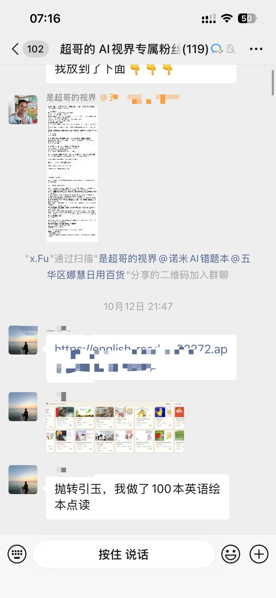
很多朋友都拿到了我给大家发的提示词，也都作出了自己的互动绘本，甚至我们粉丝群的朋友做出来了100多本，简直逆天，太佩服了！
但其实之前的互动绘本在我做好之后，收到了很多朋友的反馈，以及我自己发现的很多问题，比如绘本朗读的音频很机械感，不纯正，然后点读的单词没发显示单词的释义等等。
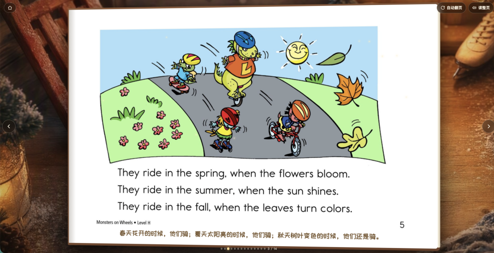
所以其实我自己已经悄悄的在背地里，把互动绘本的制作升级成了2.0版本了，并且2.0版本的互动绘本我把整个流程都做成了一个skill上传到了我的GitHub主页了，我还提前在我们AI教育学习圈的社群，让学习圈的朋友先试用起来了，大家给我的反馈都还挺不错的，所以我也让我很有信心给大家来分享
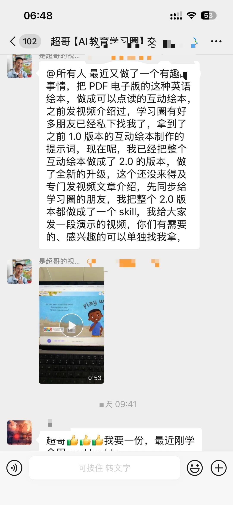
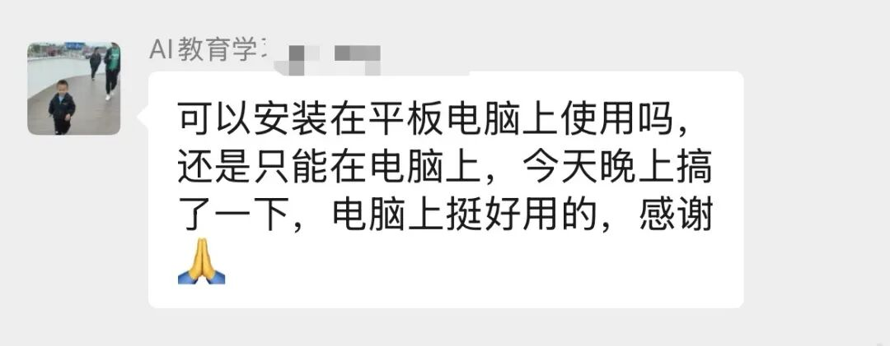
2.0版本的互动绘本做好之后，想着尽快出一期视频和文章，给大家分享，但最近实在太忙没空，我儿子上幼儿园，三天两头感冒发烧，九月开学到现在，幼儿园没上几天，老父亲我带娃快要累瘫了。所以一拖就拖了一个多星期。。。。。。
在我上传GitHub没多久，我这个互动绘本2.0版本的项目页收到一条issue咨询，是一位美国的儿童出版机构的负责人给我发的，询问我的这个互动绘本能否提供商用，希望可以和我进一步洽谈。
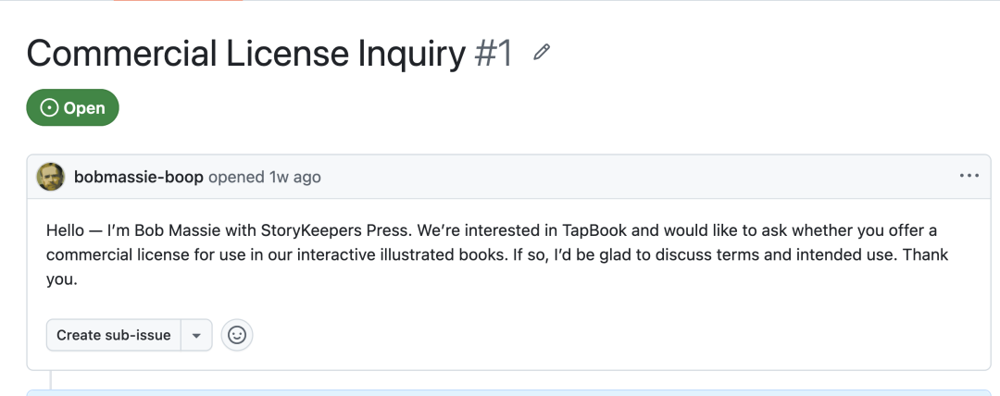
在这里给大家简单科普一下开源社区里的授权方式licence，你可以理解为它是一种版权保护，在GitHub上的项目可以有不同的licence授权方式，最常见的就是MIT授权，也就是你可以任意的使用，比如我之前分享的我的单词闪卡制作的skill[把整本教材的单词表批量做成单词闪卡：这套制作流程，我开源了](https://mp.weixin.qq.com/s?__biz=MzkzODk5NTc2OA%3D%3D&mid=2247485163&idx=1&sn=00366a4a86e7f6c9be119508b1c433b6&scene=21#wechat_redirect)就是MIT授权，你可以随意来使用，并且可以修改，像我这个互动绘本就是非商业授权，你不能拿来商用。
（所以比如是机构，或者你想要把我的项目拿来商用，请支持版权单独联系我）
我觉得这个事情就挺有意思的，我最初只是希望把自己吃灰的PDF绘本做成方便我儿子点读的互动绘本，我分享之后，现在被很多人看见了，于是就有了这个互动绘本的开源项目Tapbook了。
## 互动绘本2.0有哪些变化
关于互动绘本1.0的介绍你可以通过这篇文章来去了解一下[把枯燥的电子PDF绘本，做成可以点读的互动绘本。](https://mp.weixin.qq.com/s?__biz=MzkzODk5NTc2OA%3D%3D&mid=2247485086&idx=1&sn=923669365f2fa18330b4aaf355b57bd2&scene=21#wechat_redirect)
我这里就不再赘述了，给大家看下2.0的主要变化
### 1、变得更好看了
这是1.0版本的互动绘本
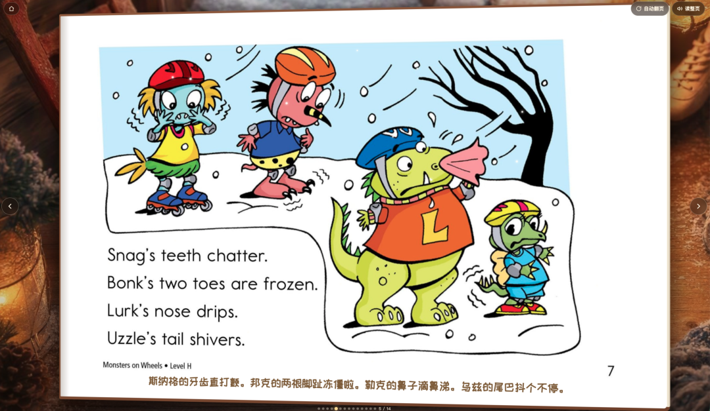
下面是2.0版本的互动绘本
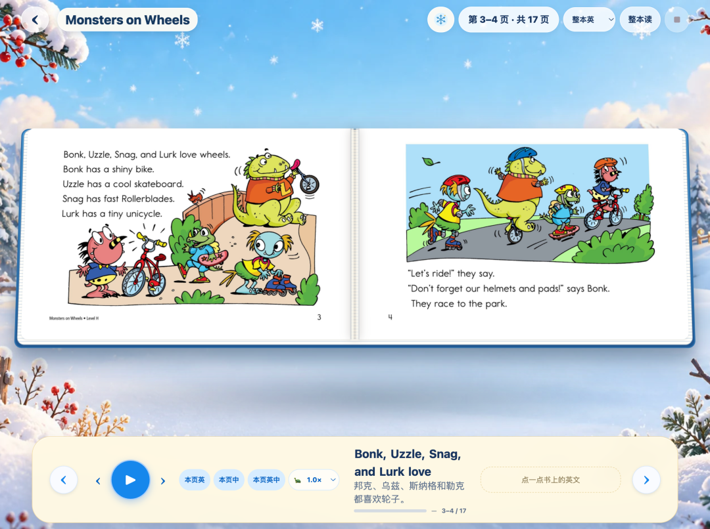
整个页面的设计变得更好看了，并且在绘本阅读界面，我还内置了9种不同的主题，用来适配不同的绘本阅读的场景
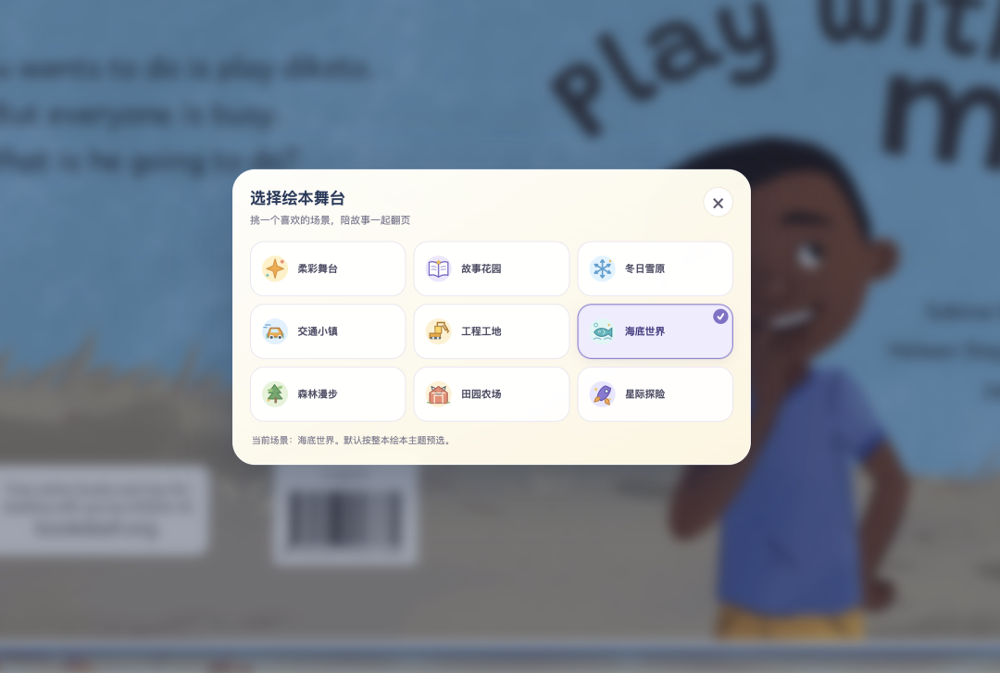
### 2、绘本点读的音色更纯正了
2.0版本的互动绘本点读的音色变得更好听更纯正了，我给大家放一段演示的视频，你可以感受下
### 3、点读单词会有同步翻译了
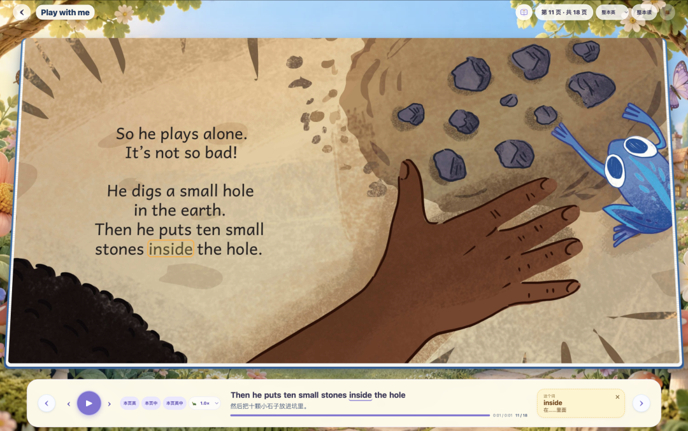
之前1.0版本的互动绘本，点读单词只会朗读，现在不光会朗读，并且在下方会显示这个单词的翻译了
### 4、朗读可以自定义语速了
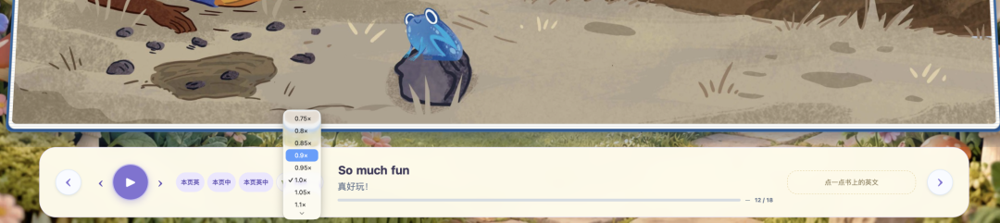
现在在底部有一个播放栏，播放栏我们可以自定义朗读的语速了，这样方便不同阅读需求的小朋友
上面这4个特性就是互动绘本2.0版本最主要的变化了，从整个体验来看，就是我目前为止比较满意的版本了，我会很愿意把做好的互动绘本，带着我儿子一起看
## 
## 如何使用互动绘本2.0
### 1、安装skill
要使用互动绘本2.0，你需要先安装我开源到GitHub的这个skill
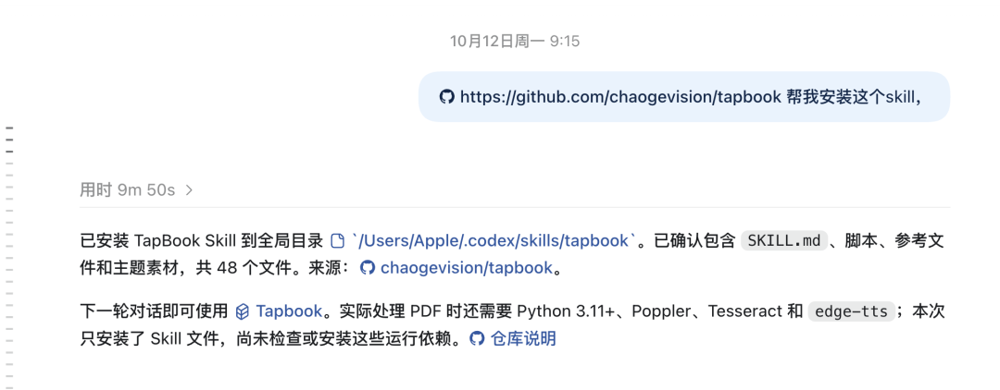
你只需要把下面这段提示语发给你的Agent
> 阅读这个开源项目：https://github.com/chaogevision/tapbook 
> 帮我把这个项目安装到本地
> 
注意这里是发给AI Agent工具，比如国外的Codex、Claude code，咱们国内的WorkBuddy、千问办公、豆包工作，这些都是可以的。
### 2、使用skill制作你的互动绘本
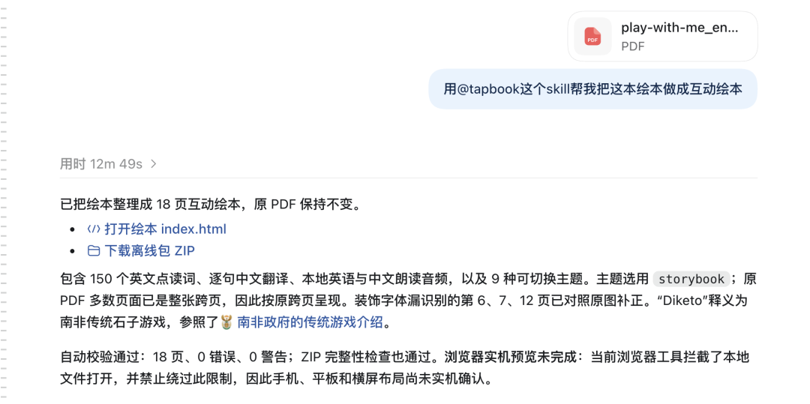
安装好skill之后，只需要把你需要做成互动绘本的PDF电子版（像RAZ啊，牛津树啊，以及其他任意的英语PDF绘本都是可以的）上传给你的Agent，然后让Agent使用刚才安装好的这个skill-tapbook帮你把PDF做成互动绘本
这里需要注意一下，如果你上传的是纯中文的绘本，朗读的音色没有那么好，而且比如一些多音字也可能读不准确，目前的tapbook主要针对英语绘本，并没有单独的针对中文绘本去匹配纯正的音色。这个也是我们AI教育学习圈的一位朋友，在之前使用的时候给我的反馈
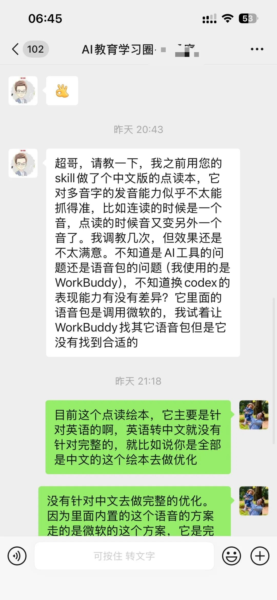
另外就是，本身我的tapbook的skill是完全免费的， 你要使用这个skill去制作互动绘本，需要你能使用上面提到的Agent，并且有积分或者已经订阅，在制作互动绘本过程中，会消耗你Agent的积分。
## 结尾惊喜彩蛋
前面我们都在说，我的这个tapbook 2.0版本的互动绘本，但实际上，背地里，我已经悄悄的做到3.0版本了。。。。。
我给大家放一段演示的视频大家可以看下
整个3.0版本，是完全为有需要建立一个互动绘本库的朋友来服务的，比如你是一个家庭，或者像绘本馆这样的机构，想要给小朋友建立一个专属的绘本库，是你精挑细选出来的一些绘本，然后在这个绘本库里面一本本的去阅读，并且还可以记录小朋友的阅读进度，阅读数据，不会的单词等等这些需求，都在3.0版本里面
他就不像我们互动绘本2.0是一本一本的做，每一本做出来之后单独阅读。所以如果你有互动绘本3.0版本的需求，那么你可以单独联系我，这个版本目前不对外。
---
另外也给大家同步一下，我们之前300w人关注过的AI错题本，现在出小程序版了，在微信里使用起来更方便了，并且我们还上线了针对初高中的互动讲解功能，能将像平面几何，一二次函数，立体几何，圆锥曲线这类难懂的题目，直接做成一堂边画图，边讲解的微课程。
你可以通过下面的视频来详细了解。
最后也欢迎你来使用我们的AI错题本，帮娃高效整理错题
做一个AI时代好用的从错题出发的个性化学习助手
是我非常想做的
你可以直接通过web端：https://nomistake.cn来使用
或者通过下面的小程序来使用
目前直接登录的话，是免费账户，大家有10次使用的额度，针对公众号的朋友，我也给大家准备了公众号粉丝的专属会员周卡，大家有需要的话，在公众号后台回复“试用”既可领取
