# 把枯燥的英语电子绘本做成可以点读的互动绘本，手把手使用教程来了！
> 💡 备注属性未写入，可能是备注属性名称或者类型被修改了，建议将字段类型设置为 rich_text，可以在小程序-操作-修改文章数据库页面进行调整
> 💡 原文链接:[https://mp.weixin.qq.com/s?__biz=MzkzODk5NTc2OA==&mid=2247485347&idx=1&sn=6384a444fb4dedcb4ce2ffbcbe4c374a&chksm=c3edcdc01728744991fd3116f55011d18be698593f204aeb31d706188b32d4f97eccf4130857#rd](https://mp.weixin.qq.com/s?__biz=MzkzODk5NTc2OA%3D%3D&mid=2247485347&idx=1&sn=6384a444fb4dedcb4ce2ffbcbe4c374a&chksm=c3edcdc01728744991fd3116f55011d18be698593f204aeb31d706188b32d4f97eccf4130857#rd)
依然是凌晨五点半开始码字，问我为啥能起那么早，家有幼儿园小班的娃，晚上九点就睡了，似乎这个作息的节奏还挺好的，早上很安静的可以码字。
你是不是也跟我一样，在你的电脑里面或者网盘里面，收藏了很多的英语绘本，像什么RAZ啊，牛津树，国际大奖的绘本，但常年是处于吃灰的状态，无法利用起来。
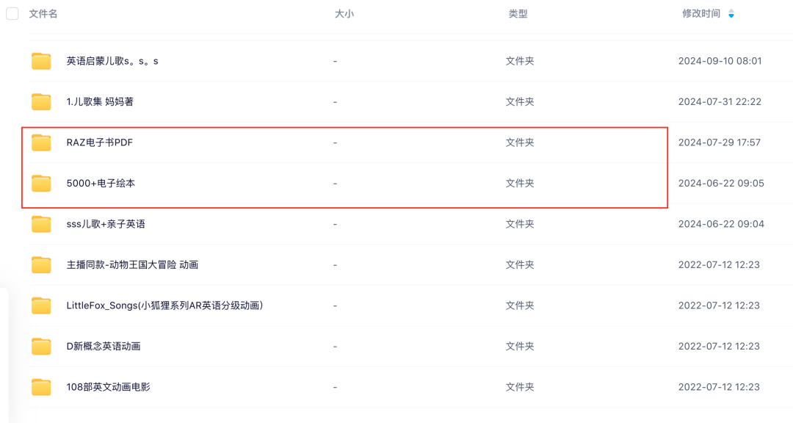
我儿子正好今年上幼儿园小班，我开始规划给他输入一定量的原版英语绘本，但枯燥的电子版PDF要手把手的带着读看，很多时候也确实没那么多时间，也想着一定程度上慢慢培养他的自主阅读原版绘本的习惯，所以作为一个硬核AI教育博主，我用AI小小的改造了一下这些电子绘本。
并且其实我之前给大家发文章和视频分享过，我是如何利用AI将我这些吃灰的PDF电子绘本，做成可以点读的互动绘本的。并且我经历了互动绘本1.0的制作，如下面的视频所示
然后后面升级到了互动绘本2.0，如下面的视频所示
并且我也发文章给大家分享了，最新的互动绘本2.0，我已经将2.0的版本的整个制作流程，制作成了一个skill叫做tapbook，并且开源到了我的GitHub主页（一个全球的开源项目平台，推荐每一个AI时代的家长或者小朋友至少有一个自己的GitHub）
> 链接在这里：https://github.com/chaogevision/tapbook
> 
如果你可以访问GitHub，麻烦你给我点个小星星star支持一下
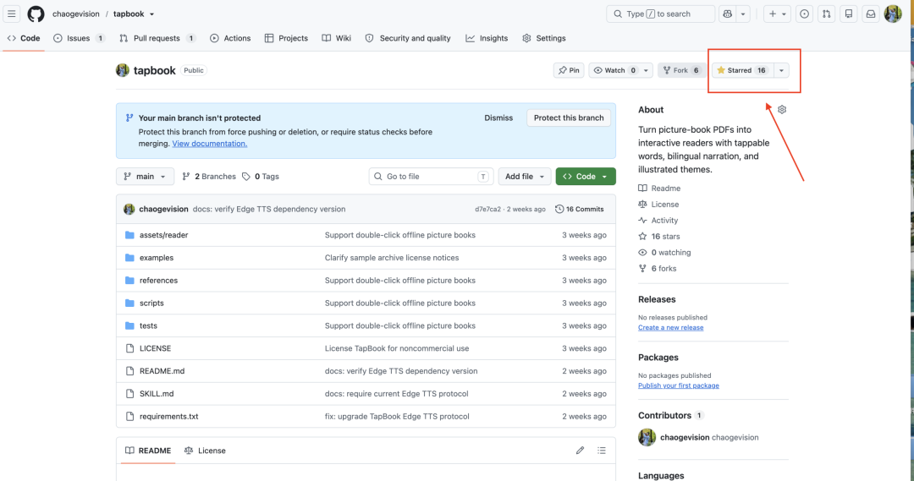
然后教大家如何来免费使用我这个skill去制作你自己的互动绘本
[把枯燥的PDF英语绘本，做成可以点读的互动绘本：这套流程我开源了！](https://mp.weixin.qq.com/s?__biz=MzkzODk5NTc2OA%3D%3D&mid=2247485229&idx=1&sn=3951d665f2be62e351d4a96900fd7183&scene=21#wechat_redirect)
但可能我写的流程太过于简单了，我设想大家应该对各种Agent已经都基本有认知了，所以我的教程写得相对简单，
我的错！！！
以至于很多朋友给我留言，包括我们粉丝群的朋友，都反馈需要更详细的手把手安装教程！
所以这篇文章我就给大家码一篇手把手的安装教程，顺带给大家简单科普一下skill和Agent的内容，本身其实安装过程我个人认为非常简答，就3步，但是顺带给一些不太用AI的家长朋友做一些AI的科普，所以这个教程篇幅会稍长，建议不同的朋友可以选择性的观看。
我们直接开始！
## 一、理解互动绘本的skill的本质
我在之前互动绘本1.0的时候，给大家分享过，我是如何改造电子绘本为互动绘本的，我的流程是，给Agent一段复杂的提示词（关于Agent下面的内容再详述），让AI去帮我按照提示词的设定的任务规范去做，这个提示词我给大家贴出来，你们可以看下
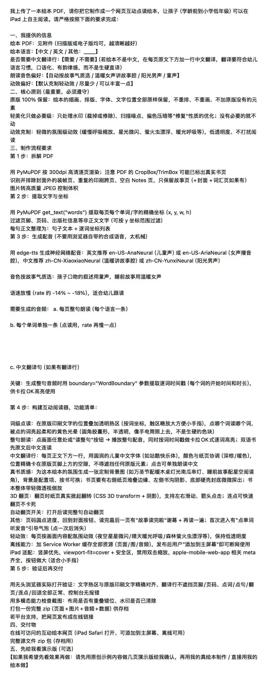
这段提示词大致就是让AI Agent先分析我上传的绘本，然后提取出里面有的英文内容，然后把这些内容进行翻译，并且要制作好配音，接下来把配音和英语一一对应，然后使用代码网页的形式，把英语单词做成可以点读的内容，最后生成一个可以点读的绘本网页
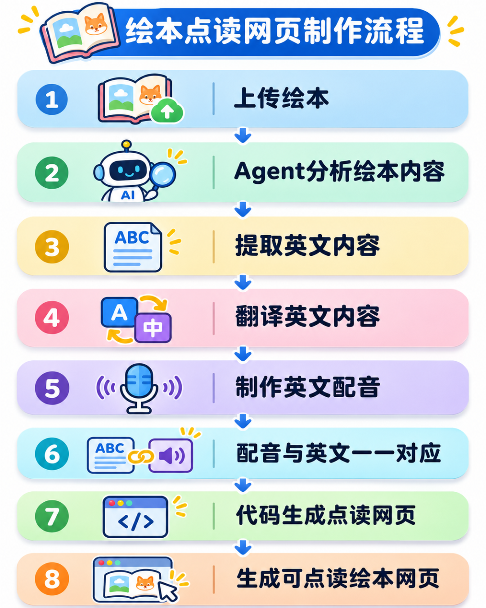
你看这里实际上我就是让AI Agent在帮我按照一定的流程在干活
然后到2.0版本的时候，我做了很多优化，整个页面的设计变得更好看了，并且在绘本阅读界面，我还内置了9种不同的主题，用来适配不同的绘本阅读的场景，然后2.0版本的互动绘本点读的音色变得更好听更纯正了，在之前的视频当中，你也能感受到，然后朗读的语速也可以自定义调整了。点读每个单词也都会带有同步的单词翻译了
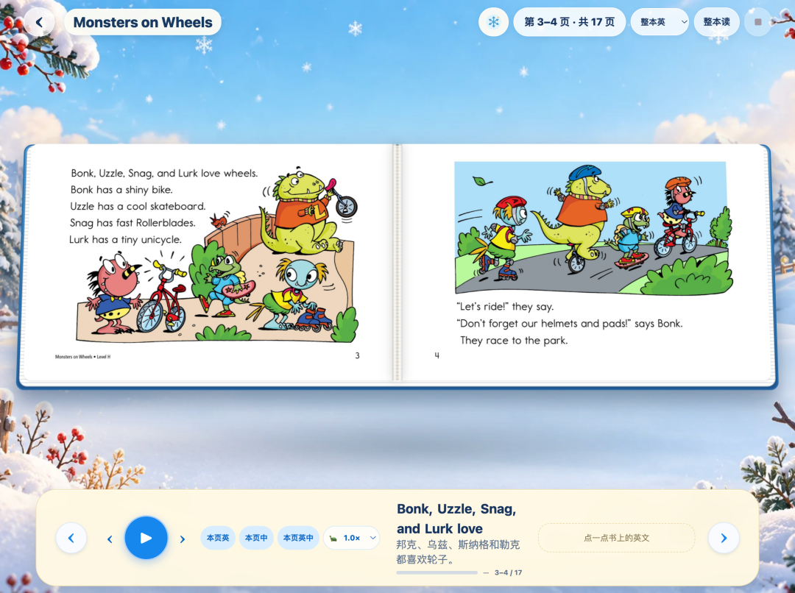
那2.0版本的互动绘本，我就不能再通过提示词的方式去做了，因为即便我们通过提示词约束了让AI Agent根据特定的流程去做，我们也没办法让Agent完全复刻出一模一样的效果
要做出一模一样的效果，就必须要把2.0的设计完全固化成一套模板，让AI从里面填充互动绘本就行，按照一定的规范（这么简单理解就好了）这些工作就不是单纯的提示词可以搞定的
这个时候我们就要把2.0的整个制作流程，做成非常详细的规范，每一步该做什么，该达到什么样的标准，如何检查，出现了问题该怎么处理，比如遗漏掉某页的内容，或者某个单词点击没反应等等这些问题，该如何处理。
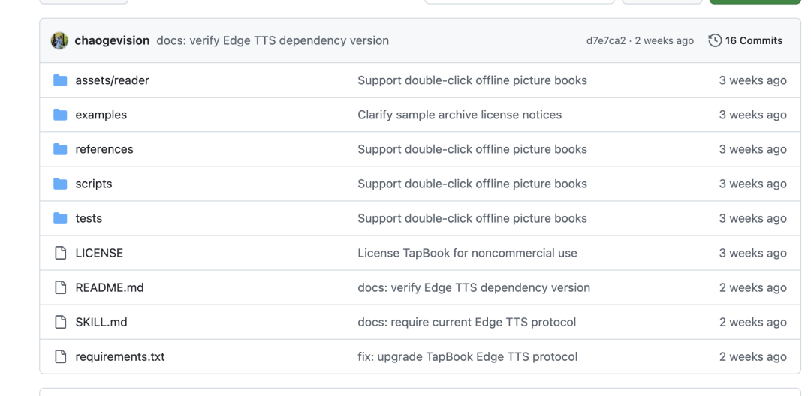
最终这个详细的规范就变成了我开源出来的这个互动绘本的skill，这个skill本质就是一些文本文档和一些脚本啊，工具之类的
所以到这里我想你应该也能明白了，所谓的skill你就可以理解为给AI Agent工具去完成一项任务的详细流程和规范，任何一个Agent拿到这个skill都能按照同样的流程去做出相同效果的互动绘本，就像到处都有肯德基，他们各个门店做出来的炸鸡味道基本都差不多，就是因为各个门店都遵循了同一套制作炸鸡的规范和流程
好这里给不太理解skill的朋友们做了点小科普
下面我们既然理解了这个绘本skill是怎么回事，下面我们就可以来安装使用了
## 二、安装互动绘本skill
## 
### 1、简单科普一下Agent
如果你都熟悉了，可以直接跳过
我们要安装这个绘本的skill，你必须要使用支持skill安装的AI工具，这些AI工具不是你经常聊天的豆包，千问这些，这些是属于AI聊天机器人，他们能快速的给你想要的答案，但是无法替你完成一些连续流程的任务。
我们必须要使用支持skill安装的AI Agent，AI智能体，说起来玄乎，你就理解为一个由AI指挥的可以干活的加强版机器人，比如你可能听过的Codex，Claude code，我们国内的，WorkBuddy，千问办公，豆包工作，他们可以帮你制作好一份精美的PPT，帮你做好一个小游戏，帮你抓取每天你关心的新闻发送给你等等
比如我经常用的Codex
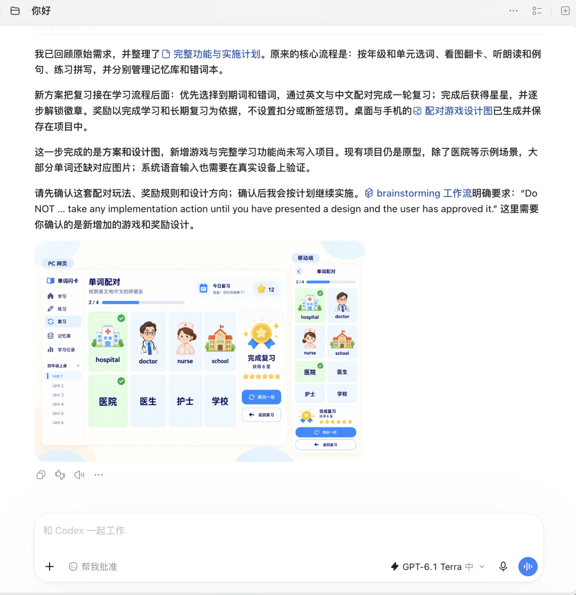
这些就是Agent
### 2、下载一个常用的Agent
然后你选择一个你能使用的Agent，如果你用国内的Agent，你就用WorkBuddy，千问办公，豆包工作，国外的话Codex
选择其中一个下载一下，下载的地址我给大家也贴出来了
> 💡 豆包工作 https://www.doubao.com/work
千问办公 https://qwenwork.cn/?utm_source=qianwenai
WorkBuddy https://www.workbuddy.cn/
Codex https://chatgpt.com/zh-Hans-CN/download/ 

下载后打开登录一下，目前这些国内的Agent，如果你是新用户的话都会给你赠送各种积分，基本可以免费使用来制作互动绘本，不过要长期使用的话，可能你还是要花钱订阅这些Agent，根据你们的需要吧
我这里以WorkBuddy为例，给大家演示一下（没有打广告，单纯因为目前国内WorkBuddy用的人相对多）打开Agent，进入到对话界面
### 3、设置Agent
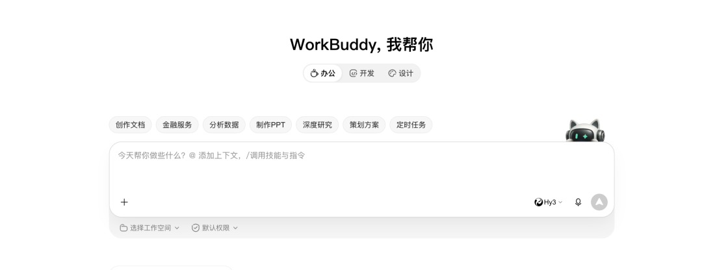
如果你想快速的开始，那可以不用做任何设置，直接跳到下面安装
但我还是给你简单介绍一下，使用各种Agent之前，必做的一个简单设置，就是选择工作空间，或者选择你的项目文件夹，不同Agent，叫法不一样，但逻辑都一样，就是你希望你完成的任务，在你本地电脑的哪个文件夹，之后做好的内容文件啥的都会保存到这个文件夹
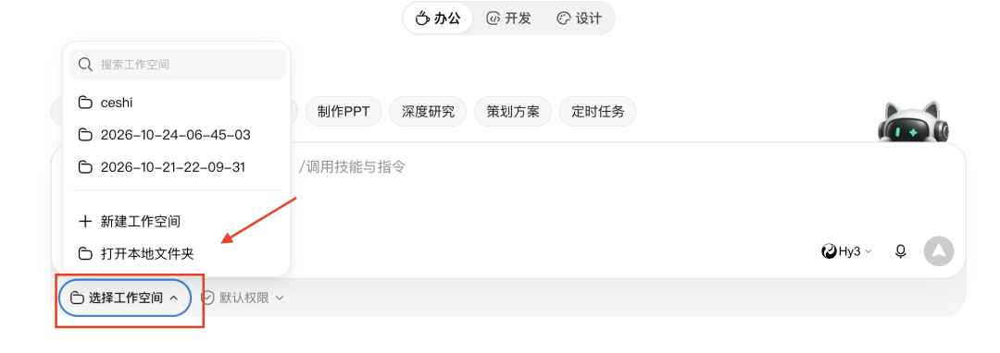
### 4、安装skill
我们直接在对话界面，把下面这段提示词发给你的Agent
> 阅读这个开源项目：https://github.com/chaogevision/tapbook 
> 帮我把这个互动绘本skill安装到本地
> 
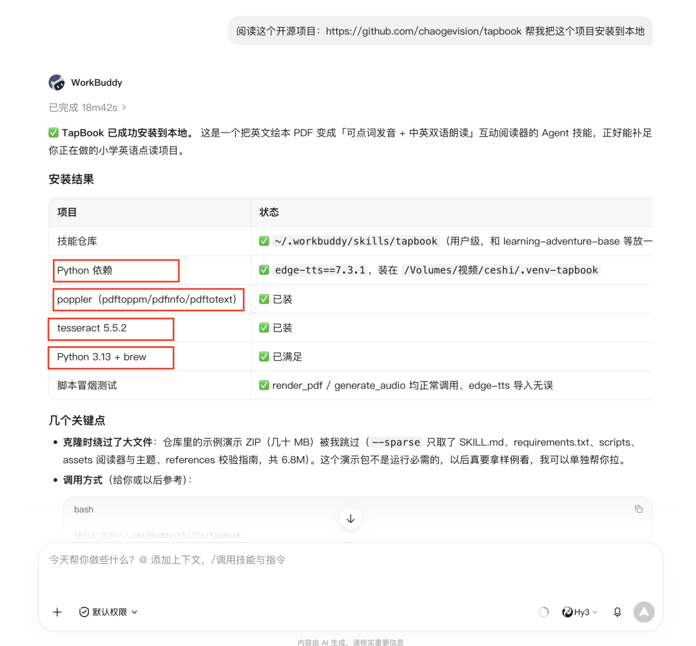
发送之后，等待你的Agent在你电脑上帮你安装这个skill就可以了
整个安装的过程，基本不需要你插手，但有几个地方需要你注意，skill运行的时候必须要安装一些工具，如上图所示的我红框框起来的地方，这些是skill运行必要的环境依赖（技术名词不用管）和一些必要的工具，很多朋友电脑上基本没有，所以你的Agent可能会提示你，问你是否安装，如果提示了，你就选择同意安装就要了，如果没提示说明你电脑上可能有，就不用管等它安装好就行。
整个安装过程大概会持续15-20分钟的样子，看你的网络条件
## 三、使用skill制作你的互动绘本
## 
安装好之后，我们点击你的Agent输入框旁边的➕号按钮，选择这里的技能，然后找到我们刚才安装的skill，叫tapbook
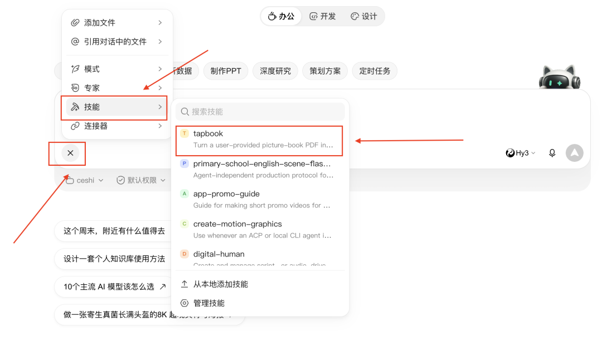
你也可以不用选择这里的技能，直接在对话框中告诉agent用哪个skill
接下来我们在Agent这里还是点击➕，然后选择添加文件，把你需要制作成互动绘本的PDF电子版绘本发上去，然后输入这段提示词：
> 请使用刚才安装的TapBook 这个 Skill 帮我把上传的这一本 PDF 的英语绘本做成点读的互动绘本。
> 
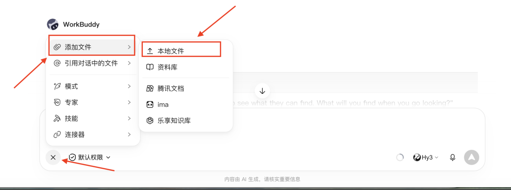
输入之后发送，然后就等待你的Agent帮你制作就好了
全程不需要你参与，你就去喝杯咖啡，看几页书书就好了
整个制作的时间，看你要生成的互动绘本的内容长度，我这里制作一本大概20页左右的，花了22分钟，不同Agent制作的时间也会有差异
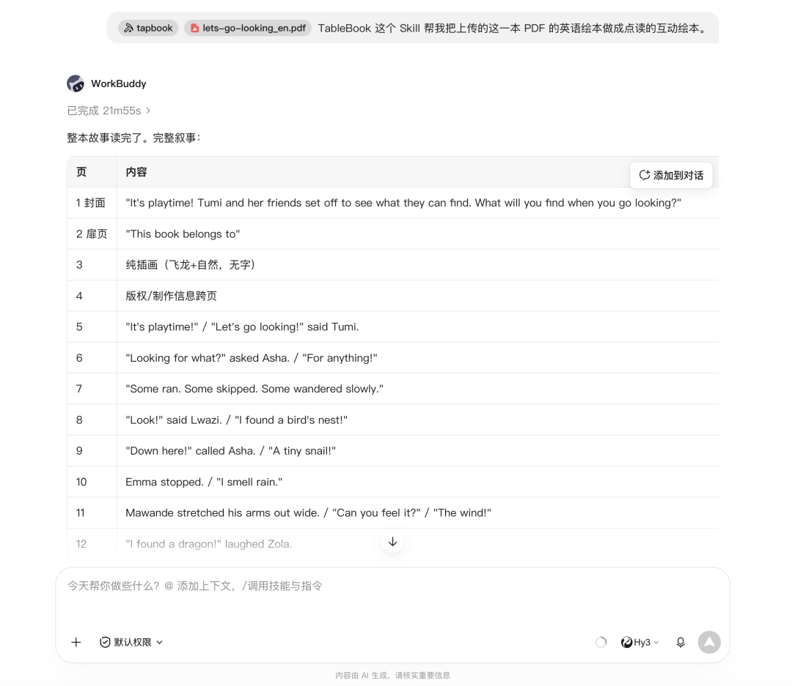
制作完成之后，Agent会给你交付一个html的网页，你直接点击打开就可以看到制作完成的互动绘本了，你会发现设计完全跟我们2.0的设计完全一致
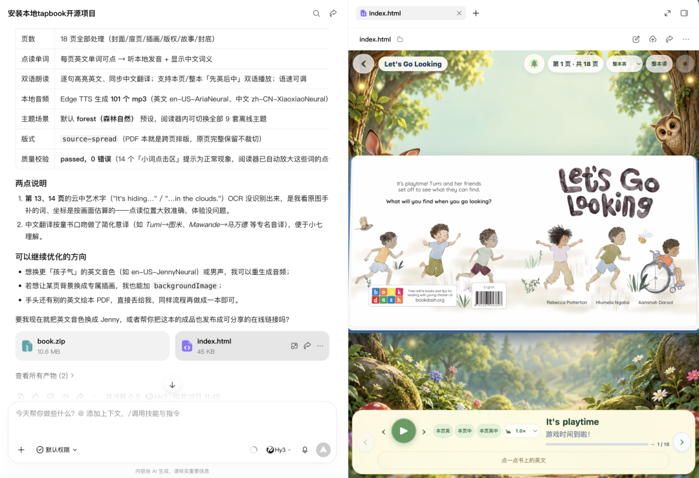
而且还会为你自动匹配与绘本主题相符的背景主题
到这里我们的互动绘本就制作完成了，那很多朋友可能会问，这个互动绘本是在电脑上使用的，能不能再平板和手机上用呢
如果你有这个需求，你接着看我们下一步操作
我们可以使用Agent的在线链接功能，目前我知道的WorkBuddy和千问办公都支持，把你做好的网页发布为在线链接的形式，别人就可以通过在线链接来使用
同理，我们把做好的互动绘本网页，让Agent直接发布为在线链接，你就把这个链接复制到平板和手机上使用就可以了
操作非常简单，给你的Agent发送这样一段指令
> 我帮我把这个互动绘本的网页做成在线链接的形式，让我可以在手机上直接访问。
> 
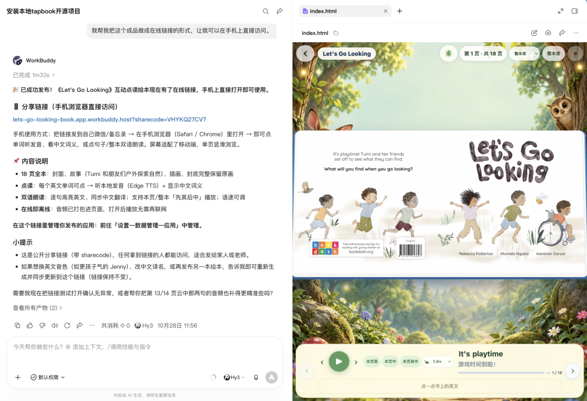
接着等待几分钟，agent就会帮你发布，给你一个链接
怎么样，是不是很方便！
以上就是完整的手把手安装使用教程了！不知道你学会了没有，没有的话，点赞收藏起来，找时间跟着步骤一步步来
到这里别忘记关注我的公众号
前面我们都在说，我的这个tapbook 2.0版本的互动绘本，但实际上，背地里，我已经悄悄的做到3.0版本了。。。。。
我给大家放一段演示的视频大家可以看下
整个3.0版本，是完全为有需要建立一个互动绘本库的朋友来服务的，比如你是一个家庭，或者像绘本馆这样的机构，想要给小朋友和学员建立一个专属的绘本库，是你精挑细选出来的一些绘本，然后在这个绘本库里面一本本的去阅读，并且还可以记录小朋友的阅读进度，阅读数据，不会的单词等等这些需求，都在3.0版本里面
他就不像我们互动绘本2.0是一本一本的做，每一本做出来之后单独阅读。所以如果你有互动绘本3.0版本的需求，那么你可以在我主页单独联系我，这个版本目前不对外，是需要单独付费的
码字完毕，现在七点十五，可以去运动一下了！
---
另外也给大家同步一下，我们之前300w人关注过的AI错题本，现在出小程序版了，在微信里使用起来更方便了，并且我们还上线了针对初高中的互动讲解功能，能将像平面几何，一二次函数，立体几何，圆锥曲线这类难懂的题目，直接做成一堂边画图，边讲解的微课程。
你可以通过下面的视频来详细了解。
最后也欢迎你来使用我们的AI错题本，帮娃高效整理错题
做一个AI时代好用的从错题出发的个性化学习助手
是我非常想做的
你可以直接通过web端：https://nomistake.cn来使用
或者通过下面的小程序来使用
目前直接登录的话，是免费账户，大家有10次使用的额度，针对公众号的朋友，我也给大家准备了公众号粉丝的专属会员周卡，大家有需要的话，在公众号后台回复“试用”既可领取
