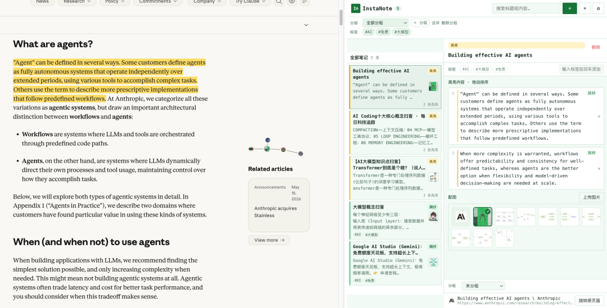

# 把笔记做进浏览器侧边栏
> 💡 备注属性未写入，可能是备注属性名称或者类型被修改了，建议将字段类型设置为 rich_text，可以在小程序-操作-修改文章数据库页面进行调整
> 💡 原文链接:[https://mp.weixin.qq.com/s?__biz=MzIzMDE5NTQyMQ==&mid=2247484195&idx=1&sn=82f644cf7b77804b81aa415bad89a624&chksm=e9ea1fc0b2af5340215d3d2b71fa947395d29e84e7397204494e6c4f87695984bbe61ac20a28#rd](https://mp.weixin.qq.com/s?__biz=MzIzMDE5NTQyMQ%3D%3D&mid=2247484195&idx=1&sn=82f644cf7b77804b81aa415bad89a624&chksm=e9ea1fc0b2af5340215d3d2b71fa947395d29e84e7397204494e6c4f87695984bbe61ac20a28#rd)
在网页上读到值得留住的段落，多数人的动作要么复制进备忘录，要么截图。文字留下来了，上下文却断了。那句话出自哪篇文章、在页面什么位置、前后讲了什么，事后全靠记忆补。截图稍好一些，至少带着版式，但想在几百张截图里找回某一句话，基本不现实。
InstaNote 是一个开源的 Chrome 浏览器扩展，针对的就是这个场景。它把记笔记这个动作直接搬进浏览器，划词高亮、摘抄存档、随手速记，全部在原页面和侧边栏里完成。

它有三条基础设计。**界面长在侧边栏，数据留在本地，笔记与原文位置互跳。**
**1**
**核心概念**
扩展基于 Chrome Manifest V3 开发，当前版本 1.0.0。界面通过 Side Panel API 以侧边栏形式常驻浏览器右侧，可以和网页并排显示。这一点决定了它的使用姿态，读文章的全程侧边栏都在，不需要来回切换窗口。
代码结构分四块。background 的 Service Worker 负责右键菜单、笔记增删改和跳转调度；content script 注入网页，负责选区采集、高亮渲染和滚动定位；侧边栏界面在 popup 目录；设置页独立在 options。
数据全部写入 chrome.storage.local，并申请了 unlimitedStorage 权限，图片存多了也不会撞上默认配额。断网状态下功能照常。
**2**
**三种笔记类型**
InstaNote 把笔记分成三类，对应三种不同的记录意图。
| **类型** | **工作方式** | **适合场景** |
| **高亮笔记** | 划词后在原文上直接加高亮，同一页面的多条高亮自动聚合为一条笔记，条目可拖动排序 | 读长文、标记重点 |
| **摘抄笔记** | 每条摘抄独立成篇，保留原网页的字号、颜色、对齐、行高等排版，可一键清除格式，正文支持行内编辑 | 收藏金句、存档带格式的内容 |
| **快速笔记** | 在侧边栏手动新建，自拟标题与正文 | 与页面无关的随手记录 |
高亮笔记的聚合逻辑值得单独说。一篇技术文档可能标十几处，列表里始终只有一条笔记，内部按条目分割，拖动能调整顺序。笔记列表不会被同一篇文章的重复条目刷屏。
摘抄笔记解决的是格式问题。从网页复制文字到普通笔记软件，排版会丢。InstaNote 的摘抄把原页面的样式一并带过来，字号、颜色、对齐方式都跟着走。不想要格式的时候一键清除，回到纯文本。
**3**
**技术核心 · 文本锚点**
划词高亮普遍面临一个难题，网页是活的。今天标记的段落，明天页面改版、加了广告位、换了模板，DOM 结构一变，按节点路径记录的定位信息就作废了。
InstaNote 不存节点路径，存**文本锚点**。选中文字的那一刻，扩展记下四样东西。
**选区文本文本偏移量出现次数前后文校验**
页面下次打开时，扩展在页面文本里重新搜索这段文字，用偏移和前后文交叉校验，命中后把高亮重新渲染回原位。页面有轻微改动，比如前后各插了一句话，锚点依然对得上。
锚点记录的是**文本内容和位置信息，不是 DOM 路径**，这是高亮能在页面改动后活下来的根本原因。
只有原文本身被大改、文字内容变了，锚点才会失效。这时候侧边栏会给出明确提示，笔记数据本身不受任何影响。
采集环节还有一处工程细节。部分网站把 style、script 标签内联在正文里，直接读取选区文本会把 CSS、JS 代码一起带进锚点，导致校验永远对不上。InstaNote 按文本节点切分后再采集，跳过样式和脚本节点。渲染高亮时同样逐段包裹，不移动这些元素，避免破坏页面原有的结构和样式。
**4**
**侧边栏与笔记组织**
界面左右分栏。左边是笔记概览，显示标题、配图、内容摘要、标签和颜色标识。右边是选中笔记的完整内容。
详情页的正文直接在页面内编辑，不弹对话框。标题可改，标签可增删，分组可切换，没有设置分组的笔记落在「未分组」。标签在详情页分两种状态，已选中的实线高亮，可选的虚线建议，点一下就加上。
笔记多了以后靠两套体系整理。分组像文件夹，支持新建、合并、删除，筛选时下拉单选。标签自由打，筛选时多选，多个标签之间取并集。两个维度可以同时生效，再叠加标题和正文的全文搜索。
跳转原文做了复用处理。点「跳转原页面」时，扩展先检查有没有已打开的同地址标签页，有就直接激活它，滚动到对应位置并闪烁提示，不会另开新标签页。
**5**
**外观与配图**
主题分明暗两套，直接切换。配色方案提供五套，现代、科技、复古、赛博朋克、终端。
高亮颜色有六种，黄、绿、蓝、粉、橙、紫。设置页可以指定一个默认色，用快捷键创建高亮时就直接用它，省去每次选色。
笔记可以配图。图片从当前页面采集，也可以上传本地文件，作为列表里的视觉标记。
**6**
**数据与隐私**
默认情况下，所有笔记、分组和设置都存在浏览器本地，chrome.storage.local，离线可用，不经过任何服务器。
备份和迁移走设置页的 JSON 导出导入。
多设备同步有一个可选方案，Git 同步。填入 GitHub 仓库地址、分支、文件路径和一个 Personal Access Token，笔记会以 JSON 文件的形式提交到指定仓库。这个功能**默认关闭，不开就不上传任何东西**。同步权交给自己的代码仓库，而不是某个第三方笔记服务的服务器。
权限申请和功能一一对应。
| **权限** | **用途** |
| storage / unlimitedStorage | 本地保存笔记与设置 |
| contextMenus | 划词右键菜单 |
| tabs / activeTab | 读取页面标题地址、复用标签页 |
| scripting | 扩展重载后向旧页面补注入脚本 |
| sidePanel | 侧边栏界面 |
| all_urls | 在任意网页上采集与渲染高亮 |
| api.github.com | 可选的 Git 同步 |
**7**
**上手流程**
安装走开发者模式加载，全程两三分钟。
**1**克隆仓库或下载 ZIP 解压，仓库地址见文末
**2**地址栏输入 chrome://extensions/ 并回车
**3**右上角开启「开发者模式」
**4**点「加载已解压的扩展程序」，选择包含 manifest.json 的目录
**5**刷新已经打开的标签页，内容脚本才会生效
环境要求 Chrome 114 及以上，这是 Side Panel API 的最低版本。Edge 这类 Chromium 内核浏览器同样能装，步骤一致。
日常使用记住四个动作就够了。
| **动作** | **操作** |
| 打开侧边栏 | 点工具栏的 InstaNote 图标 |
| 做高亮 | 选中文字，右键选「InstaNote · 高亮笔记」挑颜色，或按 Ctrl+Shift+H |
| 做摘抄 | 选中文字，右键选「InstaNote · 摘抄笔记」，或按 Ctrl+Shift+Q |
| 写速记 | 侧边栏顶部的「＋」按钮 |
两个快捷键在网页内监听，不需要把焦点切到扩展上，选中文字直接按。macOS 上把 Ctrl 换成 Control 键。
**8**
**边界与适用判断**
任何工具都有边界，这个也不例外，客观列几条实际限制。
内联样式复杂的站点，高亮按文本节点逐段包裹，极端嵌套排版下高亮的视觉边界可能被拆成几段。原文大幅改动后，历史高亮可能无法重新定位，会有提示，笔记数据不丢。快捷键与浏览器或其他扩展冲突时，以系统侧优先。chrome:// 这类浏览器内置页面没有权限，用不了。扩展安装或重新加载后，必须刷新旧标签页才有高亮能力。
它适合的人很明确。大量阅读网页、做资料收集、在意数据归属的个体用户。反过来，需要富文本排版、多人协作、跨平台客户端的场景不在此列，它没做这些。
项目仓库**github.com/xuhang/InstaNote**
笔记这件事，难点从来不在记下的那一刻，在事后找得回。找得回的前提有两个，内容在，出处也在。
InstaNote 用侧边栏、文本锚点和本地存储把这两件事一起做了。剩下的，交给阅读本身。
