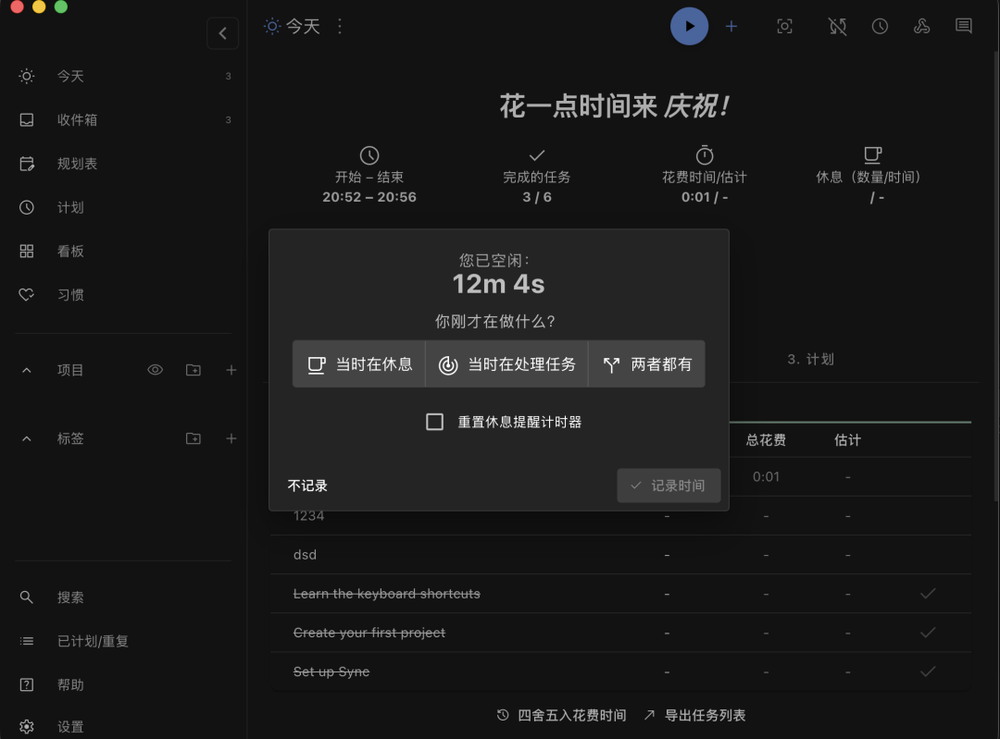
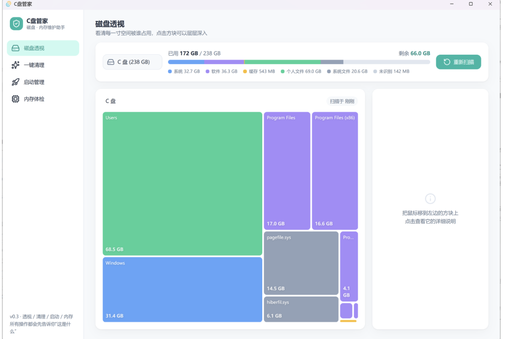
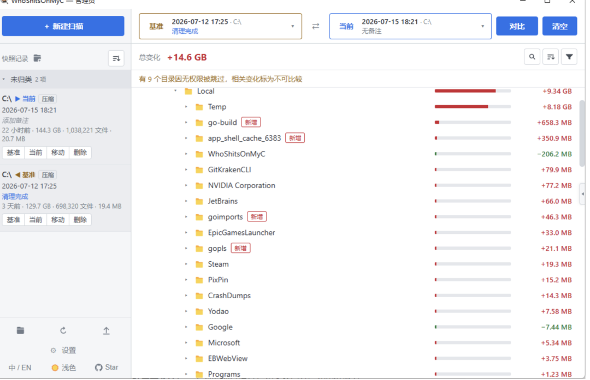

# 拒绝臃肿付费！这款21k星开源待办神器，彻底接管工作流！
> 💡 备注属性未写入，可能是备注属性名称或者类型被修改了，建议将字段类型设置为 rich_text，可以在小程序-操作-修改文章数据库页面进行调整
> 💡 原文链接:[https://mp.weixin.qq.com/s?__biz=Mzk0NTQyNzU3MQ==&mid=2247500308&idx=1&sn=fc28275834d38e332acefec786303cb0&chksm=c2ae3e93746dc45057c1fe6baf1fb2777e06f491ed4b32582bff56c730a6886232b027779864#rd](https://mp.weixin.qq.com/s?__biz=Mzk0NTQyNzU3MQ%3D%3D&mid=2247500308&idx=1&sn=fc28275834d38e332acefec786303cb0&chksm=c2ae3e93746dc45057c1fe6baf1fb2777e06f491ed4b32582bff56c730a6886232b027779864#rd)
哈喽大家好，来认识下今日份的宝藏软件。
### super-productivity
todo类软件可以说遍地都是了，但这款开源工具，居然能做到21k star数，肯定是做对了什么。一起来了解下吧。
首先几乎所有todo类软件，都是需要你手动敲任务的，而这款工具却可以介入你的工作流，原生集成 Jira、GitHub、GitLab、Gitea、Linear、OpenProject、Trello 等主流平台，它可以**自动拉取**分配给你的 Issue 或任务。

还有很多应用只有列表没有时间感，这款工具可以让你给任务设定预估时间，并在开始工作时计时，完成后可以对个对比，也同样内置了经典的番茄钟、休息提醒，专注模式。
win mac linux 安卓都有客户端，所有数据保存在本地，可借助webdav 、Syncthing等工具进行同步。对于厌倦了臃肿付费 SaaS 工具的人来说，它是完美的终极替代品。
### video-shotcraft
一个用于制作电影风格产品视频的智能体技能，包含152 张镜头配方卡 · 209 种风格 · 209 个动态预览 · 一个可直接用于生产的模板。
以前你要做个高大上的产品宣传片，得自己写分镜、找素材、用 AE或者 PR 疯狂调关键帧和动效。现在，你只要把这个skill链接扔给 AI，然后告诉它：“给我做个我们软件的宣传片”，AI 就能照着库里的模板和配方，自动帮你生成。
### C盘管家
c盘垃圾清理神器，不忽悠不夸大不留后门，就是告诉你**这是什么？为什么占空间？删了会怎样？** 看明白了，你自己做决定。

支持彩色拼图显示各文件夹占用情况，一键清理分三种模式，垃圾清理，性能缓存和个人数据清理。启动管理+内存管理，他会给出建议，让你清清楚楚知道为什么关闭，会有什么效果。
### motionsites
想让ai帮你建站，但毫无思路，写不出高级提示词。**把 MotionSites 收藏好**！

它收集了大量精心打磨的 AI 建站提示词和网页模板，从丝滑动画、3D 交互到高级感十足的首屏设计应有尽有。选中喜欢的效果，复制提示词丢进 Claude、Codex，AI 就能直接帮你生成一个又酷又能用的网站。以前折腾半天都做不出的视觉效果，现在复制粘贴几分钟就能搞定，堪称 AI 建站玩家的“网页颜值外挂”！
### WhoShitsOnMyC

很多人都遇到过，垃圾清理软件用完也清理不出什么垃圾，但是相比较几天天，空间就是莫名被占用了一大节，用这款工具就可以告诉你某段时间到底是谁在偷偷吃空间，刚好可以和前面的C盘管家搭配在一起使用。
---
好了就给大家介绍到这里吧，可在私信中发送关键字** 工具**，按发布日期获取本期分享。 （多网盘可选）
 或者点击左下角**阅读原文**直接获取。（单网盘）
