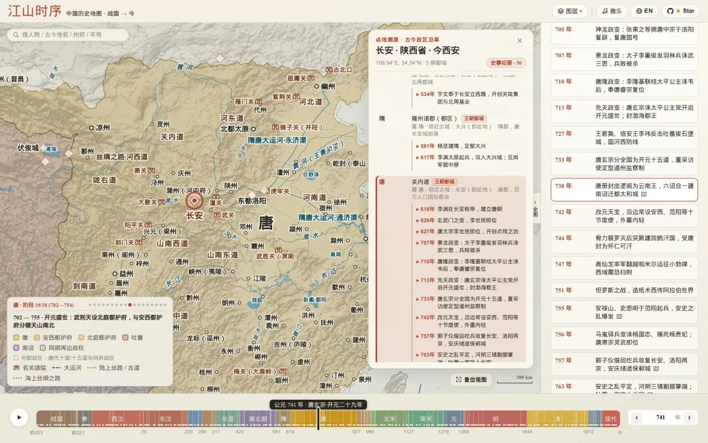
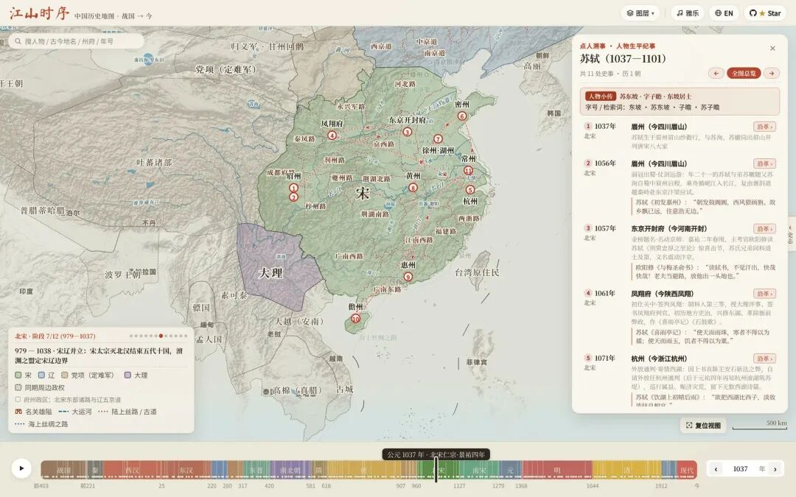

# 拖动一根时间轴，看完中国2400年疆域变迁
> 💡 备注属性未写入，可能是备注属性名称或者类型被修改了，建议将字段类型设置为 rich_text，可以在小程序-操作-修改文章数据库页面进行调整
> 💡 原文链接:[https://mp.weixin.qq.com/s?__biz=MzkwODQzNzk1OQ==&mid=2247503193&idx=1&sn=11727b71af381aaf999a4f410131d946&chksm=c176a7a3140be99900421d9ac5a80938de85056fa808c1fec5bff91e6dc5d749dec973860406#rd](https://mp.weixin.qq.com/s?__biz=MzkwODQzNzk1OQ%3D%3D&mid=2247503193&idx=1&sn=11727b71af381aaf999a4f410131d946&chksm=c176a7a3140be99900421d9ac5a80938de85056fa808c1fec5bff91e6dc5d749dec973860406#rd)
> 💡 ❝
**江山时序（jiangshan-map）是一款开源的中国历史交互地图集，把从战国（公元前403年）至今2400余年的疆域变迁、古城沿革与人物足迹，装进一张可以拖动时间轴的网页地图，浏览器打开即用，无需安装任何软件。
**
项目简介：一幅可以拖动时间、点城读史、追随古人足迹的中国历史交互舆图。

**能干什么**
- **时间跨度**：覆盖18个历史时期、164个疆域快照，从三家分晋、秦灭六国，到元设宣政院直辖西藏、1881年收复伊犁、1945年台湾光复，数据参考谭其骧《中国历史地图集》、哈佛 CHGIS 等权威史料。
- **时间轴**：战国七雄、三国群雄、五代十国、宋辽金夏蒙等多政权同屏对比，在位君主与年号实时联动；切换关键节点时，上一阶段版图以朱砂虚线残影叠加显示，疆域得失一眼看清。
- **点城溯源**：点击任意古城或关隘，弹出该地2400年行政谱系卡，例如长安历代的名称与辖区演变，以及发生在当地的大事（玄武门之变、岳飞遇害于临安等），点击事件可直达那一年。
- **人物足迹**：内置秦始皇灭六国、张骞出西域、诸葛亮北伐、玄奘取经、李白壮游、苏轼贬谪、王阳明悟道等人物编年路线，逐站播放时地图、年份、君主同步切换。
- **古今对照**：悬停古代政区可查看对应的现代省市，还能开启“透视镜”，把今省界直接叠到历史地图上。
- **动态地理**：黄河改道、云梦泽与罗布泊的盈缩、历代长城、大运河、丝绸之路、郑和航线，都随时间轴同步演化。
- **盲标挑战**：隐藏城市名后按历史线索在图上落点，按与真实坐标的距离计分，10轮后授予“太史令·舆图大家”等古代官职称号。
- **AI 友好**：提供机器可读规范 llms.txt、一键截图脚本与浏览器 API，AI 只需从诗句中提取“年份+地名”两个参数即可自动定位；支持简中/繁中/英文，URL 可分享任意历史瞬间，手机浏览器可添加到主屏当 App 用。

**上手**
- **在线使用**：浏览器打开 deanchen.me/jiangshan-map 即可，无需注册账号；手机浏览器可添加到主屏当 App 用。
- **本地部署**：`git clone` 后执行 `python3 -m http.server 8000` 即可运行，无任何依赖、无构建步骤——这是网页项目，没有安装包形态。
- **数据导出**：想拿地图数据二次开发，需另跑 `node scripts/export_geojson.js` 导出 GeoJSON，且仅覆盖公元前403年至1948年，之后的年份与现代省界不在导出范围内。
- **精度许可**：历史疆域为示意性近似，示意大致辖区而非精确测绘边界，严肃引用需另行核对；州郡级边界与战国领土数据来自 CHGIS V6 与 Hartwell 数据集，仅限学术非商业使用，商用前务必留意。
项目由 DeanChensj 开发，当前 1361 Stars。
> ❝
> **项目地址：github.com/DeanChensj/jiangshan-map（GPL-3.0）
> **
