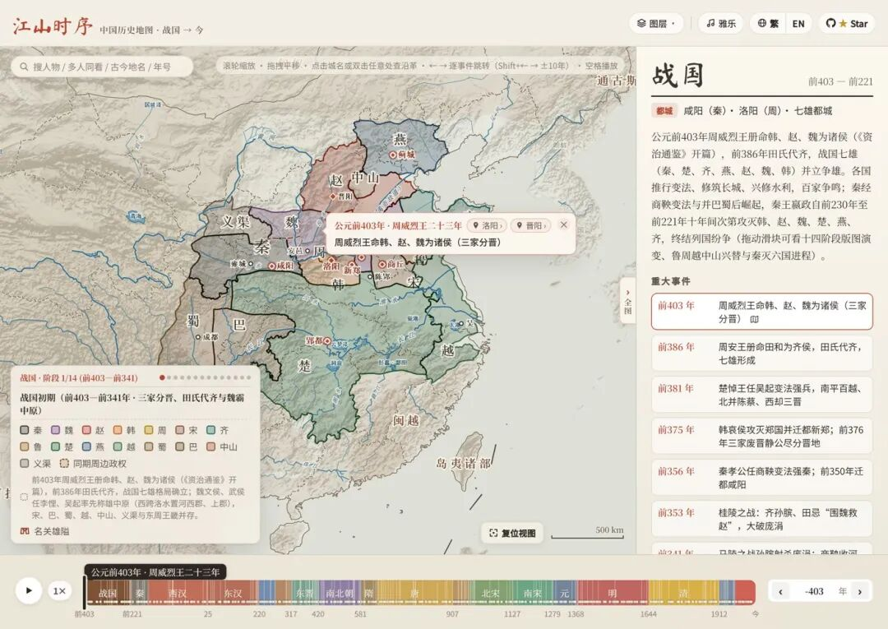
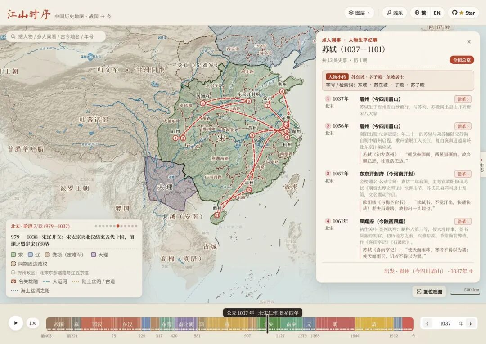
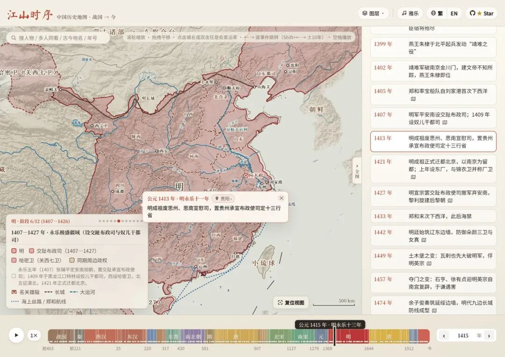

# 拖动时间轴，2400 年朝代在你手底下换，Google 工程师开源的中国历史地图
> 💡 备注属性未写入，可能是备注属性名称或者类型被修改了，建议将字段类型设置为 rich_text，可以在小程序-操作-修改文章数据库页面进行调整
> 💡 原文链接:[https://mp.weixin.qq.com/s?__biz=MzAxNDIzNzc4MQ==&mid=2649401736&idx=1&sn=5075ceca91fa24ecb14bb43fb1efceaa&chksm=8250f90b2b067cbcf9fa2a9b73059444f5f058df71bdebc11f8006d26e7c1e299d0d435b8199#rd](https://mp.weixin.qq.com/s?__biz=MzAxNDIzNzc4MQ%3D%3D&mid=2649401736&idx=1&sn=5075ceca91fa24ecb14bb43fb1efceaa&chksm=8250f90b2b067cbcf9fa2a9b73059444f5f058df71bdebc11f8006d26e7c1e299d0d435b8199#rd)

读历史读到五胡十六国那段，谁没懵过。前后赵、前后秦、前后燕，十几个政权挤在一百年里，课本上那几页静态地图翻来翻去，还是拼不出一张完整的图。
有个 Google 的工程师也懵。他的解法比较极端：自己写一张能动的地图。
现在这张地图叫「江山时序」，开源在 GitHub 上，3433 个 star。打开网页，底下是一根时间轴，从公元前 403 年三家分晋，一直拉到今天。拖动它，朝代就在你手底下换——战国七雄的色块、西汉的十三州、唐的道、明的两京十三省，连黄河改道、丝绸之路、郑和下西洋的航线，都跟着年份走。
**一句话：它把 2400 年塞进了一根滑杆。**
地址先放这儿：
- 在线体验：https://deanchen.me/jiangshan-map/
- GitHub：https://github.com/DeanChensj/jiangshan-map
### 数字先摆出来

18 个历史时期，184 幅疆域快照，480 条编年大事，687 处城池，20 座名关雄隘，7 位人物的完整行迹。
翻译一下这几个数字的意思：
**点地溯源**。地图上随便点一个古城，比如长安，会弹出一张卡片，把这 2400 年里它的名字和归属一层层列出来——战国属秦，秦置内史，西汉是京兆，唐是京畿，现在叫西安。卡片上标着"9 朝建都"，底下挂着 66 条史事，从玄武门之变点到哪一年，地图就跳到哪一年。
**点人溯事**。搜苏轼，他的一生变成地图上一条编号路线：眉州出生，开封中进士，凤翔做官，然后是杭州、密州、徐州、湖州、黄州、惠州、儋州。按右箭头一站站走，时间轴跟着他动，背景里的疆域从北宋换到南宋。贬到儋州那站，你已经看着他过了海。

还有个小彩蛋：输入 quiz，进入"舆图寻址"模式——给你一句朝代掌故，让你在藏掉地名的地图上盲标古城位置，按距离打分，十题下来给你封个"太史令·舆图大家"或"州郡从事"。

### 项目是谁做的
Dean Chen，Google 的软件工程师，理科生，历史地理常年全班最高分。他在博客里写，从小最喜欢翻历史课本里的地图，把不同朝代摊开对比。真正把他按到键盘前的是渤海小吏的《两晋悲歌》——五胡十六国读成一团浆糊，想拼张地图，拼不清。
7 月他做过一版原型，效果一般，扔了。10 月重新捡起来，只做纯地图，起点是一句 prompt：帮我做一个能够拖动时间轴的中国历史地图。AI 交的第一版只有几个色块，边界是直线和锯齿。之后两周半，两百多次提交，大半在深夜和周末。辽国的上京一度被画在辽国疆域外面，他补了一个月没做过的辽北疆域；蒙古帝国在罗布泊莫名破了个洞，查了半天才补上。
有意思的是传播路径。他先发同事群和朋友圈，反响平平；加了英文版发 LinkedIn，毫无水花；小红书、知乎投稿，被限流。转折点是 X 上一个知识分享账号转发了网站，10 月 21 日早上，star 一夜从几十涨到一百多，几天冲到 1400。
讽刺的地方他自己也写了：火了之后，不少人在小红书和公众号搬运他的地图截图，流量比原作者还高。
### 我实际跑了一遍
本机 Windows，Edge 打开在线版，不装任何东西。
深链直达：`?year=741&place=长安` 打开就是唐开元二十九年的长安卡片，域名直接进地址栏，全程没碰安装这一步。给苏轼、quiz、明永乐十一年（1415，能看到交趾布政司和哈密卫）各截了一张，都是深链一次到位，文中的图就这么来的。

（明永乐十一年：两京十三省，交趾布政司还在图上）
不好用的地方也说两句。疆域快照是按里程碑切的，两站之间的小变动看不到；官方在页面里自己声明了"历史疆域为示意性近似，非精确测绘边界"，拿它当学术依据不行，当课堂演示和历史入门绰绰有余。另外站点是个大单页，冷启动首屏要加载一阵，第一次打开白屏几秒别急着关。
和谭其骧《中国历史地图集》比：那套书是学术基准，这是给普通人玩的。定位不同，但它确实是第一张能拖的。
### 怎么用
**不想折腾的**：打开 https://deanchen.me/jiangshan-map/ ，把时间轴从左拖到右，十分钟看完 2400 年。
**想看具体人的**：网址后面加 `?person=sushi`，换 qinshihuang、zhangqian、zhugeliang、xuanzang、libai、wangyangming 都行。
**当家长的**：开 quiz 模式，跟孩子一人一局，看谁能封上太史令。
**写代码的**：仓库 clone 下来，`python3 -m http.server 8000` 就能本地跑，零依赖零构建。它还带了 MCP Server 和给 AI 用的 Agent Skill，喂给 Claude 或 Cursor，输一句"雪拥蓝关马不前"，它会定位到韩愈被贬那年的蓝关。
**最后总结**
GPL-3.0 开源，免费无广告。但要留意一条：州郡界和战国疆域部分数据来自哈佛 CHGIS 和 Hartwell 数据集，这两个原始数据只授权学术和非商用用途——想拿地图出书、做付费课，先去看仓库里的协议说明。
GitHub：https://github.com/DeanChensj/jiangshan-map 在线体验：https://deanchen.me/jiangshan-map/
打开它，搜一个你背过他的诗的人，跟着他的路线走一遍。
小时候课本里的地图是钉死的，这张是活的。差的那口气，就是"拖"那一下。
—— 觉得有点意思，点个在看。
