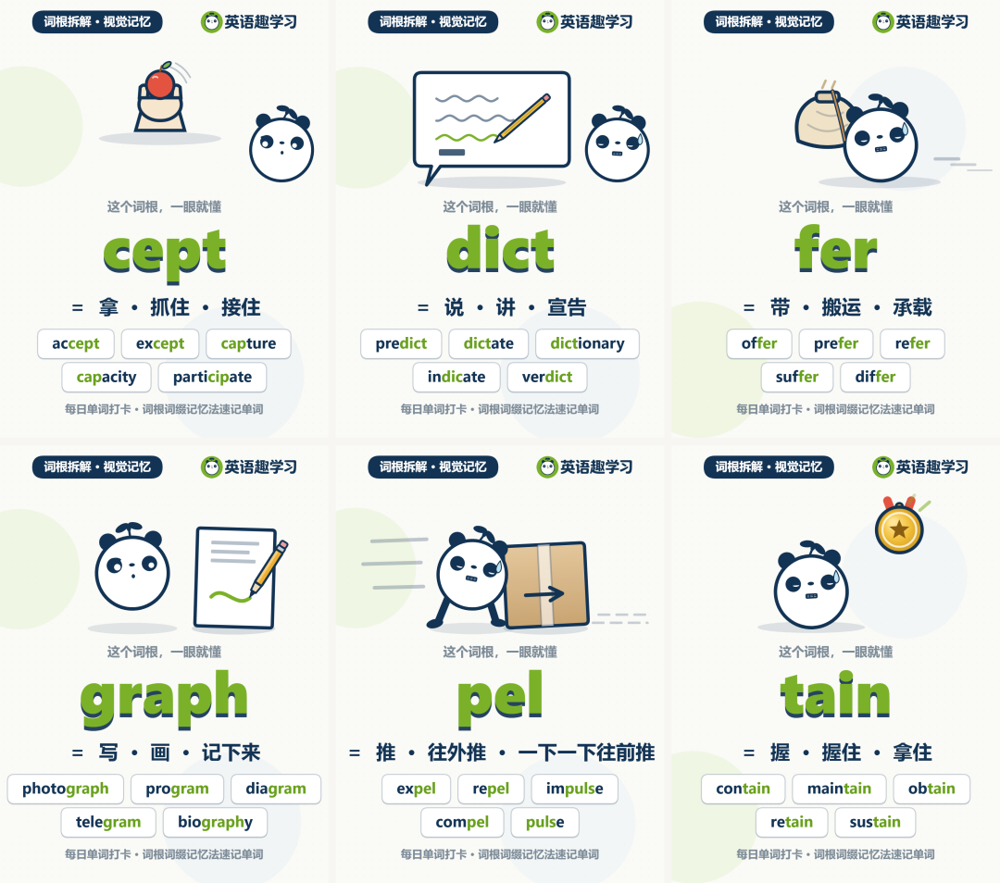
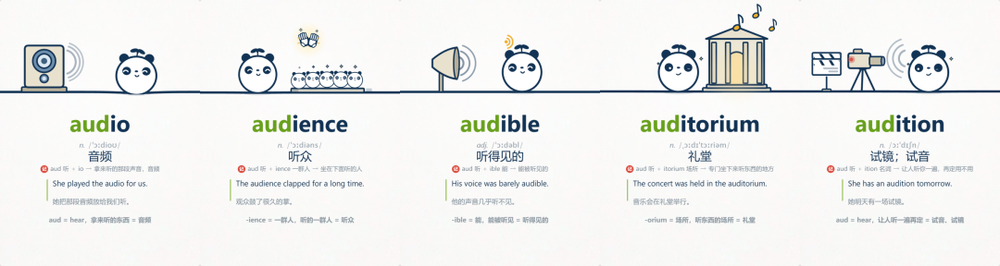
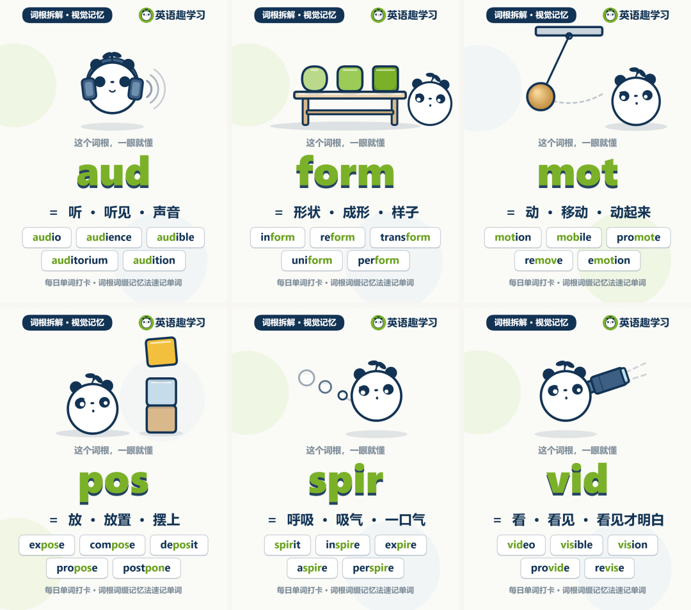
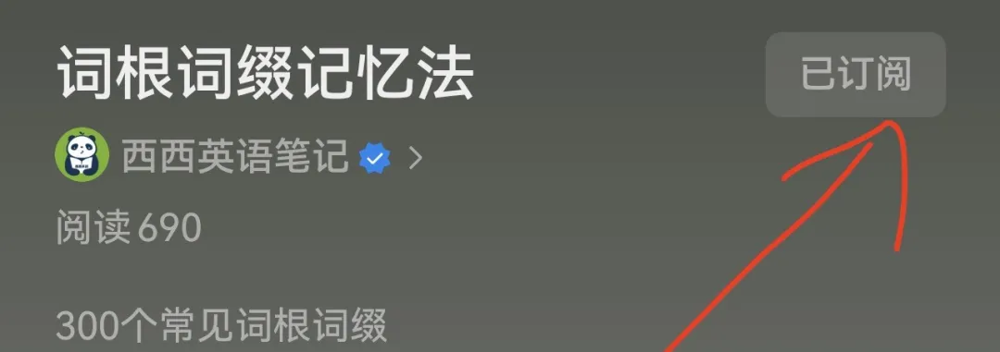

# 挑战100天记住1500个单词！持续更新 【300个常见词根词缀】【动画视频】—英语学习也可以高效又有趣！
> 💡 备注属性未写入，可能是备注属性名称或者类型被修改了，建议将字段类型设置为 rich_text，可以在小程序-操作-修改文章数据库页面进行调整
> 原文链接:[https://mp.weixin.qq.com/s/3Ja043r4zTNFyuyz1TV1iw](https://mp.weixin.qq.com/s/3Ja043r4zTNFyuyz1TV1iw)
**每日更新**
**词根词缀 趣味动画视频**，**更多视频可前往合集**[词根词缀记忆法](https://mp.weixin.qq.com/mp/appmsgalbum?action=getalbum&__biz=Mzg4NDgxMjE2Mg%3D%3D&scene=1&album_id=4768298333008609281&count=3#wechat_redirect)**订阅，以便实时看到最新动态！**

或许你正面临着英语学习中一个共同的困惑：单词总是记不住，记住了又容易忘，忘了再背、背了再忘，仿佛陷入了一个无休止的循环。
其实，这个困扰每一位英语学习者都经历过，而我们制作的系列**英语动画视频**—**词根词缀速记单词**，正是为了帮助你打破这个循环而诞生的。
** 出自 《图解 词根词缀速记单词》配套音频 **

英语单词并不是一堆毫无规律的字母随机排列。就像汉字有偏旁部首一样，英语单词也有自己的“偏旁部首”，那就是前缀、后缀和词根。一个单词常常可以被拆解成几个有意义的组成部分，当你理解了每个部分的含义，整个单词的意思便会豁然开朗。
举个例子，当你看到"audience"这个单词，如果死记硬背 a-u-d-i-e-n-c-e，八个字母时，不仅枯燥，而且容易忘记。但如果你知道"aud-"表示“听”，"ience"表示“一群人”，那么"audience"的意思——“坐在下面听的人”，便不言自明了。更妙的是，一旦你掌握了这个规律，遇到audible （听得见的）、auditorium（礼堂）、audition（试镜）等单词时，你也能轻松推测出它们的意思。这便是构词法的魅力所在——用一个规律，解锁一片单词。

** 出自 《图解 词根词缀速记单词》配套音频 **
为此，我们整理了**300 个常见的词根词缀**，其中：
• **词根200个 + 词缀100个**（50 个前缀、50 个后缀），涵盖高中，四六级；
• 300 组、每组 5个单词，**共1500 个词**；
•  **每天学习（3 组，共15 个词）**，每期一集以英语动画小场景的形式，讲清楚“这个词为什么是这个意思”；
**100 天后你记住的不只是 1500 个单词，是拆开任何生词的能力！**

** 现在，就开始每天的单词打卡吧！**
**每日更新**
**词根词缀 趣味动画视频**，**更多视频可前往合集**[词根词缀记忆法](https://mp.weixin.qq.com/mp/appmsgalbum?action=getalbum&__biz=Mzg4NDgxMjE2Mg%3D%3D&scene=1&album_id=4768298333008609281&count=3#wechat_redirect)**订阅，以便实时看到最新动态！**

** 出自 《图解 词根词缀速记单词》配套音频 **
