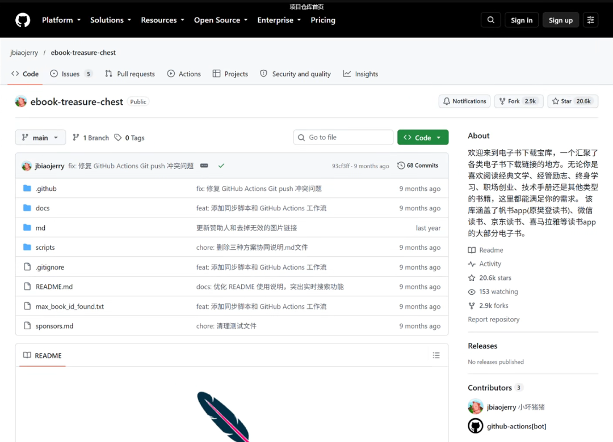
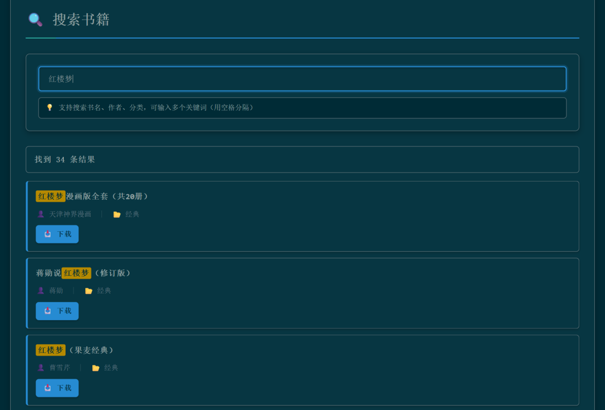
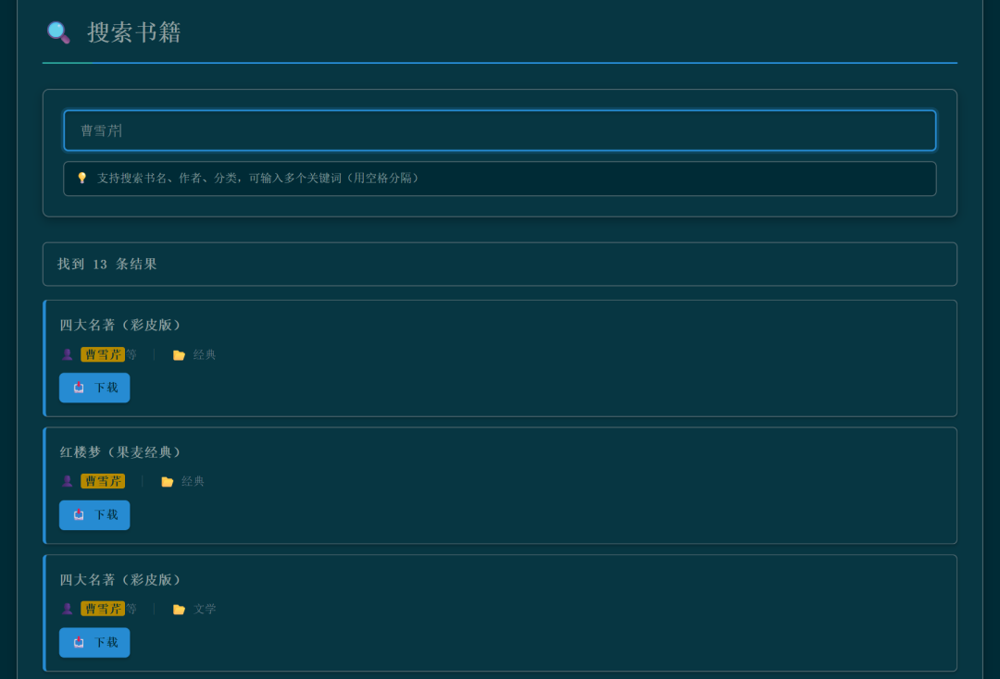
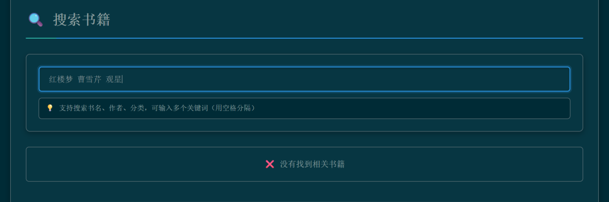

# 挖到GitHub小众工具，轻松收集全网电子书
> 💡 备注属性未写入，可能是备注属性名称或者类型被修改了，建议将字段类型设置为 rich_text，可以在小程序-操作-修改文章数据库页面进行调整
> 💡 原文链接:[https://mp.weixin.qq.com/s?__biz=MzY5NjQwOTcwMw==&mid=2247484076&idx=1&sn=ae2b3df771990845c9d9100276cf613b&chksm=f59d390800c00313600361bde8e31012897de781e66d24516c3f462050e8e85fe5b2685a17dc#rd](https://mp.weixin.qq.com/s?__biz=MzY5NjQwOTcwMw%3D%3D&mid=2247484076&idx=1&sn=ae2b3df771990845c9d9100276cf613b&chksm=f59d390800c00313600361bde8e31012897de781e66d24516c3f462050e8e85fe5b2685a17dc#rd)
查找电子书的时候，有时候卡住的原因并不是忘记了书名。
书名输入进去之后，结果也出来了，但是再往下看，漫画版、解说版、套装版等等各种版本全都挤在了一起。你要找一本书看的话，还要先分辨清楚：哪一本是原著，哪一本是介绍这本书的，哪几条是重复的。
这次我在 GitHub 上尝试了一个叫做 ebook-treasure-chest 的项目，它的中文名是“电子书下载宝库”。把书名、作者、分类以及第三方链接都整理到一起做成一个可以进行搜索的网页。
我用“红楼梦”来试一试，搜出来34条；再加上“曹雪芹”之后，就只剩下7条了。其实打动我的并不是页面上那两万多个数字，而是在搜索到之后，还可以顺着手头的线索继续往下查。不必把整本书都看完，可以跳着看。
但是搜索框也有自己的性格。换了几种输入方式之后，我发现有些地方知道的话可以少费些劲。

**项目 GitHub 主页上，在线搜索入口放在了仓库说明里面。**
### 1、不用装什么，打开网页就能试
如果你平时很少用到 GitHub，也不必被那一排文件夹所劝退。找到项目说明之后进入“在线访问 GitHub Pages”就可以进入到搜索页面了。不需要下载项目，不需要安装软件，更不需要填写什么 API 密钥。
网页为深青色，搜索框上面放了几张统计数据的卡片。打开之后显示的是24,071，分类数为1,000，旁边还有EPUB、MOBI、AZW3等格式名称。

**打开页面之后看到的统计数据，包括书目的数量以及分类的数量都在这里。**
等书目加载完毕之后就可以输入了。书名、作者、分类都可以用来搜索，输入之后稍作等待，下面就会出现新的搜索结果，不需要再按回车键。
不确定要看什么，也可以继续往下翻分类。文学、历史、科普、管理等各个方面的书籍都有，页面上默认显示了前二十个热门分类，每一类先列出十本书。它不会一下子把所有的书目都展示出来，想要找具体哪本书的话，就用上面的搜索框顺手查找一下。
至于两万这个数字，可以先有个大概的印象。等到看到后面搜索的结果之后，你就会知道为什么不能把这当作两万本不同的书来对待了。
### 2、只记得书名和只记得作者，都能查
我先输入“红楼梦”，页面显示34条结果。
下边有《红楼梦漫画版全集》、《蒋勋说红楼梦（修订版）》等。带有这两个字，但是内容却大相径庭。

**同样搜索的时候，原著版本、漫画以及相关的解读书籍都会一起出现。**
倒也可以用上。如果想找到更多与一本书相关的书籍，可以只输入书名，就会出现一些相关的讲解和延伸阅读。但是如果你要找的是原著的话，只看“34条”是没有用的，还要继续看作者、版本。
然后我将输入框中的文字替换成“曹雪芹”，这次出现了13条结果，其中有《四大名著（彩皮版）》《红楼梦（果麦经典）》《红楼梦（校注本）》之类的书目。

**换成作者的名字也可以找到相关的书籍，不需要把完整的书名想出来。**
平时遇到“作者记得，书名想不起来”的时候就可以用这种方法来查找。但是页面上作者的名字要和具体的书籍联系起来看，有的写的是“曹雪芹等”，不能只凭这一行来判断这本书的内容。
### 3、加上作者，范围就小下来了
又把两个线索放在一起，输入“红楼梦 曹雪芹”，中间留一个空格。结果只搜索书名的时候有34条，现在缩小到7条。
我认为这样的用法很实在。不需要学习搜索指令，在手上有确定线索的情况下可以添加进去试一试。

**加上“曹雪芹”之后，页面上显示了7个结果，也可以看到相同的版本被重复列出。**
但是往下看的时候，我发现《曹雪芹大传》也在结果中。明明是输的“红楼梦 曹雪芹”，为什么也会被找到呢？
旁边的信息就可以看出来了：这条书目作者一栏带了“曹雪芹”，分类也是“红楼梦”，两个词都能对得上，所以就会出现。搜索的时候，每个词都要能在书名、作者或者分类中找到，但是不必出现在书名里。
截图中《红楼梦（果麦经典）》出现不止一条，分别放在“经典”“文学”等分类下面。也就是说，在7个结果中，就有重复的了。
组合关键词可以帮你少翻几条，但是选择版本这一关还是要你自己去看了
它的优点就是让你自己去调节筛选的标准。至于某一个词语为什么能搜到这本书，看作者、看分类，一般就可以找到原因了。它不像聊天工具那样能够理解你写的整段找书的需求，并且找不到书里面的内容。
### 4、搜不到的时候，别急着继续加字
为了观察它对于更窄条件的处理方式，我故意添加了一个无关的词，输入的是“红楼梦 曹雪芹 观星”。这次页面上显示的是“没有找到相关的书籍”。

**加上无用的“观星”之后没有结果，这是有意进行的一次搜索测试。**
然后我把“观星”删掉，只剩下“红楼梦 曹雪芹”，所以7个结果又出现了。
这个过程可以很好地体现它的使用方法：条件越多，需要对上的地方也就越多。自己都不确定的词语放入其中，反而会把想要找的书挡住。
结果很多，就增加一条确定的线索；没有结果的话，就把拿不准的词去掉
所以找不到的时候可以先减小书名，或者单独搜索作者，看是不是写法不一样。页面上说“没有找到”，只是表示这次输入没有在它的书目中找到对应的内容，并不能因此认为这本书不存在。
反过来说，如果搜一个很宽泛的词，结果区出现了“100+”，也不要把它当作完整的数量统计。代码中最多只显示100条，此时可以补充作者或者分类信息，使范围更小一些。想随便逛逛的话，清空搜索框就可以，下面的分类书单还在。
### 5、有两件事，我看完代码后想补一句
前面讲到同一个版本会在不同的分类中出现。我翻看了整理书目的代码，它可以把各个分类下的记录合并在一起，并没有把重复的书籍统一合并。
首页上的24,071，按照这里的方式理解为书目记录更为恰当。一本书放进去几个分类，查出来就会有好几条。到底有多少部不同的作品，还要把版本、套装等等的情况再分清楚了，不能只看首页上的数字就下结论。
格式也是一样的道理。页面上列出了EPUB、MOBI、AZW3等格式，但是整理脚本会把书目统一填写上这些格式，并不是一个个打开文件去查找的。看到标签，并不代表已经确定该条书目的文件有三种格式。
本次只进行了在线搜索，并没有进入第三方下载按钮，也没有下载电子书。文件是否可以打开、是否需要登录或者付费、版本和授权是否明确，都没有进行核实，不能在这里为它担保。
书名找出来了，文件、版本还要继续核对
### 6、我会把它留作一个查书目的入口
如果你也在使用 Obsidian 来整理阅读清单的话，可以先把查到的完整的书名、作者以及版本先记录下来，然后去出版社、图书馆或者正规的阅读渠道进行核实。不要急于只记一个大概的书名，否则隔上几天再去打开的时候，又要重新分辨出是哪一版了。
手动记在自己的笔记本上就可以。对于我来说，把“我想找的是哪本书”弄明白，这个索引就很有用了。
只有一条线索可以记住，或者是想要看看同一本书的不同版本，用来试一试。如果想要直接查询书中的某一段原文，或者让工具来判断版本的质量的话，那么就只能另寻他法了。
我这次使用之后，觉得它好用的地方也很简单：打开就可以查，多了还可以修改词。找到书籍的时候多一个这样的入口，遇到一整排相似的书名就可以知道从哪里开始筛选了。
开源地址：jbiaojerry/ebook-treasure-chest

## 摘要

（待补充）

## 我的笔记

（待补充）
