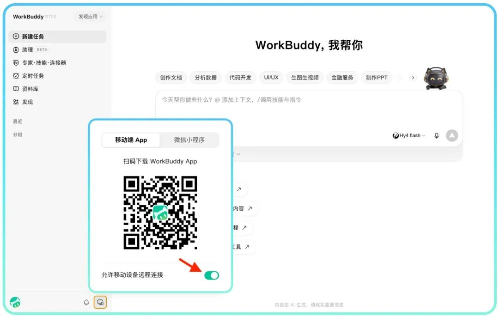
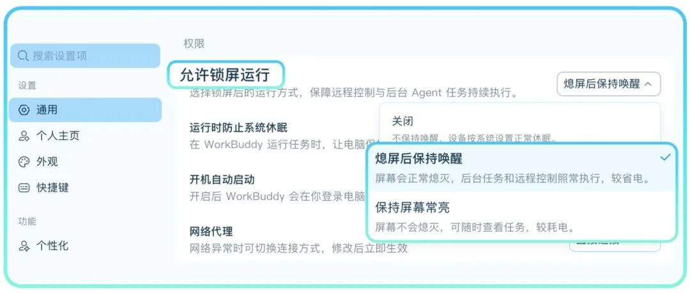
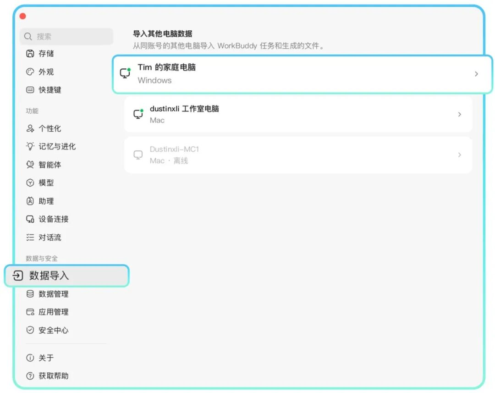
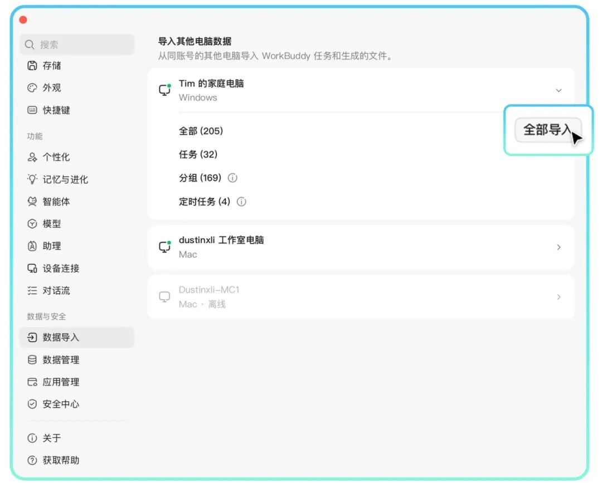
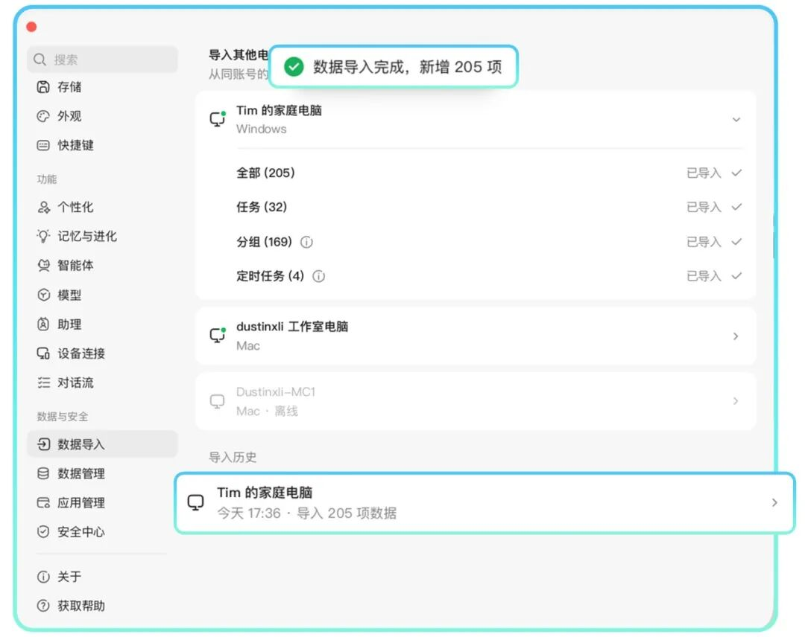

# 换电脑不用重来：WorkBuddy支持跨设备数据迁移
> 💡 备注属性未写入，可能是备注属性名称或者类型被修改了，建议将字段类型设置为 rich_text，可以在小程序-操作-修改文章数据库页面进行调整
> 💡 原文链接:[https://mp.weixin.qq.com/s?__biz=MzYzODgxODMzNQ==&mid=2247497854&idx=1&sn=b4b33921b092a94f985879ac08c521d3&chksm=f17356b4917b5fe2eba0f46392a35901b0f6079146f06085f51ca49f3ae1d9d08e239454109c#rd](https://mp.weixin.qq.com/s?__biz=MzYzODgxODMzNQ%3D%3D&mid=2247497854&idx=1&sn=b4b33921b092a94f985879ac08c521d3&chksm=f17356b4917b5fe2eba0f46392a35901b0f6079146f06085f51ca49f3ae1d9d08e239454109c#rd)

过去，换了新电脑，旧电脑里 WorkBuddy 的对话、产物和定时任务还留在原机，只能从零开始。过去，公司一台设备、家里一台设备，两边的工作各自独立，没法接续处理。
现在，在新电脑的 WorkBuddy 里，就能一键导入同一账号下原电脑的任务数据，导入后接着用。
**能带走什么？**
### 三类内容都能导入
**全部任务**
任务、对话记录、产物记录，以及 WorkBuddy 托管目录下的产物文件
**任务分组**
分组本身，以及分组关联的多个文件夹（含主次关系）、分组内的记忆和任务的本地 Skill
**定时任务**
定时任务的名称、内容、重复规则、有效期等
注：MCP 配置、日志，以及全局下发的内容（如 Skill、专家、全局记忆）不在迁移范围内。
**导入之前**
### 先确认三件事
#### 01｜更新版本，登录同一账号
两台电脑都更新到最新版本，并登录同一账号。仅同一账号下的设备之间可以导入。
#### 02｜对方电脑保持在线
导入时，被导入的那台电脑必须在线、WorkBuddy 处于打开状态。离线、关机、已重装的设备，暂时无法导入。
#### 03｜打开远程连接开关
打开“允许移动设备远程连接”开关。

注：想在锁屏状态下也能完成迁移，可以在“设置 - 通用”中把“允许锁屏运行”设为“熄屏后保持唤醒”或“保持屏幕常亮”。

** 开始导入**
#### 01｜找到入口，选设备
在新电脑上打开“设置 - 数据导入 - 导入其他电脑数据”，列表里会显示同一账号下的其他电脑，选中要导入的那一台。

#### 02｜全部导入
点击“全部导入”，就会导入全部任务、分组和定时任务。传输过程中，请保持两台电脑都在线。

#### 03｜看提示，查记录
导入完成后会有提示，之后可以在“导入历史”里查看每次导入的内容。

### 注意事项
**定时任务默认暂停。**两台电脑同时执行同一个定时任务，可能会重复推送，所以导入后的定时任务不会直接开跑：将处于关闭状态，可以再次手动启用。
**导入的任务文件，按设备分开存放。**文件保存在“~/WorkBuddy/{设备名}/”下，不同设备的文件各自独立，文件名与原设备保持一致。
**补充说明**
**Q：同一批数据导入两次，会出现重复任务吗？**
不会。导入时会按任务去重，已经存在的任务直接跳过。
**Q：导入到一半取消或断开，本机会留下残缺数据吗？**
不会。单个任务中途取消、对方断开连接或校验失败，都不会在本机留下残缺数据。
**Q：产物文件有大小限制吗？**
有，单个产物不能超过 100M。多个产物合计超过 100M 也可以导入，前提是每个产物都小于 100M。

**喜欢今天的内容就关注我们吧👇**
**后续还有更多实用干货持续更新～**
**欢迎前往官网下载体验**
**亲自感受更多惊喜功能🎉**
www.workbuddy.cn
