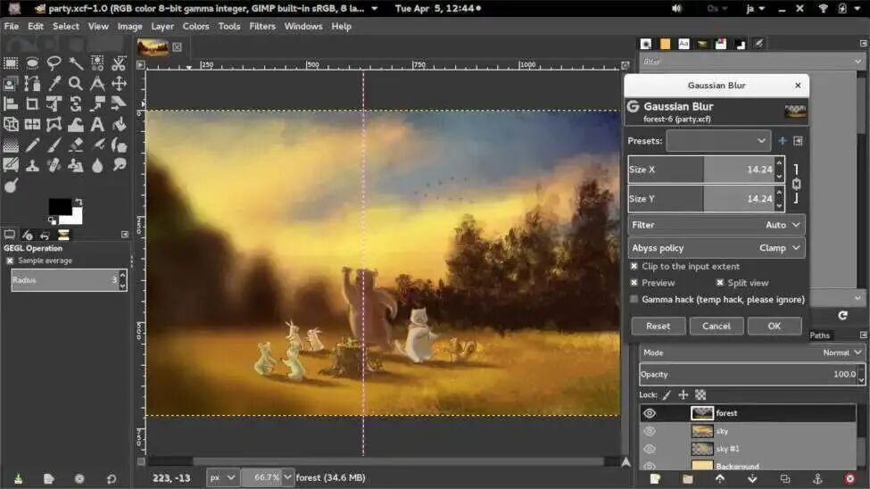
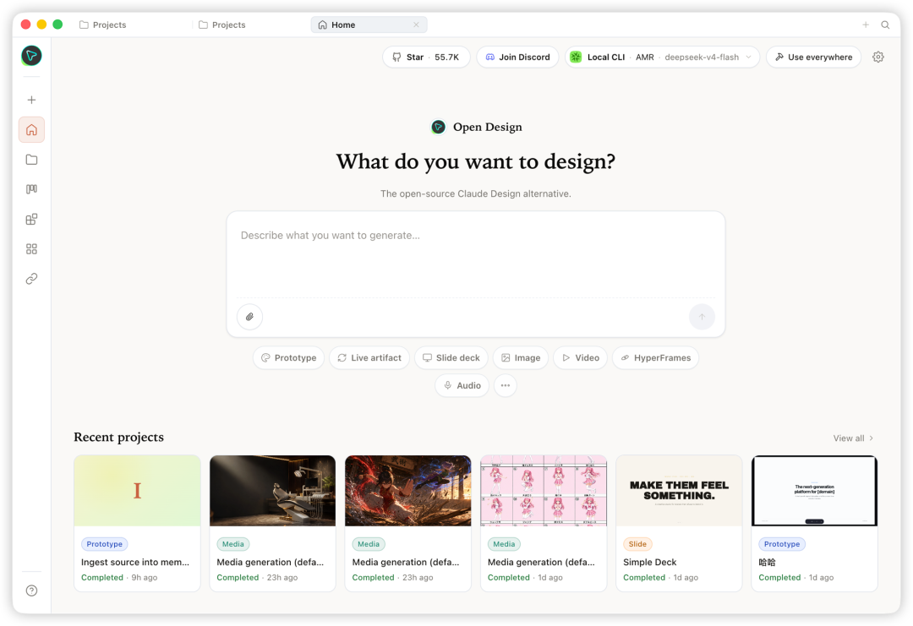
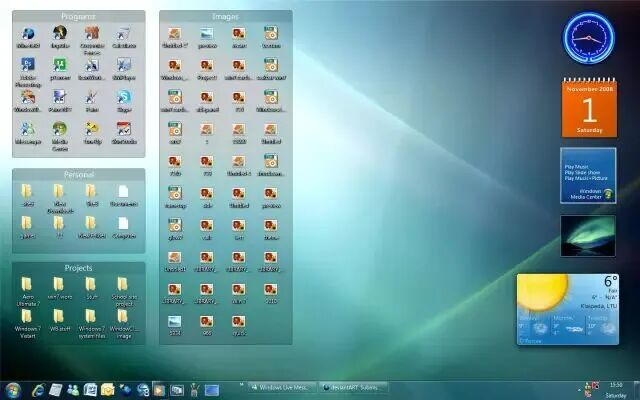
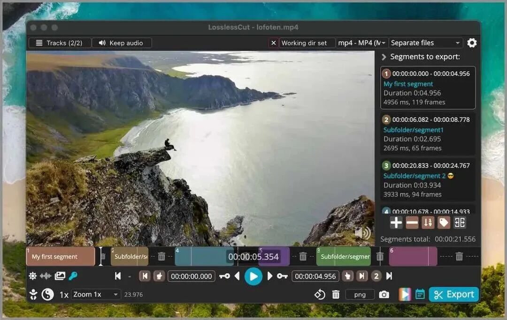
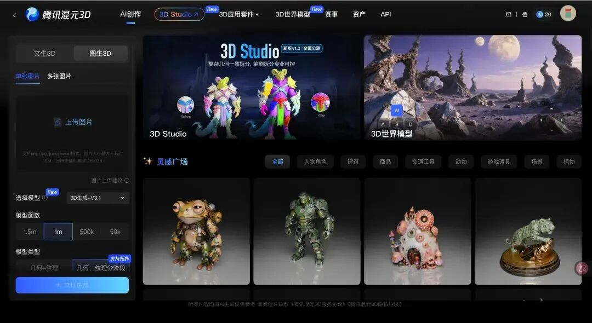
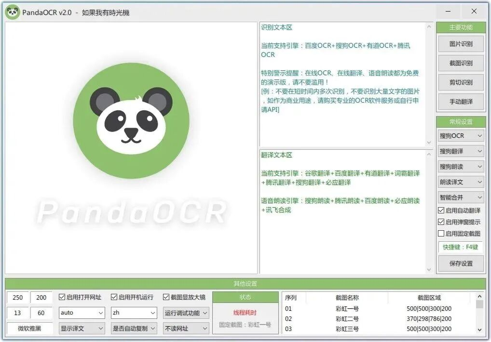
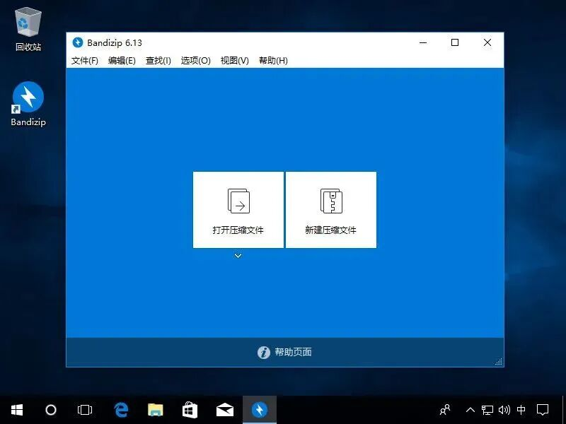
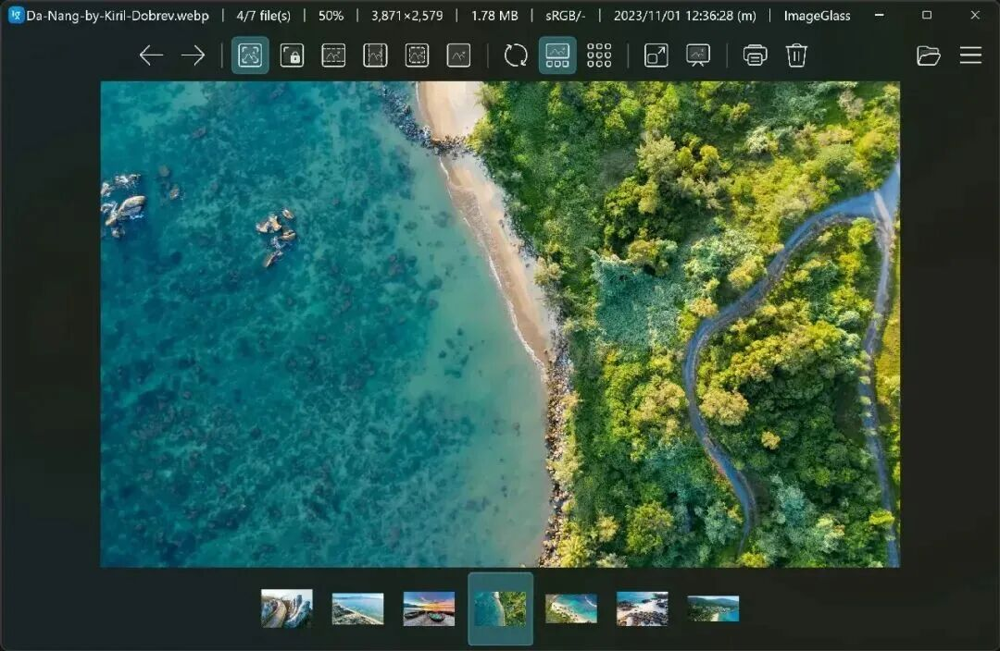
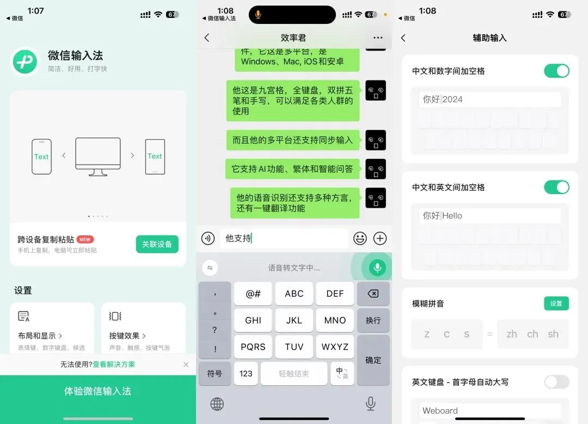
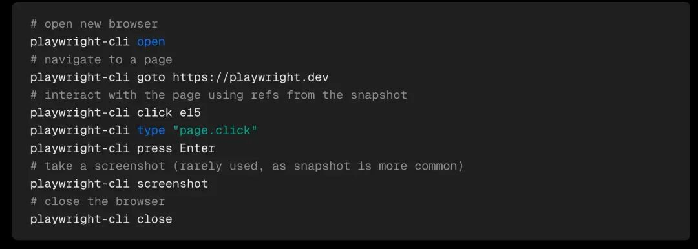

# 推荐10款精品软件！
> 💡 备注属性未写入，可能是备注属性名称或者类型被修改了，建议将字段类型设置为 rich_text，可以在小程序-操作-修改文章数据库页面进行调整
> 原文链接:[https://mp.weixin.qq.com/s/GedPCrHC_qqBVsrgVT0LWQ](https://mp.weixin.qq.com/s/GedPCrHC_qqBVsrgVT0LWQ)
#### Gimp
https://www.gimp.org/

Gimp 是一款小巧实用的图片编辑工具。如果你不想用笨重的PS，那可以尝试一下Gimp，它该有的功能都有，绘图，抠图，锐化，只要你有足够的想法，用它都可以展示出来。
而且它仅仅只有一百M 大小，同时还开源免费，电脑全平台支持。支持17 中语言，包括中文。
---
#### Open Design
https://github.com/nexu-io/open-design

最近发现一个很有野心的开源 AI 设计工具——Open Design。它可以理解成 Claude Design 的开源替代品，但它并不只是生成几张好看的界面图，而是把 Codex、Claude Code、Cursor 等编程 Agent 直接变成设计引擎。
输入一句需求，它就能生成网站、移动端原型、数据看板、PPT、图片甚至动态视频，并导出为 HTML、PDF、PPTX 或 MP4。它还支持通过 DESIGN.md 固定品牌字体、颜色和组件规则，让不同内容尽量保持统一风格。
项目采用本地优先设计，可以使用自己的模型和 API，目前已有约 8.1 万 Star，采用 Apache-2.0 许可。需要注意，它更像“面向 Agent 的设计工作台”，不是完全替代 Figma 的可视化编辑器；首次配置本地 Agent 和模型时会有一定学习门槛。
---
#### Fences
http://www.stardock.com/products/fences

Fences 是一个Windows 桌面管理软件。它可以在桌面上建立文件夹，将不同的软件整理在一个文件夹内。
而且它还有一个特别棒的功能，双击隐藏桌面的所有图标，这对于有癖好的人随时一个福利。它还支持虚拟桌面，当你拖拽桌面两侧，它就会进入一个干净的桌面，你可以所以使用。
---
#### LosslessCut
https://github.com/mifi/lossless-cut

LosslessCut 是一款主打极速无损剪切音视频与合并片段的开源实用工具。平时想给几十个 G 的长视频或者电影截取片段，用专业剪辑软件重新渲染要耗费大半天。
而用它剪切视频不需几乎所有常见的视频、音频和字幕格式，拖拽就能快速载入。界面直观，通过快捷键就能精准标记起始点和结束点，批量删除多余镜头或合并多段素材。
软件开源免费且跨平台，剪辑粗剪、整理行车记录仪和录屏素材极其高效。
---
#### 腾讯混元3D
https://3d.hunyuan.tencent.com/

腾讯混元3D 是腾讯推出的一款3D AI模型生成工具。它支持文生3D 和图生3D。
你可以上传一张或者多张图片，它就可以生成特别精细的3D 模型。可以用来打印或者执行后面操作。
它还可以设置纹理的精细程度，还支持各种拓扑。它上面有很多网友上传的内容，比如说人物角色、建筑、商品、交通工具、动物等等。
感兴趣的可以来学习。它还有丰富的套件可以使用，还有专门的API调用。
普通注册之后有20积分使用，可以生成20次。目前好像只有网页版。
---
#### 熊猫OCR
https://github.com/miaomiaosoft/PandaOCR

熊猫OCR 又是一个特别好用的OCR 识别工具。不仅支持文字识别，还支持翻译，同时还支持朗读，这个功能就比较强大了。
还支持监听到你的剪切板，自动弹窗翻译。它有一点都不好的事，就是很多功能都是连接第三方的接口，需要你自己去申请填写。
比如OCR识别，就是百度，腾讯，有道。大家看到这个不要退缩，就是简单的注册功能。
---
#### Bandizip
https://www.bandisoft.com/bandizip/

它是一款非常良心的压缩机压缩软件。目前的压缩软件要么是一些老旧的不好用的，要么是一些付费的。
这款软件它有免费的版本，而且功能也非常的强大。它支持30多种压缩格式。
还支持在线浏览编辑。 它的压缩支持nes265加密算法。
而且独创的6倍压缩速度。 目前的最新版有标准版和付费版，它是旧的版本是免费的。
而且它同时支持Windows和Mac。
---
#### ImageGlass
https://imageglass.org/

ImageGlass 是一款特别强大的图片浏览器软件。它支持80多种格式，比如说JPG，JPG, SVG, GIF, RAW 格式。
它有简洁的 UI 和各种主题和图标包，可以灵活替换，而且还可以自定义布局工具栏等等。它加载也特别快速，可以同时一次加载1000 多张图片。
不管你是普通用户还是专用户，使用它都可以轻松应对。同时它还支持第三方插件功能。
最主要的是它还是免费开源，只有Windows 版本。
---
#### 微信输入法
https://z.weixin.qq.com

微信输入法是一款特别智能的输入法软件。支持九宫格，全键盘，双拼五笔和手写，可以满足各类人群的使用。
支持语音输入法，跨屏复制剪切功能。它还内置AI 功能，可以随时随地问 AI。
还有表情包工具，可以搜索各种表情包。它支持Windows、Mac, iOS和Android。
多平台还支持同步。它支持AI功能和智能问答。
他的语音识别还支持多种方言，还有一键翻译功能。
---
#### 无头浏览器：Playwright
https://skills.sh/microsoft/playwright-cli/playwright-cli

Playwright 是一个浏览器自动化工具。它支持Chrome、Edge、火狐浏览器。
它可以通过命令行来控制浏览器，Agent 可以自动访问网页、操作界面、抓取数据和测试网站。和Agent-Reach 相比，它可以更加精准地访问浏览器、抓取内容。
还可以生成网页截图、导出PDF、生成报告等等。它还支持创建浏览器标签页，还支持保持登录状态Cookie等等。
