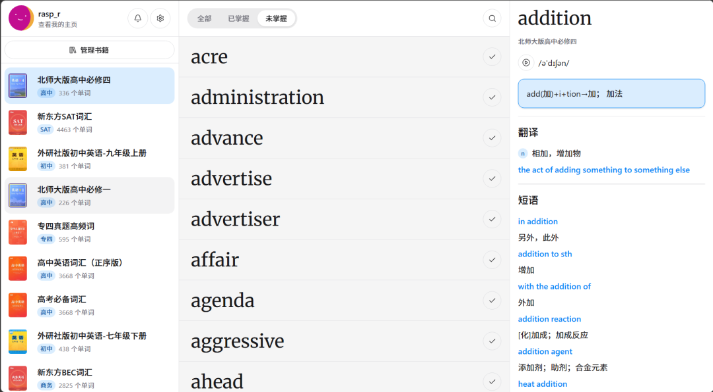
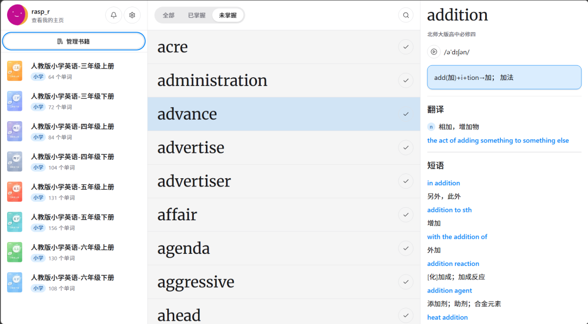

# 推荐1个免费刷背单词的网站，15万词库，人教版等书库，GitHub 1.6k
> 💡 备注属性未写入，可能是备注属性名称或者类型被修改了，建议将字段类型设置为 rich_text，可以在小程序-操作-修改文章数据库页面进行调整
> 💡 原文链接:[https://mp.weixin.qq.com/s?__biz=MzI4OTc4MDY3Nw==&mid=2247486527&idx=1&sn=26f91c1700d66d5a8789cb0772faccc5&chksm=eddac25b8d9f670742b052c3ba7347ceead9e3b8ab07e1bcf765b392e34f9de15423564c8477#rd](https://mp.weixin.qq.com/s?__biz=MzI4OTc4MDY3Nw%3D%3D&mid=2247486527&idx=1&sn=26f91c1700d66d5a8789cb0772faccc5&chksm=eddac25b8d9f670742b052c3ba7347ceead9e3b8ab07e1bcf765b392e34f9de15423564c8477#rd)

市面背单词 App 套路都熟：免费版每天限背 20 个，想解锁词书先充会员，学到一半弹广告，数据还攥在别人服务器上。想当初大约20年前，我抱着本字典被单词，现在都成电子版了。
WordsFunny直接**开源免费、无广告无付费墙**，词库里塞了约 15.2 万词条，北师大/人教/外研社教材词 + 新东方四六级考研雅思托福 GRE 专四专八全有，浏览器打开就能背，懂点 Docker 还能把整套跑在自己机器上，数据完全自己管。
### ✨ 核心能力
- **📖 按「单词书」组织学习**：左侧选词书 → 中间单词列表 → 右侧单词详情，三栏布局，路径和翻实体词汇书一样顺
- **🗂️ 词库覆盖从小学到留学**：北师大版、人教版、外研社版教材词，新东方四六级/考研/雅思/托福/GRE/GMAT/SAT/BEC/专四专八、真题高频词都能选
- **🔊 英式/美式发音点一下就播**：单词详情里配发音，例句、短语、同义词、同根词一起看，不止干巴巴一个中文释义

### 🚀 快速上手
**纯背单词（零部署）**
- 登录在线版
**自部署（有命令行基础）**
1. 安装依赖
```
npm install

```
1. 准备数据库
创建 PostgreSQL 数据库。使用 Docker 时可以直接启动一个本地数据库：
```
docker run -d \
  --name wordsfunny-postgres \
  -p 5432:5432 \
  -v wordsfunny_postgres_data:/var/lib/postgresql/data \
  -e POSTGRES_USER=postgres \
  -e POSTGRES_PASSWORD=your_password \
  -e POSTGRES_DB=wordsfunny \
  postgres:16-alpine

```
1. 配置环境变量

### 🎯 适合谁
- 备考党：四六级/考研/雅思/托福/GRE 直接选对应词书，不用开会员
- 中小学生家长：按北师大/人教/外研社版本对照学校进度刷
- 隐私党：不想背单词记录全在商业公司服务器上的，自托管最稳
- 自建工具爱好者：NAS 上跑一份，全家共享背词进度
- 老师/教研：拿词库 CSV 改改做班级专属词书
### ⚠️ 其他
- **在线版和自部署是两回事**：纯背词直接用作者线上站；自部署要装 Node/pnpm/Docker/Postgres，完全不碰命令行的别硬上
- **词库数据要自己导**：仓库不含现成数据库，得下 CSV 压缩包按外键顺序导，顺序错会卡
- **15.2 万是词条数不是“精校质量担保”**：词源来自 kajweb/dict 开源词典，量大但个别释义/音标可能有错漏，备考关键词汇自己再核一下
### 访问链接
> 评论区见
> 
⭐ **去 GitHub 点个 Star，转给适合的人**
#WordsFunny #开源背单词 #remix #tRPC #Drizzle #自部署 #无会员 #GitHub宝藏项目
** / / / 往期精选 / / /**
1. [我是如何利用RPA批量给微信(群)发消息的](http://mp.weixin.qq.com/s?__biz=MzI4OTc4MDY3Nw%3D%3D&mid=2247485222&idx=1&sn=1aa04ee843d475de07dfa761fa1d117f&chksm=ec28a18cdb5f289ab78c5eef4f183d20d9351c0a64240062a045816e443dc88c75b550d8209f&scene=21#wechat_redirect)
1. [【零代码】实现滑动验证码的处理](http://mp.weixin.qq.com/s?__biz=MzI4OTc4MDY3Nw%3D%3D&mid=2247485207&idx=1&sn=94fec9b76cdc6b01a19d97ee62103d61&chksm=ec28a1bddb5f28ab111e64621baaaf3a92ea47af55b72ed7b13f4b5b31cf7e69a2cf0f764b6b&scene=21#wechat_redirect)
1. [推荐1个高考真题下载神站，网友：别让我看见！！](https://mp.weixin.qq.com/s?__biz=MzI4OTc4MDY3Nw%3D%3D&mid=2247486326&idx=1&sn=1c2bb70cf02881292531374b3bbd350e&scene=21#wechat_redirect)
1. [推荐1个专治C盘飘红的磁盘清理神器](https://mp.weixin.qq.com/s?__biz=MzI4OTc4MDY3Nw%3D%3D&mid=2247486371&idx=1&sn=19e0d188a2add123a21903c830e8639c&scene=21#wechat_redirect)


👇点此观注，带你起飞👇
©版权归原作者所有，欢迎分享、点赞、收藏

## 摘要

（待补充）

## 我的笔记

（待补充）
