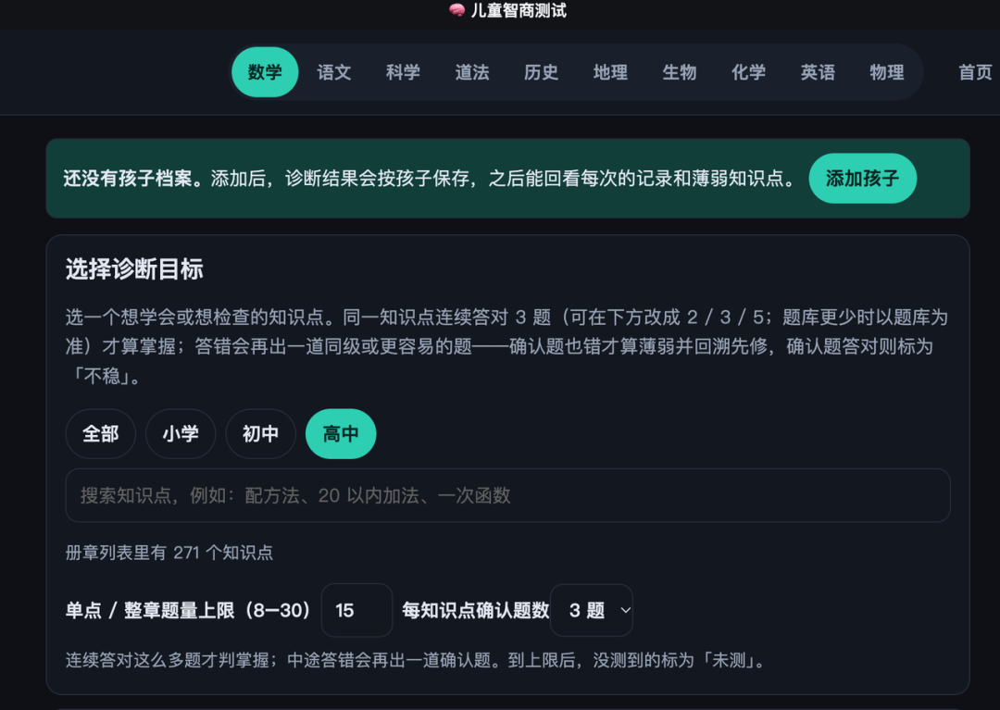
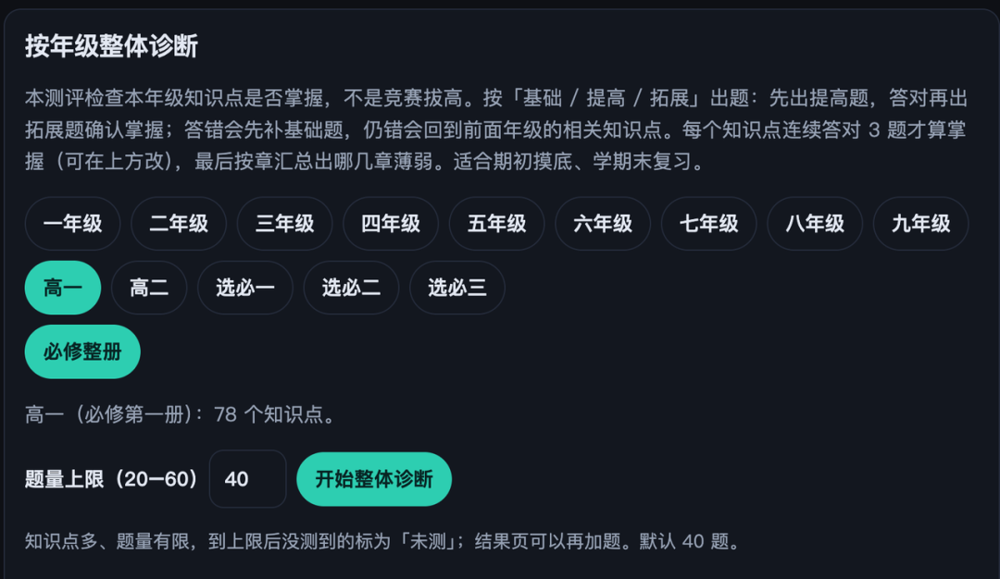
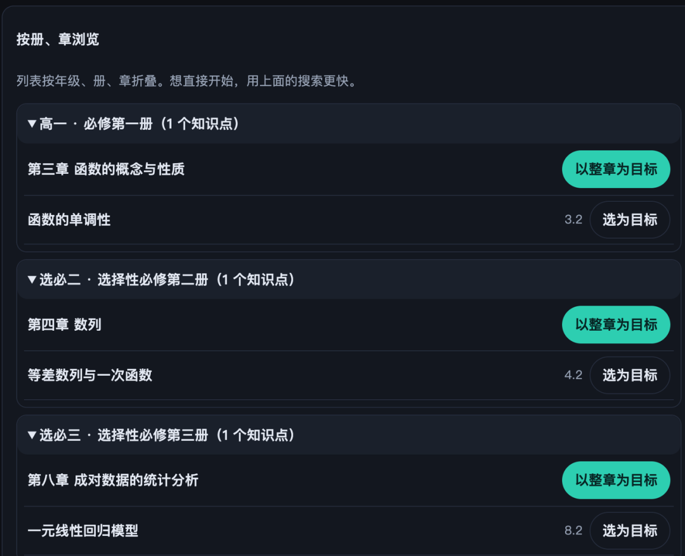
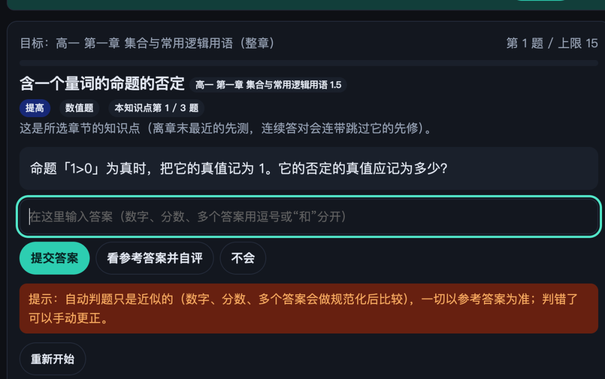
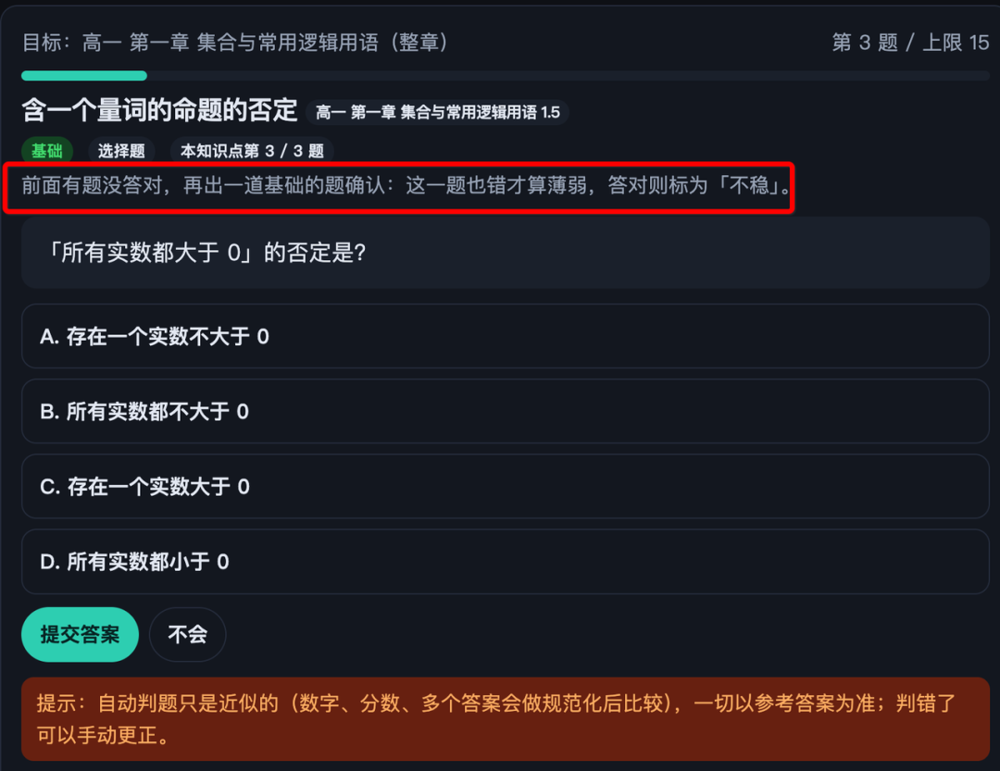
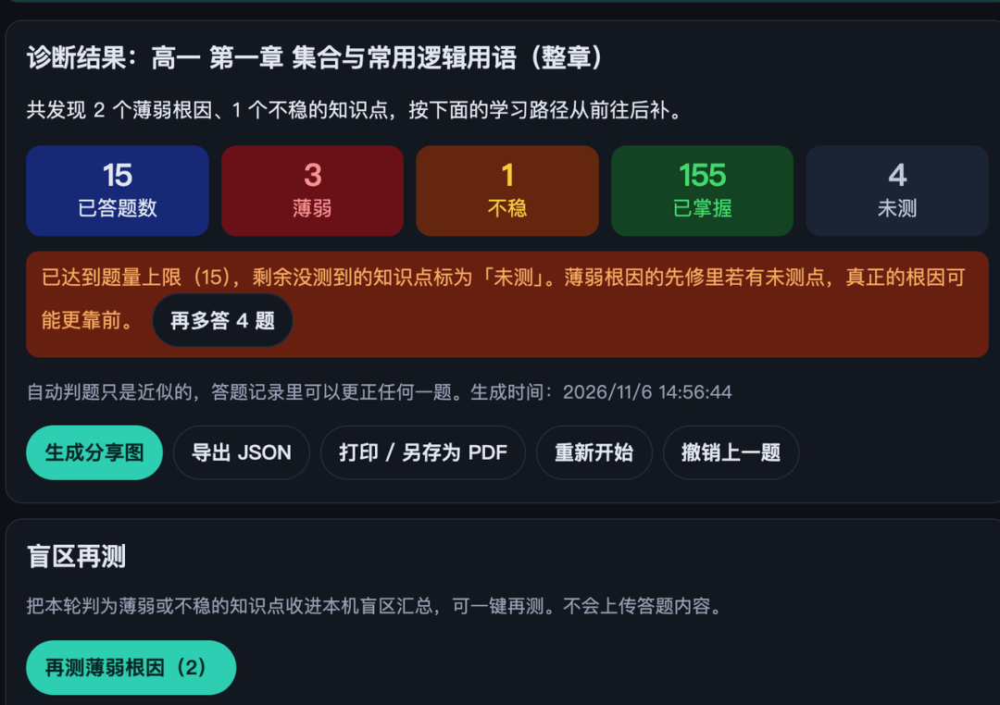
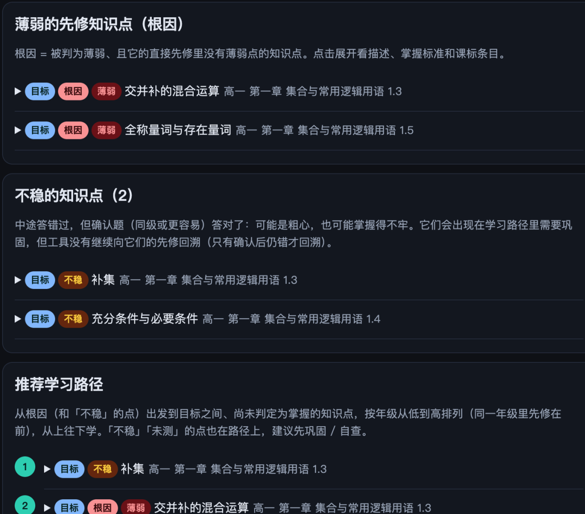
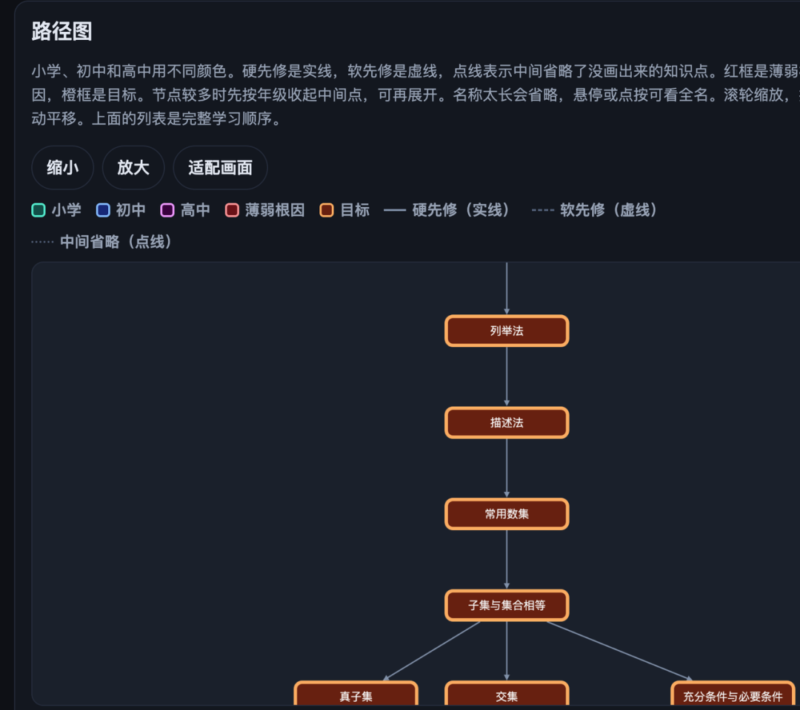

# 推荐1个免费的 K12 教育神器：从小学到高中全学科，终于不用乱花钱报课了
> 💡 备注属性未写入，可能是备注属性名称或者类型被修改了，建议将字段类型设置为 rich_text，可以在小程序-操作-修改文章数据库页面进行调整
> 💡 原文链接:[https://mp.weixin.qq.com/s?__biz=MzIxNzQ0MzkxMw==&mid=2247489210&idx=1&sn=7a06c741edb071e140183bf5f35394d3&chksm=96755c8e48e853dcd64d6985361e9e0a49f50374df4eb7191c3eab3aaef26c41c18b51d5fe2c#rd](https://mp.weixin.qq.com/s?__biz=MzIxNzQ0MzkxMw%3D%3D&mid=2247489210&idx=1&sn=7a06c741edb071e140183bf5f35394d3&chksm=96755c8e48e853dcd64d6985361e9e0a49f50374df4eb7191c3eab3aaef26c41c18b51d5fe2c#rd)
你好呀，我是悠冉，一个正在研究 AI 高效高质量育儿的职场妈妈。家里有个正在上幼儿园中班的男娃。这里记录我真做过的做法、踩过的坑，还有你能直接照抄的步骤。
哇塞，今天有点开心。
刷到一个 GitHub 上的开源项目：
中小学的学科知识图谱，配一套自适应诊断。免费，不用注册，打开网页就能用。
老朋友们都知道，我有个正在老家上高一的小姑子。
哈哈，全家估计就我对她的学习最上心，最近一直在自己手搓一个可以帮助她学习提分的AI工具。
花了不少token，出来的工具始终不如我意。
正愁得发慌的时候，刷到这个开源的工具，和我原先设想的一模一样！
### 它不是普通的刷题工具
GitHub 仓库叫 cn-math-taxonomy，最早只做数学，名字就留下来了。
现在有十个学科：数学、英语、物理、语文、化学、生物、历史、地理，还有小学科学和小学道德与法治。
数学从小学一年级铺到高中选择性必修，870 个知识点、3627 道诊断题。
整个库加起来三千多个知识点、一万三千多道题。
思路和普通题库不一样。
普通题库是：这道题做错了，再推十道同类型的。
它的做法是：这道题做错了，先往回问一层，问上一个概念会不会。
不会，再往回一层。
知识点之间的先后顺序，整理成了 1459 条线，分两种。
hard 是不会 B 就基本学不了 A；soft 是会 B 对学 A 有明显帮助，但不是门槛。
### 第一步，打开网页
地址是 math.pansgo.com，手机和电脑都能打开，不用下载，不用注册。
首页是年级入口和学科标签。
页面会提示添加一个孩子档案，加了以后诊断结果按孩子名字保存，能回看每次的记录。
不建也能用，直接选知识点开始答题。

进来第一屏：选学科、选学段，再选要检查的知识点
### 第二步，选一个知识点，有三个入口
入口一，直接搜。输入「配方法」「一次函数」「20 以内加法」都行。
入口二，按册章浏览。高一 必修第一册 → 第三章 函数的概念与性质 → 函数的单调性。左边是章，右边是节，右侧两个按钮，「以整章为目标」和「选为目标」。
入口三，按年级整册诊断。适合期初摸底和期末复习。
册章列表里写着高中数学一共 271 个知识点，正好是必修 143 加选择性必修 128。
选「高一 必修整册」，会显示这一册 78 个知识点，题量上限可以拉到 40 题。

按年级整体诊断：选一整册，系统挑骨干知识点出题

按册章浏览：和课本目录一致，可以「以整章为目标」，也可以「选为目标」
### 第三步，答题
我试的第一道题答错了。
它没有直接给答案，也没有立刻把这个点判为薄弱。
它换了一道同级或者更容易的题，上面一行红字：「前面有题没答对，再出一道基础的题确认：这一题也错才算薄弱，答对则标为『不稳』。」
一道题答错，可能是手滑，可能是题干没读明白，也可能是当天状态不好。多问一道确认题，成本很低。
判题方式写在每道题下面：自动判题是近似比对，数字和分数会做规范化比较，以参考答案为准，判错了可以手动更正。

可输入答案，也可选「看参考答案并自评」或「不会」

答错之后先出一道基础题确认：红字那一句是这一步的关键
### 第四步，看结果
做完这一章，结果页是：已答 15 道，薄弱 3 个，不稳 1 个，未测 4 个。
薄弱：连续多次答错裁判定为薄弱。
不稳：第一题没答对，确认题答对了。放进路径里巩固，但不继续往回追。
未测：题量有上限，还没轮到的点。

诊断结果：薄弱、不稳、未测三个数字分开算
### 第五步，按路径补
结果页往下是三块。
薄弱清单，点开每一个点，能看到描述、掌握标准和课标条目原文。
不稳的知识点，单独列一块。
推荐学习路径。从根因和不稳的点出发，到目标之间还没判定为掌握的知识点，按年级由低到高排，同一年级里先修在前。
再往下是路径图。小学绿框，初中蓝框，高中紫框；红框是薄弱根因，橙框是目标；实线是硬先修，虚线是软先修，点线表示中间省略了几个知识点。
颜色分开之后，一眼能看出这个窟窿是初中留下的，还是小学留下的。
以我试的这一章为例。高一第一章「集合与常用逻辑用语」，追出两个根因，一个是「交并补的混合运算」，一个是「全称量词与存在量词」。
不是计算出错，是集合这套符号语言没吃透，「所有」和「存在」这两个量词没吃透。
这一章排在必修第一册最前面，看着最简单。可后面的不等式、函数定义域、充要条件，都要用这套语言说话。

每一块都能点开看掌握标准和课标原文

路径图：绿框小学、蓝框初中、紫框高中，红框是根因，橙框是目标
### 第六步，补完再测一次
结果页底部还有两块。
盲区再测。这一轮判为薄弱和不稳的知识点收进本机盲区汇总，一键重测，不上传答题内容。
导出。生成分享图、导出 JSON、打印或另存为 PDF，孩子想做纸质的可以直接打出来。
### 实际使用中的说明
项目说明第一段就写着，未经一线教师审核。
它只是 借助 AI 开发的具，不承诺 100% 正确，在实际使用的过程中，不要完全依赖它，还是需要我们人工参与复核的。
### 最后
我已经迫不及待想等我小姑子放假回来，让她做诊断，找到薄弱点，然后有针对性地学习。
后面她用得怎么样、有没有真补上，我会继续跟，有变化再来写。
如果你对 AI 家庭教育感兴趣，想让自己的孩子接触 AI，或者想自己借 AI 帮孩子学得轻松一点，欢迎来我的 AI 育儿父母圈。好用的工具、我踩过的坑，都会第一时间丢到群里。

