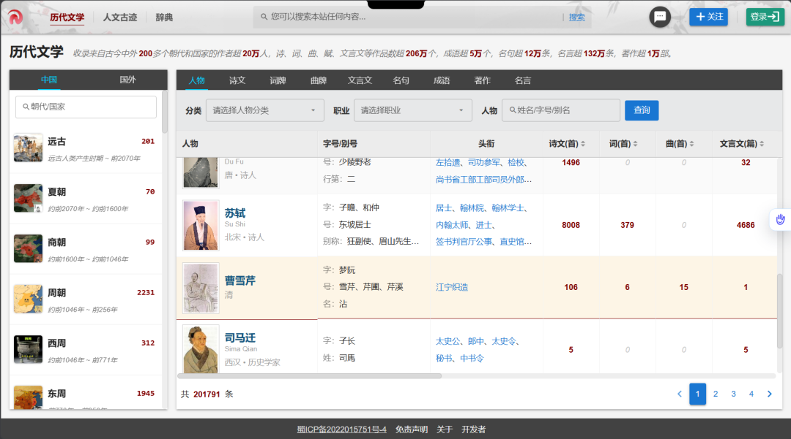
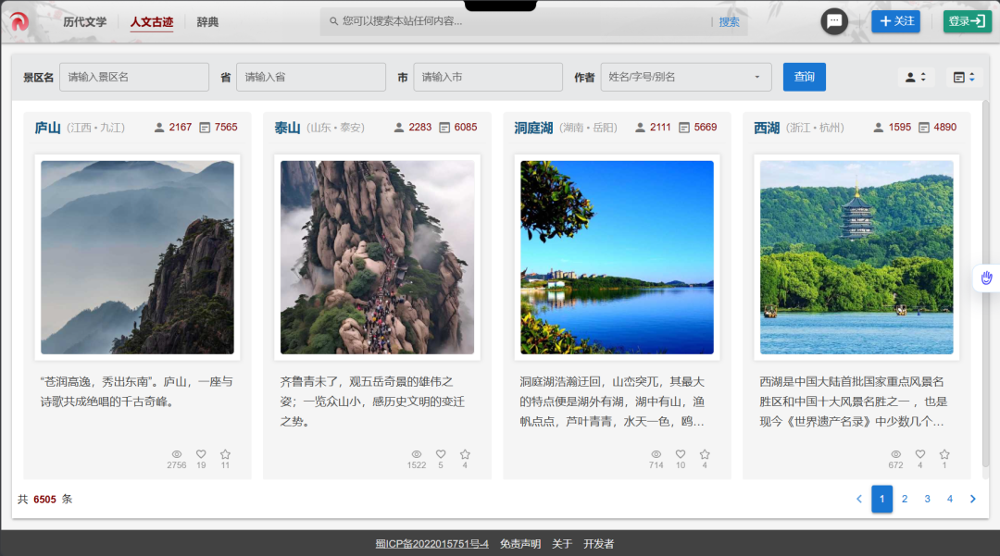

# 推荐1个火爆的免费网站：历代文学网，已收录古诗文超200万篇，古今作者超20万人
> 💡 备注属性未写入，可能是备注属性名称或者类型被修改了，建议将字段类型设置为 rich_text，可以在小程序-操作-修改文章数据库页面进行调整
> 💡 原文链接:[https://mp.weixin.qq.com/s?__biz=MzI4OTc4MDY3Nw==&mid=2247486576&idx=1&sn=006968a87a726d01076d69cdfa4bfe30&chksm=ed0f46ae0a0e2d3986587afee501b425657e881a7344dc0bc4c9dee39bfad4e7427be2ff8325#rd](https://mp.weixin.qq.com/s?__biz=MzI4OTc4MDY3Nw%3D%3D&mid=2247486576&idx=1&sn=006968a87a726d01076d69cdfa4bfe30&chksm=ed0f46ae0a0e2d3986587afee501b425657e881a7344dc0bc4c9dee39bfad4e7427be2ff8325#rd)

两个程序员闷头五年，搭出一座
**免注册、无广告、永久免费**
的线上藏书楼
从先秦到近现代，中国历代诗文为主、兼顾世界文学，按朝代—作者—作品一条线串起来，点开就能读，配译文、注解、名句、成语、词牌曲牌和字典溯源。
### ✨ 核心能力
- **📚 百万级文献规模**：收录作者约 19 万+、诗文作品 180 万~200 万篇量级，诗/词/曲/赋/文言文/著作全品类；成语 5 万+、名句 12 万+、名言 130 万条级素材池
- **🗓️ 朝代树一页纵览**：中国按 46 个历史节点排布，国外按国家/文明切分，下滑不像查资料，像沿着时间河走一遍
- **👤 作者主页很完整**：点“苏轼”能看到生平、字号、官职、家庭成员、轶事典故，以及他名下几千篇作品分体裁归类
- **📖 阅读页带注解**：单篇诗文配创作背景、译文、字词解释、名句高亮，文言文不再“字都认识连起来不懂”
- **🎵 词牌/曲牌工具**：按宫调+曲牌级联筛元曲，查《点绛唇》《沁园春》格律和代表作，写古体诗的人直接当案头工具
- **🏛️ 著作可整本读**：四书五经、二十四史、诸子百家、四大名著、《史记》《神农本草经》《工具论》都有目录导航，像翻书架
- **🗺️ 人文古迹联动**：作者页挂相关古迹地理，读“庐山”顺带看历代题咏，文字和山水连起来

### 🚀 快速上手
1. 浏览器打开网页
1. 首页按「中国历代 / 国外文学」选朝代，或直接在搜索框输半句诗
1. 点作者进主页 → 按诗/词/文/名句切 tab
1. 点单篇看译文注解；点著作进目录逐章读
1. 写东西卡壳了，去「名句」「成语」逛一圈找引文
### 🎯 适合谁
- 中小学生：查课文出处、核对原文、积累名句，比翻教辅快
- 语文老师：备课找拓展素材、讲作者生平、配创作背景，一页全有
- 写作/自媒体人：引古典名句、找成语典故，文章立刻有文化厚度
- 书法/国画/国风创作者：找题跋、落款、意境词句，顺手捞东方美学素材
- 古典文学爱好者：按朝代往下翻，像在时间里散步
- 家长陪娃：晚上挑一首诗，点开就有译文，不用自己先查一遍再教
### ⚠️ 其他
- **公益项目，非官方机构出品**：两个独立开发者自费维护，无公司无团队，定位“永久免费、不靠广告”
- **数据量是“收录级”不是“校勘级”**：篇目极多，但个别生僻文有断句/异文/出处标注误差，写论文、出书前务必回查权威版本
- **版权边界要留意**：内容聚合自公开文献数字化整理，个人学习、教学、引用没问题；**整站搬运、商业化打包、付费课素材**先联系站方确认授权
- **国外文学是补充不是主体**：主干仍是中国历代文学，西文典籍覆盖深度有限
- **无账号同步**：不登录能用大部分功能，但收藏/阅读进度不跨设备，重要篇目自己摘抄或书签
- **规模数字各渠道口径不一**：不同文章写 180 万/187 万/200 万+，以站内实时检索结果为准，别拿某个数字当硬指标
### 访问链接
> 🔗 官网： https://www.lidaiwenxue.com
> 
⭐ **把链接收藏到浏览器书签，今晚挑一个朝代往下翻十分钟；写文案卡词儿的时候，先来名句页逛一圈，比刷热搜有味道～**
#历代文学网 #古典文学 #诗词检索 #在线古籍 #公益网站 #国学工具 #朝代树 #国风创作 #免费书库
** / / / 往期精选 / / /**
1. [我是如何利用RPA批量给微信(群)发消息的](http://mp.weixin.qq.com/s?__biz=MzI4OTc4MDY3Nw%3D%3D&mid=2247485222&idx=1&sn=1aa04ee843d475de07dfa761fa1d117f&chksm=ec28a18cdb5f289ab78c5eef4f183d20d9351c0a64240062a045816e443dc88c75b550d8209f&scene=21#wechat_redirect)
1. [【零代码】实现滑动验证码的处理](http://mp.weixin.qq.com/s?__biz=MzI4OTc4MDY3Nw%3D%3D&mid=2247485207&idx=1&sn=94fec9b76cdc6b01a19d97ee62103d61&chksm=ec28a1bddb5f28ab111e64621baaaf3a92ea47af55b72ed7b13f4b5b31cf7e69a2cf0f764b6b&scene=21#wechat_redirect)
1. [推荐1个高考真题下载神站，网友：别让我看见！！](https://mp.weixin.qq.com/s?__biz=MzI4OTc4MDY3Nw%3D%3D&mid=2247486326&idx=1&sn=1c2bb70cf02881292531374b3bbd350e&scene=21#wechat_redirect)
1. [推荐1个专治C盘飘红的磁盘清理神器](https://mp.weixin.qq.com/s?__biz=MzI4OTc4MDY3Nw%3D%3D&mid=2247486371&idx=1&sn=19e0d188a2add123a21903c830e8639c&scene=21#wechat_redirect)

👇点此观注，带你起飞👇
©版权归原作者所有，欢迎分享、点赞、收藏
