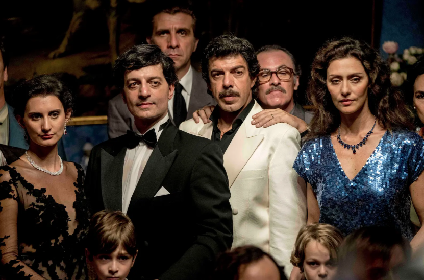
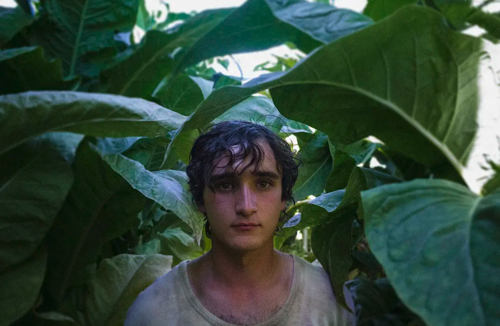
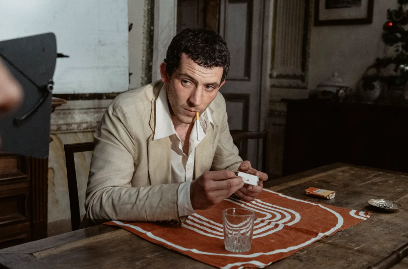
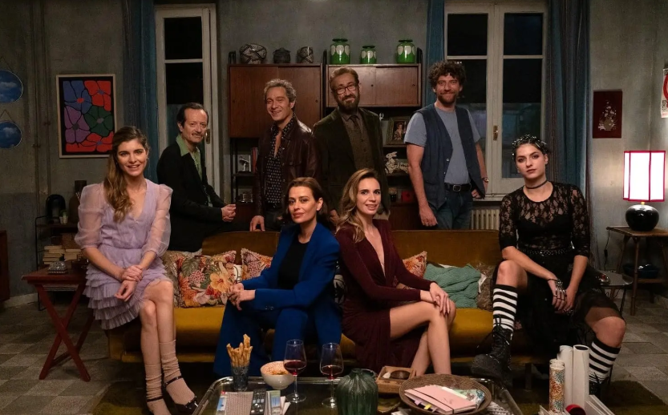
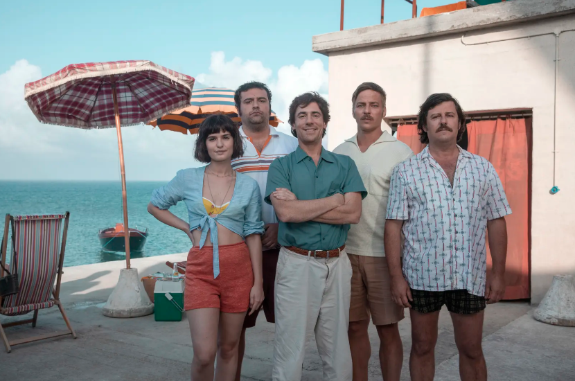
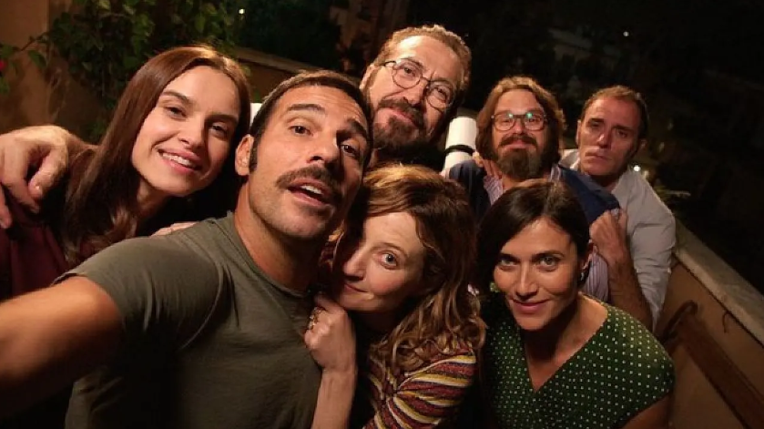

# 推荐近十年必看的10部意大利电影，喜剧、黑帮、魔幻、爱情全齐了
> 💡 备注属性未写入，可能是备注属性名称或者类型被修改了，建议将字段类型设置为 rich_text，可以在小程序-操作-修改文章数据库页面进行调整
> 💡 原文链接:[https://mp.weixin.qq.com/s?__biz=MzkxODY0MjU4Nw==&mid=2247514051&idx=1&sn=0f36e2fa4494b9ec8ebe176626d6faa8&chksm=c076c5950f5e3dae82093c954ca38e16cb0e4d6550405cc648dc275eb89524bca3bb866fe03b#rd](https://mp.weixin.qq.com/s?__biz=MzkxODY0MjU4Nw%3D%3D&mid=2247514051&idx=1&sn=0f36e2fa4494b9ec8ebe176626d6faa8&chksm=c076c5950f5e3dae82093c954ca38e16cb0e4d6550405cc648dc275eb89524bca3bb866fe03b#rd)
提到意大利电影，你脑子里蹦出来的是什么？
最近十年的意大利电影，可能会给你不一样的印象。
他们从来不只拍浪漫，拍的是体面地崩溃、笑完有点疼、看完不想说话。
**下面推荐近十年值得一看的意大利电影**，你觉得还有哪些值得推荐，欢迎补充。
## 1、《我去哪儿？》（2016年）
豆瓣评分：8.1
评价人数：2.2万

**意大利**现象级喜剧，**当年成为意大利影史票房冠军。**
一部**用喜剧，解剖意大利国民性**的电影。
公务员切科，为了保住自己的“铁饭碗”，接受调令，从北极科考站到黑手党老巢。
他只想不失业，结果把整个官僚体系搅成了一锅粥。
## 2、《叛徒》（2019年）
豆瓣评分：7.2
评价人数：7千

马可·贝洛基奥，83岁拍出的晚年力作。
获得戛纳金棕榈奖提名，**代表意大利角逐奥斯卡最佳国际影片。**
西西里黑手党头目托马索·布塞塔，在家人被杀后，选择妥协。
在长达400天的庭审中作证，直接导致338名黑手党成员被判刑。
他背叛了组织，但坚称“从未背叛西西里”。
## 3、《幸福的拉扎罗》（2018年）
豆瓣评分：8.5
评价人数：12.8万

阿莉切·罗尔瓦赫尔执导的奇幻题材，**获得戛纳电影节最佳编剧奖。**
与世隔绝的封建庄园里，纯真到近乎圣愚的农民拉扎罗，和年轻贵族坦克雷迪成为朋友。
一次意外让拉扎罗，从1970年代“穿越”到现代都市。
他依然是那个拉扎罗，但世界已经不再需要圣人了。
## 4、《奇美拉》（2023年）
豆瓣评分：7.7
评价人数：3万

**戛纳电影节主竞赛单元金棕榈奖提名。**
1980年代的托斯卡纳，英国考古学家亚瑟，拥有一种通灵能力，能感知地下埋藏的文物。
他混迹于盗墓团伙中，一边挖掘古墓，一边寻找失踪的恋人。
导演阿莉切·罗尔瓦赫尔（《幸福的拉扎罗》），延续了她标志性的魔幻现实主义，一部关于**欲望**的寓言。
## 5、《关于约会的一切》（2025年）
豆瓣评分：8.1
评价人数：8.3万

Netflix出品，《完美陌生人》导演保罗·杰诺维塞执导。
2025年的罗马，一个怕穷、怕被绿的戏精男，和女神的一场世纪约会。
他的内心，分裂出五个小人吵架，在“我想要”和“我装的”之间反复横跳。
约会变成了一场，关于表演、谎言和自我欺骗的极限测试。
## 6、《马丁·伊登》（2019年）
豆瓣评分：7.9
评价人数：1.9万

改编自杰克·伦敦的同名小说，却拍出了一股**意大利新现实主义的魂**。
粗野的水手马丁·伊登，爱上了富家小姐伊琳娜。
为了配得上她，他开始疯狂阅读、写作，试图跨越阶级的鸿沟。
但他成功之日，也是他失去一切之时。
男主角卢卡·马里内利，在威尼斯电影节上，击败了《小丑》的杰昆·菲尼克斯，**拿下威尼斯影帝。**
## 7、《玫瑰岛的不可思议的历史》（2020年）
**豆瓣评分：8.0**
**评价人数：4.8万**

Netflix出品。
一部**浪漫到不真实的荒诞喜剧**，但它是真事。
1960年代，意大利工程师乔治·罗萨，在亚得里亚海上建造了一座人工岛，宣布独立建国，以对抗官僚主义。
这座“玫瑰岛”，吸引了全世界的目光，最终被意大利政府摧毁。
## 8、《还有明天》（2023年）
豆瓣评分：9.3
评价人数：39.5万

意大利国宝级女演员宝拉·柯特莱西，52岁转型导演的处女作。
**并且由她自编自导自演，该片斩获意大利年度票房冠军。**
1946年的罗马，家庭主妇迪莉娅，每天在琐碎的家务中醒来。
她收到一封信，所有人都以为那是情书，是私奔的邀约。
直到结尾才发现，那是一张选民证，意大利女性有史以来，第一次投票的资格。
## 9、《请以你的名字呼唤我》（2017年）
豆瓣评分：8.8
评价人数：84.3万

**奥斯卡最佳改编剧本**，最佳影片、最佳男主角等四项提名。
1980年代意大利北部，17岁的少年艾利欧，在自家别墅度夏，遇到了来帮父亲做研究的研究生奥利弗。
那个夏天，两个人之间发生了一段短暂、炽烈、注定要成为回忆的感情。
卢卡·瓜达格尼诺把一部同性爱情片，拍成了**关于“夏天”本身的电影**。
## 10、《完美陌生人》（2016年）
豆瓣评分：8.5
评价人数：55.2万

**该片被全球超过20个国家翻拍。**
七个好友在月食之夜聚餐，有人提议玩一个游戏：所有人的手机收到任何消息、来电，都要公开分享。
一顿饭的时间，所有人的秘密，被一条条短信和一个个电话撕开。
它用一个极简的设定，拍出了**数字时代最恐怖的惊悚片**。
全文完。
