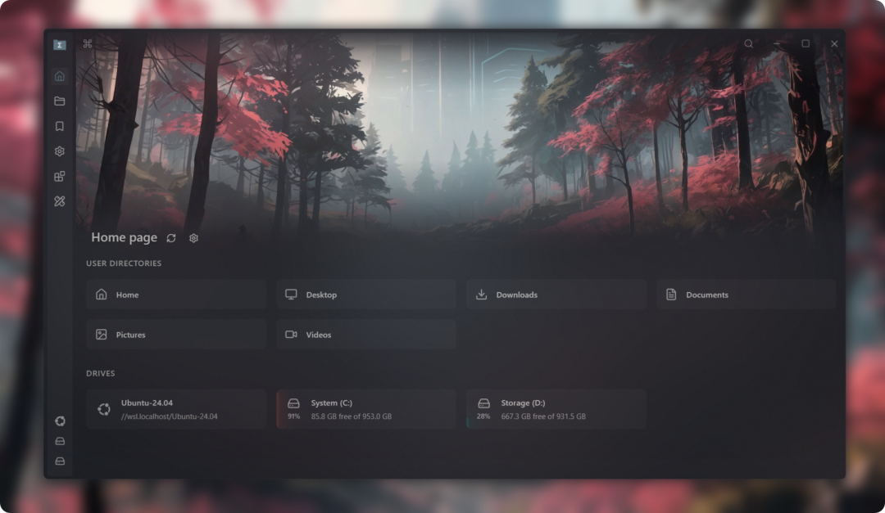
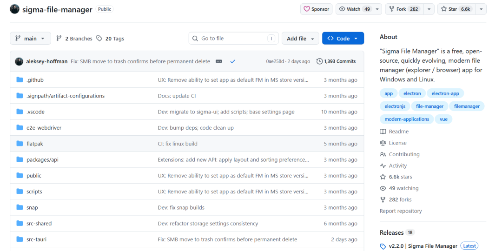
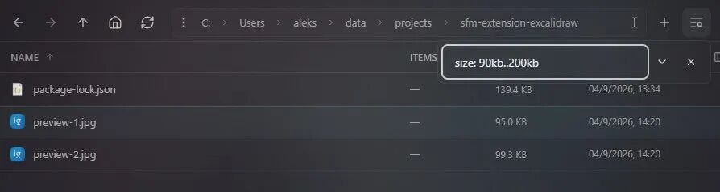
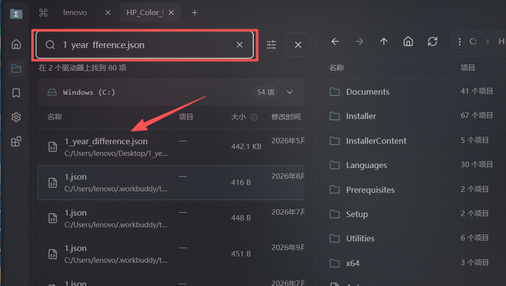
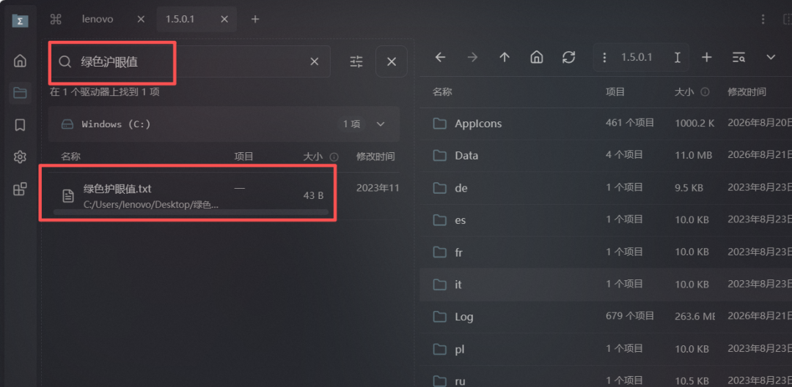
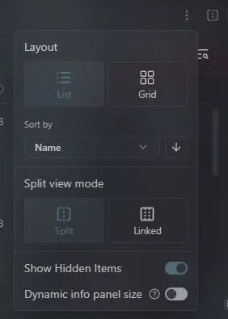
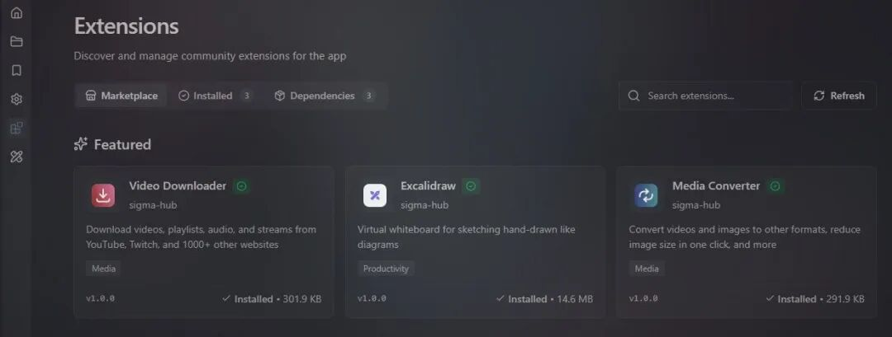
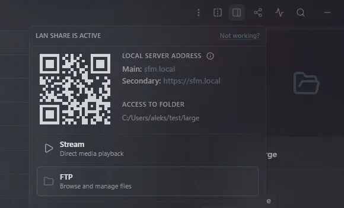
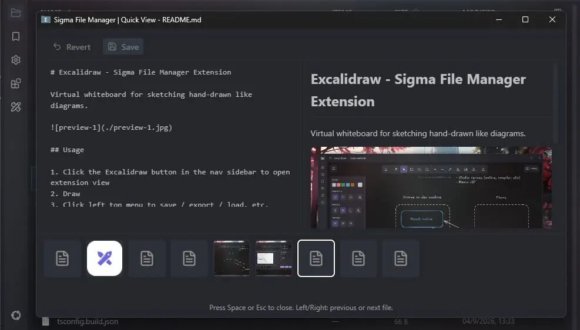
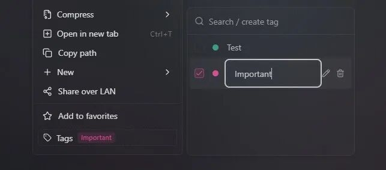

# 搜 1TB 只要 2 秒，打错字也能搜？这项目有点猛！
> 💡 备注属性未写入，可能是备注属性名称或者类型被修改了，建议将字段类型设置为 rich_text，可以在小程序-操作-修改文章数据库页面进行调整
> 💡 原文链接:[https://mp.weixin.qq.com/s?__biz=MzkwNzU4NTMyMA==&mid=2247509007&idx=1&sn=feb10a9fc28e92b2648642c4f1e78232&chksm=c1ff930e61375065072925ce294125c0200dc6de00cf3e47ca1fe7dfd39fcddbdecf5c9e4939#rd](https://mp.weixin.qq.com/s?__biz=MzkwNzU4NTMyMA%3D%3D&mid=2247509007&idx=1&sn=feb10a9fc28e92b2648642c4f1e78232&chksm=c1ff930e61375065072925ce294125c0200dc6de00cf3e47ca1fe7dfd39fcddbdecf5c9e4939#rd)
* 戳上方蓝字“**开源先锋**”关注我
大家好啊，我是开源君！
有个软件你每天都用，但是估计从来没想过要换掉它 - **文件管理器**。
出厂自带，免费，能用——所以大多数人默认「文件管理器就该长这样」。
但有些时候也非常的抓狂：记得文件名却搜不出来；想在两个目录间拷东西，只能开两个窗口来回拖；只是瞄一眼 PDF，却得等一个笨重阅读器慢慢启动。
虽然都不是什么大问题，但就是硌得慌。
Github上一位叫 Aleksey Hoffman 的开发者不想再忍，于是写了个开源替代品 - `Sigma File Manager`。

### 项目简介
`Sigma File Manager` 是一款免费、开源、更新很快的现代文件管理器，支持 Windows 和 Linux（macOS 可自行编译）。
它的定位就是做一个更好用、更好看的"资源管理器"。

亮点功能包括：
- 全局搜索很快，还自带纠错
- 标签页、分屏，多任务操作更顺手
- 内置局域网共享，不用再借助第三方工具
- 有扩展市场，功能可以按需增加
技术上采用的是 Electron + Vue + TypeScript 的组合。Electron 负责跨平台外壳和 Node 侧的文件系统能力，Vue 负责界面。
搜索之所以能做到秒级，靠的是自建索引加容错匹配，而不是临时遍历目录。
目前在 GitHub 已经收获了**6.5K Star**，非常受欢迎。

### 功能特性
#### 01 打错字也能搜到的全局搜索
这是我认为最值钱的一个功能。
官方的说法是：搜索一整块 1TB 硬盘，大约 2 秒。

更狠的是它的容错。拼错字母、大小写不对、词序颠倒、少打了几个字、漏了扩展名——它都能给你找出来，中英文都支持。


#### 02 标签页 + 分屏双栏
多标签不用多说，浏览器怎么用，这里就怎么用。
真正好用是分屏：任意一个标签页都能拆成左右两栏，两边独立导航，拖一下就把文件传过去了。
整理照片、合并两个项目的素材时，这个设计能省掉一半的切换动作。

#### 03 内置扩展市场
Sigma 内置了一个扩展市场，装完就能用，不用自己翻 GitHub 找插件。
扩展能加命令、加页面、加快捷键、加设置项。官方提到的几个：视频下载（支持 1000+ 站点，含 YouTube、Twitch）、媒体格式转换、图片体积压缩。
一个文件管理器，顺手把下载和转格式也干了。

#### 04 局域网共享，扫码就能传
同一 WiFi 下，把文件共享出去，对方用浏览器打开地址就能下载，或者扫二维码。
也支持 FTP。
手机和电脑之间传文件，不用再装一堆互传 App，也不用数据线。

#### 05 空格键快速预览
选中文件，按一下空格，直接预览。
图片、视频、音频、PDF、文本文件都支持，还能接着用方向键往下翻。
不用再等某个笨重的阅读器慢慢启动。

#### 06 标签与仪表盘
给文件和文件夹打标签，用颜色标记，比一层层建目录灵活得多。
仪表盘那一页集中了收藏、标签文件、最常访问的位置和历史记录，相当于一个私人导航台。
顺带一提，它还支持自定义背景图、视频壁纸、透明度和混合模式——是的，文件管理器也能很好看。

除此之外还有：地址栏自动补全、glob 与属性过滤器、命令面板、zip 压缩解压、WSL 目录直读、多语言、应用内更新。在 Windows 上，它甚至可以直接顶替资源管理器的大部分日常操作。
### 快速安装、使用
**Windows，推荐一行命令：**
```
winget install sfm

```
也可以去 Microsoft Store 搜「Sigma File Manager」，或者从 Releases 页下载 exe 安装包（未签名，可能会被杀软误报）。
**Linux：**
```
# Flatpak
flatpak install ./Sigma-File-Manager-*-linux.flatpak

# Snap
sudo snap install sigma-file-manager --edge

```
另外还有免安装的 AppImage 版本，下载下来给执行权限就能跑。
**macOS：** 官方没有提供编译好的包，需要自己按 CONTRIBUTING 文档从源码构建。
**上手三步：**
1. 装好后先打开设置，把它设为默认文件管理器（Windows）
1. 按  试试快速预览，按  之类的快捷键唤起命令面板
1. 去扩展市场逛一圈，装个顺手的
上手成本不高，界面逻辑和常见文件管理器一致，摸十分钟就能顺起来。
### 开源君想说
每天花在"找文件、传文件、切窗口"上的时间真的很多。
`Sigma File Manager` 把搜索、分屏、预览、共享这些高频操作，都做得顺手了一些。
如果你正好觉得系统自带的文件管理器不够用，不妨装上试试，说不定会有点小惊喜。
```
https://github.com/aleksey-hoffman/sigma-file-manager

```
推荐阅读：
[1.8万star！这个神级 Skills，直接让 AI 学会画 CAD！](https://mp.weixin.qq.com/s?__biz=MzkwNzU4NTMyMA%3D%3D&mid=2247508871&idx=1&sn=6485be65b7e277c5c23be45714a42e03&scene=21#wechat_redirect)
[跨平台的WiFi安全工具，终于有了！](https://mp.weixin.qq.com/s?__biz=MzkwNzU4NTMyMA%3D%3D&mid=2247508880&idx=1&sn=55c707a1e9c2363b083de795a0d88f67&scene=21#wechat_redirect)
[有人用Claude重写PS，几天就拿下3万Star了！](https://mp.weixin.qq.com/s?__biz=MzkwNzU4NTMyMA%3D%3D&mid=2247508896&idx=1&sn=73464dcb890b7bf47165bb64a86feb7a&scene=21#wechat_redirect)
[5 万 Star ！号称逆向任何东西，太猛了吧！](https://mp.weixin.qq.com/s?__biz=MzkwNzU4NTMyMA%3D%3D&mid=2247508915&idx=1&sn=c1cea804836c7e8061ebb131f938bf0a&scene=21#wechat_redirect)
[那个重写 PS 的团队，又盯上了 AutoCAD！](https://mp.weixin.qq.com/s?__biz=MzkwNzU4NTMyMA%3D%3D&mid=2247508970&idx=1&sn=a07e6f76e06f3d9b3432150c116205eb&scene=21#wechat_redirect)
[又一个宝藏画图 Skill，329 种画风，像翻字典一样用！](https://mp.weixin.qq.com/s?__biz=MzkwNzU4NTMyMA%3D%3D&mid=2247508991&idx=1&sn=be12f14d4eafe87a6ff2aa307101c9b1&scene=21#wechat_redirect)

## 摘要

（待补充）

## 我的笔记

（待补充）
