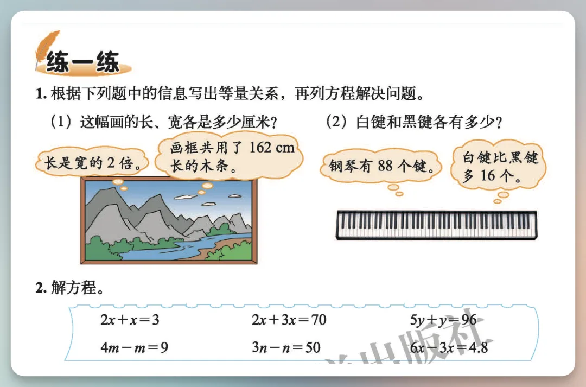
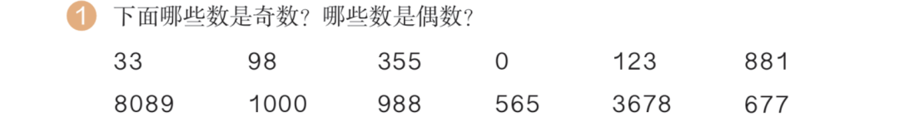
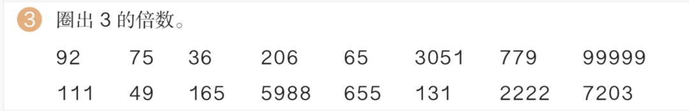
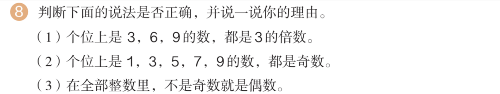
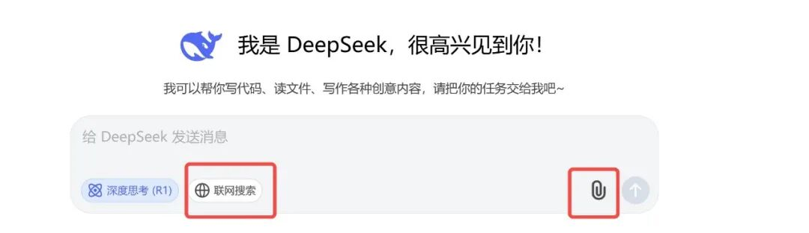
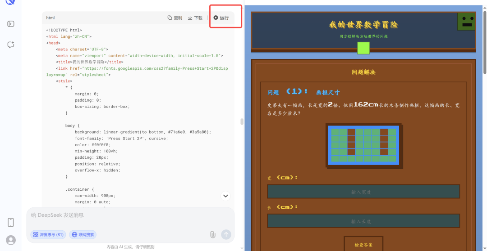
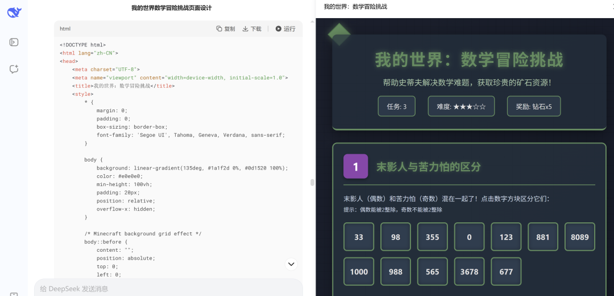
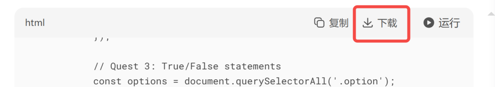

# 搞定“学习困难户”！用DeepSeek把小学数学题变成了游戏，效果惊呆了！
> 💡 备注属性未写入，可能是备注属性名称或者类型被修改了，建议将字段类型设置为 rich_text，可以在小程序-操作-修改文章数据库页面进行调整
> 💡 原文链接:[https://mp.weixin.qq.com/s?__biz=MzU4MDgyNTEyNw==&mid=2247487525&idx=1&sn=8ddb1c7a2a0d209054aa5355c992cad4&chksm=fc68e25b92e3dc6cbcc42675257da73bd129e8f341b2adbefb244635a437591ab09838fd3878#rd](https://mp.weixin.qq.com/s?__biz=MzU4MDgyNTEyNw%3D%3D&mid=2247487525&idx=1&sn=8ddb1c7a2a0d209054aa5355c992cad4&chksm=fc68e25b92e3dc6cbcc42675257da73bd129e8f341b2adbefb244635a437591ab09838fd3878#rd)
大家好，我是TFS-Boy(脱发小青年)
。
最近跟家里人聊天，说起小朋友抗拒学习，写作业老是磨磨蹭蹭的事儿，可是让大人们伤透了脑筋。
其实想想也好理解，学习本身就是一件逆人性的事。
我们成年人有时候要看个书学个习啥的，就很难坐得住，更不用说天性爱玩的小朋友。
近些年，很多组织或者机构在倡导把学习娱乐化，游戏化，以此让小孩爱上学习。
但说实话，这些支出成本最终还是落到了家长头上。
现在不一样了，有了AI，我们可以0成本去做这些事。
我受“向阳乔木”老师的启发，用DeepSeek把小学数学练习题变成了“我的世界”游戏，操作很简单，效果却非常nice。
**效果展示**
原题：

游戏化后的效果：
原题（多道数学题）：



游戏化后的效果：
DeepSeek既能生成数学题的网页游戏，又能充当老师判题，还能给出解释，这释放了家长多少的时间呀，酷！
接下来，我们就一起动手生成这样的游戏效果。
**动手实践**
首先要找题目的图片来源，我上面用的这些题目，都可以在这个网址中找到：
```bash
https://github.com/TapXWorld/ChinaTextbook/tree/master
```
这里面包含了国内所有小初高、大学PDF教材，可以说很良心了。
如果访问网址不太稳定，家长朋友们也可以用手机拍孩子的教材，图片清晰一点就行。
然后，打开DeepSeek，把刚刚选好的图片上传上来。

注意，如果使用文件上传功能，就需要关闭联网搜索。
接下来，在输入框里粘贴下面的这段提示词：
```css
把这个题目改成“我的世界”主体，并变成一个互动单页HTML，图片用CSS模拟，
不要引用第三方图片网站。
```
这里的HTML、CSS，是生成电脑可视化网页的基础元素。
您不理解也没关系，照搬就行，DeepSeek会自动处理，生成代码。
等待DeepSeek给出结果后，您会在结果这里看到一个运行按钮（目前只有电脑版有，手机版没有）。

点击运行，就可以在右侧看到预览效果。
这时候，一个数学题小游戏就做好了，而且可点击，可使用，是不是非常友好。
当然，我们还可以优化一下。
因为老师布置作业的时候，通常是随机圈选多道题目，我们可以把这几道同时上传给DeepSeek，然后修改成下面的提示词：
```css
把这些题目合并，改成“我的世界”主题，并变成一个互动单页HTML，
图片用CSS模拟，不要引用第三方图片网站。
```
等待结果生成后，便可以直接点击运行预览。

如果有的朋友说，我不想每次使用都打开DeepSeek, 而且想要全屏展示，那该怎么办？
简单！

您直接点击代码下载，保存成本地文件，然后双击就可以用默认浏览器打开了，您也可以把文件发给亲朋好友一起使用。
注意：文件名的后缀一定要是.html，不能修改，否则不能运行。
如果在手机浏览器上打开这样的文件，可能会有排版错乱的问题。
不过，您可以告诉DeepSeek，让它把排版做成手机浏览友好的样式。
```
我有在手机上预览的需求，把上面的页面样式做成手机电脑通用预览的。
```
**写在最后**
好了，以上就是本期的全部内容，操作起来其实非常简单，轻松就能上手。
您不需要掌握多么高深的技术，也能做出令人惊艳的效果，这就是AI的魅力。
所以，与其焦虑被AI取代，不如早日上手去解决实际的问题。
而技术平权，也从未像今天这么显著。
想想看，即使是世界首富，现在能用到的AI工具和我们普通人也并没有本质的差距。
具体到AI赋能教育，孩子们能否更好地掌握AI，关键其实在家长身上。
希望您成为孩子在AI使用之路上的榜样，加油，共勉！
