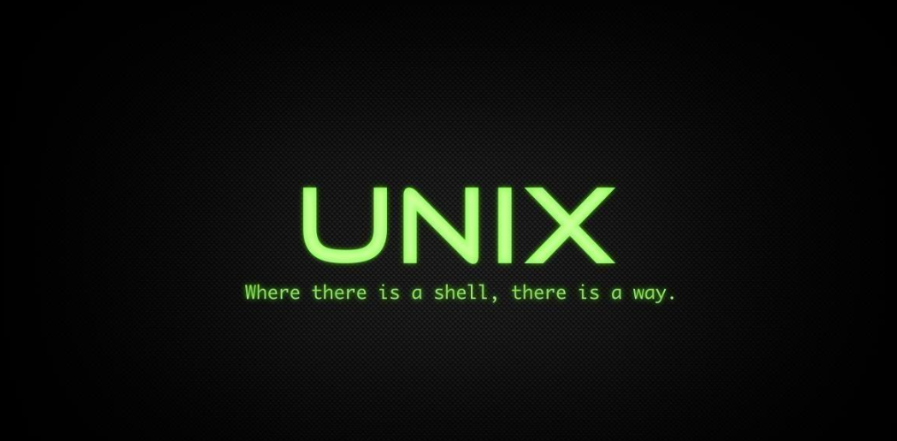
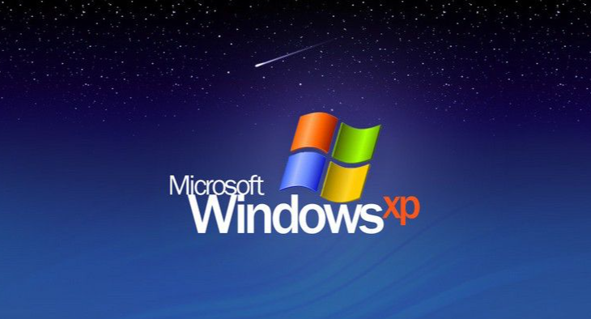
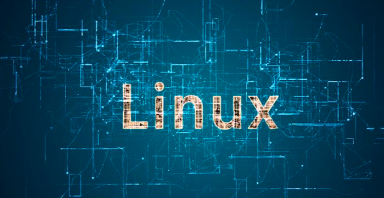
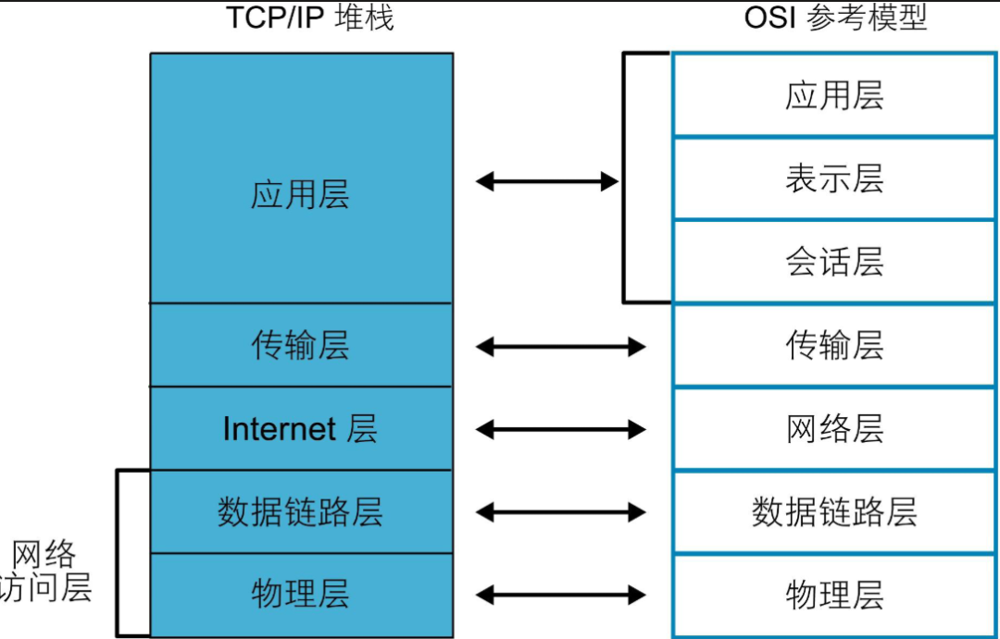
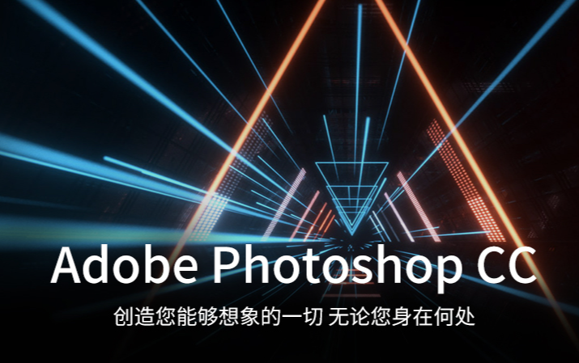
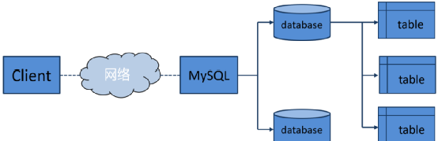
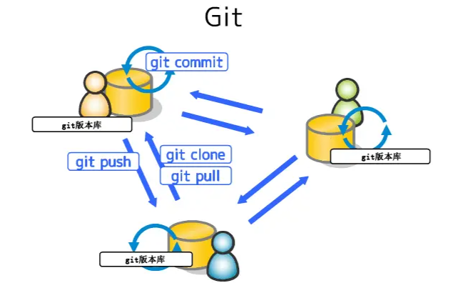
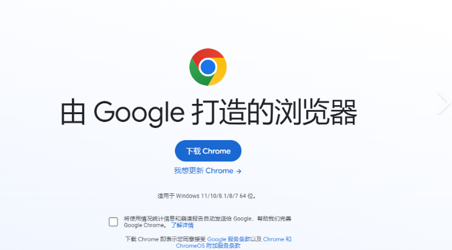
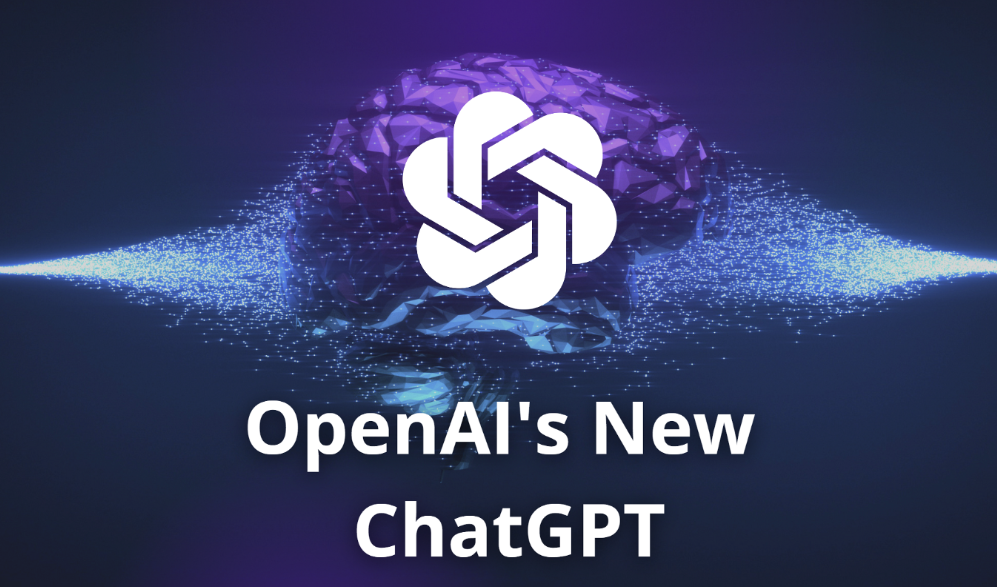

# 改变世界的十大软件
> 💡 备注属性未写入，可能是备注属性名称或者类型被修改了，建议将字段类型设置为 rich_text，可以在小程序-操作-修改文章数据库页面进行调整
> 💡 原文链接:[https://mp.weixin.qq.com/s?__biz=MzkzNDYzOTMxOA==&mid=2247491219&idx=1&sn=57702e0df60504665e19247f15754ea8&chksm=c3914427de2773c761f829cacccf79a33dcd011cd3082901f47593b7cdda05c4024158cdb8a0#rd](https://mp.weixin.qq.com/s?__biz=MzkzNDYzOTMxOA%3D%3D&mid=2247491219&idx=1&sn=57702e0df60504665e19247f15754ea8&chksm=c3914427de2773c761f829cacccf79a33dcd011cd3082901f47593b7cdda05c4024158cdb8a0#rd)
我们常常惊叹硬件、基建带来的变革，却容易忽略，真正串联起数字时代的，是一款款软件。它们有的改写了办公方式，有的打通了信息边界，甚至重塑了人与人沟通的规则。没有绝对权威的排名，这份清单结合影响力、普及度、行业变革意义整理，或许能看懂数字世界是怎么一步步成型的。
第一，Unix

很多人没直接用过它，但几乎所有现代操作系统都和它脱不开干系。早在上世纪60年代诞生，它确立了文件管理、多用户、多任务这套底层思路，Linux、macOS，还有安卓的内核根基，都源自它的设计哲学。它不面向普通消费者，更像整个互联网、服务器世界的基石，后续几十年服务器、互联网的蓬勃发展，很大程度上建立在它的思想之上。
第二，万维网浏览器（WorldWideWeb）

很多人会混淆互联网和万维网，这款由蒂姆・伯纳斯-李开发的初代浏览器，才是让普通人能看懂网络的起点。在它之前，网络只是科研人员之间传输文本的工具，有了网页、超链接这套机制，信息才可以互相跳转、公开分享。正是它，把封闭的科研网络，变成我们现在熟知的互联网。
第三，MicrosoftWindows

PC时代绕不开的软件。在Windows普及之前，电脑操作要靠枯燥的命令行，门槛高到只有专业人员才能上手。图形窗口、鼠标交互、可视化桌面，这套模式让个人电脑走进千家万户，也催生了无数配套软件、游戏，带动整个PC产业爆发。哪怕现在移动端崛起，它依旧是工业、办公、专业生产领域的主力系统。
第四，Linux

开源世界的标杆。它继承Unix的理念，完全免费开放源代码，任何人都可以修改、二次开发。现在全球绝大多数服务器、云平台、安卓底层，还有超级计算机，跑的基本都是Linux。它没有一家独大的商业公司掌控，靠着全球开发者共同维护，撑起了互联网后端的半壁江山，开源精神也因为它被广泛传播。
第五，TCP/IP协议栈

说它是软件，很多人会觉得陌生，但它就是互联网的通信规则。简单来讲，它规定了数据怎么拆分、打包、跨设备传输，不管电脑、手机，相隔万里，都能按照统一标准收发信息。没有这套协议，不同品牌、不同类型的设备根本无法互通，我们刷网页、发消息、视频通话，全都无从谈起。
第六，Photoshop

它重新定义了图像创作。在PS出现之前，图片修图、创意设计，依靠暗房、手工排版，修改成本极高。它把图像处理搬到电脑上，分层、选区、滤镜这些功能，让修图、平面设计变得可控。广告、摄影、UI、影视后期行业的工作流，全都被它重塑，直到今天，它依然是创意设计领域的标杆工具。
第七，MySQL

一款开源关系型数据库软件。互联网网站、APP都需要存储用户数据、订单、内容，MySQL轻便、稳定、免费，早年大量网站、初创企业首选它搭建后台。从早期论坛、电商网站，到现在很多互联网服务，它默默存储着海量数据，是Web时代最普及的数据底座之一。
第八，Git

开发者圈子里的革命性工具。在Git诞生之前，多人协同写代码很麻烦，版本混乱、修改冲突是常态。它可以记录每一次代码改动，随时回溯版本，支持多人异地协作。现在几乎所有软件项目、开源项目都在用Git，极大降低了协同开发的门槛，推动全球开发者一起共建项目。
第九，Chrome浏览器

它重新内卷了浏览器赛道。早年浏览器臃肿、卡顿、兼容性差，Chrome靠着简洁的架构、稳定的内核V8引擎，大幅提升网页运行速度。后来它的内核被大量浏览器采用，同时推动Web技术飞速发展，网页能承载游戏、复杂应用，网页应用的时代，和它的普及有很大关系。
第十，OpenAIChatGPT

它算是近年颠覆性的代表。在此之前，AI更多是专项工具，翻译、识图各司其职。对话式大模型把自然语言交互带到大众面前，普通人可以用文字调动AI完成写作、梳理思路、写代码、翻译。它带火了生成式AI浪潮，也让各行各业开始思考，人机协作的全新方式，当然，它的边界和风险，也还在持续讨论当中。
