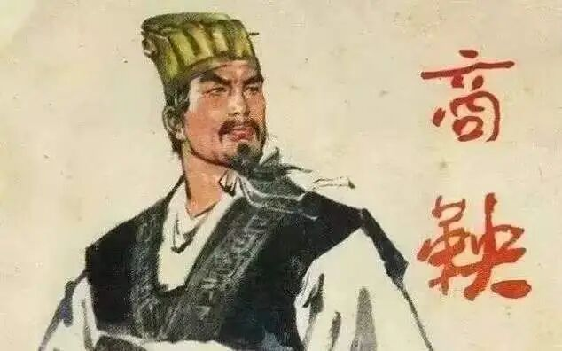
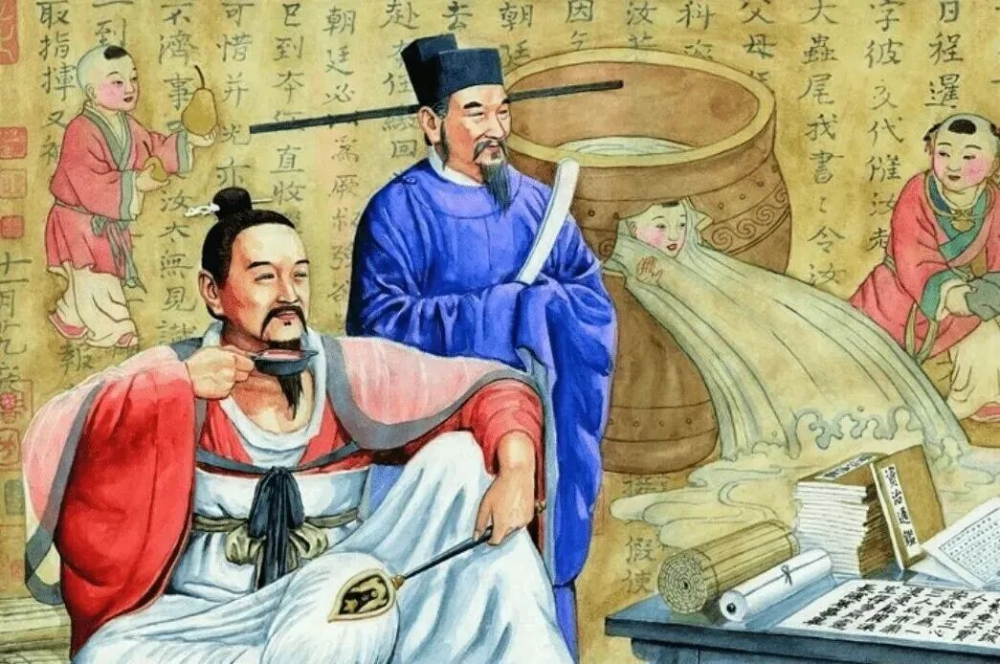
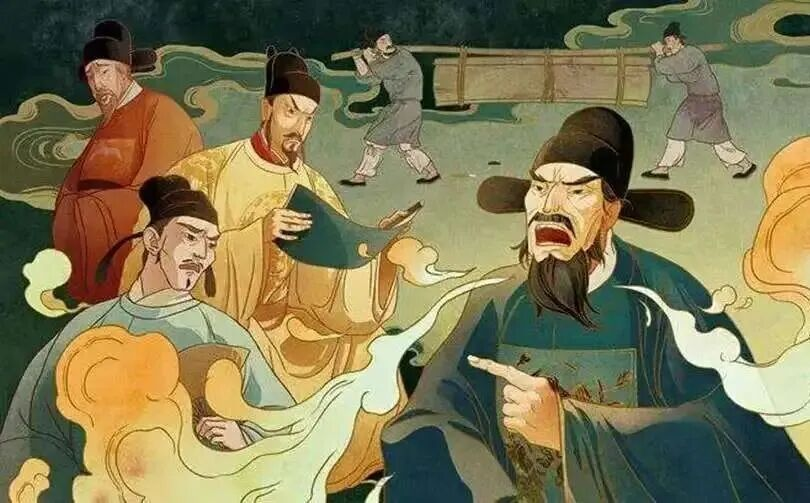

# 改革者的下场：中国三千年财政改革简史，从桑弘羊到张居正，为什么改革家的下场，往往都不太好？
> 💡 备注属性未写入，可能是备注属性名称或者类型被修改了，建议将字段类型设置为 rich_text，可以在小程序-操作-修改文章数据库页面进行调整
> 💡 原文链接:[https://mp.weixin.qq.com/s?__biz=MzkyMDYxODk5Ng==&mid=2247484713&idx=1&sn=6587e1d0162a14387465e3012d277537&chksm=c0dea2c1bc69a26c1294975b1688ee865c3051fc929954974f5bbef55d07d19fb9f074e626a4#rd](https://mp.weixin.qq.com/s?__biz=MzkyMDYxODk5Ng%3D%3D&mid=2247484713&idx=1&sn=6587e1d0162a14387465e3012d277537&chksm=c0dea2c1bc69a26c1294975b1688ee865c3051fc929954974f5bbef55d07d19fb9f074e626a4#rd)
**——点击上方卡片关注我——**
> 前两期我们聊了政府的钱从哪里来、又花到哪里去。评论区有个高赞留言问：账都算得这么明白了，为什么就没有人好好改一改？
> 
> 有的。三千年里，一代一代的能人试着改。而且他们把问题看得比你想象的更透。
> 
> 只不过，这批人的结局，普遍很惨。
> 
**一、先看几张成绩单**
**商鞅**变法，秦国从二流国家变成战争机器，为统一天下铺平道路。他的结局：车裂，五马分尸。
**桑弘羊**，替汉武帝打理盐铁官营，支撑了对匈奴的全部战争开支，不加税而国用足。他的结局：灭族。
**刘晏**，唐代最天才的财政大臣，改革漕运、整顿盐政，安史之乱后硬是把崩盘的帝国财政拉了回来。他的结局：被贬途中赐死，家产抄没，"天下冤之"。
**杨炎**，创立两税法，中国税制史的分水岭人物。他的结局：贬谪途中，被赐死。
**王安石**，发动宋代最大规模变法。他的结局：两次罢相，郁郁而终，身后背负近千年的骂名，《宋史》里一度被写进奸臣传的边缘。
**张居正**，明代最杰出的政治家，一条鞭法为帝国续命几十年。他的结局：死后半年被抄家，长子被逼自杀，全家饿死十余口，本人差点被开棺鞭尸。
看明白了吗？这些人不贪不腐、能力顶配、忠心耿耿，个个都把王朝从财政悬崖边拉了回来。然后，被他们救的那个王朝，处决或清算了他。
这不是巧合。这是制度。

**二、财政改革的本质：从别人碗里抢饭**
要理解改革者的命运，先要理解财政改革到底在改什么。
一个王朝走到中期，财政崩坏的原因，上一篇讲过：支出刚性膨胀，而收入的增长跟不上。但支出膨胀的背后，站着的从来不是抽象的"制度"，而是具体的人——靠军费吃饭的将领、靠编制吃饭的官僚、靠禄米吃饭的宗室、靠免税特权吃饭的士绅。
所以财政改革的全部内容，翻译成大白话就一句话：从这批人碗里，把饭抢回来一部分。
商鞅干的事：废除贵族世袭特权，军功授爵——抢的是老贵族的铁饭碗。所以秦国的宗室贵戚恨他入骨，孝公一死，立刻反攻倒算。
桑弘羊干的事：盐铁收归国营——抢的是地方豪强、诸侯王的暴利产业。所以盐铁会议上一片声讨，霍光顺势借"上官桀谋反案"把他株连灭族。
刘晏干的事：漕运改革，整顿盐政——每一刀都砍在利益集团的供应线上。他倒台，正是因为挡了权相元载一党的财路。
抢人的饭碗，如杀人父母。这个道理，改革者自己都懂。但他们为什么还要上？
**三、改革者是一种"工具人"**
这里就是问题最扎心的地方：改革者本人，往往不是改革的主人，而是执行改革的工具。
真正的操盘手，是皇帝。
皇帝缺钱了，需要一个能臣替他从利益集团嘴里掏钱。这个活儿脏、得罪人、要背锅，所以不能皇帝亲自干——皇帝必须永远正确。于是就有了那个经典分工：皇帝出权，改革者出命。
汉武帝缺钱，桑弘羊设计方案；汉武帝驾崩，桑弘羊被清算。功劳是汉武帝的雄才大略，骂名是桑弘羊的与民争利。
宋神宗想富国强兵，王安石冲锋陷阵；变法遭遇反弹，神宗动摇，第一次罢相。后来神宗后悔了，把王安石请回来；反弹再起，再罢。王安石两起两落，而神宗始终是那个"想用新法但又不想担责任"的皇帝。
张居正更典型。他作为万历的老师兼首辅，替十岁的小皇帝掌了十年国权，考成法、清丈田亩、一条鞭法，刀刀见血。他活着的时候，没人敢动他——因为他就是"皇帝意志"本身。
然后万历长大了。一个从小被这位严师管教的皇帝，积累的不是感激，是怨恨。张居正一死，清算立刻开始：抄家、削爵、子孙流放。而万历清算了张居正之后，自己放弃了张居正的改革，从此怠政三十年，明朝的续命方案被亲手作废。
改革者一死，改革往往人亡政息——这是财政改革最昂贵的隐形成本：它依赖某一个人的能力和权威，而不是制度本身。

**四、为什么连"好结局"都是例外**
三千年里，财政改革者全身而退的，几乎只有一个：管仲。他帮齐桓公搞盐铁官营的雏形（"官山海"）、统一铸造货币，富国强兵，自己也富可敌国，寿终正寝，齐桓公尊他为"仲父"。
为什么管仲可以？因为他是春秋早期，诸侯竞争白热化，齐桓公对他的依赖是全方位的——经济、外交、军事全靠他，动他等于动自己的国本。改革者的安全，来自于不可替代性。
而另一个"成功案例"更值得玩味：雍正。
摊丁入亩（人头税并入土地税，按财产课税）、火耗归公（把灰色收费变成正规财政）、改土归流、士绅一体当差纳粮——这是清代最硬核的财政改革，刀刀砍向既得利益。士绅阶层恨他入骨，民间流传他"谋父、逼母、弑兄、屠弟"的十大罪状，他死后甚至有"被吕四娘刺杀"的野史。
雍正的下场如何？正常死亡，改革成果保留，乾隆全盘继承。
区别在哪？因为雍正自己是皇帝。 改革的最高风险——被皇帝抛弃、替皇帝背锅——对他不存在。他付出的代价是另一重：背负骂名，成为清代口碑最差的皇帝之一。民间说他刻薄寡恩、抄家成瘾，"雍正一朝，无官不抄"。
看，规律闭环了：
- 权臣改革，死于人亡政息：商鞅、桑弘羊、张居正
- 能吏改革，死于政治斗争：刘晏、杨炎
- 皇帝改革，死于身后名声：雍正
在这套体制里，财政改革没有全身而退的选项。你想动整个利益格局，就要准备好被整个利益格局反噬——区别只是反噬你的肉身，还是你的名声。
**五、但制度活了下来**
故事讲到这儿，还差最关键的一层。别光盯着改革家的下场，要看他们留下的制度。
商鞅虽死，秦法不废。商鞅的编户齐民、军功爵制一直运行到秦统一天下——秦惠文王杀商鞅，却把他整套制度全盘保留。人可以死，制度继续杀伐。
桑弘羊灭族，盐铁官营成了此后两千年国家财政的基石。今天的国企、专卖制度，血脉里都有"官山海"的基因。
杨炎赐死，两税法运行了三百年，"量出以制入""户无主客，以见居为簿"——按居住地、按资产课税的原则，直到今天还是税制的底层逻辑。
张居正抄家，一条鞭法活了下来，劳役折银、货币化征税，直接为清代"摊丁入亩"铺了路。
发现那个惊人的悖论了吗：改革者的肉身被清算，恰恰是改革得以保留的条件。
皇帝杀掉改革者，等于把民愤和利益集团的怒火全部引到这个人身上，替改革"付了血债"；血债付完，账平了，制度反而安全落地。商鞅的死，是变法的祭品，也是变法的保险费。
从这个角度说，张居正们未必没有想到自己的结局。这是他们最悲壮、也最清醒的地方：明知下场，仍然动手。

**六、三千年改革史，三句话收尾**
第一句：财政改革从来不是经济问题，是权力问题。 账人人会算，难的是让愿意让利的人让利、让必须出血的人出血。技术方案从来不缺，缺的是能压住利益格局的权力，以及这份权力的持续性。
第二句：改革者的命运，取决于他和皇权的关系，而不取决于改革本身的对错。 商鞅、张居正败在"人亡政息"，雍正赢在"朕即改革"。这就是为什么中国历史上最成功的财政改革，几乎都出自强人之手——不是强人爱好改革，是只有强人改得动。
第三句：评价一个改革者，别看他死得多惨，要看他留下的制度活了多久。 车裂的商鞅赢了，寿终正寝的反对派输了——历史的账本和权力的账本，从来不是同一本。
[上一期（钱都去哪儿了）我们说过：财政崩溃是王朝最诚实的体检报告。](https://mp.weixin.qq.com/s?__biz=MzkyMDYxODk5Ng%3D%3D&mid=2247484687&idx=1&sn=f5dd0a0f7673b013d86ec4c5c70b47d8&scene=21#wechat_redirect)这一期补上后半句：改革者，是这份报告的送信人。治得了病的人，常常治不了自己的命。
下一期，我们聊聊政府缺钱的最后手段——印钱。从董卓的小钱到蒋介石的金圆券，中国两千年通货膨胀史：当政权开始无锚印钞，会发生什么？
✨✨✨✨✨✨✨✨
**点击下方名片⬇️立即关注**
