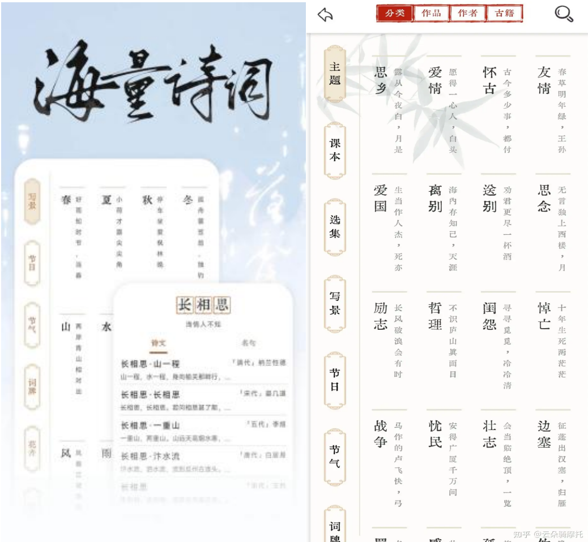
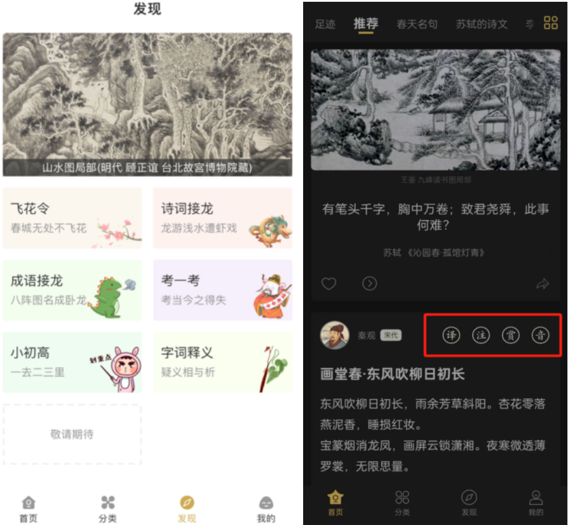

# 教学工具 | 语文老师必备的两款古文学习APP
> 💡 备注属性未写入，可能是备注属性名称或者类型被修改了，建议将字段类型设置为 rich_text，可以在小程序-操作-修改文章数据库页面进行调整
> 原文链接:[https://mp.weixin.qq.com/s/3jhIW6uka_Y1iq0JF7Jxhw](https://mp.weixin.qq.com/s/3jhIW6uka_Y1iq0JF7Jxhw)
点击上方 信息化教学创新 订阅本刊
**未经许可不得转载，若需转载请在后台联系我们**
你是否曾为古文教学的深度与广度而苦恼？是否在寻找一种更高效、更有趣的方式来引导学生们领略古文的魅力？今天，小编要揭秘两款古文学习app，它们不仅能让你的教学如虎添翼，更能激发学生们对古文的热爱与探索欲，感兴趣的话就继续往下了解吧!

**一、长相思**
“长相思”是一款诗词学习APP，专为学生人群、在诗词方面有自我提升需求的用户打造，包含**69万**首诗词及文言文内容。“长相思”不仅收录了**从学前到高中的课本诗词**，也收录了大量**课外名篇**，“长相思”推出全新诗词赏析方式，将诗词动画和原创古风诗词歌曲结合，以娓娓歌声吟唱经典名句，用精美动画还原诗词意境。

**特色功能**
**1**
**诗词收录，覆盖各个学习阶段**

“长相思”书阁内诗词藏品浩如烟海，分门别类，内容解析有条有理。更有海量诗词素材，内容涵盖写作、取名、祝福等。
**2**
**真人朗诵，由画入诗，生字读音不再难**

每首诗都配有真人语音朗读、详细注释、原创插画，从音、意、形三方面帮助您进行诗词学习记忆、赏析。同时，您可与古代诗人点触互动，还有原创诗词动画，让您沉浸式体验古代诗词的意境。
**3**
**零门槛体验，无限次使用**

“长相思”利用图像记忆法联合艾宾浩斯记忆曲线，设计了独特的学习计划版块，掌握自身的记忆规律，养成良好的学习习惯，让诗词学习更加轻松高效！

**二、古文岛**
“古文岛”是一款古文学习APP，无论唐宋元明清，各大诗人之作，皆收录于此。古文岛功能齐全，分类细致，包括名句、诗句、古籍、作者等模块。支持**译、注、赏、背**，让古文阅读不再困难；古文岛app支持**原文线上朗读**，对文言文进行**拼音注释讲解**，使您可以耳听古文之美。

**特色功能**
**1**
**海量古文资源，分类细致**

“古文岛”收录了大量的经典古文，包括《论语》、《大学》、《中庸》、《孟子》等儒家经典，以及《史记》、《资治通鉴》等历史巨著，还有唐诗、宋词、元曲等文学作品。
**2**
**逐句解析，逐字释译**

“古文岛”对每篇古文进行逐句解析，包括译、注、赏、音四个模块，翻译、注释、赏析以及朗读一应俱全，帮助您更全面地理解古文。
**3**
**游戏丰富，互动学习**
“古文岛”提供了丰富的互动学习功能，包括飞花令、诗词接龙、成语接龙、考一考等趣味学习模块，在闲暇之余，您可借此APP学习古文，陶冶情操，提升文学素养。
**4**
**个性化推荐**

“古文岛”根据用户的阅读记录和学习进度，为用户推荐适合的古文篇目，满足不同用户的学习需求。

“
今天小编为您带来的两款APP，期待您的探索，希望能帮助您更好地引导学生们在古文的海洋中遨游，提高古文阅读能力，让古文之美触手可及。如果您有好的古文学习平台，也欢迎在讨论区和我们分享！
“

25个教研应用场景
25个实用技术工具
在线教研干货锦囊
一线教师必备指南

**《在线教研实用指南》**
 京东 👉

搜索《在线教研实用指南》

京东、当当、天猫皆可购买
● 推荐阅读 ●

