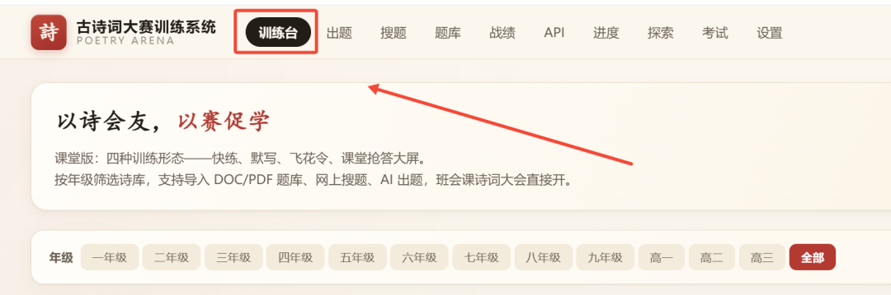
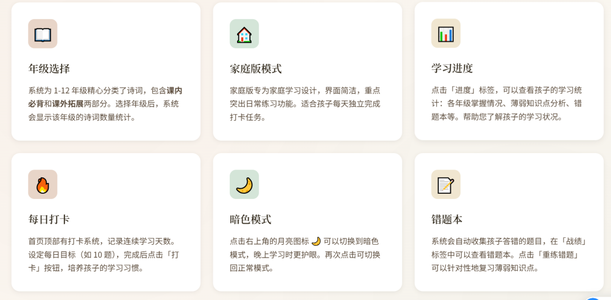

# 教程：2.0版古诗词大赛训练系统
> 💡 备注属性未写入，可能是备注属性名称或者类型被修改了，建议将字段类型设置为 rich_text，可以在小程序-操作-修改文章数据库页面进行调整
> 💡 原文链接:[https://mp.weixin.qq.com/s?__biz=MzAxNzc5MDgyMg==&mid=2649970239&idx=1&sn=bbf16d95f5043bed1234843f424db301&chksm=823350d6473329630b637b24de68f729ff11d2f7f437df183af8145225593305cdeefccd22bc#rd](https://mp.weixin.qq.com/s?__biz=MzAxNzc5MDgyMg%3D%3D&mid=2649970239&idx=1&sn=bbf16d95f5043bed1234843f424db301&chksm=823350d6473329630b637b24de68f729ff11d2f7f437df183af8145225593305cdeefccd22bc#rd)

| **✦古诗词大赛训练系统2.0** |

点左下角的阅读原文，就直接登录
也可以向后台发消息：爱上古诗词
[作文批注助手全新升级，可以一键出讲评PPT](https://mp.weixin.qq.com/s?__biz=MzAxNzc5MDgyMg%3D%3D&mid=2649970102&idx=1&sn=02fc262ed379ca8e48e5fd7f812656e8&scene=21#wechat_redirect)

有以下功能:

> 💡 疑似存在合并单元格，表格内容无法展现（Notion 暂不支持合并单元格）。qid(nMVgBg5R7CRgmbZggqPi8)

1. 鼓励为主：关注孩子的进步，而不是错误。每次完成练习都给予肯定。
2. 一起参与：周末用「课堂抢答」模式，一起玩，让学习变成亲子时光。
3. 循序渐进：不要一开始就设定太高目标，从每天 5 题开始，逐步增加。
4. 注重理解：引导孩子使用「诗词详解」和「诗人年谱」，理解诗词背后的故事。
5 .定期回顾：每周查看「进度」页面，了解孩子的学习情况，及时调整计划。
