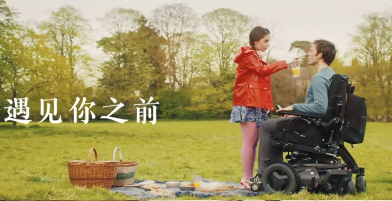
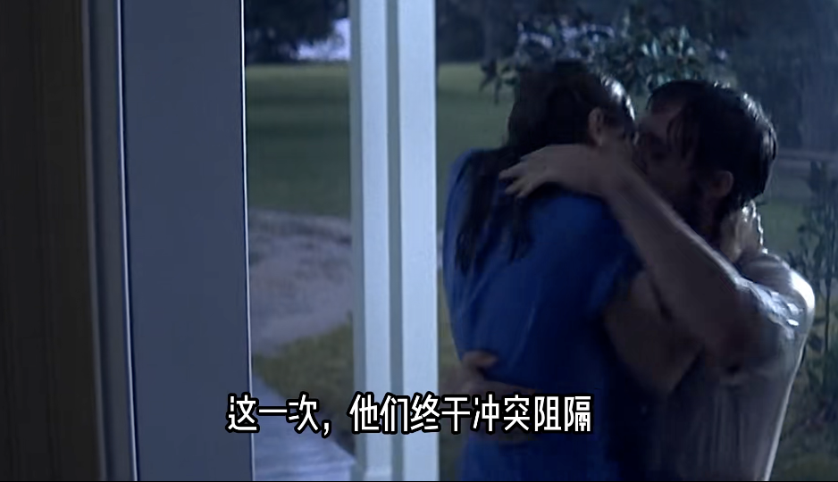
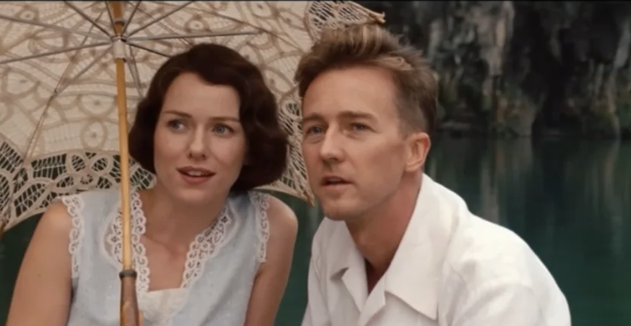
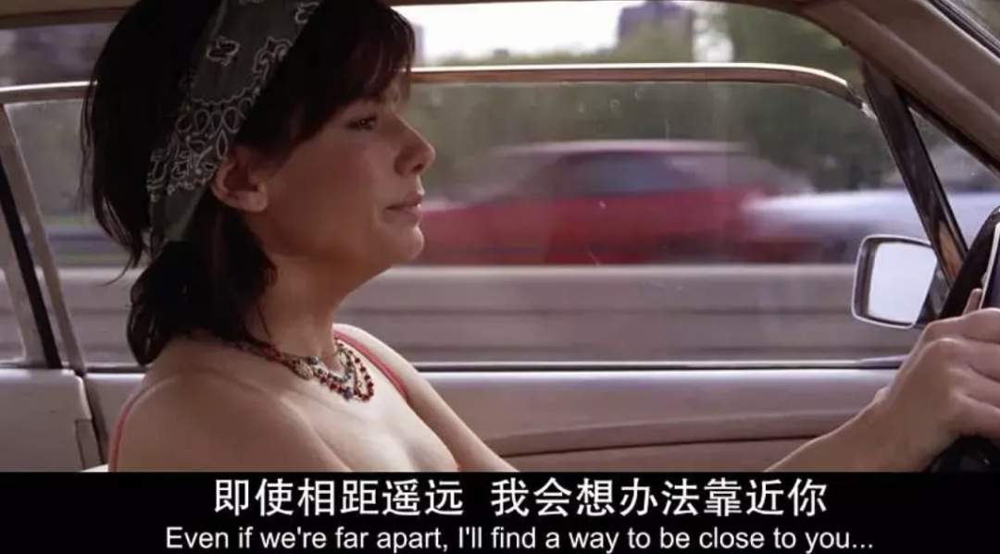
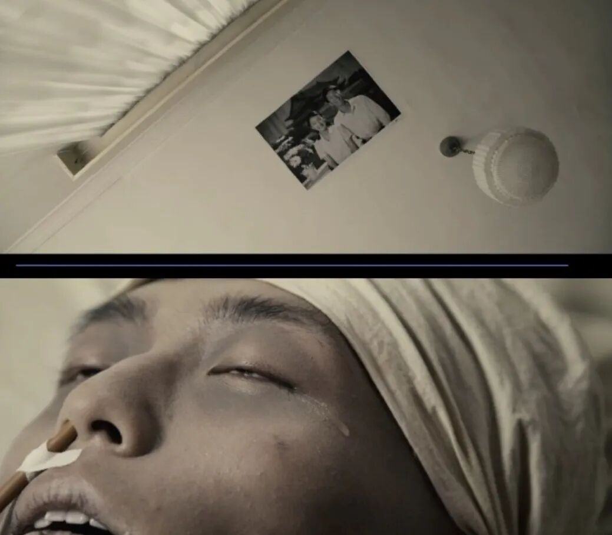
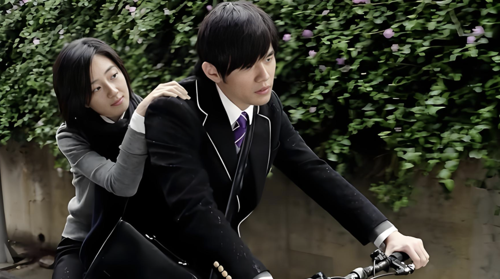
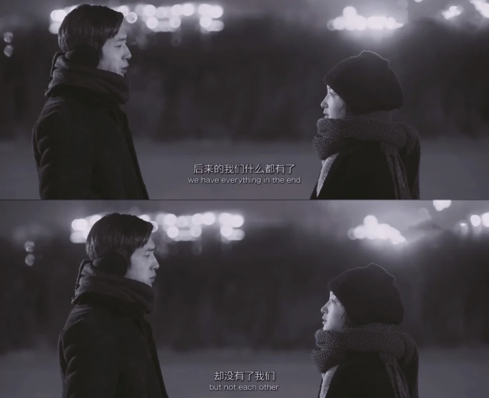
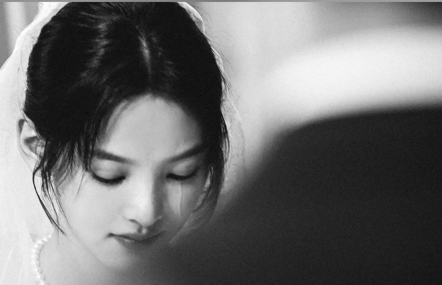

# 敢不敢点开？这10部爱情片，每一部都让你哭到散场灯亮
> 💡 备注属性未写入，可能是备注属性名称或者类型被修改了，建议将字段类型设置为 rich_text，可以在小程序-操作-修改文章数据库页面进行调整
> 💡 原文链接:[https://mp.weixin.qq.com/s?__biz=MzkwODU3NDUxMQ==&mid=2247495729&idx=1&sn=f8bf6f4fb9eb251753cbde00336df68c&chksm=c1c5fa6981930033509cb730af3d4dfcf964ab4ef38d6bd5508bb94d9df092de2759673c4441#rd](https://mp.weixin.qq.com/s?__biz=MzkwODU3NDUxMQ%3D%3D&mid=2247495729&idx=1&sn=f8bf6f4fb9eb251753cbde00336df68c&chksm=c1c5fa6981930033509cb730af3d4dfcf964ab4ef38d6bd5508bb94d9df092de2759673c4441#rd)
** 点击上方蓝字关注我们 **

作者/侃侃 字数/1573
唯一的遗憾，是我的遗憾里有你。

**01**
**国外篇：跨越时空与偏见的奔赴
**
**《遇见你之前》**
小镇女孩露易莎去照料因意外瘫痪的威尔。
六个月里，她带他看赛马、听音乐会，他教她打开眼界。
可最终，威尔依然选择安乐死——他爱她，但更渴望以尊严告别。
露易莎坐在巴黎街头，拆开他留下的信：
**“你是我每天早上醒来的唯一动力……但你不能改变我的选择。大胆地活，积极向上，别妥协。”**
这不是圆满的爱情，而是爱与尊重的终极诠释：我爱你，但我也要对自己的人生负责。

**《恋恋笔记本》**
诺亚用365封信和一座白房子，等回了失忆的艾莉。
雨中的湖上，诺亚划着船带艾莉去看那栋白房子。她推开门的瞬间，满屋的画架和素描，每一张都是她。七年了，他一直在画她。
**她转身问他：“你为什么不等我？”他说：“因为我知道你是我的。”**
当艾莉在雨中恢复记忆的瞬间，两人相拥而泣。
爱情能否跨越阶级、战争，甚至对抗阿尔茨海默症？
这部电影给了最浪漫的答案，哪怕只是片刻，也值得用一生去铭记。

**《面纱》**
英国细菌学家沃特发现妻子吉蒂出轨，带她远赴霍乱肆虐的中国乡村。
在水深火热的疫区，他们从冷漠疏离到重新认识彼此。
**“我知道你愚蠢、轻佻、头脑空虚，然而我爱你。”**
当死亡与牺牲将浮华剥离，爱情才显露出最真实的质地，那是彼此救赎后灵魂的深度契合。

**《傲慢与偏见》（2005年电影版）**
达西在彭伯利的晨雾中走向伊丽莎白，大衣被露水打湿，头发凌乱。
**他结结巴巴地说了三遍“我爱你”。**
那个一贯高傲的男人，此刻像个笨拙的少年。
偏见让两人错过，傲慢让彼此试探，但好在真正的爱情经得起误解，也值得放下身段去奔赴。
当傲慢遇见偏见，唯有真心能击碎所有壁垒。

**《触不到的恋人》（美国翻拍版）**
生活在不同时空的两人，通过一个神秘邮箱互通书信。
他在2004年，她在2006年，却爱上了彼此。
时间的错位让每一次相见都像偷来的奇迹。
**如果爱情能穿越时间，那当下的每一刻都该被好好珍惜。**

**02**
**国内篇：遗憾是青春的底色
**
**《不再让你孤单》**
舒淇饰演的港女佩如在北京酒醉后遇见了刘烨饰演的警察方镇东。
她为买房奔波、为生活低头，他默默守候、倾其所有。
当他患上血管性痴呆，她选择从香港逃回北京。
佩如回来推开门，方镇东坐在沙发上，已经不记得她了。
**她蹲下来对他说：“我是佩如，你不记得我没关系，我每天都会回来，告诉你我叫什么。”**
他呆呆看着她，然后慢慢伸出手摸了摸她的脸，身体还记得。

**《山楂树之恋》**
静秋和老三，一段被时代裹挟的纯爱。
老三得了白血病，临终前叮嘱家人不要告诉静秋，只说：
**“我等不了你一年零一个月，等不到你二十五岁，但我等你一辈子。”**
最干净的爱情，最痛的道别。
静秋赶到医院，老三已经奄奄一息。
她趴在他床边一遍遍喊：“我是静秋！我是静秋！”老三的睫毛动了动，一滴泪从眼角滑下来，他已说不出话，但他听到了。
张艺谋用近乎白描的镜头，让无数人哭湿了纸巾，也记住了那个年代爱情的克制与深沉。

**《不能说的秘密》**
周杰伦自导自演的奇幻爱情。
叶湘伦意外发现路小雨来自20年前，两人在琴房跨越时空相爱。
当小雨因哮喘在旧琴房死去，湘伦在拆迁前的最后一刻弹完那首《Secret》，回到过去找到了她。
**青春里的秘密，往往藏着一生中最勇敢的奔赴。**

**《后来的我们》**
见清和小晓在春运火车上相遇，一起在北京打拼、相爱、分手，十年后再重逢已各自有了人生。
**“后来的我们什么都有了，却没有了我们。”**
刘若英用一部电影唱完了《后来》那首歌：有些人，一旦错过就不在。

**《你的婚礼》**
周潇齐追了尤咏慈十五年，从高中到大学到社会，终于在别人的婚礼上彻底告别。
**“我的青春里，所有的幸福都是你给我的。”**
遗憾是青春最真实的底色，而真正的成长，是在失去后学会祝福。

这10部电影里的爱情，或残缺、或遗憾、或穿越时空，但都在诉说同一件事：
**真正的爱不是占有，而是彼此照亮。**
即使结局未必圆满，那段相遇本身已是生命最好的馈赠。
