# 数学圈公认的数论殿堂级科普神作，豆瓣9.1高分，小学生都能轻松入门，入门经典首选！
> 💡 备注属性未写入，可能是备注属性名称或者类型被修改了，建议将字段类型设置为 rich_text，可以在小程序-操作-修改文章数据库页面进行调整
> 💡 原文链接:[https://mp.weixin.qq.com/s?__biz=MjM5Njc0MjIwMA==&mid=2649844621&idx=1&sn=55b2c646a58f38bb64c12870d0e452f2&chksm=bf69742196cdb49b24ff01d7b627c1664395ec36a3ef3835cbec40e5d55bd4700f260a65d3e4#rd](https://mp.weixin.qq.com/s?__biz=MjM5Njc0MjIwMA%3D%3D&mid=2649844621&idx=1&sn=55b2c646a58f38bb64c12870d0e452f2&chksm=bf69742196cdb49b24ff01d7b627c1664395ec36a3ef3835cbec40e5d55bd4700f260a65d3e4#rd)

数论其实就是研究整数性质的数学，被誉为“最纯”的数学领域。在20世纪前，数论还一直叫算术呢。
但是，千万别以为整数就变不出什么花样。正整数按乘法性质划分，可以分成质数、合数、1，质数产生了很多一般人能理解却又悬而未解的问题，如哥德巴赫猜想，孪生质数猜想等。
也就是说，很多问题虽然形式上十分初等，解决起来却要用到许多艰深的数学知识。这一领域的研究从某种意义上推动了数学的发展，催生了大量的新思想和新方法。很多知名数学家都为数论都发展作出过贡献，包括费马、梅森、欧拉、高斯、勒让德、黎曼、希尔伯特等人。
高斯有过这么一个经典比喻：「数学是科学的皇后，数论是数学的皇后。」
——卡尔·弗里德里希·高斯
这本《数学女王的邀请》，就是一本初等数论佳作。作者从数的由来说起，带着读者通过一步一步计算来体会数学的乐趣，并理解什么是“数学证明思维”。
《数学女王的邀请：初等数论入门》
作者：[日]远山启
译者：逸宁
文 | 第一章：数的由来与发展
#### 
#### 第1节　自然数
**1.自然数是无穷无尽的**
在回答“盒子里有几个杯子”这个问题时，我们会从1, 2, 3, 4, . . .中挑选出一个数作为答案。像这样，能回答关于“有几个”的问题的数叫自然数①。
大家可能会注意到，出现在我们日常生活中的数几乎都是自然数。
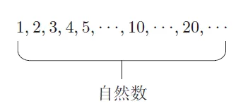
自然数是无穷无尽的。无论一个自然数有多大，只要我们耐心地不断累加1，最终一定能得到它。
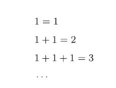
正如古人所说：“千里之行，始于足下。”
如果想一目了然地观察自然数，我们可以尝试把它们排列到一条间隔均为1 的射线上。
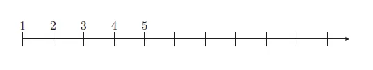
如图所示，射线的左端为1，向右则是无限延伸的。
**2. 自然数的加法与乘法运算**
两个自然数可以进行加法运算，即任意选取两个自然数，其相加后得到的结果也是自然数。
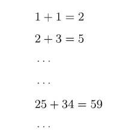
即，
自然数+ 自然数= 自然数
因此，了解自然数的人可以随时自如地进行加法运算。
乘法运算与之完全相同。任意选取两个自然数进行乘法运算，其结果同样为自然数。
自然数× 自然数= 自然数
**3.从自然数到整数**
对于自然数的减法运算，就不能模仿前面那样来生搬硬套了。两个任意自然数并不一定总是可以进行减法运算的。例如，只知道自然数的人无法回答“2 − 5”等于多少。
为了解答这类问题，一种全新的数便应运而生，它就是负数。如果在表示自然数的射线的左端添加上0，那么就可以得到一条向左无限延伸的射线，也就得到了一条左右都无限延伸的直线。
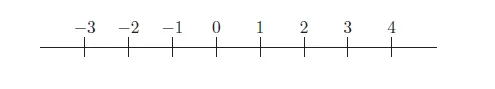
如图所示，在直线左侧的0, − 1, − 2, − 3, · · · 也以相等的间距排列着。
于是，正数和负数以夹在二者之间的0 为界限左右对称，整齐地排列在0 的两侧。这些数被统称为整数。
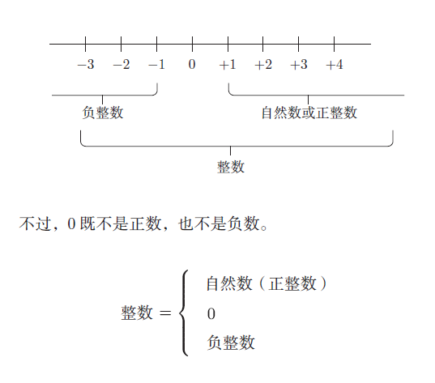
#### 第2节　辗转相除法
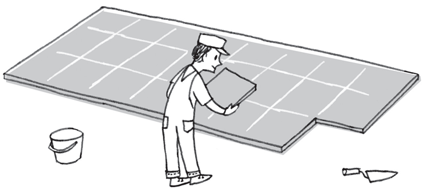
**1.能够简化任意分数的约分方法**
由于在学校教材中出现的分数并不复杂，所以比较容易约分。
例如54/42，我们首先能发现公约数2，所以第一步可以得到
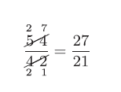
此时我们又能发现公约数3，所以可将其进一步约分成
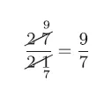
的形式。
不过，一旦遇到稍微复杂的分数，例如315/91，我们就不一定能如此轻易地发现分子和分母的公约数了。
我们的确可以先找到分子和分母的最大公约数，再对分数进行约分简化。不过，还有一种更加便捷的约分方法，它就是“辗转相除法”。
下面请大家试着和我一起来思考这种方法吧。虽然我早就已经掌握了这种方法，但我不会在一开始就把它教给大家。我希望各位能自己把它想出来，因此在接下来的讲述中，我只会偶尔给出一些提示。
**2.用图形思考**
为了方便大家的理解，我们可以把抽象的数的问题转移到具体 的图形上来思考。
在求解a、b 两个数的最大公约数时，我们先假想存在一个宽为a 且长为b 的长方形，b 比a 长，即a < b。
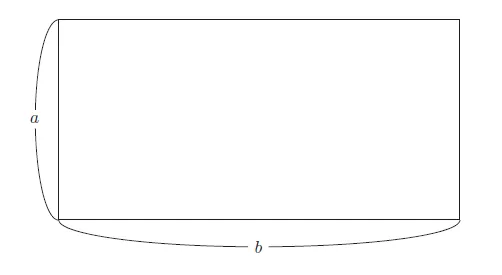
接下来请大家试着思考，如何用一些面积相同的正方形恰好将该长方形的内部空间填满。
我们也可以将这个问题理解为，当泥瓦匠在这块长方形地面上铺瓷砖时，要用多大尺寸的正方形瓷砖才能正好将其铺满。
此时，所需正方形的边长c 便是a 和b 的约数，即c 为a 和b的公约数。
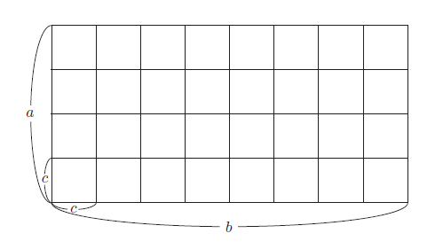
如果泥瓦匠能在满足上述条件的正方形瓷砖中选择面积最大的，那么他的工作就会轻松很多。
我们把公约数中最大的数称为最大公约数。
这样一来，问题就变成了如何找到这个最大公约数。
我们首先可以尝试使用各种尺寸的正方形。由于正方形越大越好，所以我们先从面积最大的入手。
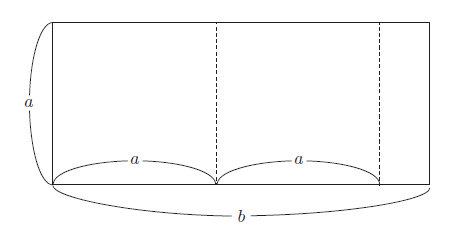
由于正方形的边长只能小于或等于a，所以我们先用面积为a × a 的正方形来试一试。
由左向右依次铺设，该长方形能够容纳2 个面积为a × a 的正方形，同时还会剩余一部分空间，因此面积为a × a 的正方形不符合要求。
既然面积为a × a 的正方形行不通，接下来我们就试试面积为的a/2 × a/2正方形。
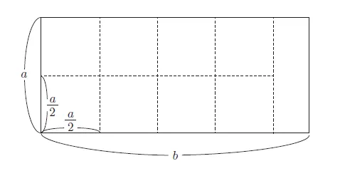
然而在这种情况下也会出现剩余，这样的正方形依然不合格。
下面我们再用面积为a/3 × a/3的正方形继续尝试。
很遗憾，这种正方形同样不符合要求。
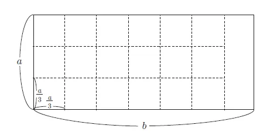
以上3 种方法都不能满足条件，我们的尝试似乎都不太顺利。
**3.从失败中学习**
在此让我们暂停尝试，试着换一种思路吧。因为“从失败中学习”才是聪明人的做法。
我们先来仔细比较一下之前导致失败的3 个图形。
让我们把3 个图形重叠起来试试看。
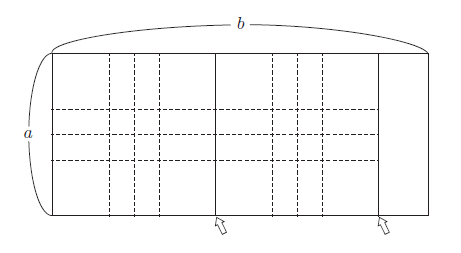
大家有没有发现什么呢？
如上页图所示，3 个图形的虚线（用来填充长方形的正方形的 边界线）有重合的部分。
听我这么一说，大家应该马上就能发现这一点。
虚线重合的部分，是箭头所指的那条边，即面积为a × a 的正方形的右侧的边。
也就是说，既然虚线会在箭头标记处重合，那么无论采取哪种填充方式，我们都可以从箭头指示的位置开始。
那么，这个问题就变成了如何用面积相同的正方形填满长边为a、短边为b − a 的长方形。长方形面积变小后就简化了原来的问题。
也就是说，即使从面积为a × b 的长方形上剪掉一个面积为a × a 的正方形，要解决的问题也不会发生变化。
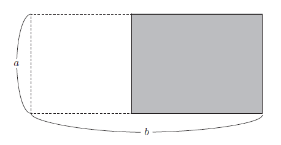
在此基础上，我们可以继续剪掉一个面积为a × a 的正方形。
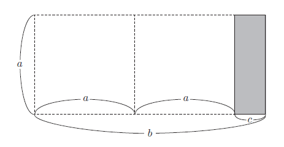
如图所示，我们将得到一个细长、竖直的长方形（水平方向的边短于竖直方向的边），即通过进行
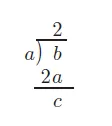
的运算，得到了一个长边为a、短边为c 的长方形。
如此一来，问题就变成了如何用面积相同的正方形填满这个新的长方形。由于现在这个长方形的较短边是c，所以我们从中剪掉面积为c × c 的正方形。
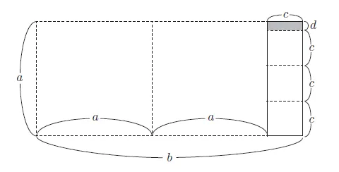
减掉c × c 的正方形后，长边a 被短边c 分割后剩余d，

由此得到了短边为d、长边为c 的长方形。

在此基础上，我们再从该长方形中剪掉面积为d × d 的正方形，

我们会发现，面积为d × d 的正方形正好填满了这个长方形。
综上所述，用面积为d × d 的正方形可以恰好填满最初面积为a × b 的长方形。
这种方法就叫作辗转相除法。
**4. 用辗转相除法求最大公约数**
让我们假设a = 91, b = 210。

那么此时，在最后一步实现了整除的除数7，这就是91 和210的最大公约数。
使用一种新的符号表示最大公约数会方便一些。
于是，我们用(a, b) 来表示整数a 和b 的最大公约数。
那么，利用这个符号对该问题进行求解的过程便如下所示。
(91, 210) = (91, 28) = (7, 28) = 7
下面让我们试着求出185 和111 的最大公约数吧。
首先，用185 除以111。

接下来就要求余数74 和111 的最大公约数。由于我们无法一眼就看出答案，所以此时还需再次进行除法运算。
(185, 111) = (74, 111)
这次我们用数值较小的74 去除数值较大的111。

接下来问题就变成了寻找37 和74 的最大公约数，显然答案为37，因为74 可以被37 整除。

**《数学女王的邀请：初等数论入门》**
作者：[日]远山启
译者：逸宁
日本长销数论入门科普读物，日本学校图书馆协议会选定图书。
迷倒高斯、费马、欧拉的“数学女王”，究竟有何魅人魔力？
本书是初等数论入门的通俗科普读本。书中以身边的生活之事为例，由浅入深、生动形象地介绍了数的奇妙性质与规律。作者用直观、易懂的讲解，引领读者去体会数论证明的不可思议与酣畅淋漓，在惊奇与畅快之中提升对数学的理解程度。
