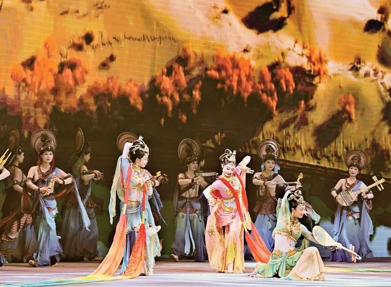

# 文化走出去，说到底是什么？
> 💡 备注属性未写入，可能是备注属性名称或者类型被修改了，建议将字段类型设置为 rich_text，可以在小程序-操作-修改文章数据库页面进行调整
> 💡 原文链接:[https://mp.weixin.qq.com/s?__biz=MjM5NjQ1NjY4MQ==&mid=2663692448&idx=1&sn=dd1e2cad387d0751ab41518493791afb&chksm=bc9e9fd04f1e92d83ea084149d47ba276c8dcd45fab66ba9b0d1f6814ee21869079520b1973b#rd](https://mp.weixin.qq.com/s?__biz=MjM5NjQ1NjY4MQ%3D%3D&mid=2663692448&idx=1&sn=dd1e2cad387d0751ab41518493791afb&chksm=bc9e9fd04f1e92d83ea084149d47ba276c8dcd45fab66ba9b0d1f6814ee21869079520b1973b#rd)
文化走出去，说到底是什么？是一个国家在与世界打交道时回答“我是谁、从哪里来、到哪里去”的过程。因此，文化走出去，不单是传播问题，还是文明定位问题。
中国的文化基因中天然具有文明的自觉与天下的眼光。中华文化走出去正是这种文明自觉在当代的展开，深层来看是中华文明在世界历史中重新确立自身位置的过程。

文明因交流而多彩，文明因互鉴而丰富。文明交流互鉴，是推动人类文明进步和世界和平发展的重要动力。图为2025年5月30日，在第四届文明交流互鉴对话会的开幕式上，演员进行敦煌石窟文化艺术主题表演。 新华社记者 张领/摄
习近平总书记强调，要强化用文化同世界对话的理念，不断提升国家文化软实力和中华文化影响力。当前，中华文化的全球影响力正处于一个关键时刻。据英国“品牌金融”咨询公司发布的《2026年全球软实力指数》报告，中国该指数位居全球第二。在这样的时刻，我们更应当追问：当世界开始注视中国时，中国能否用自己的话语讲清楚自己是谁、要走向哪里。
从大历史观来看，中西方之间几次重要的文明交流，为今天的文化走出去提供了重要启示。16世纪至18世纪，儒家宋明理学的“理性”与“道德”为欧洲启蒙运动提供了思想资源；19世纪至20世纪初“西学东渐”，促进中国开启以学习西方、实现近代转型为目标的中西文明交流互鉴；第一次世界大战后，李约瑟、汤因比、雅斯贝尔斯等西方思想家将目光投向中国，寻求救治西方文明危机的良药；等等。不同文明之间的交流互鉴揭示了两条规律：一是文明之间的优越位势历经多次转换，暂时的优越地位不能成为文明等级论的理由；二是每次文明转向都发生在某种文明陷入危机、产生向其他文明学习的强烈需求之时。这意味着文化走出去既要有积极的传播自觉，也要有历史与文明的自觉。
和羹之美，在于合异。人类社会的发展进步，始终离不开各种文明的交相辉映，这是文化走出去的根本动因。习近平总书记指出，傲慢和偏见是文明交流互鉴的最大障碍，如果居高临下对待一种文明，不仅不能参透这种文明的奥妙，而且会与之格格不入。今天，以海纳百川的胸怀打破文化交往的壁垒，以兼收并蓄的态度汲取各国文明的养分，以自信开放的姿态更好推动中华文化走出去，方能推动各国文明在交流互鉴中共同前进。
[更多内容，详见钟实文章《推动中华文化更好走向世界》](https://mp.weixin.qq.com/s?__biz=MjM5NjQ1NjY4MQ%3D%3D&mid=2663691964&idx=1&sn=413f189581a87265565610146041295b&scene=21#wechat_redirect)
---
来源：求是网
策划：何雯雯 唐媛媛
责编：汤宝兰
审核：李达 林经纬

