# 文革中身亡的175位文学艺术大师！
> 💡 备注属性未写入，可能是备注属性名称或者类型被修改了，建议将字段类型设置为 rich_text，可以在小程序-操作-修改文章数据库页面进行调整
> 💡 原文链接:[https://mp.weixin.qq.com/s?__biz=MzU0NjQwMzcyMA==&mid=2247531552&idx=1&sn=2b925bafbcb927f5e3aecd528df2b10f&chksm=fafa51365befcdd3003e24af4a41f4554014ff9561fc5bc91103aa5e8ff76e94b39a4b5e8b16#rd](https://mp.weixin.qq.com/s?__biz=MzU0NjQwMzcyMA%3D%3D&mid=2247531552&idx=1&sn=2b925bafbcb927f5e3aecd528df2b10f&chksm=fafa51365befcdd3003e24af4a41f4554014ff9561fc5bc91103aa5e8ff76e94b39a4b5e8b16#rd)
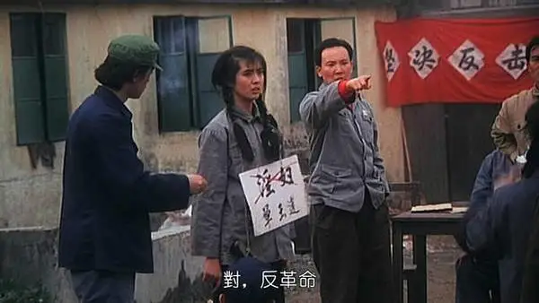
编辑：微信公号@世界人文历史
📌
**推荐关注**
近年来，不少文革时期“红卫兵”公开向被害人和公众道歉，让这段十年浩荡的血腥往事再度浮现在世人面前。近半个世纪过去了，对于文学艺术界而言，最沉痛的，莫过于在那十年里，有175名文学、书画等艺术大师被迫害致死或自杀身亡。
人艺群星璀璨，但属于他们的黄金时代太过短暂。建院初期绽放光芒后，随着“反右”和“文革”的风暴来袭，人艺不可避免地卷入政治运动的汹涌洪流。优秀的艺术家们，被裹挟着向前，身不由己。
**147名被迫害致死的文学艺术大师**
**书画艺术家**
潘天寿、丰子恺、王式廓、董希文、陈半丁、秦仲文、陈烟桥、马达、倪贻德、肖传玖、吴耘、张正宇、吴镜汀、叶恭绰、刘子久、乌叔养、符罗飞、贺天健、彭沛民、郑野夫、李斛、沃渣、王颂咸、李又罘、张肇铭、李芝卿
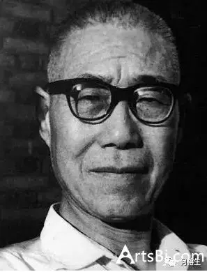
**潘天寿**
1966年文革爆发，潘天寿成了浙江美院第一批被揪斗的对象。他被关牛棚的时间最长，吃的苦头也最多。他在杭州的家被抄得底朝天，“革命干将”们拉走的珍贵书画文稿达六、七车之多，连笔墨纸砚也抄了去，作品被列入墨画名单。1971年5月，被定案为“反动学术权威、为敌我矛盾”。
潘天寿当晚大量尿血，昏迷不醒。病中被造反派押回宁海老家，交给当地群众作为“活靶子”批斗，百般凌辱……9月5日凌晨，突然气喘得厉害，双腿剧烈地抖动，汗如雨下。黎明前，一代国画大师潘天寿带着“士可杀不可辱”的傲骨，[带着“自古有沉冤”的无声呐喊溘然长逝](https://mp.weixin.qq.com/s?__biz=MzU0NjQwMzcyMA%3D%3D&mid=2247529889&idx=2&sn=a41f797154597cdf57b09aed7095338d&scene=21#wechat_redirect)！
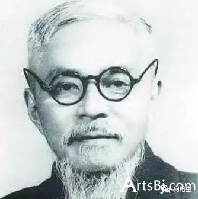
**丰子恺**
1966年6月，上海中国画院出现了第一张批判丰子恺的大字报。大字报是针对丰子恺发表在《上海文学》1962年八月号上的随笔《阿咪》的这猫名叫“猫伯伯”。在丰子恺故乡，伯伯不一定是尊称，称鬼为“鬼伯伯”，称贼为“贼伯伯”。故“猫”也不妨称之为“猫伯伯”。大字报居然说，“猫伯伯”是影射毛主席，因为江浙一带口语，“猫”即“毛”之谐音。这之后，丰子恺被诬为“反动学术权威”、“反革命黑画家”“反共老手”等等，甚而成为上海市十大重点批斗对象之一。“牛棚”，是我们经常看到的文革中的一个字眼，丰子恺一样没逃过“牛棚”一劫。
十年浩劫期间，丰子恺被林彪、“四人帮”加上莫须有罪名，遭到残酷迫害，身心备受摧残。1970年初他患重病，卧病半年。病愈后，他不顾林彪、“四人帮”的迫害，仍坚持作画，并从事翻译。但由于长期受折磨，患了肺癌。1975年9月15日，丰子恺在阴霾蔽日的情况下含恨长逝。
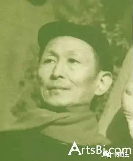
**董希文**
“文化大革命”开始后，刘少奇成了党内最大的“走资本主义道路的当权派”而被打倒。一夜之间，刘少奇的标准像便从中国的公众和家庭中消失。中国革命博物馆通知董希文在画面中去掉刘少奇。此时，新生的共和国已经历了1957年的反右斗争和1959年反对彭德怀“反党集团”的斗争，政治空气十分紧张。董希文本人也经历了被打成“右派”，留党察看两年，下放干校劳动改造的磨难。“文革”中，他被打成“反动学术权威”，在北京钢厂接受劳动改造，因过度疲劳，胃溃疡穿孔，经首都医院抢救八小时才苏醒过来。在做了胃切除四分之三的大手术后不到半年，又回到了劳改农场，数月后被诊断为癌症晚期。因此，从画面上拿掉刘少奇，他本人已有了“充分的思想准备”，但这次修改更难了，与删除高岗不同，由于刘少奇位于中间，去掉后的空缺一定要有“人”来填补，而且还要牵动旁边的人。董希文抱病奉命到博物馆亲自进行修改，在刘少奇的位置上改画了董必武。
**作家、诗人**
田汉、阿英、赵树理、柳青、周立波、何其芳、郑伯奇、郭小川、芦芒、蒋牧良、刘澍德、孟超、陈翔鹤、纳赛音朝克图、马健翎、魏金枝、司马文森、海默、韩北屏、黄谷柳、远千里、方之、萧也牧、李六如、穆木天、彭慧、姚以壮、邓均吾、张慧剑、袁勃、徐嘉瑞、李亚群、林莺、沈尹默、胡明树
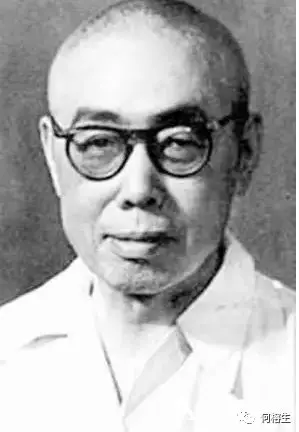
**田汉**
中国国歌《义勇军进行曲》词作者田汉文革中被迫害致死。有媒体披露，田汉1968年在禁闭室死的时候，名单上写的是假名，跟刘少奇死的时候一样悲惨。有糖尿病的田汉被逼趴在地上把自己的小便喝掉吃掉，活活被逼死。1968年12月10日在狱中去世，终年70岁。1971年冬，田汉母亲易克勒穿着陈旧的棉衣，整天孤零零的一个人坐在房门口，她心里牵挂着儿子的安危，却不知他身在何处。直至去世的那一天，她也没有见到儿子的面。在他的骨灰盒中只有他的眼镜、钢笔，和生前创作的《义勇军进行曲》、《关汉卿》。
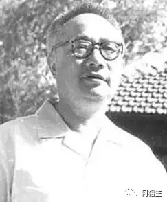
**何其芳**
文革开始后，何其芳受到拳打脚踢式的批斗，被罚跪、扫厕所，历经磨难。1969年后，何其芳被打倒，下放到河南干校劳动改造，在那里喂猪。“文革”中，造反派认为中国科学院文学所所长何其芳不能用这个好听的名字，于是给他改名“何其臭”。以后每逢开批斗会，都让他自报家门。开始他不适应，仍报何其芳，立即受到斥责：“你能叫何其芳吗！你是反党反社会主义反毛泽东思想的三反分子，你‘芳’在哪里！”他马上改口：“何其臭，何其臭！” 1976年10月，“四人帮”被粉碎，长达十年的“文化大革命”结束了。他拼命地想夺回文革耽误的那十年时间，没日没夜地工作、写作。但他终于倒下了，被查出是晚期的癌症。1977年7月24日，[何其芳永远离开了人世。](https://mp.weixin.qq.com/s?__biz=MzU0NjQwMzcyMA%3D%3D&mid=2247529889&idx=2&sn=a41f797154597cdf57b09aed7095338d&scene=21#wechat_redirect)
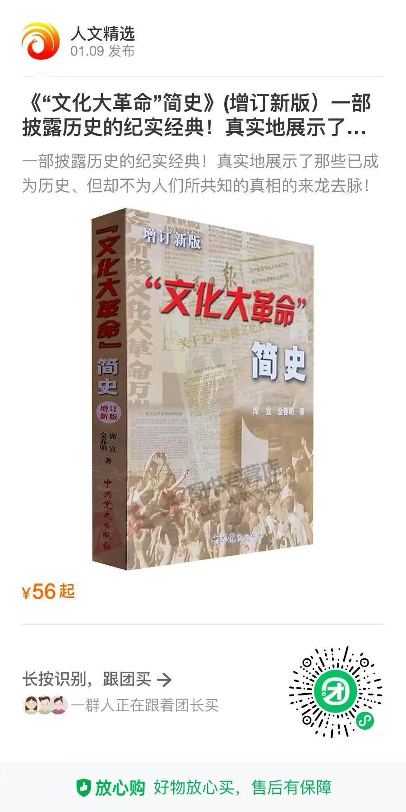
**文艺评论家**
冯雪峰、邵荃麟、王任叔、刘芝明、何家槐、侯金镜、徐懋庸
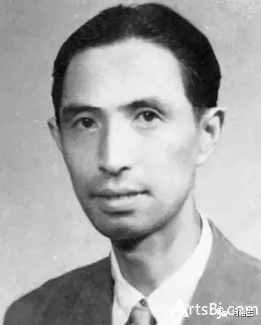
**邵荃麟**
邵荃麟（1906年-1971年），浙江慈溪人。出生于四川重庆。原名邵骏远，曾用名邵逸民、邵亦民，笔名荃、力夫、契若。中国文艺理论家、现代文学评论家、作家。曾任中国作家协会副主席、主席、党组书记。“文革”发动以前，1964年底，邵荃麟因所谓“中间人物论”受到了严厉的批判。他从1925年起直到“文革”被剥夺各项权利止的40年间，经历了现代史上几个时期社会政治的动荡、分化、改组，他从中共革命的青年参与者，进入中高级领导层，几度沧桑，最终沦为阶下囚而丧生。
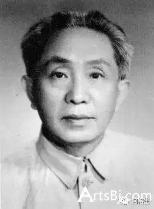
**王任叔**
1959年康生点名批评王任叔，指出他和蒋介石是同乡，且王任叔曾在国民党任职，从而导致他作为文学界的代表人物，与史学界的尚钺，经济学界孙冶方开始共同受严重批判，撤销党内外一切职务。被剥夺文学创作权利后，他转向史学研究。1960年，在“反右倾”运动中受批判，撤销党内外一切职务。翌年起，任中共中央对外联络部东南亚研究所编译室主任。1966年初完成160万字史学专着《印度尼西亚历史》的初稿。“文化大革命”中遭批斗、隔离审查。1966年被抄家，受尽折磨。1968年开始有大字报宣传王任叔是郁达夫被害事件中向日本人告密的叛徒，使得他遭到更严重的迫害。1970年3月被遣返家乡，安置在村西头的两间旧茅屋里，严重的摧残使得他精神崩溃。1972年7月25日病逝。1979年6月平反，恢复政治名誉。
**翻译家**
董秋斯、满涛、丽尼
**电影艺术家**
蔡楚生、郑君里、袁牧之、田方、崔嵬、应云卫、孟君谋、徐韬、魏鹤龄、杨小仲、刘国权、罗静予、孙师毅、夏云瑚、冯喆、吕班、王莹、赵慧深、瞿白音
**京剧表演艺术家**
周信芳、盖叫天、荀慧生、马连良、尚小云、李少春、叶盛兰、叶盛章、高百岁、裘盛戎
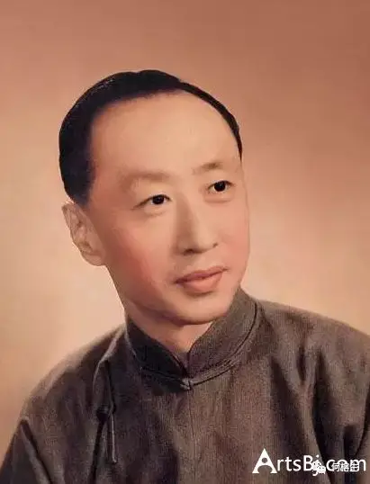
**马连良**
1966年6月4日，马连良正准备演出《年年有余》时，听到广播里已把周信芳打成“反革命”，联想到自己主演的《海瑞罢官》天天在受批判，急火攻心，一向甜润嘹亮的嗓子突然嘶哑起来——马连良预感到自己大祸临头了。果然，第二天，北京京剧二团团部就有人贴出了马连良的大字报。从此，这位中国京剧艺术的顶级大师被赶出了摸爬滚打一辈子的京剧舞台，随后一病不起，住进了医院。一个月后，他被造反派从医院里拖上大批判的舞台，开始了自己的屈辱表演。马连良在京剧舞台上的地位高，住牛棚的“地位”也高，造反派给他单独设置了一个牛棚。10月1日，马连良被释放回家。　马连良竟然没死，不过此时他已气若游丝，全身浮肿。这时的他已是心脏病晚期，造反派却不允许他去治病。1966年12月13日中午，马连良步履蹒跚地排队买了碗面条，还未等转身，就先扔掉拐杖，再扔了装着面条的碗，[仰天一跤，如一片枯叶缓缓倒下。](https://mp.weixin.qq.com/s?__biz=MzU0NjQwMzcyMA%3D%3D&mid=2247529889&idx=2&sn=a41f797154597cdf57b09aed7095338d&scene=21#wechat_redirect)
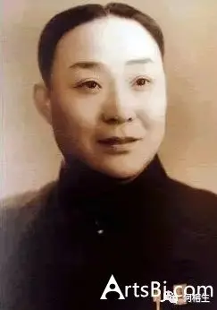
**尚小云**
1966年5月，尚小云正在为编演革命现代京戏《秦岭长虹》和改进戏校教育奔走。想不到6月1日那篇大动乱宣言书《横扫一切牛鬼蛇神》出台，戏校就和全国一样像炸开了锅。大字报铺天盖地，“打砸抢”随处可见，尚小云被扣上了“资产阶级反动艺术权威”的帽子关押批斗。他的家多次被抄，门被煳上了封条。夫人和儿子都受牵连同他一起关进“牛棚”，每人每月只给极少的生活费。1973年，尚小云获得了“解放”，回到了自己的家。但八年的折磨，他坚持每日练功的雄健身体被摧残了，先是全身伤痛，继之左眼失明。1976年春日的一天，尚小云在家中突感身体不适，家人送他往医院抢救，因系心脏病猝发，终于4月19日逝世。一代艺术大师就这样悄悄地殒落了。
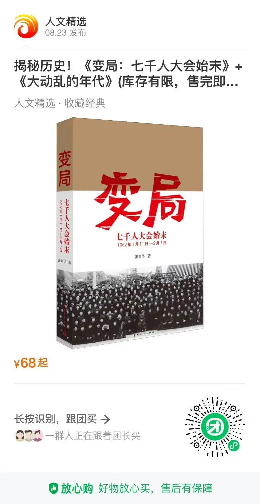
**话剧艺术家**
章泯、焦菊隐、孙维世、舒绣文、兰马、高重实、万籁天、白辛、伊兵
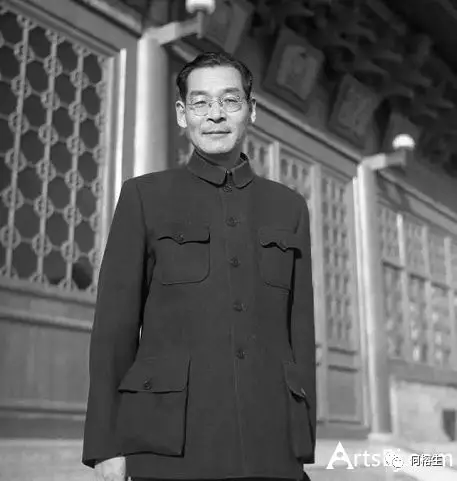
**焦菊隐**
焦菊隐 (1905年- 1975年) 是知名戏剧大家和翻译家。焦菊隐先生以戏剧导演大师立于世。他是中国将莎翁名着《哈姆雷特》搬上舞台的第一人，也是把《罗密欧与朱丽叶》改编为京剧（《铸情记》）的第一人。《茶馆》是他的导演代表作，首演于1958年。1966年文革初期，焦菊隐先生一夜之间被打倒，被扣上反动权威的大帽子，被无休止的批斗，家被多次查抄，多年保存的书籍文物大量流失，而批斗也不断升级。被囚禁在人艺北四楼排演场大牛棚。[文革的政治运动终止了焦菊隐的学术进程](https://mp.weixin.qq.com/s?__biz=MzU0NjQwMzcyMA%3D%3D&mid=2247529889&idx=2&sn=a41f797154597cdf57b09aed7095338d&scene=21#wechat_redirect)，摧毁了他的一切梦想，在生命的最后十年里，他被剥夺了创造和言说的权利，曹禺回忆那时的焦菊隐是“沉默的、几乎不会说话的上了年纪的人”，两人都在“牛棚”，“铺挨着铺”。1975年2月28日凌晨，焦菊隐离开人世。
**戏曲艺术家**
张德成、李再雯、竺水招、苏育民、顾月珍、筱爱琴、韩俊卿、丁果仙、阎逢春、徐绍清、蔡尤本、刘成基、白云生、韩世昌
**曲艺家**
王尊三、王少堂、张寿臣、俞笑飞、江枫、连阔如、肖亦吾、固桐晟
**音乐家**
郑律成、马可、黎国荃、向隅、蔡绍序、陆洪恩、费克、舍拉西、查阜西、李淦、张斌、王建中、沈知白、李翠贞、阿泡、杨宝忠
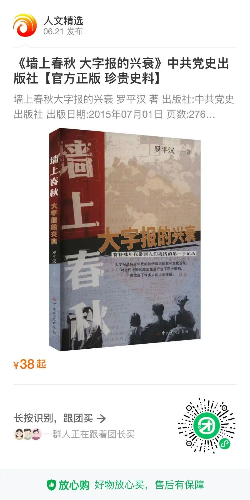
**28名被迫害自杀身亡的文学艺术大师**
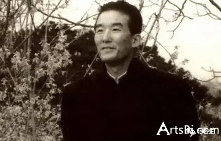
**邓拓**
1912年生，福建闽侯人。1930年加入中共。曾任中共北京市委宣传部部长、《人民日报》总编辑和社长等职。1966年5月因“三家村”冤案受迫害，5月16日，戚本禹发表文章公开点名批判邓拓，称邓拓“是一个叛徒”；5月17日晚，邓写下《致北京市委的一封信》和《与妻诀别书》后，于5月18日自缢身亡，成为在那段非常的岁月里，第一个以死抗争的人。
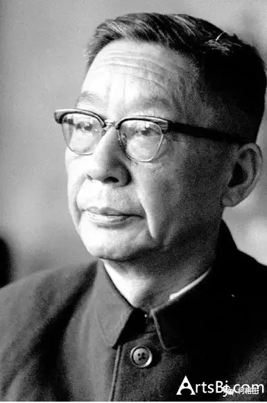
**老舍**
生于1899年。北京人，满族。著名小说家、剧作家。抗日战争期间曾主持中华全国文艺界抗敌协会工作。1949年后历任全国文联副主席、作协副主席、北京市文联主席等职。代表作有长篇小说《骆驼祥子》、话剧《茶馆》等。1966年8月24日因不堪迫害投北京太平湖自杀。
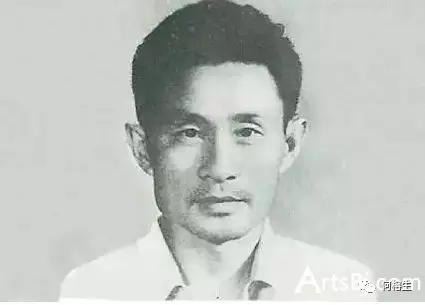
**陈笑雨**
1917年生，江苏靖江县人。著名文艺评论家。1949年后历任《文艺报》副主编、《新观察》主编、《人民日报》编委兼文艺部主任。文革初期即遭批斗，因不甘屈辱，于1966年8月24日投永定河自尽。
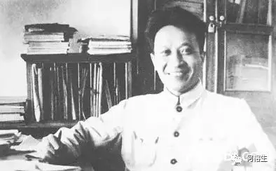
**陈梦家**
1911年生，浙江上虞县人。考古学家，古文字学家。16岁开始写诗，师从徐志摩、闻一多，1931年出版《梦家诗集》，为新月派重要成员之一。1949年后先后在清华大学、中国科学院考古研究所工作，曾任考古所学术委员、《考古通讯》副总编，在考古及古文字研究方面着述甚丰，颇多创见。1966年9月3日自缢身亡。
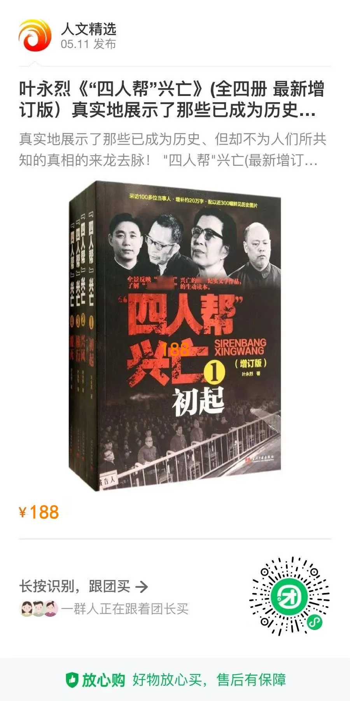
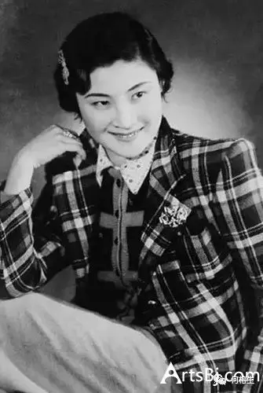
**言慧珠**
1919年生，北京人，蒙族。著名京、昆剧表演艺术家。言菊朋之女，梅兰芳之徒，俞振飞之妻。1949年后曾任上海市戏曲学校副校长，擅演《玉堂春》、《游园惊梦》等。文革中遭批斗、殴打，肉体和精神均受到巨大伤害。1966年9月11日晚，接连写下三封绝命书后自杀身亡。

**叶以群**
1911年生，安徽歙县人。著名文艺理论家。1932年加入中共，同时加入“左联”并任组织部长。1949年后曾任上海电影制片厂副厂长、上海文联副主席、上海作协副主席等职。1966年跳楼自杀。

**刘盼遂**
1896年生，河内淮滨县人。古典文学研究专家、语言学家。1925年入清华大学国学研究院，问教于王国维、黄侃、梁启超门下；1946年起在北京师范大学中文系任古典文学教授。1966年自杀身亡。

**赵慧深**
1911年生，四川宜宾人。著名表演艺术家，以在《雷雨》中成功饰演繁漪闻名。文革中，因电影剧本《不怕鬼的故事》及家庭成分不好而被打成“三反分子”，屡遭批斗；又因曾在《马路天使》中饰演过妓女小芸而受到造反派的嘲弄和侮辱，于1967年12月4日含恨自杀。

**罗广斌**
1924年生，四川成都人，毕业于西南联大，1949年前参加反抗国民党的地下斗争，是“重庆中美合作所集中营”的幸存者。1949年后曾任共青团重庆市统战部长。与杨益言合作的长篇小说《红岩》影响巨大。文革中受到迫害，于1967年跳楼自杀。

**严凤英**
1931年生，安徽桐城人。著名表演艺术家，以主演黄梅戏《天仙配》闻名。文革中被指为“文艺黑线人物”、“宣传封资修的美女蛇”，并被诬蔑为国民党潜伏特务，屡遭批斗。1968年4月7日夜自杀身亡。死后曾被剖尸检查，[因怀疑她腹中藏着特务密电和微型收发报机](https://mp.weixin.qq.com/s?__biz=MzU0NjQwMzcyMA%3D%3D&mid=2247529889&idx=2&sn=a41f797154597cdf57b09aed7095338d&scene=21#wechat_redirect)。

**杨朔**
1913年生，山东蓬莱人。著名作家。1949年后曾任中国作协外国文学委员会主任、保卫世界和平大会党组常委。文革开始后，杨朔被中国作协的造反派列为重点批斗对象，1968年8月3日吞服安眠药自杀。

**储安平**
1909年生，江苏宜兴人。清华大学毕业后曾留学英国三年，攻读政治学。50年代初先后加入九三学社和中国民盟，为九三学社中央委员，全国人大委员。1957年大鸣大放中出任《光明日报》总编辑，因所谓“党天下”言论被定为“右派”。文革中再次成为造反派折磨的对象，任意打骂，人身侮辱，无所不为。1968年8月的一天投河自尽。

**傅雷**
1908年生，上海南汇县人。著名翻译家。傅雷学贯中西，文学、美术、音乐、外语“四位一体”，着作等身。1958年4月被划为“右派”。1968年8月30日，造反派抄家四天三夜；9月2日，[傅雷夫妇被揪到大门口站在长凳上戴上高帽子批斗](https://mp.weixin.qq.com/s?__biz=MzU0NjQwMzcyMA%3D%3D&mid=2247529889&idx=2&sn=a41f797154597cdf57b09aed7095338d&scene=21#wechat_redirect)，惨遭人格凌辱。9月3日傅雷夫妇双双自缢身亡。

**翦伯赞**
1898年生，湖南桃源人。维吾尔族。著名历史学家。有《中国史纲》等18部着作行世。1937年加入中共，1949年后曾任北京大学副校长、中国社科院哲学社会科学部委员、《北京大学学报》主编等职。文革中，因对前途绝望，于1968年12月18日偕妻戴淑宛双双自杀。

**上官云珠**
1920年生，江苏苏州人。著名电影演员，曾在《乌鸦与麻雀》、《早春二月》等片中饰演角色。1949年后在上海电影制片厂工作。1968年跳楼自杀。

**容国团**
1937年生，广东中山县人。著名乒乓球运动员。自幼居香港，1957年回大陆，曾多次获世界冠军称号。“文革”中被诬为“修正主义苗子”。1968年6月20日目睹了贺龙、荣高棠批判大会后，在龙潭湖附近的一个鸭房中自缢身亡。

**周瘦鹃**
1895年生，江苏吴县人。现代著名作家。曾主编《申报》、《礼拜六》等，有长篇言情小说《新秋海棠》等，系“鸳鸯蝴蝶派”代表人物之一。1968年跳井自杀。

**李广田**
1906年生，山东邹平人。著名作家。1935年毕业于北大外语系。1948年加入中共。1949年后历任清华大学中文系主任、副教务长、云南大学校长、昆明作协副主席。文革中因遭残酷迫害，于1968年跳池自杀。

**吴晗**
1909年生，浙江义乌县人。历史学家。清华大学史学系毕业，28岁时被云南大学聘为教授。1949年后，先后任清华大学历史系主任、文学院院长，后又任北京市副市长。1959年起先后写了《论海瑞》、《海瑞骂皇帝》和京剧《海瑞罢官》等，后遭批判。文革中受到残酷迫害，于1969年10月11 日在狱中自杀身亡，死前头发被拔光。

**顾而已**
1915年生，江苏南通人。著名电影艺术家。执导过《小二黑结婚》、《天仙配》等影片。文革中，因30年代与江青有过交往（了解蓝苹历史）而备受迫害。1970年6月18日，在五七干校自缢身亡。

**闻捷**
1923年生，江苏丹徒人。著名作家、诗人。1949年后曾任新华社新疆分社副社长、中国作协兰州分会副主席。文革一开始即遭批斗，1969年下半年获得“解放”后，又因人际交往问题遭诬陷，被张春桥说成是“阶级斗争新动向”。1971年1月13日，张春桥、姚文元正式任上海市委第一、第二书记，闻捷于当晚写好遗书后开煤气自杀。十余年后，作家戴厚英据此写成长篇小说《诗人之死》。

**刘绶松**
1912年生，湖北洪湖县人。著名文学史家。1938年毕业于西南联大。1949年后历任武汉大学中文系教授、作协武汉分会副主席，《长江文艺》副主编等职。着有《中国新文学史初稿》等。“文革”中遭受迫害，1969年3月16日与妻子一起自缢身亡。

**范长江**
1909年生，四川内江县人，著名新闻记者、新闻学家。1949年前曾任新华通讯社总编辑、《人民日报》（华北版）总编辑等职。1949年后历任政务院新闻总署副署长、《人民日报》社长、国家科委副主任等职。1970年10月23日跳井自杀。

**王重民**
1903年生，河北高阳县人。版本目录学家，敦煌学家，曾留学法国。1948年任北平图书馆代理馆长；1952年起专任北大图书馆学系主任，一生对图书馆学和敦煌学的研究影响巨大。1975年4月15日自缢身亡。

**陈琏**
1919年生，浙江慈溪县人，系蒋介石高级幕僚有"文胆"之称的陈布雷之女。1939年加入中共，1949年后曾任林业部教育司副司长、全国妇联执行委员。"文革"开始后。造反派诬蔑她是叛徒、特务。1967年11月19日，48岁的陈琏从十一层楼上跳楼自杀。

**李平心**
1907年生，江西南昌市人。历史学家。1946年与马叙伦、许广平等筹组中国民主促进会；1949年后任华东师大历史学教授并当选为上海历史学会副会长。除历史学外，对生产力性质问题的研究也甚有影响。文革前夕即遭围攻和迫害，1966年6月20日自杀。

**熊十力**
熊十力：国学大师，1968年5月24日绝食身亡。

**顾圣婴**
著名女钢琴家，1969年1月31日与母亲弟弟开煤气全家自杀。

真相如火，传播真相者如普罗米修斯。陈徒手先生几十年如一日地在档案中挖掘真相，目的是“记录40年代末之后知识分子的几声长长叹息”，[把历史的灰暗面平铺给人看。](https://mp.weixin.qq.com/s?__biz=MzIzMDc5NzMxNg%3D%3D&mid=2247561718&idx=2&sn=787f48620909c55bbc3c1320f5726bc9&scene=21#wechat_redirect)
陈徒手说，[“知识分子有个天职，就是说话，不论用嘴还是用笔。若一声不吭，是失职；若作假，是渎职。”](https://mp.weixin.qq.com/s?__biz=MzIzMDc5NzMxNg%3D%3D&mid=2247561718&idx=2&sn=787f48620909c55bbc3c1320f5726bc9&scene=21#wechat_redirect)

[**知识分子的脊梁是如何一步一步弯曲的？“思想改造”、“洗澡”这些消失于教科书，只会偶尔散落在网络世界隐秘角落的陌生词汇，究竟意味着什么？知识分子又如何看待“今日之我”与“昨日之过”？**](https://mp.weixin.qq.com/s?__biz=MzU0NjQwMzcyMA%3D%3D&mid=2247503635&idx=1&sn=77d119211da636300ad779c70d50c35c&scene=21#wechat_redirect)
回答这些问题，在今天，仍有意义……
为此，@人文精选诚荐陈徒手先生作品**《**[**故国人民有所思**](https://mp.weixin.qq.com/s?__biz=MzU0NjQwMzcyMA%3D%3D&mid=2247523960&idx=2&sn=b04728c2772a660cc6b98d2471d28c02&scene=21#wechat_redirect)**》和《**[**人有病，天知否**](https://mp.weixin.qq.com/s?__biz=MzU0NjQwMzcyMA%3D%3D&mid=2247523960&idx=2&sn=b04728c2772a660cc6b98d2471d28c02&scene=21#wechat_redirect)**》**。
这是两部深入解读[**“知识分子思想改造”**](https://mp.weixin.qq.com/s?__biz=MzU0NjQwMzcyMA%3D%3D&mid=2247523960&idx=2&sn=b04728c2772a660cc6b98d2471d28c02&scene=21#wechat_redirect)的著作，运用了海量有据可查的档案资料，实在不可多得。
陈徒手先生根据几十年积累的资料所写出来的著作，其实还有好几本，但是由于众所周知的原因，目前能出版的就这两本，而且[《人有病，天知否》](https://mp.weixin.qq.com/s?__biz=MzU0NjQwMzcyMA%3D%3D&mid=2247523960&idx=2&sn=b04728c2772a660cc6b98d2471d28c02&scene=21#wechat_redirect)还颇多波折，属于“漏网之鱼”，最终能与读者见面，实属不易。
**陈徒手先生的这两部作品，数量有限，之前一度售罄，有兴趣的朋友，现在可以收藏了，数量有限，先到先得。**

**立即抢购**
**（出版社直发，正品保障，放心购买)**
（若需要开发票请备注留言）

中国具有悠久的历史学传统。自孔子以来，中国历史学家差不多都格外重视当代史的研究与表达。
不论是孔子册《春秋》，还是司马迁著《史记》、班固写《汉书》、司马光编《通鉴》，历史学家尽管都会述往事、追源头，但其真正兴奋点无不在于当代，在于[**给刚刚逝去的时代一个说法。**](https://mp.weixin.qq.com/s?__biz=MzU0NjQwMzcyMA%3D%3D&mid=2247507559&idx=2&sn=5a6e75efee2b76b9101345b07d53e263&scene=21#wechat_redirect)
然而，不知从何时起，中国的历史学家无法对刚刚逝去的时代进行研究，更不要说描绘。我们的历史却总要“出口转内销”，[要靠外国人的研究去为自己的历史定位。](https://mp.weixin.qq.com/s?__biz=MzU0NjQwMzcyMA%3D%3D&mid=2247507559&idx=2&sn=5a6e75efee2b76b9101345b07d53e263&scene=21#wechat_redirect)
我不是说外国人不能研究、不能写作中国当代史，而是当我们捧读如此厚重的《邓小平时代》时，[**除了钦佩作者远见卓识、中允公道外，多少有点为中国历史学家感到羞愧，或不平。**](https://mp.weixin.qq.com/s?__biz=MzU0NjQwMzcyMA%3D%3D&mid=2247507559&idx=2&sn=5a6e75efee2b76b9101345b07d53e263&scene=21#wechat_redirect)
中国历史学家为什么不能像傅高义先生那样行万里路、读万卷书、阅人无数，写出这个伟大时代的历史呢？
今天要向大家重点推介的，就是傅高义先生遗作《邓小平时代》。这是傅高义先生“十年磨一剑”的巨作，掌握了大量第一手资料，披露了大量不为人知的细节。在写作上既不苛求历史人物，也不为尊者讳。
早在傅高义《邓小平时代》香港版问世，我就急切阅读过最感兴趣的章节。这确实是一部伟大作品。[**我们可以不完全赞同作者的看法，但我们必须承认傅高义先生为我们勾勒的这个伟大时代是可信的。**](https://mp.weixin.qq.com/s?__biz=MzU0NjQwMzcyMA%3D%3D&mid=2247507559&idx=2&sn=5a6e75efee2b76b9101345b07d53e263&scene=21#wechat_redirect)

[**一切历史都是思想史！**](https://mp.weixin.qq.com/s?__biz=MzIzMDc5NzMxNg%3D%3D&mid=2247548304&idx=1&sn=b7e7d7ab7d07d245ab02b2a20ff664bb&scene=21#wechat_redirect)看懂邓小平时代背后的涌动暗流，既能了解种种社会思潮，更是一把洞悉当下的钥匙。
作为中国改革开放和现代化建设的“总设计师”，邓小平无论之于曾经还是之于当下的中国，都举足轻重。
尤其在关键时期，一个重要的选择就可以决定命运，对于个人如此，对于一个国家而言更是如此。“改革开放”这样一个重大选择，几乎决定了中国40多年来的经济增长。
[**人们关注历史，研究历史，不外乎寻找真相、发现真理，并汲取经验教训，警示现实。**](https://mp.weixin.qq.com/s?__biz=MzU0NjQwMzcyMA%3D%3D&mid=2247509944&idx=2&sn=34f5f429d71261d32b54fc7373d63676&scene=21#wechat_redirect)
因此，中国若想延续这种社会经济的繁荣，则不可以忘记邓小平当年的选择，以及他当时所处的那个时代，只因我们今天依然身处邓小平时代的延长线上。
为此，@世界人文历史公号特别推荐一部堪称邓小平研究“纪念碑式”的作品——**傅高义教授的《邓小平时代》。**
这本书不只是给邓小平个人立传，更是给一个时代立传。[**资料非常出格，但写得很客观，还原了那个时代的真相。**](https://mp.weixin.qq.com/s?__biz=MzU0NjQwMzcyMA%3D%3D&mid=2247502127&idx=2&sn=a21d298597c9c2ea4db2be909e43e2e1&scene=21#wechat_redirect)这是一部比历史课本生动百倍的当代史，向我们展示出了教科书里所未提及的那些惊心动魄、跌宕起伏的历史细节。

在改革开放面临严峻挑战的当下，社会出现的种种问题，很大程度都能在邓的时代里找到可作为参考的答案。
正如马勇老师所说：读傅高义《邓小平时代》，仿佛那个慈祥老人并没有离我们远去，他似乎一直在注视着中国的发展变化。
说实话，很多外国作者写中国领导人的书，大多都“不太好看”，然而这本《邓小平时代》除外。
作者傅高义教授“十年磨一剑”，收集了来自日文、俄文、中文和英文的种种史料，并得天独厚地采访了包括邓小平家属、身边干部在内的众多历史亲历者，掌握了大量第一手资料，这一切都使该书具有独特的历史成因，其价值在未来相当长时间内难以被超越。
[众所周知，当代史难写，而写当代史中的领导人难度则更大。](https://mp.weixin.qq.com/s?__biz=MzU0NjQwMzcyMA%3D%3D&mid=2247509944&idx=2&sn=34f5f429d71261d32b54fc7373d63676&scene=21#wechat_redirect)
本书最成功的一点，傅高义将目光聚焦于从1976-1997年的“邓小平时代”，把史实、叙事和评价极好的融合起来，在写作上既不苛求历史人物，也不为尊者讳。因此，有读者说：“这本书七百多页的篇幅，居然能一口气酣畅淋漓的读下来。”

因此，本书的中文版，从最初的港版繁体到中文简体，都因话题宏大、题材特殊而一度洛阳纸贵，频频断货。并且近些年，每逢邓小平时代的重大事件、重要人物的关键节点，包括中美关系、港澳台问题，这本书更是频频被推荐。
这不仅因为本书所披露的大量细节所蕴含的史料价值，更重要的是，今天，我们依然身处邓小平时代的延长线上，而未来，无论“邓小平时代”是继续，或出现转折，本书都绝对无法绕开。
**邓质方：**我最近看《邓小平时代》，这本书太值得看了。我通读了全书，才真正意识到，老爷子后来提出的24个字的战略方针，“绝不当头”最重要。这不是简单的权宜之计，这里面体现了老爷子的世界观——谦虚、敬畏和开放。老爷子还说，他不是改革开放的总设计师，他没有做什么事，**他仅仅是给松了一下绑，解除了一些禁忌，**一切的一切，都是人民群众自己创造出来的。
**张维迎：**每一个中国人都应该看一看《邓小平时代》。
**沈志华：**傅高义能写出来《邓小平时代》，中国人写不出像他那样的。
**秦晖：**通过傅高义先生高超的叙事能力，给我们讲了一个关于邓小平以及当代中国的非常精彩的故事。**能把故事讲到这个程度，的确是我们都应该学习的。**
《邓小平时代》的译者是著名学者冯克利先生，其译笔精准且朴实无华。**本书豆瓣评分高达9.3，除了傅高义先生详实的写作，冯克利先生流畅又中国化的翻译功不可没。**
这本书，不少朋友已经读过，但由于各种原因未曾读过的朋友，想必也大有人在，所以值得再次推介。
本书口碑极佳，多次断货下架，今天再次上架。我早在2013年本书中文版首发时，就买过一本，当时的售价是88元。10年过去，售价仍然是88元。
**谁也不能预测《邓小平时代》在将来什么时候有可能下架，至少可以说再版的可能性已经很小很小。毕竟邓小平时代……已是另一个时代。强烈建议还没有这本书的朋友，长按下图，识别图中的二维码，立即一键收藏（库存已所剩不多了，数量有限，先到先得）：**

**立即抢购**
**（出版社直发，品质保障，放心购买）**
**（若需要开发票请备注留言）**

**@世界人文历史**公号始终致力于精选优质文章，相信思想的力量，拒绝贩卖焦虑，以有价值的阅读，有意义的思考，遇见不一样的观点态度，看清社会与人性的复杂和纯良，成就更美好的人生。长按识别二维码赞赏，支持我们一起传播更多优质内容。
商务合作请联系
微信：553660332
📌
**推荐关注**
**现在关注“思想潮流、世界人文历史”公号：**
回复“**文学名著**”，即可**免费获取**中国古典文学名著**99部（珍藏版）。**
回复“**公开课**”，即可**免费获取**清华北大牛津剑桥哈佛耶鲁等全球各大名校的文史哲艺术精品课程。
