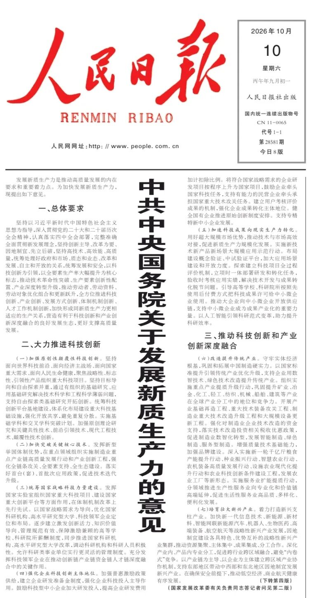

# 新质生产力：出版社别只当搬运工
> 💡 备注属性未写入，可能是备注属性名称或者类型被修改了，建议将字段类型设置为 rich_text，可以在小程序-操作-修改文章数据库页面进行调整
> 💡 原文链接:[https://mp.weixin.qq.com/s?__biz=MzE5MTc3MDIwMw==&mid=2247509512&idx=1&sn=33165474aba88f58bb5aa5c1c7c582e9&chksm=97864a8c29bc1205bc9e1b09a1f6a31205377ba881f011842e915befa3b19db36d39b5a690c2#rd](https://mp.weixin.qq.com/s?__biz=MzE5MTc3MDIwMw%3D%3D&mid=2247509512&idx=1&sn=33165474aba88f58bb5aa5c1c7c582e9&chksm=97864a8c29bc1205bc9e1b09a1f6a31205377ba881f011842e915befa3b19db36d39b5a690c2#rd)

3980字 
**内容摘要**
新质生产力是让知识进入生产，出版社若只当“搬运工”，内容便止于库存。本文基于《意见》，从科技出版、产业出版、AI+出版、绿色出版、开放配置、体制机制与人才建设切入，提出出版社应从介绍人转向当事人，从卖书转向卖知识服务，以先使用后付费、知识图谱、数据确权、耐心资本等为抓手，深度嵌入科技创新和产业创新融合。同时须因地制宜、先立后破，避免一哄而上。结论：**把内容变成能力，把阅读变成生产**，出版社方能成为新质生产力的参与者而非旁观者。
**关键词**
新质生产力；出版转型；知识服务；产业创新；深度融合
**目录**
**一、出版社站在哪儿：从搬运工到过日子的人**
 1.知识不流动，就是库存
 2.编印发各管一段，得改
**二、科技与产业出版：别等论文发完才进场**
 3.企业研发那头，出版社能做什么
 4.传统产业出版：别嫌土
 5.新兴与未来产业：今天播种，明天发芽
**三、AI、绿色与开放：新工具、新账本、新出路**
 6.AI+出版：换发动机，不是换人
 7.绿色出版：纸书还在，碳账本也得算
 8.开放与全球配置：好姻缘不怕远
**四、机制与人才：让干活的人有底、有劲、有盼头**
 9.体制机制：改革别只改KPI
 10.人才：出版人自己也得“新质”起来
**五、稳稳过日子：作者、读者与自己的节奏**
 11.先胜后战，后勤先行
 12.把作者当伴侣，把读者当家人

新近印发的这份《意见》，我已经反复读了三遍：第一遍看政策，第二遍研产业，第三遍谋本社发展。文件开头说：“**发展新质生产力是推动高质量发展的内在要求和重要着力点**”。出版社总爱说自己是内容行业，可内容不转化、不进入生产，就只是库存。新质生产力这桌饭，出版社不能只当端盘子的，得下场做菜。

**一、出版社站在哪儿：从搬运工到过日子的人**

文件讲坚持创新主导、改革为要、因地制宜、先立后破，讲高技术、高效能、高质量，落脚点是**全要素生产率大幅提升**。全要素生产率靠什么？靠人、靠技术、组织方式。出版社干的事，就是把知识装进人脑、把标准送进车间、把数据连成网络。文件还讲劳动者、劳动资料、劳动对象优化组合和更新跃升，教材管劳动者，专业书管工具，数据库管对象，三样都能碰。

**1. 知识不流动，就是库存**

出版社手里攒着好东西，学术专著、行业标准、技术手册、案例集，出了库房，进了书店，之后呢？很多书躺在仓库里睡大觉。不是内容不好，是没找到用的人、没找到用的场景。婚恋里，媒人只负责让两人认识，以后日子过得好不好，得看两人怎么搭伙。出版社不能只当媒人，要把作者的知识和读者的需求搭上线，让知识真正流起来。

**2. 编印发各管一段，得改**

以前出版社是编、印、发各管一段，编辑管内容，印制管生产，发行管卖书，谁也不碍谁。新质生产力要的是**科技创新和产业创新深度融合**。融合不是口号，是编辑、技术、发行、数据、国际一起商量事。选题会上，技术编辑说数据，发行说渠道，编辑说内容，国际说版权，谁也别嫌谁多嘴，各管一段，不如坐一条板凳。

**二、科技与产业出版：别等论文发完才进场**

科技出版不是等论文发完了再出书，产业出版不是等企业做大了再约稿。新质生产力讲原创性颠覆性科技创新，讲有组织的基础研究，讲新型举国体制，讲国家战略科技力量。这些话背后，全是出版机会。科技期刊、学术专著、预印本、数据论文、技术路线图、专利导航，哪一样离得开出版？允许科研类事业单位实行更灵活的管理制度，机制活一点，期刊快一点，平台实一点。

**3. 企业研发那头，出版社能做什么**

强化企业科技创新主体地位，建立企业研发准备金制度，提高企业研发费用加计扣除比例，将符合国家战略需求的企业研发项目按程序上升为国家项目。企业研发要情报、标准、专利、培训，出版社不做，咨询公司就做了。**先使用后付费**，把科技成果许可给中小微企业使用。出版社手里版权、内容、数据库，能不能也学？先让企业用，用了再算账。人工智能引领科研范式变革。科研人员查文献、做综述、找交叉点，方式变了，出版社不把内容做成知识图谱、语义检索，就成纸堆。年轻学者论文发出来千辛万苦，发完了没人看，可惜。出版社早一步，把知识接住、传出去，是本分。

**4. 传统产业出版：别嫌土**

改造提升传统产业，实施产业基础再造工程、重大技术装备攻关工程、制造业重大技术改造升级工程和大规模设备更新工程。矿业、冶金、化工、轻工、纺织、机械、船舶、建筑，升级缺不了标准、手册、案例、培训教材。别嫌土，越土行业，越需要把经验变成可复制知识。车间里干了一辈子的老师傅，手艺要是没人记录、没人整理、没人出版，就随人走了，出版社把他们的经验变成书，就是留住了他们的命。

**5. 新兴与未来产业：今天播种，明天发芽**

培育壮大新兴产业，新一代信息技术、新能源、新材料、智能网联新能源汽车、机器人、生物医药、高端装备、航空航天。文件提避免“内卷式”竞争。出版也一样，一窝蜂出AI书，最后同质化。低空经济、商业航天健康有序发展，多少空白选题？行业报告、专业期刊、标准白皮书，都是活。前瞻布局未来产业，量子科技、生物制造、氢能和核聚变能、脑机接口、具身智能、第六代移动通信，现在看着远，五年后就是教材和科普富矿。工业革命不是一夜之间，是蒸汽机、铁路、印刷、教育慢慢咬合，新质生产力也一样，得一层层长。

**三、AI、绿色与开放：新工具、新账本、新出路**

文件讲全面实施“人工智能+”行动，智能网联新能源汽车、人工智能手机和电脑、人形机器人等新一代智能终端场景应用。出版社内容，未来不一定只躺书里，可能嵌在手机、电脑、机器人里，强化算力、算法、数据等高效供给，出版行最缺数据，不是没内容，是内容没结构化。

**6. AI+出版：换发动机，不是换人**

AI编校、翻译、有声、知识图谱、个性化学习，都能做，别只想着降本增效，出版也要变范式：从卖书到卖知识服务，从一次性出版到持续更新。风险也得说。构建技术监测、风险预警、应急响应体系，**确保人工智能安全、可靠、可控**，版权、幻觉、数据合规，一个都不能少。八楼有位快退休的老编辑戴着老花镜还学AI编校，手抖着点鼠标，不是他不行，是时代太快。得等等他们，拉他们一把。

**7. 绿色出版：纸书还在，碳账本也得算**

构建绿色低碳循环发展经济体系，建设一批零碳工厂和园区，全面实施碳排放总量和强度双控制度，产品碳足迹管理体系，以全国碳市场为主体完善碳定价机制。出版社听着离碳远，纸、印、运、仓储，哪一样不排碳？绿色印刷、按需印刷、电子出版、循环纸，都是路。健全绿色消费激励机制，加强绿色产品认证与标识体系建设。出版社可以出碳管理标准、ESG报告、绿色认证读物，企业做碳披露，要培训、案例、工具书，谁先出，谁先占位。印刷厂里闻了一辈子油墨味的老工人，肺和手都在为出版付出，绿色印刷，不光是政策，是对人的疼。

**8. 开放与全球配置：好姻缘不怕远**

在全球配置先进生产要素，扩大高水平对外开放，鼓励自由贸易试验区结合区位特点、资源禀赋、产业优势，集聚国内外先进生产要素。推动共建科技园区、“一带一路”联合实验室、国际先进技术应用推进中心等平台，主动构建全球创新合作网络。牵头实施并积极参与国际大科学计划和大科学工程。鼓励外资创业投资机构、国际标准组织等来华发展。建立高效便利安全的数据跨境流动机制。出版走出去，不只是卖版权，是建合作网络、办联合实验室、推标准。做版权输出的同事，为的是让中国故事走得更远。异地恋、跨国恋难，但不是不能过，靠信任、靠流动、靠共同目标。开放，就是好姻缘不怕远。

**四、机制与人才：让干活的人有底、有劲、有盼头**

文件讲职务科技成果赋权和资产单列管理改革，允许符合条件的国有企业开展多种形式激励。出版社大多是国有文化企业。激励怎么搞？股权、分红、项目制、工作室，都可以试，编辑考核不能只看码洋，加快推动科研人员考核评价激励与报项目、发论文、评奖励等适度脱钩，防止简单按人才“帽子”定薪酬、定职称、定待遇。这话对出版科研人员一样管用。

**9. 体制机制：改革别只改KPI**

市场监管也在变。完善市场准入制度，强化反垄断和反不正当竞争，建立高效的知识产权综合管理体制，完善惩罚性赔偿制度，研究同新业态相适应的税收制度。盗版、洗稿、侵权，成本会越来越高，出版社版权资产，反而更值钱。金融那头，天使投资、风险投资、私募股权投资，耐心资本，投早、投小、投长期、投硬科技，科技创新债券，覆盖科技创新全链条的保险产品。出版集团能不能设基金？并购？上市融资？都可以想。法学讲产权，政治学讲治理，都是让干活的人有底、有劲、有盼头，多少编辑，半辈子编好书，职称上不去，待遇上不去，心里憋屈。机制不改，人心就凉了。

**10. 人才：出版人自己也得“新质”起来**

文件说教育科技人才体制机制一体改革，新型研究型大学，工学一体化技能人才培养模式，大国工匠、高技能人才兼任职业学校实习实训教师。出版社位置特殊。教材、培训、知识更新、技能认证，都是老本行。新八级工制度推开，产业工人向上发展，配套教材和课程从哪来？加快破除各种隐性壁垒，畅通高等学校、科研院所、企业人才交流通道。出版人能不能去企业？企业工程师能不能来当编辑？学者型编辑、产品经理、数据编辑、版权经纪人，这些新岗位，得有人干。编辑不懂AI、不懂产业、不懂数据，光会改错别字，路会越走越窄。四五十岁还在出版社默默编书的人，不是没本事，是没被看见，给他一个机会，他能撑起一片天。

**五、稳稳过日子：作者、读者与自己的节奏**

出版社做新质生产力，像打仗。先胜后战，选题论证、作者储备、数据底子，得在开战前备好。不打无准备之仗，别等风口来了才找专家。后勤先行，内容库、版权库、数据库，就是粮草，粮草不济，前线冲不动。联合作战，编辑、技术、发行、数据、国际，不能各自为战。文件讲跨区域跨部门协调，讲全国一盘棋，就是联合作战。

**11. 先胜后战，后勤先行**

集中优势兵力，别撒胡椒面。一个社，把一两个领域打穿，比十个领域蜻蜓点水强。兵贵胜不贵久，快速迭代，小步快跑。文件最后讲：**因地制宜，先立后破、稳中求进**，不能脱实向虚、贪大求全、搞泡沫化，不能出现产业空心化或产业断层现象，不能盲目求新、顾此失彼。还特别说，严禁借发展新质生产力之名违规滥用政策，对一哄而上、盲目投资造成重大损失的严肃追究责任。嘿嘿！也别一听AI就建平台，一听数据就买服务器，最后空转，有的出版社一改就乱。稳着来，不是不动，是看准了再动。

**12. 把作者当伴侣，把读者当家人**

出版社和作者，不是买卖版权的甲乙方，更像长期伴侣。作者把心血交出来，出版社不能只想着首印和折扣，要一起做产品、做课程、做数据库、做国际推广。出版社和读者，不是单向输出，是共同经营，读者反馈、使用数据、二次创作，都是内容的一部分。大社小社，也不必都做大而全。专精特新中小企业发展，放在出版里，就是专业社、特色社、小而美。不是只有一种幸福模板，有人适合大平台，有人适合小日子，关键是找到自己的节奏。

新质生产力对出版社，而是**把内容变成能力，把阅读变成生产**，而不是把书变成屏。出版社手里有内容，心里有作者读者，把书出好，把知识传好，这条路，走得通。❤️
**·END·**
**欢迎**点击下方↓**关注**“红蓝线” **欢迎转发**

## 摘要

（待补充）

## 我的笔记

（待补充）
