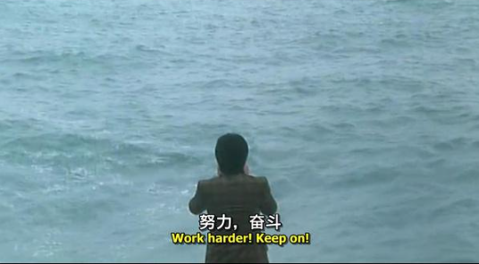
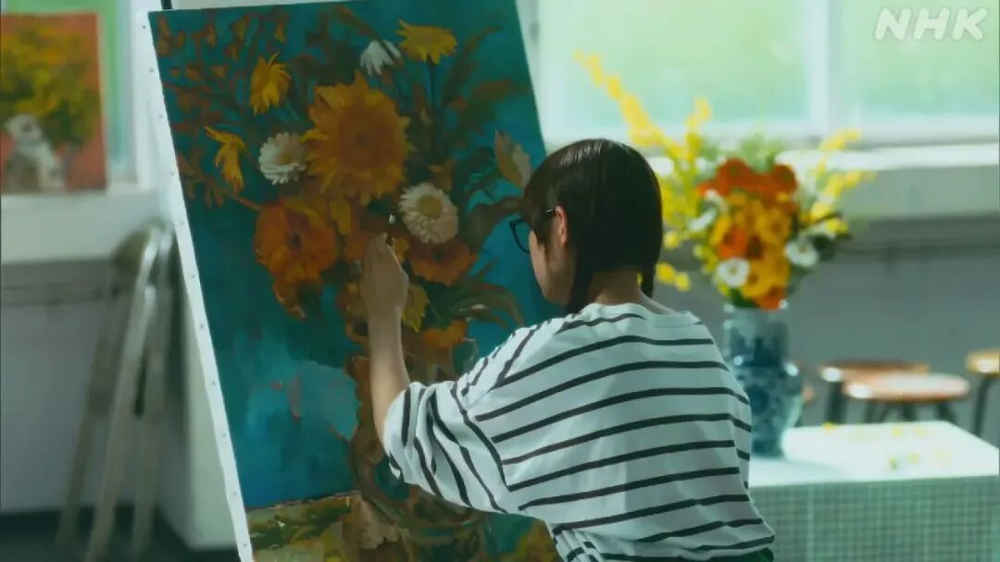
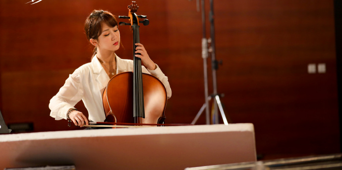
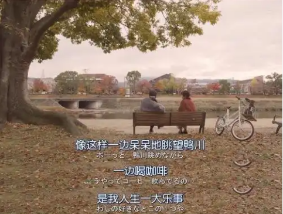
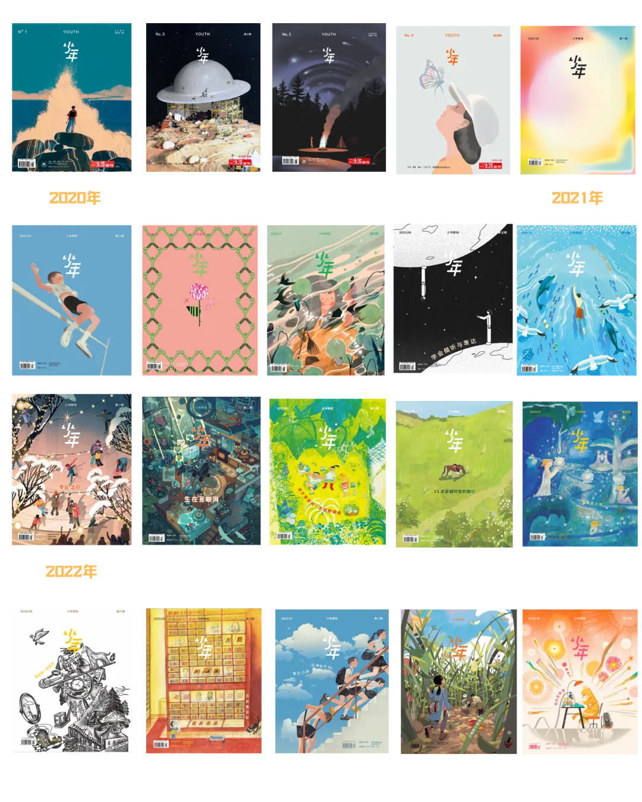
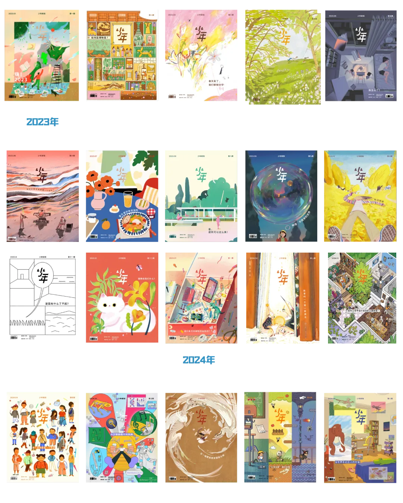
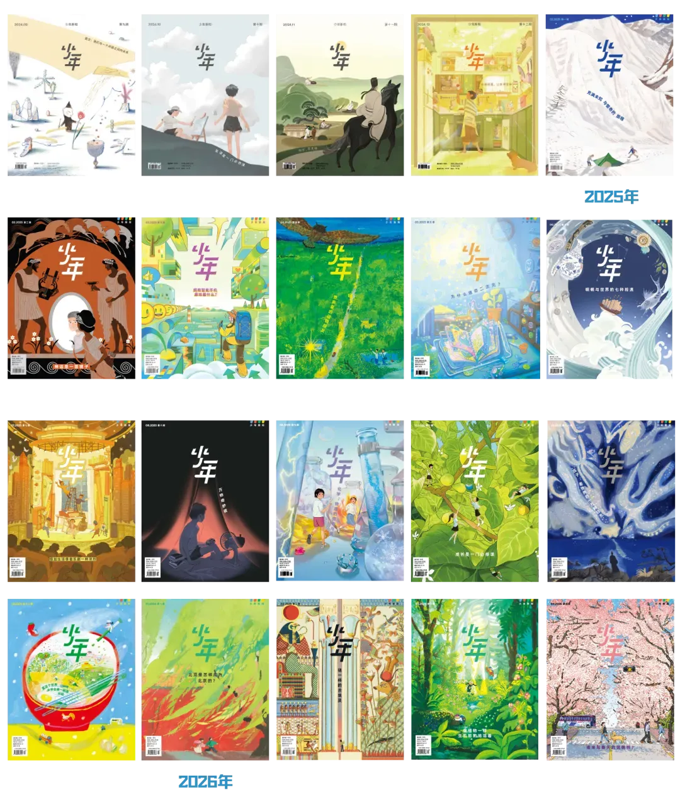
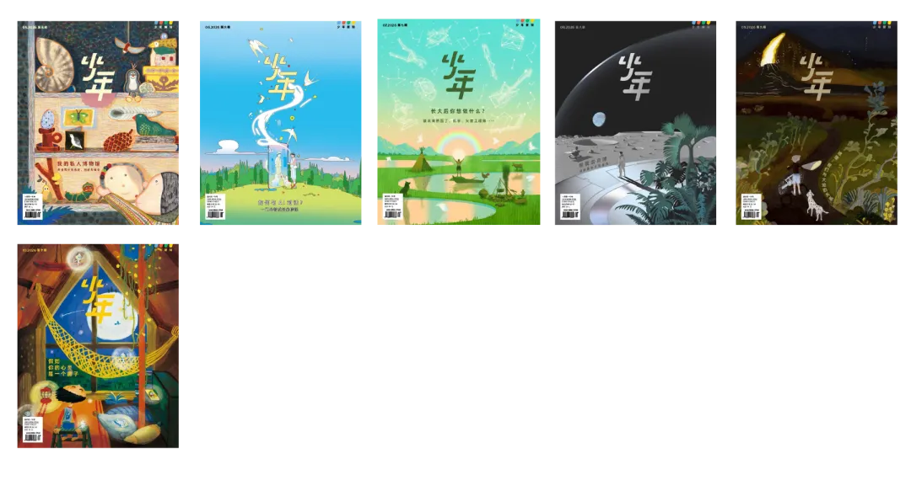

# 无所事事的时光有多重要？
> 💡 备注属性未写入，可能是备注属性名称或者类型被修改了，建议将字段类型设置为 rich_text，可以在小程序-操作-修改文章数据库页面进行调整
> 💡 原文链接:[https://mp.weixin.qq.com/s?__biz=MzI1NzI3NjEwOQ==&mid=2247615973&idx=1&sn=fbf018f431f9bc64899c4a980273bf8e&chksm=eb5337e632fff3a730ad7cde20a7a3f9a48f93b1f88824569bad1f848d90c94bed8fe490311c#rd](https://mp.weixin.qq.com/s?__biz=MzI1NzI3NjEwOQ%3D%3D&mid=2247615973&idx=1&sn=fbf018f431f9bc64899c4a980273bf8e&chksm=eb5337e632fff3a730ad7cde20a7a3f9a48f93b1f88824569bad1f848d90c94bed8fe490311c#rd)
一个人的时间如果从早到晚都预先规定了用途，他就很难遇见那些尚不知道有什么用却真正吸引自己的东西。
我们生活在一个越来越容不下“无所事事”的时代。
这里所谓的“无所事事”，不是一般意义上的慵懒、虚度光阴，而是指一段尚未被自己或他人规定好用途的生命时间——我可以做点什么，也可以什么都不做，而不必立刻回答“这有什么用”。
**更快、更高、更强——现代社会对效率的崇拜几乎不言自明，却很少有人追问：为什么不是速度合适、高度恰好、力量和柔韧性相配？**

《喜剧之王》剧照
古典世界其实很在意“刚刚好”。亚里士多德谈美德时讲“中道”。勇气处在鲁莽和怯懦之间，慷慨处在挥霍和吝啬之间。它不是数学上的五五开，而是针对情境而言的恰当分寸。《老子》则从另一个方向说：“有之以为利，无之以为用。”房子之所以能成为房子，不只是因为有墙、有梁柱，更因为中间有一块什么都没有的地方，人才能在其中生活居住。中国画里的留白也是这样。**“白”不是什么都没有，而是“气口”；恰恰因为没有被画满，山水才有了气息。**
现代生活的逻辑恰恰相反，我们越来越习惯把每一个空格填满。德国社会学家哈特穆特·罗萨把现代社会的一种基本状态称作“加速”：技术越来越快，社会变化越来越快，生活节奏也越来越快。现代社会需要增长、创新和加速，只为了维持既有状态。最麻烦的是，这种社会结构让我们停不下来，而是必须不断增长、不断更新、不断向前，才能维持原来的位置。**这种“动态稳定”让人想到陀螺，为了稳定，只有高速旋转下去，一旦慢下来就会倾覆。**这种逻辑最后深入骨髓。只要停下来，就觉得自己不进而退；只要没有结果，就觉得蹉跎时日；只要没有成功，就觉得自己不够好。我们开始拒斥无所事事。

《走走停停》剧照
这种逻辑进入教育以后尤其明显。许多父母疑惑，自己的孩子为什么缺乏自驱力。这个问题乍听起来很合理。但在实际经验中，却不免自相矛盾。一方面希望孩子“自己驱动自己”，另一方面却替他把生活的每时每刻填满：运动半小时，因为运动有利于大脑；睡眠八小时，因为睡眠可以提高学习效率；假期出去旅行，因为可以增长见识；休息也是为了服务于学习。
**“你必须有自驱力”这句话本身就是一个悖论——自驱力的前提是“自主”，而“必须”恰恰意味着别人来规定自己。**就像说“你必须自由”一样，命令本身就取消了自由的条件。一个人需要感到“这是我的行动”，而不只是“我在执行别人替我决定的事情”。

《加油！妈妈》剧照
我们的问题在于，太渴望有用，太渴望卓越，甚至不惜揠苗助长。孩子一旦显示出星点兴趣，家长就恨不得培养成特长。然而，一件事情被塞得太满，就会过犹不及，性质也随之改变——从“我乐意做”变成了“我不得不做”，乐趣往往就是这么被扼杀在萌芽时。
“无所事事”和“努力”不一定非此即彼。努力当然重要。写作、绘画、运动，任何一种技艺，要想领略其美，都绕不开长期熏陶与习得，不论作为创作者，还是作为读者与观众。**真正的问题在于：谁在努力？是因为停下来就害怕落后，所以不得不继续往前跑，还是因为自己想再向里面走一步？**后一种努力，有时候比前一种还辛苦，但是身在其中的人未必觉得“苦”，反倒乐在其中。所谓“知之者不如好之者，好之者不如乐之者”。“乐之”不是任务完成以后得到的嘉奖，而是事情本身就是奖励。

《平屋慢生活》剧照
我以前听一位法国摄影师说，他的不少中国同行对电影创作很有雄心壮志（ambition），而他在工作里更在意乐趣（plaisir）。我一直记得这句话。
哲学家斯宾诺莎对“喜悦”做了很有启发的区分。他把喜悦理解为一种“过渡”：一个人从较小的完善性走向较大的完善性，也就是行动能力有所增加。斯宾诺莎认为情感有主动与被动之分，有的快乐受制于外物，我便是被动的，比如社交媒体的推送、获得大量点赞，即时的刺激会让人喜悦。这种依赖外部刺激的快乐，很容易使我停留在被动状态。刺激一停，快乐也跟着停。
另一种快乐的源头是我自己的行动能力的增长，我便是主动的。我弄懂了一个问题，想再往下想。弹琴时领悟了一个以前没有听见的细节，于是我想继续练习。外界触动了我，我把乐趣转化成我自己的行动，来认知，来追寻。两种快乐的区别就在这里：一种需要外部刺激不断续接，一种却慢慢转化成了有内在驱动的“乐之”——我自己的行动。

《余生，请多指教》剧照
所以我们需要的也许并不只是“休息”。**“休息”今天也已经被工具化了。休息是为了继续高强度地学习、工作，连游玩也是为了充电，提高效率。**依照这个说法，连休息都只是工作的一部分，像手机充电，充满后重新投入使用。
在这个意义上，尚未被“有用”奴役的无所事事，真的很重要。我们真正失去的，也许不是休息时间，而是允许时间暂时没有用途的能力。如果我们想建一栋房子，就需要图纸、砖瓦、木料、建筑工人。但在这一切之前，我们先需要一块空地。这块空地不是空洞、荒废，而是留出空间，成全，让人成为他自己。一个人能无所事事自己待着，而不立刻感到空虚和恐慌，这本身就是一种能力。如今，任何空隙都立刻被算法推送填满——我的关注力已经成为流通货币，媒体奇观是日常经验，成瘾机制则被精心设计为商业套利的手段。“无聊”变得越来越稀缺，我们很少有机会体验无事可做的乏味。

《在京都小住》剧照
问题并不在“有所事事”本身，而在生活时时受到外部目标的支配。一个人的时间如果从早到晚都预先规定了用途，他就很难遇见那些尚不知道有什么用却真正吸引自己的东西。
罗素在《赞美闲暇》中猛烈批评过一种根深蒂固的观念：劳动本身就是美德。我们甚至把赋闲看成某种亏欠。技术进步本来应该使人获得更多可以自行支配的时间。

而教育的一项任务，也应该是使一个人拥有使用闲暇的能力。有意思的是，英语的school（学校）和scholar（学者）都可以追溯到古希腊语的 σχολ （scholē），指闲暇、免于劳作，可以用于智力活动（沉思、讨论和学习）的自由时间。闲暇居然和学习、学校、学者联系在一起，今天听起来，几乎有一点不知所云。也许这提醒我们，**真正的学习，本来就不完全发生在被密集安排好的日程里，成长亦是如此。**

《欢迎回来百音》剧照
成长本来就如同历险，有一点不可预测。人当然可以追求卓越。但是比卓越更基本的，也许是拥有一 个不需要时时证明自己的生活。外在驱动可以让一个人向前走，却很难单独解释他为什么有一天愿意自己继续走。人就像植物，成长是需要一点林间空地的。在别人看来，他只是在发呆，在闲逛，在做一些没有意义的事情。也许正是在这些“无用”的时刻，他才第一次有机会发现：什么是自己真正“好之”“乐之” 的事情。一个人要成为行动的主体，他的生活里必须有一部分尚未被别人提前命名和规定的东西。

**作者简介**

王歌，哲学博士，柏林自由大学哲学院访问学者，研究领域涉及德国早期浪漫主义、德国古典主义哲学、启蒙以及德国现代哲学。

**《少年新知》是《三联生活周刊》旗下的原创青少年杂志，我们的自我定位是人文思维启蒙。我们希望这本杂志能够陪伴青少年一起直面真实复杂的世界，让他们意识到，看待世界不是只有一种方法。**
**自2020年6月创刊，《少年新知》已经推出66期杂志。我们的主题涉及时间、魔法、友谊、家庭、偶像、未知、运动、冬日、海洋、倾听与表达、网络生存、像侦探一样思考、历史、成长的烦恼、微观世界、写作实验室、清单、博物馆、爱情、野外、情绪、音乐、美食、建筑、物理、秋日、漫画、流行、故事、社团、身体、AI、南北朝、游戏、古生物、语文、苏东坡、厨房、旅行、神话、智能手机、野生动物、二次元、明朝、音乐剧、夜晚、化学、成长、庄子、面条、北京、古埃及、植物、诗歌、私人博物馆、职业、月球、地理、青春期等。**

**许多愿意为青少年写作和绘画的成年人加入了这本杂志的创作。科学、游戏、哲学、文学、心理学、艺术专栏的创作者不断地输送着前沿的研究和对日常生活的思考，试图回应青少年对现实世界的困惑。**
**点击图片，一键下单↓↓**

