# 无需破解，自己做软件免费用，随便用！
> 💡 备注属性未写入，可能是备注属性名称或者类型被修改了，建议将字段类型设置为 rich_text，可以在小程序-操作-修改文章数据库页面进行调整
> 原文链接:[https://mp.weixin.qq.com/s/Z_Kw91uaGF-xSoHevOJYTg](https://mp.weixin.qq.com/s/Z_Kw91uaGF-xSoHevOJYTg)

大家好，我是阿闲~
今天给大家分享阿闲自己做的实用工具软件合集，**完全免费，无需联网、无广打扰、无需安装，下载双击即可使用。软件启动后自动隐藏在右下角托盘，做到零打扰**。
这个软件其实就是前几天分享过的**【桌面管家】v2.11.33版本**，这次更新了三个实用的新功能。
**第一个：图绳**
这本来是一个国外的网友为Mac系统开发一个开源项目，适用于macOS 14及以后版本。可以将你的截图全部挂在一条绳子上，点击即可复制。

鼠标放到顶部就自动弹出来，鼠标离开就会隐藏起来。这个创意是还是非常不错的，让人眼前一亮。
还能保留多张截图，确实解决了截图不能同时展现的问题。
这个项目已经在github上开源，并且在短时间内斩获了2.6K star ，并且还在持续增加。
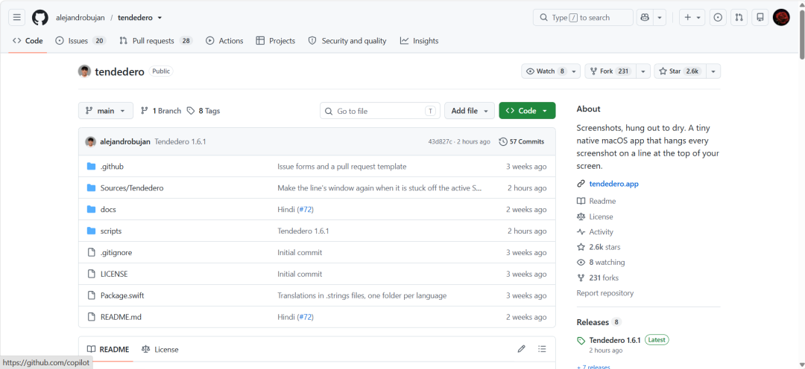
可惜没有Windows版本，很多朋友想用都用不了。
好在源码都在，于是阿闲直接复刻一个Windows版本，并且植入了【桌面管家】里面。
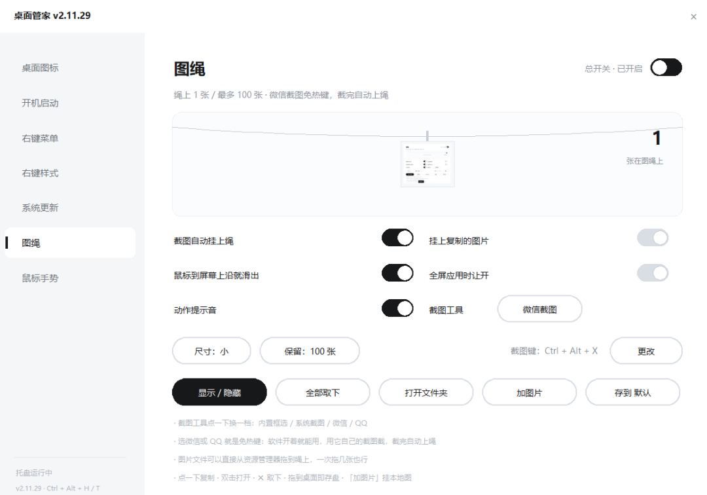
阿闲对此还是花了不少心思的，成功复刻了出来，并且还优化了不少功能。
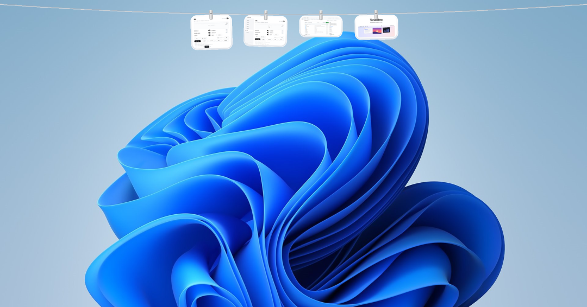
支持**微信、QQ、系统以及软件内置的截图方式**，并且支持截图后进行标注。
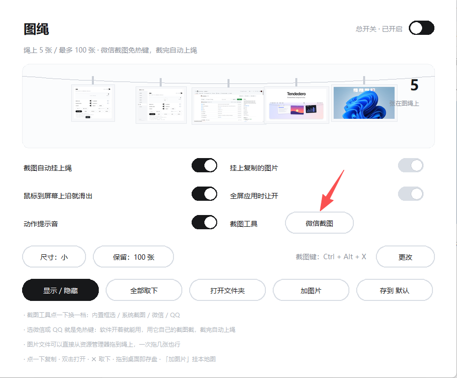
可以自定义设置截图存放位置，修改显示的尺寸。
不想要了，点击左上角的X，即可删除图片。
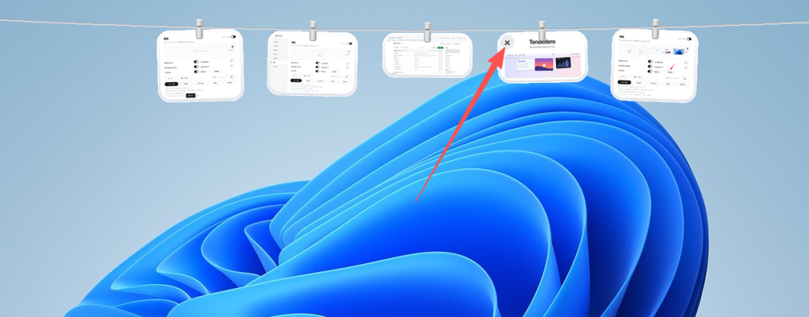
还可以直接拖拽到桌面，双击即可查看图片。
甚至本地图片，你也可以像晾衣服一样挂上去。只要选中图片，拖拽到晾衣绳，鼠标箭头对准晾衣绳就能快速挂上去。
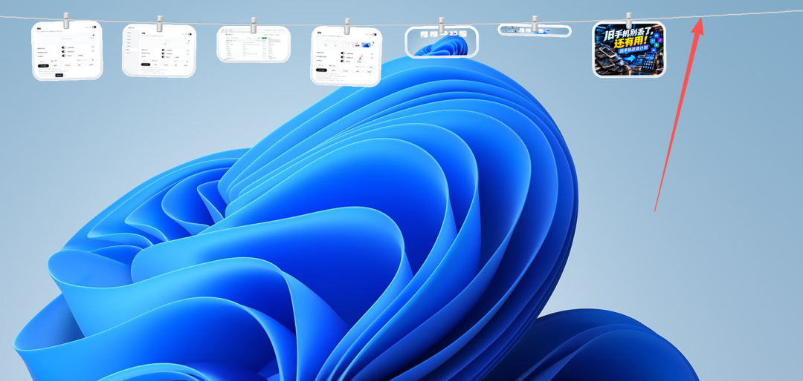
不想用了，点击右上角的关闭按钮就可。
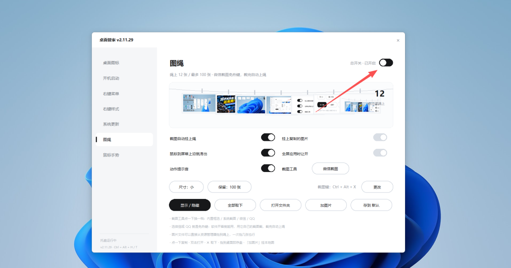
**第二个：鼠标手势**
之前阿闲虽然也给大家分享过两款鼠标手势的软件，但不知道为什么那些软件对于**粘贴**这个功能一直都是用不了。
你们电脑是这样吗？
阿闲以为是我自己电脑的问题，结果换了三台电脑还是一样。
最后只能卸载软件了，毕竟日常用得最多的就是复制粘贴了，既然这个都用不了，那实在就没必要留着了。
但我还是想使用鼠标手势怎么办？
于是就自己做了一个，植入了软件。晋级支持复制、粘贴、以及关闭窗口三个手势。就这三个日常用得比较多，多了也记不住，所以就写了这三。
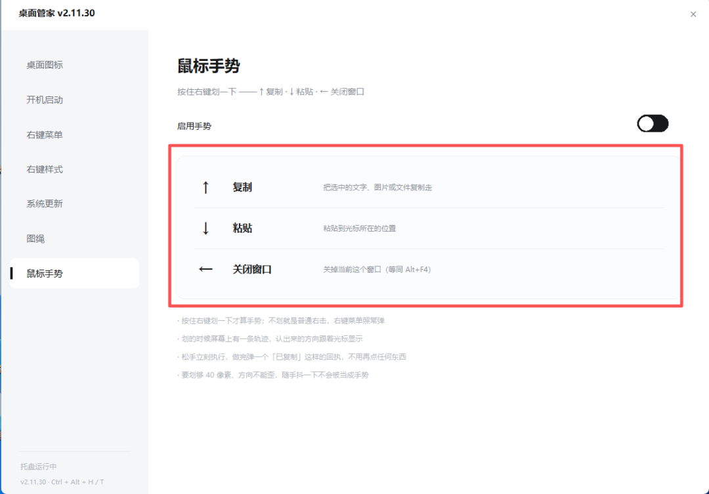
没想到这个简简单单的功能，居然折腾了好久才搞出来。
想要复制的话，需**选中文字**，让**按住鼠标右键往上滑即可复制**成功，然后在任意**输入框按住鼠标右键往下滑即可粘贴**。

不想用了，也可以直接关闭。
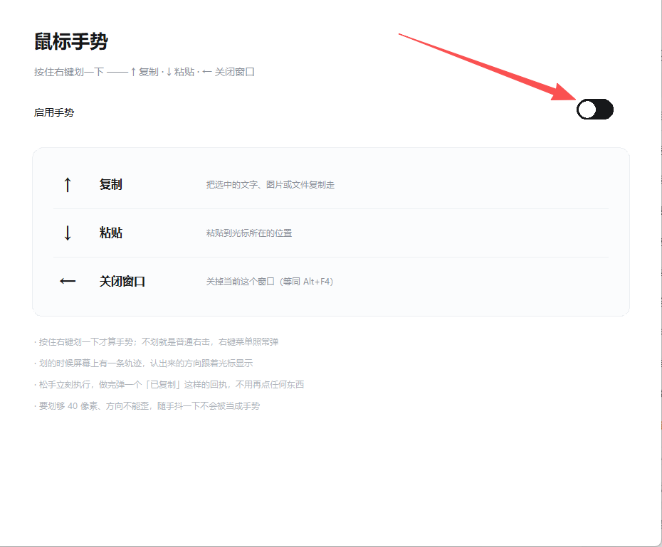
**第三个：禁止系统更新**
虽然win10已经不更新了，但是发现win11更新实在是太频繁了，很烦人。
于是写了这个一键禁止更新功能，开启后你的电脑再也不会提示更新了。
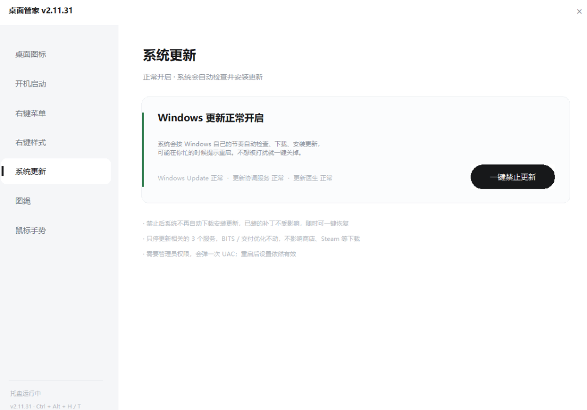
当想要更新的时候，直接点击开启即可。
剩下的功能，就是之前分享过的了，看过的朋友可以跳过了，没看过的朋友可以继续看下去。
**第四个：双击隐藏图标**
**双击桌面任意空白处**，即可快速隐藏桌面所有文件，再次双击即可还原。
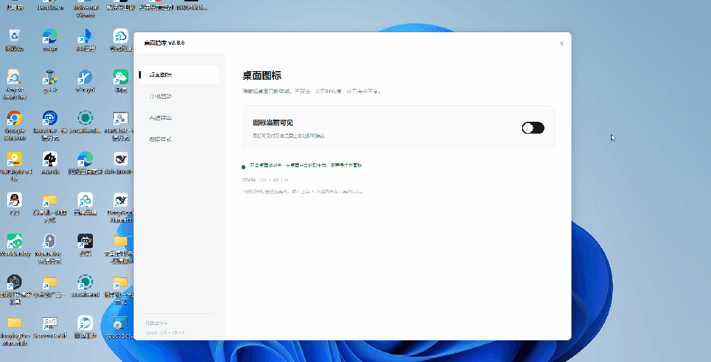
特别适合需要录屏的小伙伴使用，再也不用把那些图标和文件录入视频了。
**第五个、开机自启动管理**
现在的软件是真的流氓，很多都默认开机自启动，实在烦得很。所以阿闲特地花时间写了这个功能。

软件会自动识别你电脑开机自启动软件，**可以一键关闭和开启**。
不过要使用这个功能，**软件最好以管理员身份运行**，因为有些软件想要关闭自启动功能需要管理员权限。
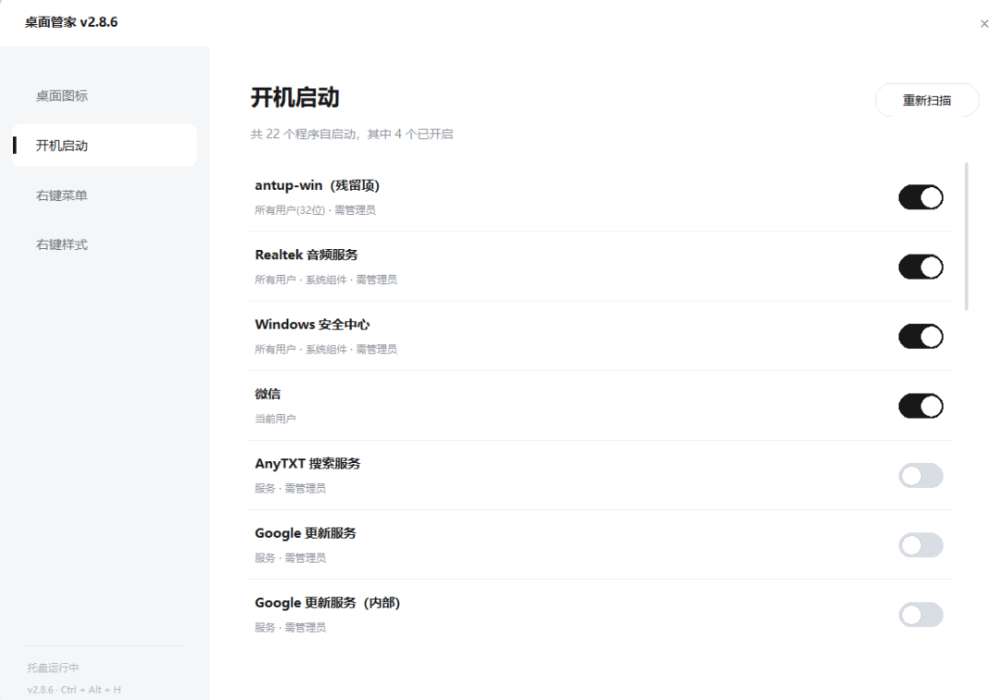
**第六个、右键菜单栏管理**
除了自启动外，鼠标右键菜单栏也是重灾区。
被强行捆绑了一大堆右键功能，特别是wps、百度网盘、夸克、最喜欢干这种事。
而且把关闭的按钮，隐藏得特别好，一般用户都很难找到。
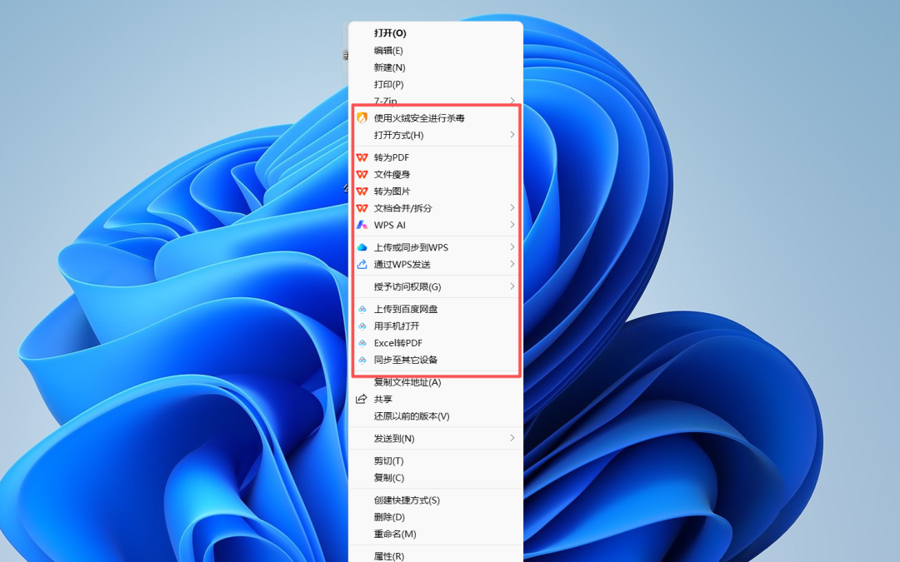
所以阿闲也把这个功能写了进来，可以一键关闭这些无用的鼠标右键，让你的右键变得更加清爽。
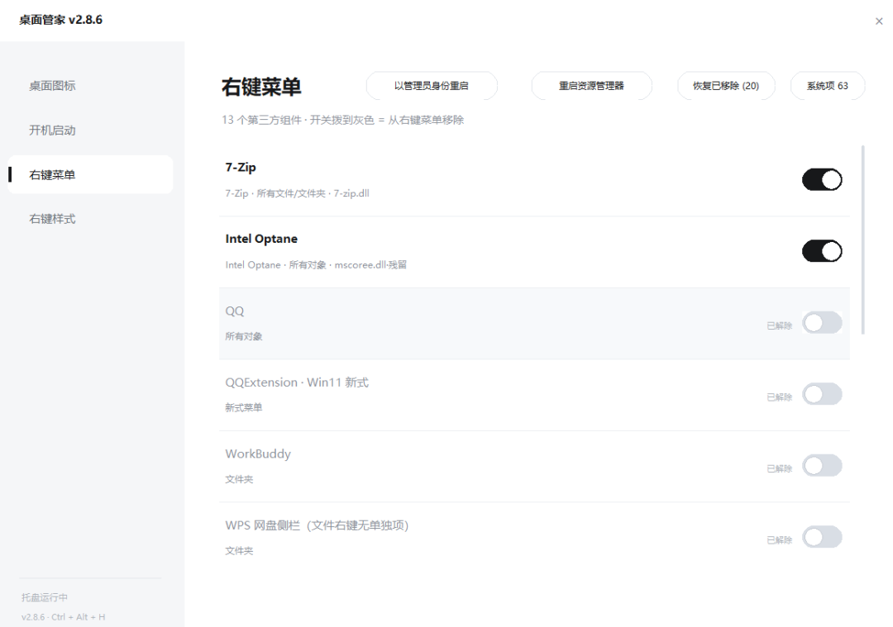
**第七个、右键样式更改**
你喜欢win10还是win11的鼠标右键样式？
我用惯了win10，实在是接受不了win11右键样式，还得多点一个**显示更多选项，**感觉没win10那个好用。
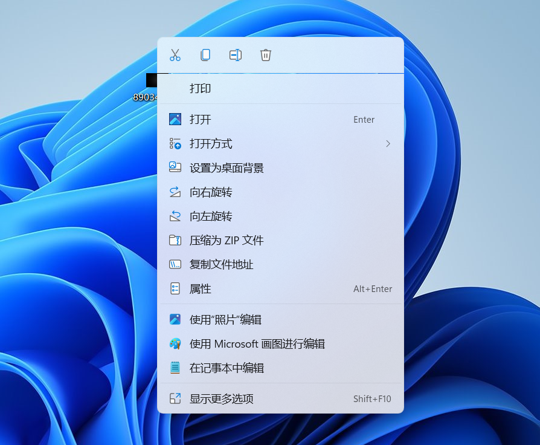
所以新增了这个右键样式切换功能，可以一键切换成win11右键，也可以一键变回win10右键，让你随意选择。
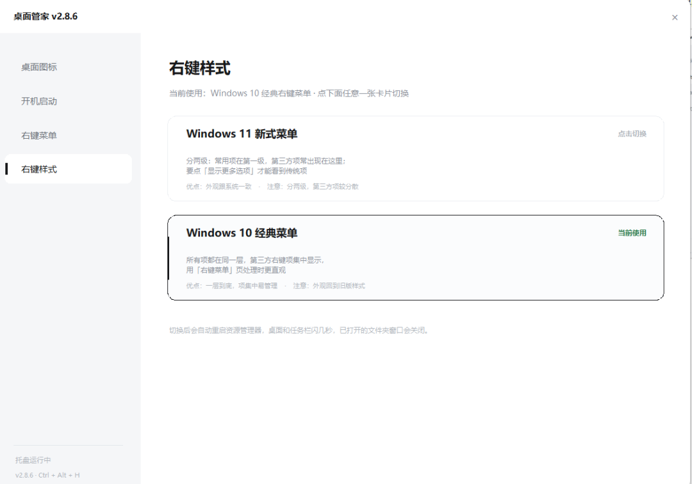
好了，以上就是今天的全部内容，感兴趣的朋友可以直接亲自去体验一下。
最后需要的小伙伴关注上面的**吾优公众号回复关键数字“008”**自取。
