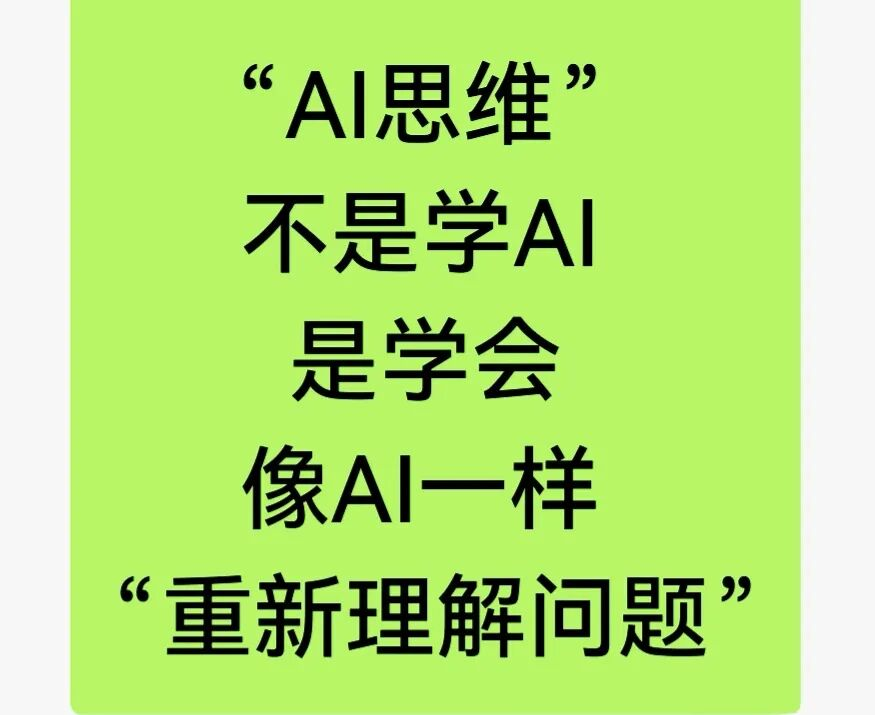

# 日本出版业AI转型：慢功夫里的快逻辑
> 💡 备注属性未写入，可能是备注属性名称或者类型被修改了，建议将字段类型设置为 rich_text，可以在小程序-操作-修改文章数据库页面进行调整
> 💡 原文链接:[https://mp.weixin.qq.com/s?__biz=MzU1MzE1OTc5MQ==&mid=2247496720&idx=1&sn=eeadb8f4652fa5c2016fe70eb4807203&chksm=fa3f4e73dc9fac061364c210fc9145906ed4a86815edb31a6c1e7f637d00d44674d418a5d579#rd](https://mp.weixin.qq.com/s?__biz=MzU1MzE1OTc5MQ%3D%3D&mid=2247496720&idx=1&sn=eeadb8f4652fa5c2016fe70eb4807203&chksm=fa3f4e73dc9fac061364c210fc9145906ed4a86815edb31a6c1e7f637d00d44674d418a5d579#rd)

**日本出版业AI转型：一边守版权，一边用AI，慢功夫里的快逻辑**
2026年，日本早川书房SF大赛的投稿量从往年400篇暴增至1012篇。
编辑部发现，有些作品前半段段落之间有空行，后半段突然流畅起来，那是AI生成的痕迹。
评审费用激增，新人文学奖面临存废危机。
与此同时，KADOKAWA的89名编辑正在一个叫“AI研究会”的Slack群里分享用法，讲谈社用AI预测电子漫画的销量，一个编辑说AI做标题“不够有吸引力”，但AI做需求预测“比凭感觉强”。
日本出版业对AI的态度从来不是“用不用”，它比多数人想象的更早用、更深用。
它只是比多数人更慢说。

一

日本版权法里有一条著名的条款：第30条之4。

2018年修订的著作权法规定，出于“非享受目的”，比如机器学习，使用受版权保护的作品，原则上不需要获得权利人许可，除非“不当损害著作权人利益”。
这条规定让日本被国际同行称为“机器学习的乐园”。
它意味着AI公司可以在相当宽的范围内，合法地拿日本的作品去训练模型，不用一个一个去谈授权。

但这个“乐园”是有边界的。“不当损害”四个字，是悬在头顶的一把剑。
2024年3月，日本文化审议会著作权分科会发布了一份文件，把“不当损害”的解释推向了更严格的方向：如果AI生成物与既有作品“类似”或“依拠”（即依赖、使用了原作品的核心表达），就可能构成侵权。
更关键的是，文件指出：如果AI的训练数据里包含了某作品，而生成物与它相似，通常可以“推定”存在依拠关系，举证责任转移到了AI使用者身上。

这意味着，日本的法律姿态不是“你可以随便用”，而是“你可以用，但你得能证明你没用坏”。

这种“用而有度”的逻辑，贯穿了日本出版业对AI的全部实践。

二

KADOKAWA是日本出版业里对AI态度最积极、也最系统的大社。

2024年4月，KADOKAWA内部成立了一个叫“出版事业集团AI研究会”的组织。
到2025年9月，已经有89名成员，编辑、工程师、数据专家，来自儿童书、生活方式、娱乐、非虚构等不同部门。
他们在一个Slack频道里分享AI用法，每月开一次线上定例会，讨论最新工具和版权问题。

KADOKAWA的AI研究会有两个特点。

第一，从业务需求出发，不从技术出发。
研究会的发起人伊集院元郁是儿童教养类图书的编辑长。
他的诉求不是“我们要用AI”，而是“编辑的时间被行政事务吃掉了，怎么省出来”。
所以研究会最先探索的，是写邮件、整理书目、总结材料这些“不产生内容但消耗时间”的环节。
一位接受访谈的编辑说得很直白：AI擅长“总结信息”，所以她主要用它做头脑风暴的辅助和营销材料的草稿。

第二，守住“最终成果物”的底线。
KADOKAWA的AI使用指南里有一条核心规定：原则上不把AI生成的内容作为最终交付物。
如果你想用AI生成的内容作为成果，得走一个专门的咨询窗口，经过审查。
这条规定的潜台词很清楚：AI可以做草稿，但不能做成品。
可以用它加速，不能用它替代判断。

三

KADOKAWA元副社长井上伸一郎说过一句话：“AI就像当年动画现场的CG。一开始很多人反对，现在不用CG的动画现场反而少了。”
他的结论是：“使いこなした人が勝つ”，会用的人赢。

这话听起来像“拥抱技术”，但井上的重点其实在后半句。
他说，AI的答案“取决于你让它学什么”。在Netflix的《ULTRAMAN》制作中，AI被用来提升影像处理质量，效果显著。
但那是“人类创造性的补强”，不是替代。

讲谈社的做法提供了一个更具体的注脚。

讲谈社与漫画应用Palcy合作，用AI做电子漫画首卷的销量预测。
最初他们用应用内数据直接建模，交叉验证结果不好。
后来他们做了一件事：让编辑和销售介入，用“深层的领域知识”给作品分类。
少女漫画、女性漫画的读者倾向不同，连载形态不同，更新频率不同，这些分类逻辑，是编辑日复一日和作品打交道长出来的，AI自己学不到。
加上这些分类之后，预测精度让编辑“惊讶”。

讲谈社还做了另一件事：用AI从Web媒体的文章标题预测PV（页面浏览量）。
编辑们一直为“什么样的标题会被读”发愁，AI给出了可量化的参考。
还有一个应用：根据Web媒体的文章内容推荐书籍，把文章和书库做语义匹配，自动推荐相关书目。

这些应用的共同点是：AI不替编辑做内容，它帮编辑做判断。
预测销量、预测PV、推荐书目，这些都是“决策辅助”，不是“创作替代”。
它们让编辑的经验有了数据支撑，而不是被数据取代。

四

日本出版业对AI的另一种用法，指向了一个更远的目标：让书被看见。

マイナビ出版2026年做了一件事：为了一本商业书《働くこと、生きること、つながること》，制作了AI生成的动画和漫画，在书店的数字屏、YouTube、SNS上投放。
他们的判断是：SNS和短视频成为主流信息渠道之后，书的封面和简介“已经不够了”。
读者需要更直观地感受一本书的“世界観”。
AI动画和漫画，是用更低的成本、更快的速度，把书的内容“翻译”成适合不同渠道的形态。

这个逻辑和KADOKAWA的“可发现性”问题意识是一致的。
出版业的问题从来不是“没有好书”，是“好书太多了，读者找不到”。
AI的价值，在营销端比在创作端更直接、更安全、更立竿见影。

五

日本出版业AI转型里，最值得注意的，可能不是那些“用了AI”的案例，而是那些“还没用”的领域。

一位接受访谈的编辑说，她只把AI输入限制在自己写的文本上。
她担心两件事：一是版权，二是信息泄露。“如果用于训练的作品内容被泄露，对出版社来说就是严重的信任问题。”她说。

文学奖的困境是另一个信号。
AI让投稿量翻倍，但翻倍的投稿里，大量是“没有经过长期打磨”的文本。
早川书房SF大赛的编辑发现，AI写作的痕迹很具体：段落之间有不必要的空行，后半段突然变流畅。
新人文学奖是出版社的“生命线”，用来发现未来的作者。
如果AI生成的投稿淹没了真正需要被看见的人，这条生命线就会被切断。
早川书房决定从下一届开始，强制要求提交AI使用情况说明。

韩国文学界选择了另一条路：直接禁止AI作品参赛。
日本选择了“允许，但要求说明”。
这个差别的背后，是对“AI使用透明度”的不同信任程度。
日本出版业似乎更愿意相信：与其禁止，不如让使用变得可追溯。

六

日本出版业AI转型的路径，可以用三个词概括。

第一，守。 守住版权底线，守住“最终成果物必须由人负责”的原则，守住“编辑判断不可替代”的认知。
日本版权法第30条之4的“非享受目的”条款给了AI训练空间，但“不当损害”的解释和“依拠推定”的判例方向，又在收紧这个空间。

第二，用。 用在“效率环节”和“决策环节”，不用在“创作环节”。
写邮件、做草稿、预测销量、推荐书目、生成营销素材，这些是AI的舒适区。
标题创作、封面设计、文学编辑，这些是AI的边界区。
一位编辑说得很准确：AI做标题“不够有吸引力”，但做需求预测“比凭感觉强”。

第三，慢。 不急着“全面AI化”。KADOKAWA的AI研究会做了快两年，还在“分享用法”的阶段。
讲谈社的销量预测先“小范围试验几个月”，观察结果和编辑判断的偏差，再决定推广。
这种“慢”，不是保守，是让AI在可控的范围内积累信任。

七

日本出版业对AI的态度，说到底是一个关于“信任”的故事。

信任不是靠“拥抱技术”的口号建立的。
信任是靠一个一个具体的场景、一次一次可验证的结果、一层一层可追溯的规则，慢慢攒出来的。
一位编辑说，AI的价值和生命线“在于仔细审视内容、提供准确信息的能力”。
这个能力，AI目前给不了。
它只能帮人更快地到达那个能力的门口。进门之后的事，还得人自己做。

井上伸一郎说“会用的人赢”。
但他没有说“用得最多的人赢”，也没有说“最早用的人赢”。
他说的是“会用的人”，知道什么时候用、用在哪儿、用到什么程度、什么时候停下。
这种“会”，不是技术能力，是判断力。
而判断力，恰恰是AI给不了的东西。

## 摘要

（待补充）

## 我的笔记

（待补充）
