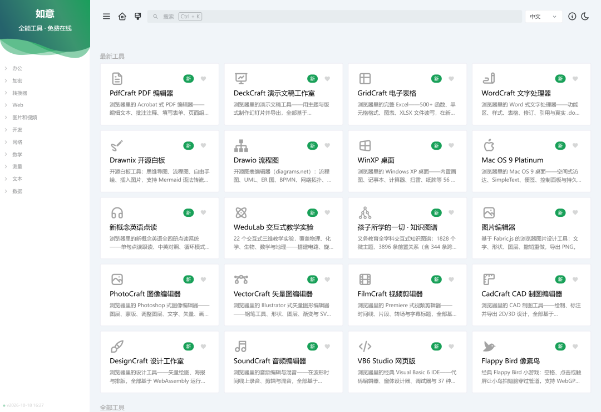

# 早读课又"安静"了？这个不用联网的单文件小工具，让全班跟着读完一篇课文
> 💡 备注属性未写入，可能是备注属性名称或者类型被修改了，建议将字段类型设置为 rich_text，可以在小程序-操作-修改文章数据库页面进行调整
> 💡 原文链接:[https://mp.weixin.qq.com/s?__biz=MzI1ODk1NDI4MA==&mid=2247492729&idx=1&sn=06da6c38e96b69f9ddcf78959d2e5be1&chksm=eb5b4a739c78b479c22cc5b7f37a8b2727b059b47da59185234a56969040694925868e5bc0aa#rd](https://mp.weixin.qq.com/s?__biz=MzI1ODk1NDI4MA%3D%3D&mid=2247492729&idx=1&sn=06da6c38e96b69f9ddcf78959d2e5be1&chksm=eb5b4a739c78b479c22cc5b7f37a8b2727b059b47da59185234a56969040694925868e5bc0aa#rd)
## 早读课又"安静"了？
## 这个不用联网的单文件小工具，
## 让全班跟着读完一篇课文
月小意的学涯 · 帮老师创造工具的人
早读课最尴尬的三个瞬间
1你按下播放，全班稀稀拉拉跟了两句，声音越来越小，最后只剩音响在响；
2有人读得快、有人读得慢，一篇课文永远读不到一块儿去；
3你刚巡视到后门，前门那头的声音已经弱下去了——两个班，你顾不过来。
有位老师跟我说："早读缺的不是内容，是一个不知疲倦的带读员。"
这句话，就是**「早读带读器」**的起点。

---
### 一、项目背景：一个被提问"问"出来的工具
早读带读器最早收到的留言之一，是位小学老师问的：**"是不是需要收音器才得啊？"**
她想要一个能领读、能倒计时、能自己定节奏的早读助手，又怕它"娇气"——要装软件、要插设备、要联网。
答案统一是：**什么都不用买。**
它是一个**单文件 HTML 工具**：不用安装、不用联网、不用注册，双击打开就能用。电脑自带的声音就能领读，机器读一句，全班跟读一句。
后来，留言越来越多：
"教室电脑关机，数据会不会没？""在家设置好了，拷到教室一体机上，怎么全不见了？""英文也是可以读的！""英语读得不对，不能用"……
每一句留言，最后都变成了这个工具里的一个功能：
● 问"换电脑怎么办"，它长出了**数据备份迁移** v1.4
● 问"能不能用原声"，它接进了**课文音频原声带读** v1.3
一个工具好不好用，不是做出来那天说了算，是被用的老师们一次次问出来的。

---
### 二、核心功能：一台"带读员"该有的样子
**1. 两种模式，管住两种早读**
跟读领读模式
机器逐句领读 → 全班跟读 → 下一句，一句一句带节奏。顶部大倒计时和进度条，底部句子轨每个小格代表一句，读完的变金——读到哪、还剩多少，一眼看清。最适合统一内容、需要带着读的早读，最能防安静。
自由朗读模式
把内容清空再点开始，大倒计时 + 背景节拍 + 到点鼓励语，不粘任何课文。适合复习默读、各自朗读，全班自己读自己的。
**2. 逐句可控：暂停、跳过、重读**
全班停一下讲两句？按 空格。这句读顺了？按 → 直接进下一句。重点句想多读几遍？按 ↑，这句跟读完自动再领读一遍，可连按到 4 遍，按钮会显示 ×2、×3。
**3. 原声带读：课文录音直接上场**
上传课文原版录音（教材配套音频、网上原声或自己录的，mp3 / wav / m4a，60MB 以内），开始早读自动播放原声——发音、重音、语感原汁原味，尤其适合英语课文。
不传原声时用机器领读：中英文自动识别断句，推荐 Edge 浏览器 + "晓晓 / 云希"音色，接近真人。

**4. 小树森林：把"读完、读好、坚持读"变成看得见的成长**
这是核心激励：**不测音量、不奖励喊得响**，奖励的是真实发生的朗读行为——
● 跟读模式每读完一句，树长一档，读完整篇正好长成大树；
● 重点句每多读一遍，额外再长半档，难句多练，树长得快；
● 树高 = 这篇内容累计完成度，跨天累计，下周接着上周长；
● 树满 100% 结金色果子，累计读满 10 次的树开粉花，是森林里最亮的树。
学期末，设置页就是一片小森林。课前花 10 秒投影给全班看：**"这篇读得多、那篇读得少，自己看。"**
**5. 真人鼓励语 + 早读记录**
开始、读完一遍、过半、剩 3 分钟、剩 1 分钟、结束——6 条鼓励语都可以录老师自己的声音。学生听到老师的声音，比机械音亲切得多。每次早读结束自动记录（日期、内容、句数、重读遍数、用时），森林、汇总表、明细表随时可查。

---
### 三、独特卖点：它和别的工具有什么不一样
| 卖点 | 说明 |
| 零门槛 | 单文件、离线、免安装、免注册、免费，U 盘拷走就能上课 |
| 数据是你的 | 内容存在本机浏览器，导出 .zaodu 备份文件，换电脑一键导入，三台电脑十分钟搞定 |
| 适配真实教室 | 深色水波皮肤配液晶大屏/一体机；浅色白底皮肤配老式投影仪，背景图自动隐藏 |
| 老师的声音在场 | 6 条鼓励语可录真人语音，早读有你的语气，不只是提示音 |
| 功能表是问出来的 | v1.3 原声带读、v1.4 数据迁移,每个版本都对应一批真实提问 |
---
### 四、目标受众：谁适合用
● **小学 / 初中语文、英语老师**：早读主理人，最直接的受益者；
● **班主任**：早读看班、两栋楼巡视，需要"不用盯也不停声"的方案；
● **教研组 / 学校信息化**：统一装备推荐，零部署成本；
● **居家早读的家长**：带孩子按篇目跟读，同样适用。

---
### 五、三步上手
1**粘贴朗读内容**：打开文件，把要读的内容粘贴进"读什么"（中英混合都行，换行分段、标点自动切句），内容自动记住；
2**选时长与方式**：10 / 15 / 20 / 25 分钟一键选，按需调语速、跟读宽紧、节拍、皮肤；常用内容可存"预设"，语文英语一秒切换；
3**点"开始早读"，投屏全屏**：点绿色按钮，按 F11 投屏，课堂马上开读。
**最省事的工作流**：把常用内容存成预设，上课时下拉选一下、点开始，5 秒进入状态。
---
### 写在最后
这个工具几乎没有凭空造出来的功能，大部分都是被老师们一句一句"问"出来的。
问"要不要收音器"，
它证明了不插设备也能领读；
问"英语怎么没声音"，
它补上了系统语音的排查方法；
问"换电脑怎么办"，
它长出了数据迁移；
问"能不能用原声"，
它接进了课文音频；
让早读不停声，让朗读看得见。
如果你也想试试，或者有下一个"为什么"，欢迎留言——说不定，它又会变成下一个功能。
---
### 鸣谢
特别感谢 **洵**、**win my**、**子萌** 等老师关于「导入课文音频」的提议。正是这些来自一线课堂的反馈，让「课文原声带读」功能更早落地、更贴近真实教学场景。工具因提问而生长，也因你们而更好用。
**📦 这篇文章的「配套资源」**
**🔧 在线互动工具**

https://jiaoshiai.com.cn/tools/zaodu/index.html
手机电脑都能点，免费，不用下载
**📖 在线使用手册**

https://jiaoshiai.com.cn/tools/zaodu/%E6%97%A9%E8%AF%BB%E5%B8%A6%E8%AF%BB%E5%99%A8%E4%BD%BF%E7%94%A8%E6%89%8B%E5%86%8C.html
**🌐 我的网址**
https://jiaoshiai.com.cn/
更多课堂小工具都在这里
［入群码 “加群一起聊课件 · 工具 · 物理科普”

**互动话题**：你早读时最头疼的是什么？评论区聊聊，呼声高的需求会进入下一个版本。
-END-
图文编辑/月小意
**本文首发于公众号月小意**
**转载请联系公众号**

