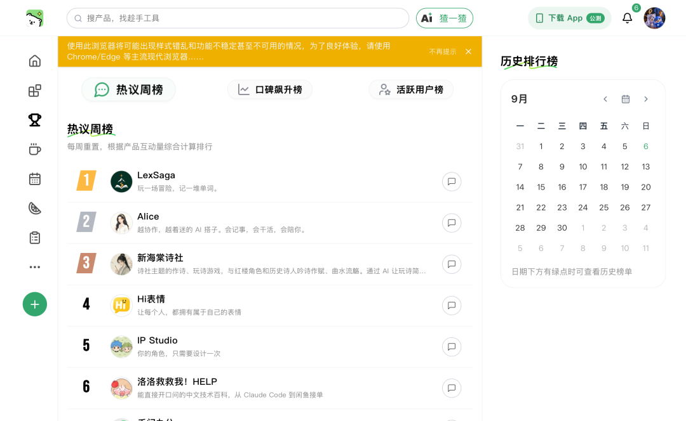
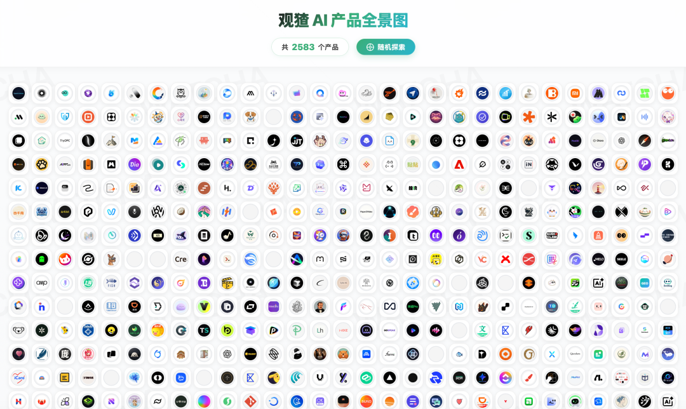
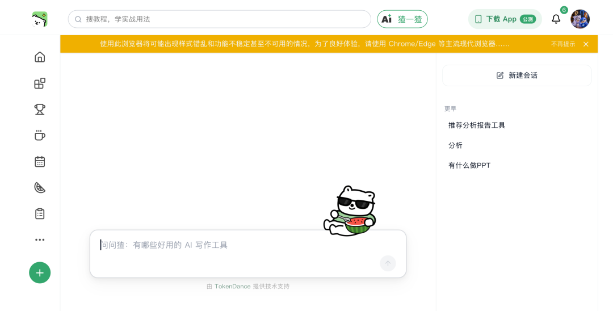
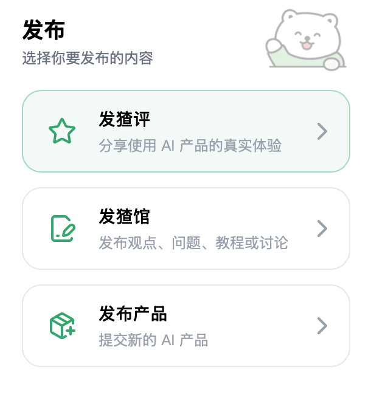
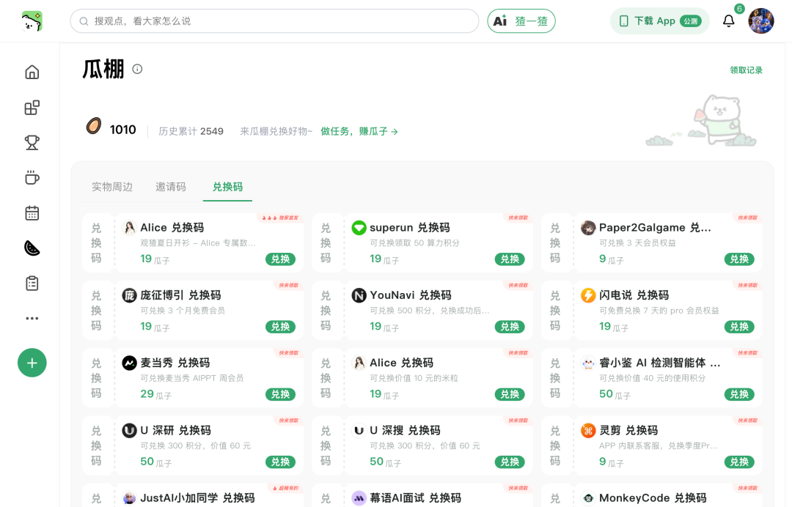
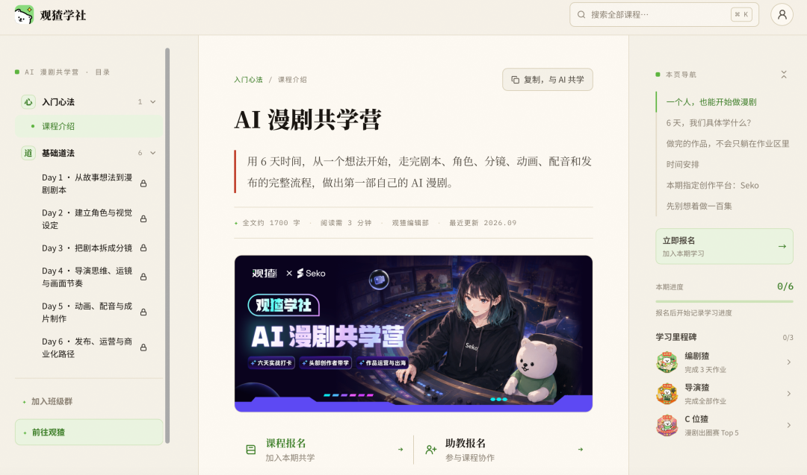
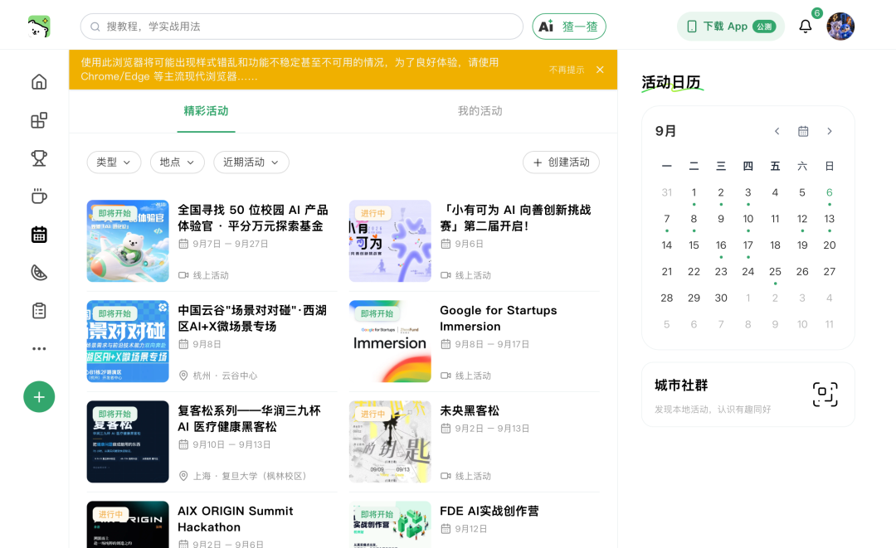

# 普通人想用AI，先别急着买会员：上观猹，简单找工具，还能换免费体验
> 💡 备注属性未写入，可能是备注属性名称或者类型被修改了，建议将字段类型设置为 rich_text，可以在小程序-操作-修改文章数据库页面进行调整
> 💡 原文链接:[https://mp.weixin.qq.com/s?__biz=Mzk3NTY5NDc0NA==&mid=2247487263&idx=1&sn=66237ff329428aaa0a657389b3686c11&chksm=c57def0702710764466dc01f020c0f9e0bcc4ca6866fd04b04f716f1816cae647cae9587506c#rd](https://mp.weixin.qq.com/s?__biz=Mzk3NTY5NDc0NA%3D%3D&mid=2247487263&idx=1&sn=66237ff329428aaa0a657389b3686c11&chksm=c57def0702710764466dc01f020c0f9e0bcc4ca6866fd04b04f716f1816cae647cae9587506c#rd)
想用 AI 做一份 PPT，结果先收藏了十几个工具。
想试试 AI 视频，点进去才发现要充值。
好不容易找到一个看起来不错的，又开始犹豫，这个到底好不好用？有没有人已经试过？
工具越来越多，挑工具反而成了一件费劲的事。
今天想给大家介绍一个地方，叫“观猹”。

你可以先在这里找产品、看使用评价，再看看有没有适合自己的体验权益。
对普通人来说，先找到一个能解决眼前问题的工具，比记住一堆模型名字有用多了。

### 免费开始，先弄清楚它能帮你什么
观猹把自己定位为 AI 产品的发现与评价社区，官方产品页目前标注为免费。你可以把它理解成一个找 AI 工具、看大家怎么用的入口。
这里的“免费”要分清楚。
观猹平台免费，不代表里面收录的所有 AI 产品都永久免费。具体工具可能有试用额度，也可能需要订阅。
但你可以先了解它，再决定要不要花钱。
这件事很实在。
买会员之前，多看一眼使用反馈，至少能减少一点“付款之后才发现不适合”的懊恼。
在这次整理的截图里，观猹的 AI 产品全景图显示了2583 个产品。这是截图当时的数量，后续还会变化。
写作、学习、做图、视频、办公，各种方向都能看到。
当然，没人需要把它们全部学会。
你今天要做什么，就先找能帮你完成这件事的。

### 不知道工具名字，也可以先说需求
我觉得比较适合新手的一个入口，是“猹一猹”。
官方 App 介绍提到，它支持用 AI 搜索整理产品口碑和讨论线索。
你不一定要先知道某个产品叫什么，可以从自己的需求开始问。
比如可以这样输入：
> 我是第一次做工作汇报，想找中文 PPT 工具，最好有免费体验，操作简单，做完还能修改。请帮我找几个，并说明限制。
> 
这比只问“哪个 AI 最好用”更容易得到有用的方向。
因为“最好用”太宽了。
有人需要设计漂亮，有人需要数据准确，有人只想明天开会前把文件交出去。
把用途、预算和不会做的地方说清楚，再去比较产品，选择会简单不少。

### 真正值得看的，是别人卡在了哪里
截图里能看到热议周榜、口碑飙升榜，还有产品评分和讨论入口。
其中，热议周榜的页面说明写着，榜单根据产品互动量综合计算，每周重置。
所以我会把它当成发现产品的入口。
排名靠前，说明值得点进去看看；是否适合自己，还得往下读。
我更建议大家关注具体评价。
有没有人用它完成了与你相似的事情？
免费额度够不够试出效果？
生成之后能不能修改，导出有没有限制？
一句“太好用了”，参考价值有限。有人把使用过程、结果和不足讲清楚，才更方便你判断。
另外，平台存在评价任务奖励，看评价时也值得多留意内容是否具体，别只盯着分数。
能说清楚哪里不好用的评价，有时候反而更能帮你省钱。

### 免费体验的机会，藏在“瓜棚”里
这部分是我觉得值得普通人去了解的。
观猹有任务中心，也有一个叫“瓜棚”的兑换区域。
按照截图展示，用户可以通过符合规则的任务积累“瓜子”，再兑换对应的东西。
瓜棚分成了实物周边、邀请码和兑换码。
其中一些兑换码对应工具积分，另一些对应限时会员权益。
比如这次截图里显示：
- Paper2Game，9 瓜子对应 3 天会员权益。
- 闪电说，19 瓜子对应 7 天 Pro 会员权益。
- 麦当秀，29 瓜子对应 AIPPT 周会员。
这些是截图当时的展示，领取前还要看库存、有效期、适用账号和兑换说明。
邀请码也要和会员权益分开看。有些邀请码只是让你获得内测资格，并不等于附送付费功能。
我喜欢这种方式的原因很简单。
如果刚好有你想试的工具，就有机会先体验，再判断值不值得继续付费。
不过，别为了凑积分，把几个小时花在一个自己根本用不上的权益上。
免费也有时间成本。

### 第一次去，照这个顺序就够了
不用一口气研究所有栏目。
第一步，带着一个具体任务进去。
比如做一份汇报 PPT、整理一篇文章，或者尝试一段故事视频。
第二步，搜索需求，挑两三个候选工具。
看介绍，也看评价里提到的不足。先别收集二十个，工具多了反而难选。
第三步，去瓜棚看看有没有对应权益。
如果需要瓜子，就先读任务规则。真实体验后再写评价，不必为了奖励硬夸产品。
第四步，用同一份材料试一遍。
比如把同一份汇报提纲交给两个工具，比较生成结果、修改难度和导出条件。
最后留下更适合自己的那一个。
这样逛完一圈，你带走的会是一点使用经验，甚至是一份完成的文件。
而不只是浏览器里又多了几个收藏夹。
### 想继续学，也能找到一起动手的人
除了产品，截图里还有讨论区、活动日历和观猹学社。
其中，AI 漫剧共学营页面把学习过程拆成了六天，从故事和剧本，到角色、分镜、动画配音，再到发布与运营。本期页面标注的创作平台是 Seko。

对想做作品的人来说，这种按步骤推进的安排，比漫无目的地找教程更容易理解。
感兴趣的话，先查看报名条件、时间安排和工具费用。公开活动页也能查看不同的线上、线下活动。
找到适合自己的节奏就好。
没有必要看见活动就报名，看见新工具就注册。

### 普通人接近AI，可以从一件小事开始
我推荐观猹，最看重的是它把找工具、看评价、交流和体验机会放到了一起。
你可以先不付费，先不研究复杂术语。
就从今天最想完成的那件事开始。
让 AI 帮你把一份材料整理好，把一张图做出来，或者把一直想讲的故事往前推进一点。
工具是不是适合你，做过一次，比看过十篇介绍更清楚。
#### 闪Q留个槽
为了换一个 AI 工具的免费体验，你愿意花多少时间做任务？
A：十分钟以内
B：真用得上就愿意
C：宁愿付钱省时间
只回一个字母也行，也欢迎直接反驳我。
我是闪Q，带着你的需求探索 AI。
观猹传送门：https://watcha.cn/r/HIn74d
