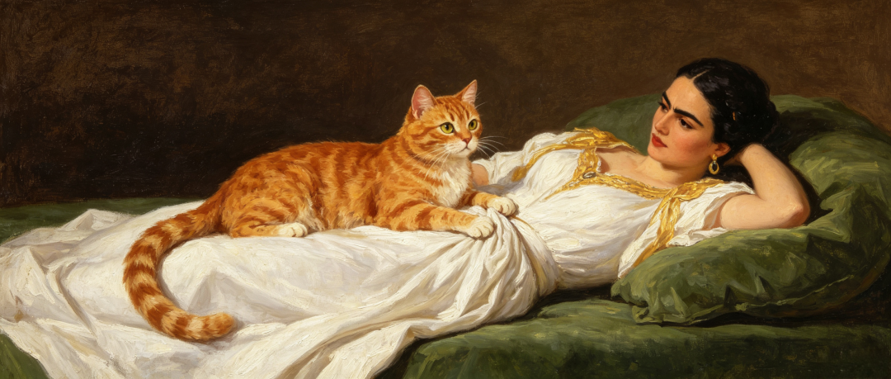

# 普通家庭出身的孩子，前半生唯一主线就是积累自己的生存资本，千万不要过早就把精力浪费在爱情、面子、无效社交上
> 💡 备注属性未写入，可能是备注属性名称或者类型被修改了，建议将字段类型设置为 rich_text，可以在小程序-操作-修改文章数据库页面进行调整
> 原文链接:[https://mp.weixin.qq.com/s/oi-WbpeDlYYZXXim9oDxHg](https://mp.weixin.qq.com/s/oi-WbpeDlYYZXXim9oDxHg)
**点击下方👇“肥猫说财”关注公众号**
**赚钱思维 | 财富故事 | 人性丛林 | 认知提升**
**原创文章，搬运洗稿追究法律责任**
哈喽啊，我是肥猫，我其实不肥，我的猫肥。

**图片为肥猫制作**
你一定在深夜的地铁上，或下班后的出租屋里，经历过这样一种无力感。
打开手机，大家都在各种晒。
你看着自己银行卡里少得可怜的余额，想想过几天要交的房租，明天要拜访的客户，悬着的项目，心里一阵发慌。
你觉得自己被同龄人抛弃了，迫不及待地想要脱单，想买几件名牌撑撑场面，想要向上社交。
停下这些行动。
如果你只是一个完完全全的普通家庭出身的孩子，你可能没法像别人那样去反复试错、去伤春悲秋，去为了所谓的爱情死去活来。
为什么底层家庭出身的孩子，能够跨越阶层的只是少数。
他们最大的劣势不仅是缺钱，更是“抗风险容错率”几乎为零。
你没有任何可以浪费的时间和筹码。
你前半生的唯一主线，应该是铆足劲，完成原始的生存资本积累。
那些过早消耗你的爱情、面子和无效社交，是三个极其耗费你的时间和精力的碎钞机。
**先聊聊过早的爱情。**
年轻时候，人总渴望有个肩膀依靠，觉得爱情能抵御世间的严寒。
然而，婚姻和恋爱本质上是“价值匹配”。
当你的生存资本极低时，你在市场上的议价能力同样处于谷底。
这个阶段，你大概率只能遇到同样处于资源匮乏期的伴侣。
你们的结合，不仅无法产生“1+1>2”的协同效应，反而可能演变成一场惨烈的内耗。
你们会为了花费而争吵，为了晚饭后谁洗碗而冷战。
更可怕的是，维护一段低质量的关系，会极大消耗你的“认知带宽”和情绪能量。
你原本应该用来学习新技能、研究行业趋势的夜晚，全被用来向对方证明“你到底爱不爱我”，用来修补对方原生家庭带来的心理创伤。
这不叫爱情。
这叫弱者之间的相互吞噬。
查理·芒格说过：
“想要得到某样东西，最可靠的办法是让自己配得上它。”
爱情是奢侈品。
在你还没有建立起坚固的物质基础和独立的人格时，过早去碰它，只会让你在患得患失中被彻底榨干。
把你那泛滥的荷尔蒙收起来，去搞钱，去提升认知。
等你站在高处时，市场自然会把更优质、更同频的伴侣推到你面前。
**再来看：脆弱的面子。**
**普通出身的孩子，往往有一种极其敏感的自尊心。**
**这一点，大家应该深有体会。**
别人一个无意的眼神，一句无心的玩笑，都能让他愤怒、应激。
为了不让别人看扁，咬牙分期买奢侈品包包，贷款买车。
为了在饭局上充老大，抢着买单。
为了维护那点可怜的尊严，在工作中和指出你错误的领导针锋相对。
为什么会这样？
肥猫喜欢用进化心理学和经济学这两个维度看问题。
远古时代，人类生活在部落里，失去社会地位就意味着分不到食物，意味着死亡。
所以你的大脑对“地位威胁”有着本能的恐慌，一旦觉得没面子，杏仁核就会疯狂报警。
但现代商业社会的运转法则是完全不同的。
因为，真正的资本，从来不是你穿在身上的衣服，也不是你大声争辩时的嗓门。
而是你账户里随时可以调用的现金流，是你脑子里别人抢不走的技能，是你能为公司/市场创造的不可替代的价值。
**记住：当你弱小的时候，你的面子一文不值。**
最愚蠢的行为，就是为了维护一个虚幻的尊严，去透支你真实的生存资源。
把你的面子扔在地上，踩两脚。
只有当你的实力足够强大时，这个世界才会把面子恭恭敬敬地双手奉上。
最后讲讲：无效社交。
我们总是被灌输一种幻觉：
什么朋友多了路好走。
什么一定要向上社交。
于是你奔波于各种无聊的饭局，加了N个微信好友，每天给各种根本不熟的人点赞评论。
罗宾·邓巴有个著名的结论：
一个人能维持的稳定社交网络，上限大约是150人。
你的社交位置是宝贵且有限的。
如果你把这150个名额，全都填满了只会抱怨生活、拉着你打游戏、消耗你的人，你就彻底堵死了自己向上生长的通道。
肥猫不止一次说过：
**所有的社交，底层都是价值交换。**
**资金价值、情绪价值、认知价值、信息价值，问问自己，在你和大佬链接的时候，你能给到别人什么？**
**别人为什么要把你留在微信里？**
你是一个月薪五千的职员，你就算加上了身价过亿的老板的微信，那也不叫人脉。
因为你手里，没有任何可以和对方交换的筹码。
放弃那些看似热闹、实则空虚的圈子。
**孤独，是普通孩子完成原始积累的必修课。**
把用来应酬的时间，拿来深度阅读。
把用来讨好别人的精力，拿来打磨自己的专业。
人类的大脑天生短视，想偷懒，想走捷径，想抱怨……。
我们偏好那些立刻就能拿到的微小奖励（比如吃一顿大餐、打一把游戏）；
而厌恶那些需要漫长等待才能看到的巨大回报（比如学一门新语言、存下第一桶金）。
想要跨越阶层，你必须逆人性。
**一、剥离一切不能产生复利的短期行为**
下班后的三个小时，决定了你后半生的走向。
不要去刷那些五分钟看完一部电影的短视频，不要去玩那些让你上瘾的游戏。
去死磕那些门槛高的硬技能。
去写文章、写书、分析数据，研究财务报表，去拆解行业里顶尖的商业案例。
这些事在初期会让你痛苦，因为大脑得不到即时的多巴胺反馈。
但只要你熬过那个临界点，这些技能就会像滚雪球一样，在你身上产生可怕的复利效应。
**二、捍卫你的注意力**
你要像一个守财奴一样，去捍卫你的注意力。
拒绝一切没有明确目的的聚会，拒绝一切不能让你变得更强的情绪消耗。
**三、把你所有的子弹，集中打在一个最能产生价值的标靶上。**
在某一个细分领域里，把自己打磨成一把锋利无比的尖刀。
在这个社会里，平庸的全才没有生存空间，只有极致的专才，才能撕开阶层的防线。
人生是一场马拉松。
对于我们这些普通家庭，甚至贫穷家庭出身的孩子来说，来到这个世上，我们不仅光着脚，甚至有的背上还扛着沙袋。
不要抱怨命运的不公。
不要羡慕别人沿途可以停下来看风景。
你要做的，就是盯着脚下的路。
把汗水、时间，都转化为你能握在手里的生存资本。
忍受孤独，忍受不被理解，忍受一次次失败后的痛苦。
当你手里握满了真实的资本，不再为明天的生计发愁，不再看任何人的脸色行事。
你回过头去看，你会感谢当年那个没有把时间浪费在风花雪月里的自己。
到那时，你再去谈一场不掺杂算计的爱情，再去结交那些和你棋逢对手的人物。
把所有的精力，都收敛到自己身上。
去积累。
去沉淀。
去像野草一样疯狂地向下扎根。
直到有一天，你可以从容不迫地，破土而出，直至遮天蔽日。
你我共勉。
**认识肥猫:**
毕业于中央财经大学。全网70万粉丝，“肥猫说财”公众号一年涨粉42万，自媒体ip孵化、爆文写作教练；
基金深度研究和投资者，资产配置践行者；20年投资经验，著书《指数基金投资从入门到精通》：

觉得文章对你有启发，请不吝你的点赞和转发。还没关注的小伙伴，戳下面的名片，关注肥猫：
