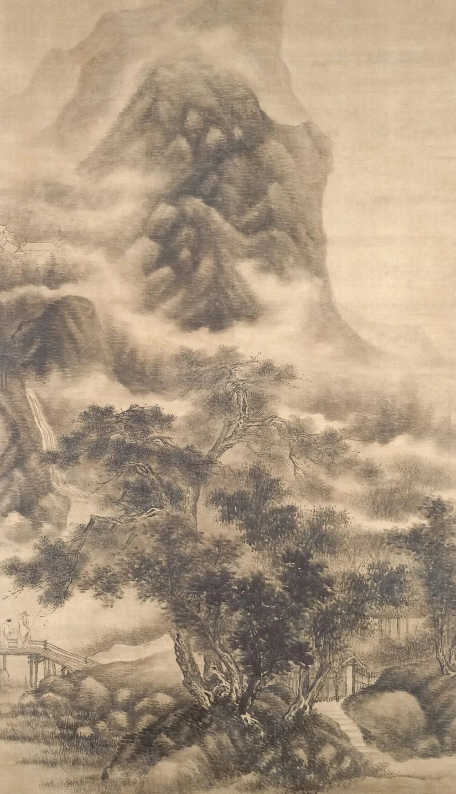

# 曹操到毛泽东，5首诗词跨1700年，说的同一桩事
> 💡 备注属性未写入，可能是备注属性名称或者类型被修改了，建议将字段类型设置为 rich_text，可以在小程序-操作-修改文章数据库页面进行调整
> 💡 原文链接:[https://mp.weixin.qq.com/s?__biz=MzY4MzM5MzM2MA==&mid=2247485459&idx=1&sn=98238fbb9c1130c5bcf13e1f2e7f63f6&chksm=f21bb7409f7c4f04cc6abfad472f15988bcf402d557263338dcbf42e946337eeeddcfd7a949f#rd](https://mp.weixin.qq.com/s?__biz=MzY4MzM5MzM2MA%3D%3D&mid=2247485459&idx=1&sn=98238fbb9c1130c5bcf13e1f2e7f63f6&chksm=f21bb7409f7c4f04cc6abfad472f15988bcf402d557263338dcbf42e946337eeeddcfd7a949f#rd)
‍
气势这个东西，写不出来就写不出来，装也装不像。
它不在字大，不在喊得响。真正的气势，是一个人在某个地方站着，往远处看了很久，然后把看到的东西如实写下来，读者自己会觉得胸口发紧。
从曹操作到毛泽东，横跨一千七百年。这五首写的是同一件事：一个人面对比自己大得多的东西，没有退。

一
**观沧海**
〔东汉〕曹操
东临碣石，以观沧海。
水何澹澹，山岛竦峙。
树木丛生，百草丰茂。
秋风萧瑟，洪波涌起。
日月之行，若出其中；
星汉灿烂，若出其里。
幸甚至哉，歌以咏志。
**译文**
向东登上碣石山，来观看大海。海水多么荡漾，山岛高高地耸立。树木一丛丛地生长，百草茂盛。秋风萧瑟吹来，巨大的波浪涌起。太阳月亮的运行，好像都从这片海里出来；银河灿烂，也好像从这片海里升起。幸运极了，用歌唱来抒发心志。
**评点**
这是曹操北征乌桓、东临碣石时所作，收在《步出夏门行》组诗里，也是中国诗歌史上现存最早的一首完整的山水诗。清人沈德潜《古诗源》在诗后只批了七个字：“有吞吐宇宙气象。”他评曹操四言诗还有一句：“曹公四言，于『三百篇』外，自开奇响。”
**赏析**
这首诗的气魄，全在后四句。
前面八句很实在：登碣石山、看海、水在动、山岛立着、树多、草茂、秋风、大浪。这是一份很规矩的看见了什么的清单。如果就这样结束，它只是北方海边的一幅写生。
然后忽然往上跳了一句：“日月之行，若出其中；星汉灿烂，若出其里。”太阳和月亮走的路，好像都从这片海里出来；银河那么亮，好像也从这片海里升起。
注意“若”这个字，是好像。他并没有说海真的装下了日月星辰，他说的是看起来像。可就是这一句像，把一片海变成了整个宇宙。
清人沈德潜《古诗源》给这首诗的批语只有七个字：“有吞吐宇宙气象。”吞吐两个字下得极准：海不是在“装”日月，是在吐和收。能吞吐宇宙的，当然不是海。是站在碣石山上的这个人。
写这首诗的时候，曹操是刚打完乌桓、正在收拾北方的那个曹操。他面对大海，想到的不是我好渺小，而是“这片海吞得下日月，我站在这儿看它”。这就是气势,不是把天地看小，是把自己站到了和天地同一个高度上。
二
**望岳**
〔唐〕杜甫
岱宗夫如何？齐鲁青未了。
造化钟神秀，阴阳割昏晓。
荡胸生曾云，决眦入归鸟。
会当凌绝顶，一览众山小。
**译文**
泰山到底怎么样呢？那青翠的山色，在齐鲁大地上绵延不尽。大自然把神奇秀丽都聚集在这里，山南山北被分割成黄昏和拂晓。层层云气在胸中激荡，睁大眼睛看归鸟飞入山林。一定要登上最高处，那时候看所有的山，都会变得很小。
**评点**
这是杜甫现存诗集中年代最早的一首，大约作于开元二十四年（736）前后，他二十多岁、正在齐赵一带漫游。清人浦起龙《读杜心解》评：“杜子心胸气魄，于斯可观。取为压卷，屹然作镇。”他认为这部诗集应该用这首来开卷。仇兆鳌《杜诗详注》则说它“气骨峥嵘，体势雄浑，能直驾齐梁以上”。
**赏析**
这是杜甫最早的一首诗，写它的时候他才二十多岁，还没去过长安，还没见过乱世。
所以这首诗里有一种他后来再没有的东西：一口气。
开头不是赞叹，是一个真问题：“岱宗夫如何？”泰山到底怎么样？然后他自己回答：“齐鲁青未了。”那一大片青色，从齐国铺到鲁国，还没铺完。他不说“高”，不说“大”，他说颜色看不过来。清人施补华《岘佣说诗》说这五个字：“囊括数千里，可谓雄阔。”
最狠的是“阴阳割昏晓”。山的南边是白天，山的北边是黄昏；一面山，把一天分成了两半。“割”这个字是刀口的字。仇兆鳌说这句尤为奇险，是很有道理的：别人写山高用耸插，杜甫直接用“割”，不是高，是能切开光。
可这首诗真正的份量在最后两句：“会当凌绝顶，一览众山小。”，“会当”是一定要。注意，他还没上去。这首诗从头到尾，他一直站在山下看。可他已经把上了山之后的事写完了。
清人浦起龙《读杜心解》为这首诗下过一句评语：“杜子心胸气魄，于斯可观。取为压卷，屹然作镇。”意思是,杜甫这个人到底有多大的心胸，看这一首就够了。一个二十多岁的年轻人，站在山下，指着一座山说我一定要上去。后来他真的爬了很多山，也摔了很多次。但中国诗里最漂亮的那句我想要，就是这一句。
三
**走马川行奉送封大夫出师西征（节选）**
〔唐〕岑参
君不见走马川行雪海边，平沙莽莽黄入天。
轮台九月风夜吼，一川碎石大如斗，随风满地石乱走。
匈奴草黄马正肥，金山西见烟尘飞，汉家大将西出师。
将军金甲夜不脱，半夜军行戈相拨，风头如刀面如割。
……
虏骑闻之应胆慑，料知短兵不敢接，车师西门伫献捷。
**译文**
你没看见吗，走马川一直延伸到雪海边，平展的沙漠无边无际，黄沙一直连到天上。轮台的九月，风在夜里吼叫；满川的碎石大得像斗，被风吹得满地乱跑。匈奴那边的草黄了，马正肥壮；金山西边望见了烟尘，汉家大将向西出兵。将军的铠甲夜里也不脱，半夜行军，兵器互相碰撞；风头像刀子，割在脸上。敌人听说了一定胆寒，料想他们不敢短兵相接，在车师西门，等着献上捷报吧。
**评点**
岑参长期在安西、北庭边塞幕府任职，是唐代写得最实的边塞诗人之一。南宋陆游在《渭南文集·跋岑嘉州诗集》里说：“予自少时，绝好岑嘉州诗……尝以为太白、子美之后，一人而已。”他把岑参放在李白、杜甫之后，认为再没有第二个人。这首用三句一转韵的写法，节奏短促，读起来像马蹄声。
**赏析**
读这首诗，最好出声念。因为它不是给人“看”的，是给人“听”的。
看开头三句：“君不见走马川行雪海边，平沙莽莽黄入天。”一句里塞了三个沙/川/海的地名意象，颜色直接顶到天上去了。然后立刻转到九月的风：“轮台九月风夜吼”，注意是“吼”，不是刮。
接着是这首诗最有名的一句：“一川碎石大如斗，随风满地石乱走。”石头大得像斗，被风吹得满地跑。你想想：能吹动斗大的石头的风，得是什么风？岑参不写风有多大，他写石头在跑。这就是边塞诗最厉害的手法,不写主语，写结果。
后面写行军的三个字更狠：“风头如刀面如割。”风迎面扑来像刀子，脸像被割。没有比喻的解说过渡，就是把两个感受硬并在一起。你读到这儿，脸会自己紧一下。
这首诗的节奏也要说一句：它三句一转韵。“边、天”一韵，“吼、斗、走”一韵，“肥、飞、师”一韵，三句一换，一路往下砸，像鼓点，也像马蹄。形式本身就在跑。
陆游在《跋岑嘉州诗集》里说过一段很动人的话：他年少时就极爱岑参的诗，在山里住的时候，每次喝醉酒回来，斜靠在胡床上，就让孩子念岑参的诗给他听，一直念到他酒醒，或者睡熟。然后他说：“尝以为太白、子美之后，一人而已。”一个南宋人，把盛唐边塞的风沙，当成自己的醒酒汤。那风沙里有他想要却一直没能拿到的那个东西。
四
**从军行（其四）**
〔唐〕王昌龄
青海长云暗雪山，孤城遥望玉门关。
黄沙百战穿金甲，不破楼兰终不还。
**译文**
青海湖上大片长云，遮得雪山都暗了；一座孤城，远远地望着玉门关。在黄沙里打了上百次仗，铁甲都磨穿了；不攻破楼兰，绝不解甲回家。
**评点**
《从军行》七首组诗中的第四首。王昌龄是盛唐写七绝最多、也最被推重的人之一，明人王世贞《艺苑卮言》评他的绝句“可与李白争胜毫厘，俱是神品”。后人称他“七绝圣手”“诗家夫子”。
**赏析**
二十八个字，前两句写景，后两句写人。可真正让人记住的，是第二句和第三句。
“青海长云暗雪山，孤城遥望玉门关。”第一句把颜色压暗了：云是“长云”，山是“暗”的。第二句出现一个人称上的转折：“孤城遥望玉门关”，不是我望，是一座城在望。玉门关是内地的方向。所以这一句的真实内容其实是,这里离回家，还隔着一整个大西北。
然后第三句扔出一件东西：“黄沙百战穿金甲。”，“穿”是磨穿，磨破了。铁做的甲，在黄沙里磨穿了。你要知道“百战”是很多年，而甲能穿，说明他一直在最前头。
这一句比任何苦字都重。因为它是实物：不是我们很辛苦，是我的铠甲已经磨破了。
收尾一句极硬：“不破楼兰终不还。”，“终”是绝不。这句话放在“穿金甲”之后，分量就完全不一样了。如果先说“不破楼兰终不还”，那是喊口号；可它藏在磨破的铁甲后面，就成了一种很静的决心。
这就是王昌龄的本事,他不写悲壮，他写磨损。一个人被磨到那个样子还没有走，才是真的硬。
五
**沁园春·雪**
〔近现代〕毛泽东
北国风光，千里冰封，万里雪飘。
望长城内外，惟余莽莽；大河上下，顿失滔滔。
山舞银蛇，原驰蜡象，欲与天公试比高。
须晴日，看红装素裹，分外妖娆。
江山如此多娇，引无数英雄竞折腰。
惜秦皇汉武，略输文采；唐宗宋祖，稍逊风骚。
一代天骄，成吉思汗，只识弯弓射大雕。
俱往矣，数风流人物，还看今朝。
**译文**
北方的风光，千里冰封，万里雪飘。望长城内外，只剩下白茫茫一片；黄河上下游，立刻失去了滔滔水势。群山像银蛇在舞动，高原像白象在奔跑，都想和老天比个高低。等到晴天，看红日白雪相映，格外娇艳。江山这样美好，引得无数英雄为之倾倒。只可惜秦始皇、汉武帝，文采上差一点；唐太宗、宋太祖，风雅上略输一些。那位号称一代天骄的成吉思汗，也只会弯弓射大雕。都过去了。真正称得上风流人物的，还要看今天。
**评点**
这首词作于1936年初，作者率部东渡黄河、到达陕北时遇上大雪。1945年重庆谈判期间，毛泽东于10月7日致信柳亚子，抄赠此词。柳亚子读后大为叹服，在和词跋语中写道：“余索润之写长征诗见惠，乃得其初到陕北看大雪《沁园春》一阕。展读之余，叹为中国有词以来第一作手，虽苏、辛犹未能抗手，况余子乎？”他另有一篇《跋》说：“毛润之《沁园春》一阕，余推为千古绝唱，虽东坡、幼安，犹瞠乎其后，更无论南唐小令、南宋慢词矣。”1945年11月14日，此词在重庆《新民报》晚刊首次公开见报，一时轰动，后续和词论战不断。
**赏析**
先交代一件事：这首词是1936年初写的，可藏了将近十年，1945年才公开。
1945年10月7日，正在重庆谈判的毛泽东给老友柳亚子写了一封信，抄赠了这首词。柳亚子读了以后激动得睡不着，连夜和了一首，又写了一篇跋。他在跋里说：“毛润之《沁园春》一阕，余推为千古绝唱，虽东坡、幼安，犹瞠乎其后，更无论南唐小令、南宋慢词矣。”苏轼、辛弃疾，在他看来都落在后面。这话出于一位爱国老诗人之口，情绪是热的，评价也是极高的。
词公开见报是11月14日，重庆《新民报》晚刊。一时山城震动，和词、驳词几十首，成了一桩文化事件。
回到词本身。上半段最有气势的一句是“山舞银蛇，原驰蜡象，欲与天公试比高”。山像银蛇在动，高原像白象在跑，还想跟老天比比谁高。这里的关键是“舞”和“驰”,他写的是静止的雪景，可用的全是动词。一个不动的世界，被他写成了在动。
真正的分量在下半段：“惜秦皇汉武，略输文采；唐宗宋祖，稍逊风骚。一代天骄，成吉思汗，只识弯弓射大雕。”五个人，中国历史上最能打的几个皇帝，他一个一个点过来，每人给一句评语。注意他用的都是“略”“稍”“只”，不是否定，是还差一点。一个人敢对两千年的帝王做这样的评点，这本身就是气魄。
最后三句把话收住：“俱往矣，数风流人物，还看今朝。”，“俱往矣”三个字，是向历史告别。而“还看今朝”，把眼光从两千年的过去，一下挪到了眼前。这首词所以有那样大的冲击力，不在于它写了雪，而在于它把整个中国史当成了一个可以评点的名单。
这五首里面，曹操看到的是宇宙，杜甫看到的是自己还没爬的山，岑参看到的是跑起来的石头，王昌龄看到的是磨破的铁甲，毛泽东看到的是两千年的名单。同一件事：他们都站在一个比自己大得多的东西面前，没有往后退，也没有说我很渺小。他们说的是，我要上去；我要过去；我要评一评。
👇 点击关注「陪你读古诗」👇
