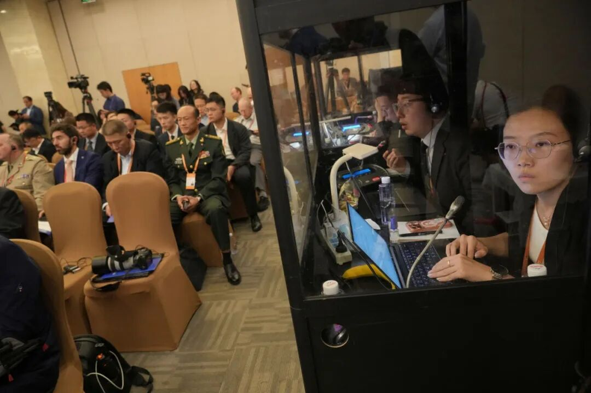
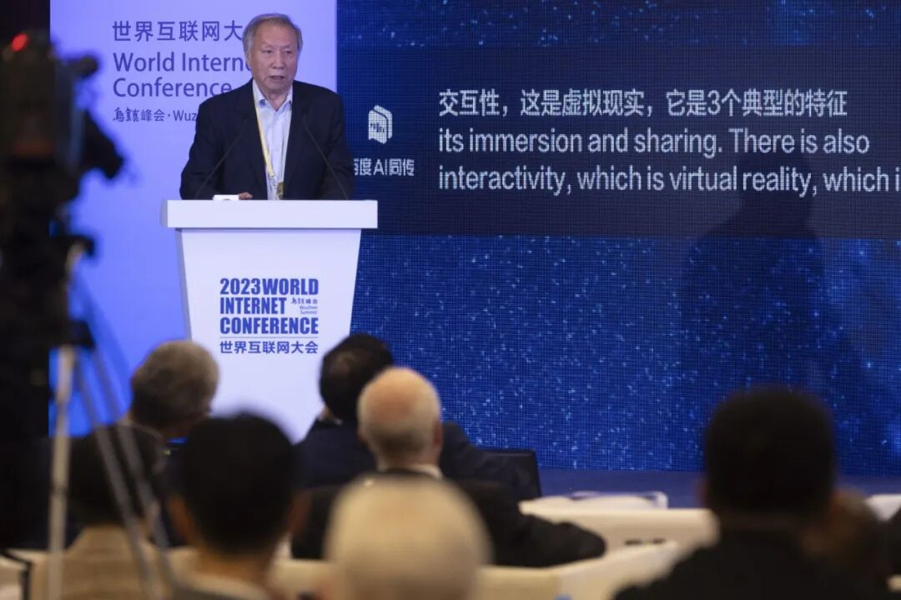
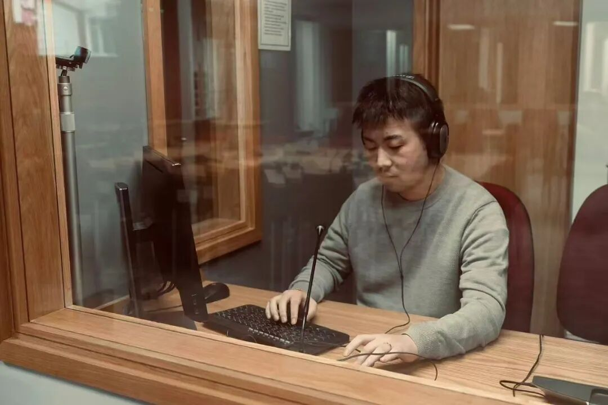

# 曾经日赚过万的同声传译，不能替人背锅的AI还取代不了
> 💡 备注属性未写入，可能是备注属性名称或者类型被修改了，建议将字段类型设置为 rich_text，可以在小程序-操作-修改文章数据库页面进行调整
> 💡 原文链接:[https://mp.weixin.qq.com/s?__biz=MTY0MzI5NDcwMQ==&mid=2651376167&idx=1&sn=852c3e99ca7b62b45abbf75d387263b7&chksm=5384d02962e705e1d1106e380db68f0529429e99583d12f25feb65b8396f9cb2691b30fd56bb#rd](https://mp.weixin.qq.com/s?__biz=MTY0MzI5NDcwMQ%3D%3D&mid=2651376167&idx=1&sn=852c3e99ca7b62b45abbf75d387263b7&chksm=5384d02962e705e1d1106e380db68f0529429e99583d12f25feb65b8396f9cb2691b30fd56bb#rd)

▲2026年9月15日，北京，第十三届北京香山论坛先期举办高端访谈活动，同声传译员在工作间内工作 图/视觉中国

在被冲击最狠的行业里，翻译首当其冲，翻译行业里公认的皇冠明珠同声传译，也免不了订单和价格打对折的境遇。
但想把同声传译彻底取代，AI目前还做不到——不过AI确实让同传的收入少了很多。或许它很快就能准确理解人类发言时那些难以琢磨的口误、跳跃的思路以及凌乱的口癖，然而市场真正筛选的从来不是“译得对不对”，而是“错了谁负责”。
某种意义上，人类译员卖的是把关和担保。伦理决策和意义确认的不可让渡，才是这个行业真正的护城河。

本文首发于南方人物周刊
文 / 南方人物周刊实习记者 贺毅炜
 南方人物周刊记者 孟依依
编辑 / 李屾淼 lishenmiao1989@126.com

二战结束后的1945年11月20日，纽伦堡国际审判开庭。庭审涉及多种语言，同时，法官、检辩双方和被告，都必须听懂庭审内容。交替传译——发言人讲完一段，译员翻译一段——将会显著增加会议时间。为避免翻译过程拖延审判，同声传译成为重要的解决方案。
而后，同声传译方案进入联合国会议，逐渐变得普及，成为翻译行业中培训周期最长、难度最高、压力最大、最为稀缺——当然也是收入最高——的工种。
在被AI冲击的所有行业里，翻译大概是被冲得最狠的行业之一，翻译行业的金字塔尖同声传译，当然也未能幸免。
新冠疫情让人们对线上会议和远程办公的接受度逐步增加，实时语音翻译也陆续进入会议软件和商业产品，加上2022年年底生成式大语言模型技术的普及，让同声传译的必要性再次受到挑战。语言服务行业研究机构Nimdzi于2025年预测，尽管“人工智能支持的机器口译（MI）目前仍处于起步阶段”，但在“客户需求的驱动下，未来两到三年内，口译市场整体将更加依赖人工智能（AI）”。
那么在2026年，高职业门槛、高时薪以及高社会地位的同声传译行业，究竟面临着何种境遇？它又将走向怎样的未来？

▲2026年5月2日，在深圳华强电子世界一家店铺内，店员用智能翻译器与来自沙特阿拉伯的顾客交流 图/新华社

**人与AI，快乐合作**
AI刚进入翻译市场的时候，资深译员更多感受到的其实是便捷。
2026年1月，从业逾十年的自由译员高大玉在自媒体平台分享了自己一天九场同传会议的工作日常，主题包括“建筑、航空航天、冰上运动、非遗物品、城市发展、晚宴、交响乐”和“新能源汽车产线的线上会议”。
这类专业度极高的场景，意味着头疼的术语，和必须高度结合专业语境才能理解的发言，即使AI语音同传，同样错误频发。人类译员，则需要在会议的前一天搜集背景资料、学习术语，并了解发言人，以便翻译准确。
高大玉一般需要准备近20小时。有时候，前一天的过度疲惫甚至会影响她的临场发挥。而现在，AI可以直接按照译员的需求，生成“双语版，甚至三语版”的高频词汇清单，将准备阶段压缩至4-6个小时。
她的同事甚至根据极其有限的材料和发言人的公开资料，让AI生成一份发言稿，最后发现，这份发言稿与实际稿本“有90%的重叠”，“AI让我变得更会同传了”，同事后来感慨。
AI同传确实惊人地减少了翻译成本。
据高大玉粗略估算：假设一场时长在一个工作日之内的200人会议，且都需要声音形式的翻译，在涉及两门外语和中文语言的情况下，共需要四位译员、两个同传箱、四个译员机和200个接收机，成本高达4-6万元人民币；但如果用AI翻译，就可以省下人工和人工所需的设备，这样一来，成本就不到2万元人民币。
这个成本差距，还会随着语种的增加而翻倍：“因为不同的语言价格也不太一样，四门语言的话，人工同传一天可能就需要8-10万块，而AI同传的成本可能仍然是2万左右，肯定不到3万。”
在很长一段时间里，无论翻译公司还是译员，多少都对机器翻译心怀疑虑：如果翻译中掺杂了机器翻译，会被视为译者能力不足——更早的时候，“机翻”一词意味着翻译生硬。
曾任字节跳动AI Lab总监、参与过“火山翻译”开发的李磊介绍，最早的机器翻译，可以追溯到上世纪50年代初，但那时只能基于单词与单词之间的相互映射规则，或句式结构的对应，一旦超出输入语料的范围，就无力承担了。
直到1993年，国际商业机器公司（IBM）研发出来的翻译系统不再基于规则，而是基于对语料中词语出现概率的统计。
在小牛翻译的CTO杜权博士看来，机器翻译真正“从可看变为可用”，是神经机器翻译技术的彻底爆发。2017年，谷歌研究员在论文《Attention Is All You Need》中发布了Transformer模型，这一模型完全基于注意力（Attention）机制——模型处理每个单词时，能够兼顾句子中其他所有词的重要性，直接将2014年第一个完全基于神经网络的机器翻译技术“从六七十分拉到了八十分”——这也成了后来大语言模型的技术基础。
接着，基于神经网络机器翻译技术的DeepL正式上线。
从这时开始，机器参与的比重在译员的翻译中不断加大。
那时，高大玉接过一些德语与英语之间的笔译订单，常常需要非常精准的词典来确认某个单词在其他语种中的对应词。她发现，“DeepL非常好用，尤其是它的词典，帮我大大减轻了我的工作量……对整个行业来说， DeepL都是一个比较趁手的工具。”
在神经网络翻译极大提升翻译质量后，不仅从业者，连客户的需求也发生了变化。杜权博士提到，那时有客户会问，有没有用机器翻译，“没用反而是不对的。”
不久后，更大的节点到来。2022年11月30日，ChatGPT由Open AI正式向公众发布。
北京外国语大学教授任文将基于规则和统计的机器翻译，以及后来的神经网络翻译，归为“任务型工具”：“人工译员将待译文本扔给它，那么机器作为客体就产出译文，双方的关系到这里就结束了。”
而这次的生成式人工智能，已经不能再用“工具行为”来理解。因为它可以与人类交互，并理解人类的指令，必要时还能跨领域汇总知识，甚至整合包括语音、文字和图像在内的多模态内容，从而为使用者提供多种解决方案。
人与机器的关系，已经从过去的人机二元主客关系，变成了更为复杂的协作关系。
**高大玉将生成式人工智能的到来形容为“颠覆性的”，因为ChatGPT“让所有的从业者受到冲击”，“因为AI的翻译确实比市面上很多译员都要好。”**

▲2023年11月9日，浙江乌镇，世界互联网大会乌镇峰会发布大会成果之一——《发展负责任的生成式人工智能》研究报告及共识。大会嘉宾演讲由“百度AI同传“负责实时翻译 图/视觉中国

**并非完全由AI带来的窘境**
AI所能实现的效率，以及对成本的极致压缩，正在让初级译员的境遇变得更加严峻。中国翻译协会于2026年4月发布的《2026中国翻译行业发展报告》中提到，“人工智能技术对初级译员的替代效应明显。” 
这两年，陈凯程时常为初级译员的报价感到惊讶，“比如我看他简历，他的报价可能要比我想象的水平低个2000元左右。以我自己的甲方招译员经历，一般要求较高的会议，一天的同传预期预算是平均是7000-1万元，更高的也有。但逐渐就能看到报价5000元甚至更低的。”他公司的工作团队，裁员后不再招聘——“因为有了AI，三个人就能干之前五个人的活。”
不过，陈凯程并不认为这全是AI的原因。
**他回忆，公司经济情况比较好的时候，大家不会太在意价格差异，即便人工比机器贵，原则仍是“能用人工译员，就让人工译员来现场”。如今社会对远程办公和线上会议的接受度逐步增加，情况就变成“人工线上翻好像也不是不行”、“用机器随便翻一翻（也行）”。**
回想2017年，对同声传译职业前景尚不清晰的高大玉，只是抱着尝试的心态正式接了一单，后面甚至去欧洲玩了一段时间。尽管如此，回来后，出乎她的意料，订单仍然源源不断。她每年变得越来越忙，感觉翻译行业像那时的大部分行业一样，在不断增长，她形容，“有时候我能每天把高铁当地铁坐，每天都在换城市出差，开会做翻译”，直到2020年新冠疫情暴发。
也许，蒙特雷国际研究学院（MIIS）的境遇，更能说明翻译行业的窘境并非完全由AI导致。
2025年8月29日，这所在业内有“翻译界哈佛”之称的学院，宣布其研究生项目和部分在线学位项目将逐步停止招生，并计划于2027年6月正式结束办学。
消息一出，联系到近年AI带来的普遍的职业恐慌，许多报道便将之视为“翻译行业正在被AI取代”的象征。
对此，任文澄清了一些误解。事实上，长期以来，蒙特雷学院就在经济上处于亏损状态，需要其主体——美国的明德大学（Middlebury College）——不断投入大量资金。这种投入甚至引起过明德大学师生的普遍不满，他们在校园里发起游行，强烈要求甩掉这个“包袱”。
亏损的原因一方面在于，蒙特雷坚持高成本的小班教学，但另一方面在于，其招生标准又坚持“宁缺毋滥”，每年只招收四百多名学生。再加上全球化环境让多语人才逐渐变得并不罕见，像欧洲语对这类项目，本身就长期处于亏损状态，于是就难以维持庞大的开支。
最新的消息是，蒙特雷学院已经被美国的创价大学（Soka University of America）收购，只保留了诸如中英语对、中西语对这类赚钱的项目。
事实上，在生成式大语言模型尚未普及之时，翻译行业就已经无法带给从业者安全感。
15年前，初入口译行业时，陈凯程就已经着手准备转型。他选择的是in-house译员——受雇于固定公司（一家美资金融机构），领固定薪水——因为他看重平台带来的其他职业可能性。而他目前的工作主轴是资产配置：和投资经理开晨会、讨论市场、盯盘、读研报——这占据了他工作内容的百分之九十。只是在诸如季度股东会或董事会这样的场合，他才会做一些比较定期的口译任务。
陈凯程注意到，现在的招聘平台已经很少能找到“全职口译员”的岗位，更多的是诸如“语言服务专家”、“国际业务助理”这样的岗位。“翻译可能越来越难作为一个全职工作，都是作为一个技能树，跟其他技能组合打包为一个新的岗位或新的业态。” 
杜权也给出了相同的观察。尽管就AI训练、人工干预员这类岗位而言，他所在的“小牛翻译”仍需专业译员参与搜集、评判和校对数据的工作，并根据结果持续反馈意见，但翻译背景和语言背景确实变得越来越不重要。招聘时，他们会更偏重应聘者是否熟悉AI操作系统，以及能否更好地与技术人员对接。
**对初级译员而言，最早的职业训练非常重要。提起最早的订单，高大玉表示，“那时候，一份一份的文件翻译，每一份都很重要……不能说一颗螺丝钉不重要，哪怕是其中一个很小的螺丝钉，对于整个结构的稳固性都很重要。”但这些初级岗位，在新的技术形势的冲击下，都在减少，甚至消失。**
那么，翻译院校内部，又将如何应对这种新的形势？
任文建议，面对AI的冲击，比如培养提升学生的译后编辑和定稿能力、审美能力、批判性思维能力，以及在多个选择中选择，并为自己的选择负责的能力。
但就整体的翻译专业改革，任文认为，需要整个翻译行业多方参与才可能实现，如果仅靠学校一方，很难有好的效果。
当被问及“是否还建议年轻人进入翻译行业”时，几位受访者都倾向于，如果对外语学习有强烈的兴趣，已经具备良好的外语基础，并且对其他国家的文化有好奇心，在这样的情况下是可以进入翻译行业的；否则，还是再想想别的路子吧。

▲2020年11月6日，上海，第三届进博会食品与农产品展区，日本贸易振兴机构（JETRO）展位内，翻译和参展者正在隔间内与日本企业进行在线洽谈 图/中青报·中青网记者李峥苨

**AI已经可以取代同传了吗？**
虽然焦虑重重，但人类译员、学院教授和科技公司的技术人员普遍认为，AI并不能胜任同传，至少目前不能。
实时语音翻译得以实现，是因为“端到端”语音翻译技术能将延迟降到最低——只需戴上同传耳机，同传译员仿佛就在旁边，只不过并不是人类。但是，与书面写作中的反复推敲、检查不同，人在口语表达中总难以压抑即兴的冲动：正说着的一句话还没完，发言人的思维却已飞翔至别处，于是后半个句子就突然变了航道——逻辑的跳跃、无意识联想的插入，甚至彻底的离题，都会将原有的发言逻辑带往未知之处。
在正式会议中，这样的情况十分常见。
对高大玉来说，机器翻译最明显的问题就在这里——当发言人的表达缺乏逻辑、不够系统，机器却只能字面翻译，结果就容易“七零八碎，让人看不懂”；人类译员，则可以理解同为人类的发言人，必要时可以进行解释和补充。
任文从符号学的角度，分析人类译员尚未失去的优势：
“一是‘文本意义’，即文本自身呈现出的意义；二是‘意图意义’，创作者、作者、发言人所想表达的意思；第三则是‘解释意义’，指作为人类主体，我们对文本进行阐释而得出的意义，所谓一千个读者就有一千个哈姆莱特。三种意义中，AI最擅长的就是（分析）‘文本意义’，但对发言者的意图意义和解释意义，则不如人类擅长。”
这种缺失，也是目前AI同传的主要短板所在。
首先，因为无法真正理解人类的发言，AI无法形成重点。
陈凯程曾在自己的B站账号“one海绵”提出这样一个说法，“一段话，100个信息给过去，它（机器）会把权重平均分到这100个信息里。比如，10%的内容会犯错，它可能刚好那10%就是最重要的，但人不会，假如你对这个事情有过准备，你会知道什么是最重要的，就算人类漏了30%的内容，但他会保证最核心的内容是对的。”

▲陈凯程 图/受访者提供
所以，只有在对内、或需求仅仅是基础信息交换、或这类翻译错误造成的尴尬并不会导致特别高昂的代价时，AI翻译才会显得极具性价比。像外交会议、对外商业洽谈这样的场合，翻译错误可能会给会议方带来严重问题，所以不会轻易使用AI同传。据杜权博士介绍，即便国际会议使用AI同声传译，也通常要求必须配备人工干预方案，以应对突发状况。
其次，会议并非仅仅是信息交流。一场均由人类参加的会议，会议桌的暗处还常常涌动着利益博弈的暗流。
尽管AI同传正在不断突破俚语、文化背景差异、一语双关所造成的理解困难，但仍然在很大程度上受限于交互模式。按照杜权的形容——大语言模型目前“最多拿个麦克风做收音”，连通过实时视频来读取与会者的更多动态信息，都还无法实现，“它获取的信息相比于人来讲少太多了。” 
AI同传，也难以具备人的立场。
在美资金融机构工作的陈凯程，提到两类难以应用AI同传的场景。比如，公司对外谈判时，当分歧出现，以公司利益为重的人类译员，可从公司的立场为发言做解释，并可以在团队内部私下沟通，这点对于机器，甚至中立译员，都很难做到；而到了政府外交场合，不同翻译更是可能直接影响对相同事件的解释权——“（要是）让美国人去把你的中文翻译成英文，外部媒体根据英文解读出来的东西，可能就会完全失控。”
**任文则从AI语料训练的角度强调，AI不可完全被视为价值中立。因为“国外的”AI模型是基于大量英美国家的英语语料进行训练的，因此难以避免“西方中心主义”的文化偏向。**
她以珠穆朗玛峰的名称为例：英语世界通常称之为“Mount Everest”，而中国官方的英文语境则使用源自藏语名称的“Mount Qomolangma”；在尼泊尔，它又被称作“Sagarmatha”。同一座山峰的背后，也存在不同语言和文化传统的命名体系，但ChatGPT给出的翻译往往以“Mount Everest”为标准。
所以，任文特别强调，在人与AI处于协作关系（“人机共创”）的当下，至少有两个不可让渡性——一是伦理维度的不可让渡性，“伦理决策，必须由人类译者来作出”；二是对最终意义的确认，应当由人类译者负责，并充当最后的决策者和责任承担者。
同时，她也发出警告：“我觉得，最好不要把今天人的优势想象成一道永远不会被跨越的护城河。我一直觉得不能太有‘人类中心主义’。**我越来越倾向于认为，AI会不会取代（人的）思维能力，这一点可能在很大程度上取决于人愿不愿意让自己被取代。**而我们的学生，很多时候为了便捷，就会把任何的问题，不管这个问题的难易程度，都扔给AI去回答，他其实是把自己的思考能力让渡给了AI，我觉得这很可怕。我们这一代人经历了万事手搓，自己去做，自己思考，自己写作，自己回答所有的问题。现在学生因为（工具）太便捷了，也太智能了，我们一边上课，他们可能一边在下面查，基本上不需要过大脑，他们知道答案。这不利于批判性思维能力的训练。”

**语言，到底意味着什么？**
ChatGPT尚未发布的2019年年底，陈凯程就做过一期题为“AI会取代人工翻译吗”的视频。视频开头，他给出了结论——在技术上，AI一定会取代人工译员。只是当时，他认为AI会像飞机或者触屏技术，从发明到真正普及，需要近半个世纪的时间。
如今，即使AI还不能完全取代人工译员，但这一目标似乎也不再遥不可及。据李磊介绍，他在卡内基梅隆大学语言技术研究所带领的团队，正在研究进一步降低延迟的方法，比如并不需要真正等人说完，就可以预测后面的内容。当这一技术的准确率——模型知道何时可以预测，何时无法预测，并兼顾翻译速度与质量——再度提升时，人工译员与AI同传的界限也将再度变得模糊。
那么，在今天，学习语言究竟还意味着什么？
高大玉上高中时，偶然在杂志上读到了11个自由译员的世界：跟着项目，天高海阔地飞行；工作时全身心投入，工作结束后时间就完全属于自己。
那是2006年，这种自由深深打动了高大玉。那年的电视上，中央五套的体育频道正全程直播在德国举办的世界杯。英勇帅气的德国国家足球队运动员，和杂志上自然环境优美的德语区，共同构成了高大玉对广阔未知世界的想象。德语，就是通往这个世界的旅票。

▲高大玉 图/受访者提供
任文的语言学习则有几分古典主义色彩。她本科就读于四川大学，那时，“综合性大学吧，它没有那么skill-oriented（技能导向）。”由于高中时就喜欢阅读、写作，进了大学后，任文就跟着老师一起读莎士比亚的戏剧、艾米丽·狄金森的诗歌、《嘉莉妹妹》、《理智与情感》等等。
在阅读的过程中，尽管需要查词典“硬啃”，她仍然为英语中那些优美的语言所打动，并喜欢上了朗读英语——“可能跟现在的学生不太一样，因为我很少听到我们的学生朗读英语。”至于听力，需要反复听磁带，“有一个词，叫tape hours，就是说要学好翻译，学好口译，要练多少个磁带小时。”
一次，与美国商人联系口译事宜，任文在邮件中写到了Pride and Prejudice（《傲慢与偏见》）还有Sense and Sensibilities（《理智与情感》），“都是英语小说的书名”，美国商人感到很诧异，并坦承，很少看到有一个外国人这么表述。
一次旅行经历，让陈凯程深刻感受到语言学习的意义：“有次去中东玩，忘了哪个国家，那块儿的人英语不太好，（但）你可以很强烈地感受到，你对面那个人想跟你聊天，但是他又不会英语。你会有一个强烈感觉，你想要去学一门语言，用（对方的）母语，去跟那个人交流，而不是用英语。当你用对方的母语，去跟对方交流，跟你用翻译，或者第三方的中介，感觉是差非常多的。”
任文觉得，曼德拉讲过的一句话很能说明这一点：
**“If you talk to a man in a language he understands, that goes to his head. If you talk to him in his language, that goes to his heart.” (“如果你用一个人听得懂的语言跟他说话，你说的话会进入他的头脑；如果你用他的母语跟他说话，你说的话会进入他的心里。”)**

