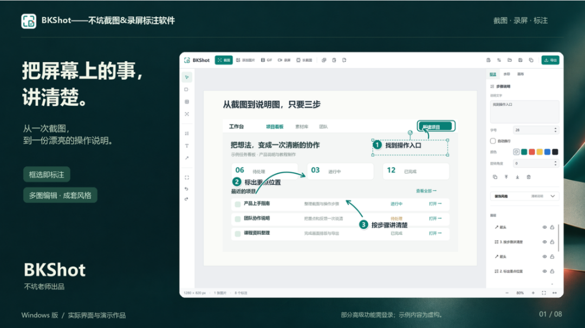
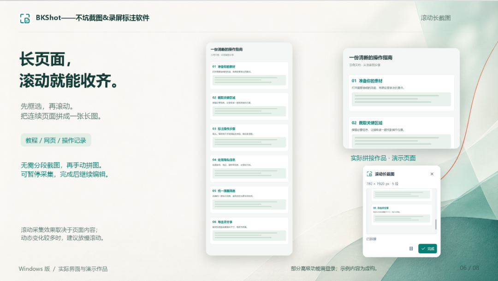
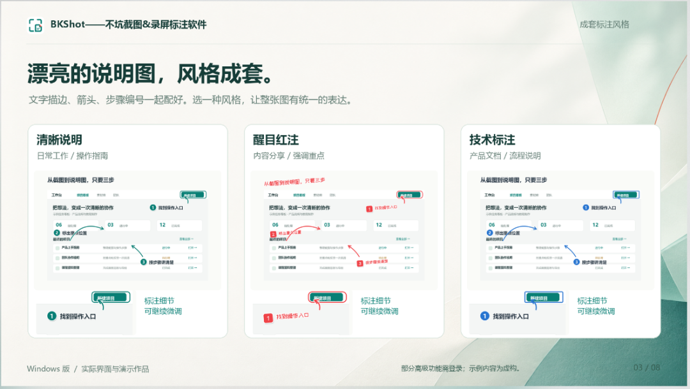
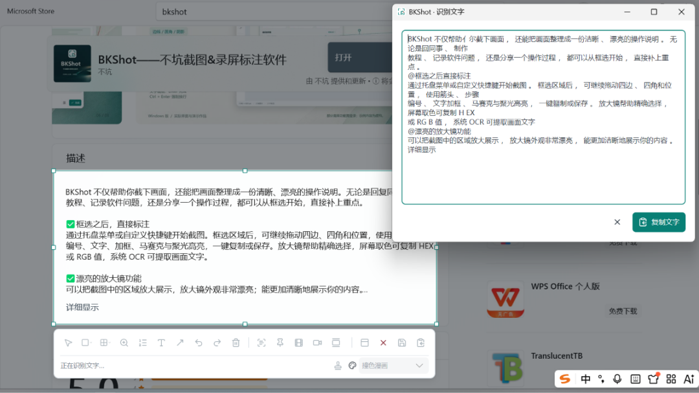
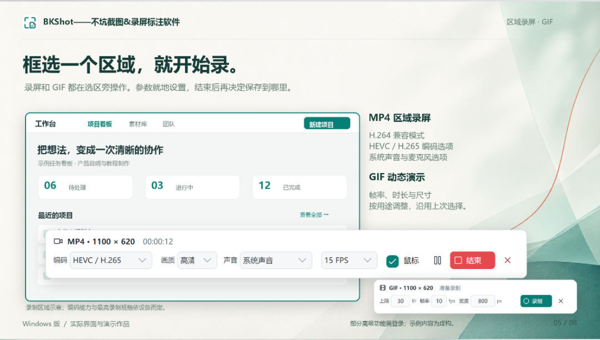
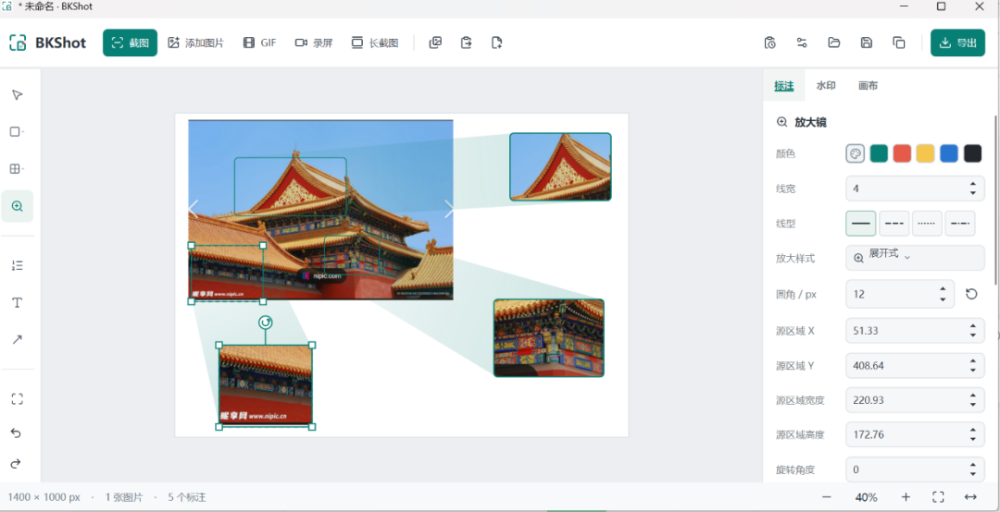
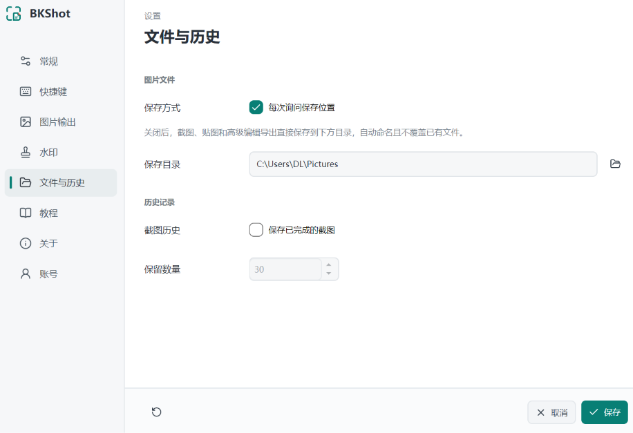
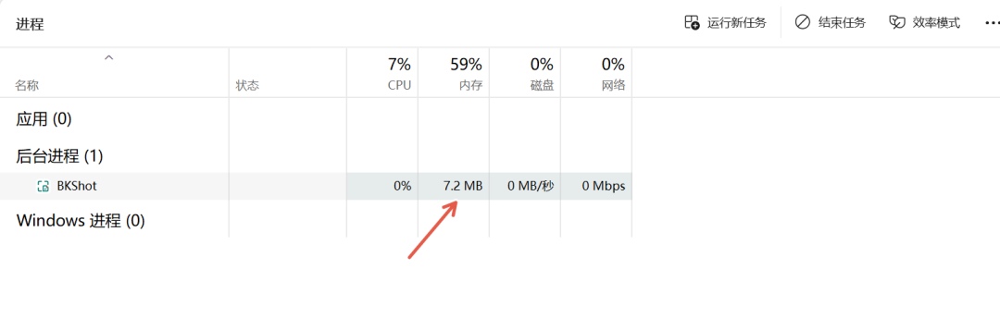

# 替代 Snipaste？国产免费截图工具 BKShot，自带长截图 + OCR+GIF 录屏
> 💡 备注属性未写入，可能是备注属性名称或者类型被修改了，建议将字段类型设置为 rich_text，可以在小程序-操作-修改文章数据库页面进行调整
> 原文链接:[https://mp.weixin.qq.com/s/qPdHINVKjmlRZcTCZiIQXw](https://mp.weixin.qq.com/s/qPdHINVKjmlRZcTCZiIQXw)
果然还是国人更懂国人需求，今天给大家分享一款国产免费 Windows 截图工具：BKShot，又叫不坑截图。作者是不坑老师，专门面向教程创作者，Win10、Win11 都能跑，完全免费，无水印

## ✨ BKShot 核心亮点
✅滚动长截图网页、长文档一键滚动截取，不用多次截图再拼接。

✅教程神器：自动递增序号这个功能我最喜欢。做分步教程，一键生成 1、2、3 步骤序号，样式干净，文档、公众号配图直接用，省去手动打字画圈。

✅离线 OCR 文字识别本地识别，不用联网，图片里的文字一键提取，隐私不用担心。

✅GIF 区域录屏支持选区录屏直接导出 GIF，做操作演示动图，不用额外打开 LICEcap。

✅局部放大镜 + 取色器截图时可以局部放大细节，适合演示按钮小字；内置取色器，一键复制色值，前端、设计朋友也能用。

✅截图历史记录就算清空剪贴板，历史截图还能在软件里面找回，不怕误删。

✅轻量低占用后台常驻只占几 MB 内存，低配电脑也不卡。

✅截图贴图｜把截图钉在屏幕最上层截完图之后，直接点击贴图按钮，这张截图就会变成悬浮小窗口，永远置顶在所有软件窗口上面，相当于钉在桌面。

## 📥 怎么下载
微软商店、火绒应用商店、联想应用商店，直接搜索BKShot即可安装。
## 💬 写在最后
现在 Windows 好用的截图工具不少，但同时集齐长截图、离线 OCR、GIF 录屏、自动序号还免费无水印的，BKShot 算是很有特色的一款。如果你经常写教程、做配图，可以装一个试试。
> 温馨提示：软件免费使用，建议从微软商店等正规渠道下载，避免第三方打包安装包。
> 
#Windows软件#截图工具#BKShot#免费工具#电脑神器#效率工具

## 摘要

（待补充）

## 我的笔记

（待补充）
