# 最经典的50部武侠电影（收藏）
> 💡 备注属性未写入，可能是备注属性名称或者类型被修改了，建议将字段类型设置为 rich_text，可以在小程序-操作-修改文章数据库页面进行调整
> 💡 原文链接:[https://mp.weixin.qq.com/s?__biz=MzcwMTE0NDE3NQ==&mid=2247497847&idx=1&sn=89327fb39bdfa6dfa59ef992008fccdf&chksm=f554625afad04f6d6b87a8591e86599b5069fdec73e2bedc00d8e9766164d99a718b9aadac8f#rd](https://mp.weixin.qq.com/s?__biz=MzcwMTE0NDE3NQ%3D%3D&mid=2247497847&idx=1&sn=89327fb39bdfa6dfa59ef992008fccdf&chksm=f554625afad04f6d6b87a8591e86599b5069fdec73e2bedc00d8e9766164d99a718b9aadac8f#rd)
如今的电影市场，武侠电影越来越少了，也越来越不受市场待见。但是对于喜欢武侠迷的朋友来说，现在的电影院基本已经看不到武侠电影了，曾经年轻人向往的大漠江湖、侠胆柔肠、浪迹天涯、充满诗酒与快意恩仇，无拘无束的世界似乎也都已经一去不复返了，也许是时代的潮流，也许是文化的变迁，武侠电影正逐渐消失。
一部好的武侠电影绝非单纯的动作奇观堆砌，武戏必须服务于侠义精神的表达，否则只是暴力美学。正所谓武为形，侠为魂，兼具美学、故事与精神内核。例如胡金铨的《侠女》借明末东林党争背景，让侠女杨慧贞的复仇承载着家国大义。徐克的《黄飞鸿》系列将佛山武师置于清末民初的变革洪流，个人武艺再高强也挡不住时代巨轮。
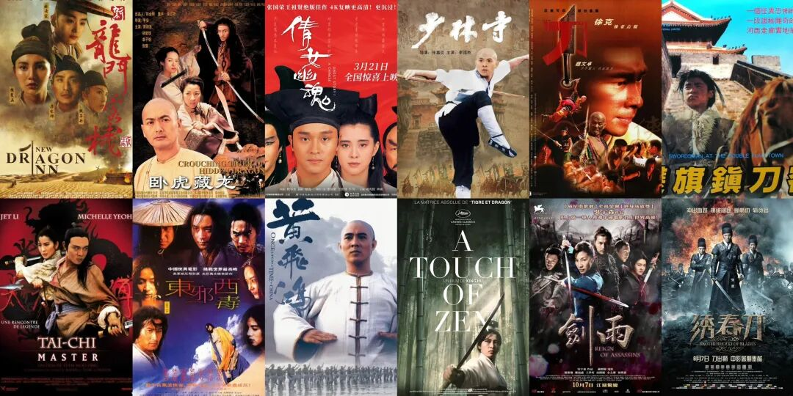
侠不只是武功高强的英雄，更在于取舍与坚守。武侠故事不能只有正邪对立，人物应当有挣扎与矛盾。侠客会面对情义、恩怨、道义的抉择，有弱点、有执念，让观众明白：侠，是明知艰难，仍守住本心。

好的武侠片敢于展现侠者的脆弱与失败，因为人在江湖，身不由己本身就是最大的悲剧。江湖不止客栈、刀剑、门派，更是一套人情与规矩。环境、服饰、台词氛围，共同营造独有的江湖气质。好武侠懂得留白，不用过多说教，在一颦一笑、一言一剑间传递东方风骨，含蓄厚重。
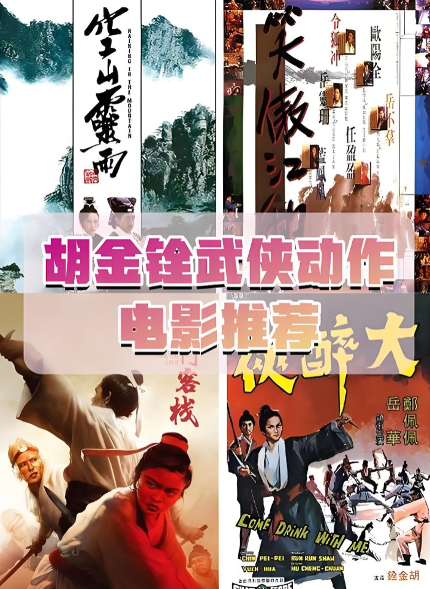
武侠电影是根植于‌中国传统文化‌，融入‌儒家、道家或佛教‌思想，探讨‌个人与社会、正义与复仇‌等议题，江湖是侠之大者为国为民，亦是儿女情长与权力纷争。‌真正的武侠好电影，最终要回答的是：**在一个失序的世界里，人如何保持尊严与信念。它既是成人的童话，也是关于正义与牺牲的永恒寓言。**

今天给大家分享的是中国电影史上最经典的50部武侠电影，当电影院里面看不到武侠电影的时候，只能在过去的影像中去观看。这些武侠电影不仅是经典，更是留给一代人的回忆，如果喜欢的话记得点赞收藏，想要资源的朋友可以在后台留言。
**1.《新龙门客栈》1992**
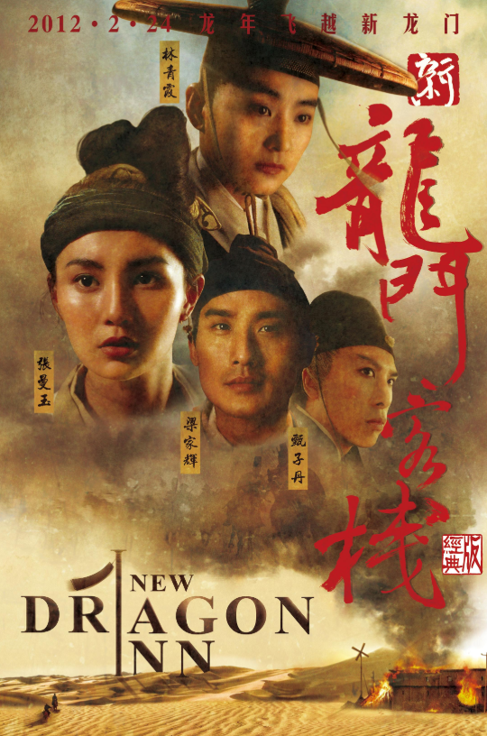
导演: 李惠民
主演: 张曼玉 / 林青霞 / 梁家辉 / 甄子丹
类型: 动作/爱情/武侠/古装
评分：8.7分
**故事简介：香港新派武侠的起点。**
影片背景设定在明朝中叶，讲述了武林侠士救助忠良之后，与东厂高手在大漠龙门客栈展开的一场惊心动魄的较量。电影中的人物形象鲜明，金镶玉的泼辣、邱莫言的深情、周淮安的侠义，都给观众留下了深刻的印象。而龙门客栈这个独特的场景，也为影片增添了神秘和紧张的氛围，各种机关暗道、尔虞我诈的情节，让观众仿佛置身于那个充满危险与机遇的江湖之中。
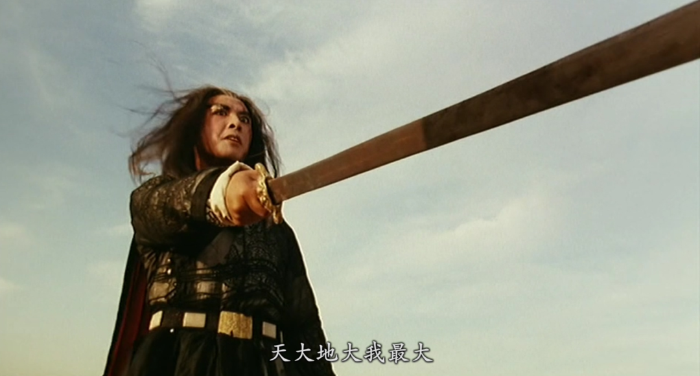
**精彩看点：新派武侠的巅峰之作**
将徐克式的视觉奇诡与胡金铨的古典气韵熔于一炉，构成了武侠史上最精彩的客栈困兽叙事。梁家辉的周淮安儒雅中见刚烈，张曼玉的金镶玉风骚里藏侠骨，甄子丹的曹少钦的阴鸷狠辣，人物弧光在刀光剑影中完成蜕变。香港武侠片黄金时代的谢幕强音。它证明了武侠不仅是打斗，更是人性在极端情境下的试炼场。此后客栈叙事成为武侠亚类型的重要母题，影响深远。
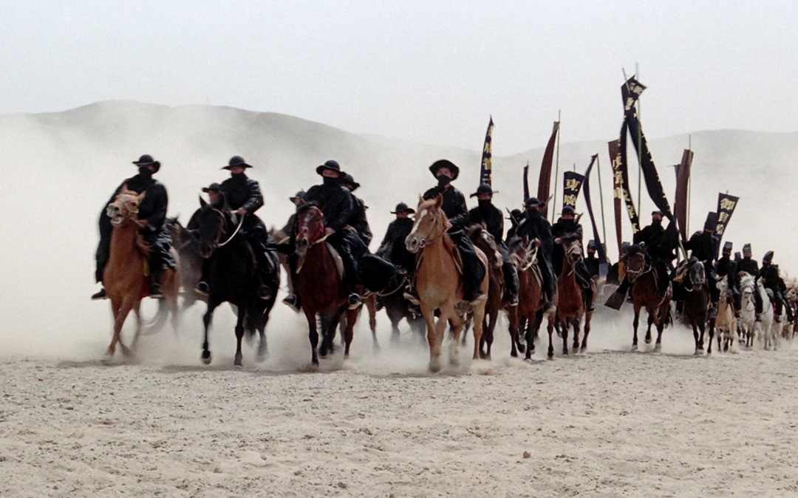
**2.《卧虎藏龙》2000**
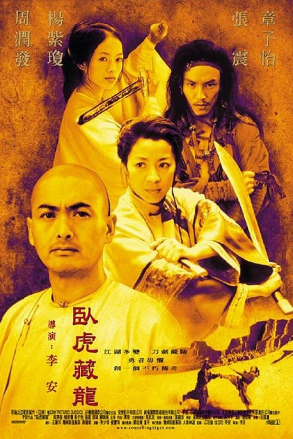
导演: 李安
主演: 周润发 / 杨紫琼 / 章子怡 / 张震
类型: 剧情/爱情/武侠
评分：8.4分

华语第一部奥斯卡最佳外语片
**故事简介：**影片讲述了一代大侠李慕白欲退出江湖，却因青冥剑引发一系列恩怨情仇的故事。这部电影在武打动作设计上极具美感，将武术与舞蹈相融合，动作如行云流水般流畅自然。同时，影片深入探讨了人性、爱情、侠义等主题，
**精彩看点：真正将武侠推向世界舞台。它证明了武侠的普世价值，关于欲望、压抑与自我解放的永恒命题。此后华语武侠片再难摆脱其文人化叙事范式的影响。**
以文人笔触解构武侠神话，竹林斗剑的飘逸与玉娇龙纵身一跃的决绝，构成东方美学的极致表达。李慕白的得道与玉娇龙的叛逆形成哲学对照——前者困于礼教束缚，后者追求绝对自由。都展现了人物内心的复杂性和矛盾性，让观众在欣赏精彩武打的同时，也能感受到情感的细腻与深刻。
最大的感触的是每个人都活得很纠结，江湖里卧虎藏龙，人心深处又何尝不是。李慕白喜欢俞秀莲，但是出于封建的世俗礼教，一辈子都没有说，俞秀莲同样喜欢，可是又无法说出来。多少人梦想着做肆意的玉娇龙，结果一不小心做了忍了一辈子的俞秀莲。到死的时候像李慕白一样叹一句“这一辈子都浪费了”。
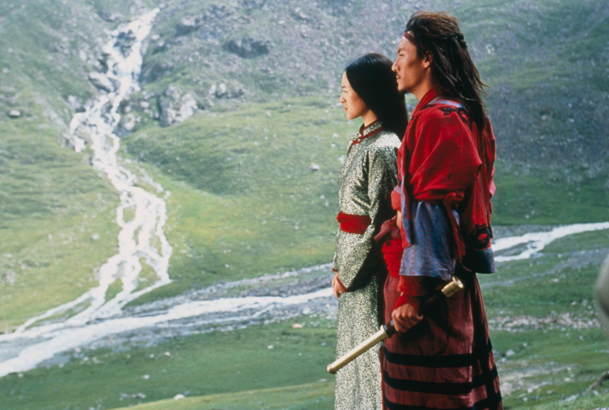
**3.《侠女》1970**
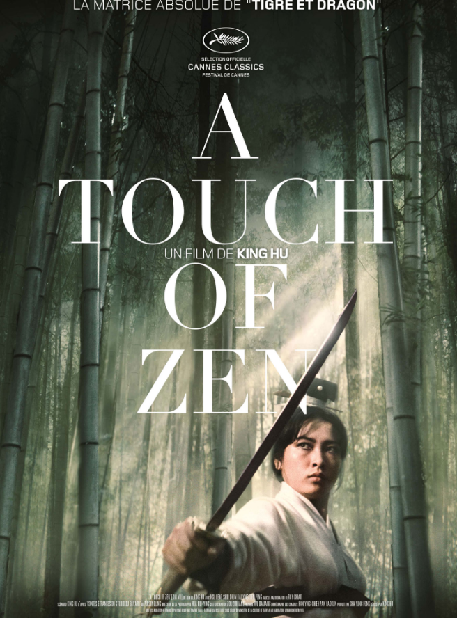
导演: 胡金铨
主演: 徐枫 / 石隽 / 白鹰 / 田鹏
类型: 剧情/动作/武侠/古装
评分：8.6分
**故事简介：**该片改编自蒲松龄所著《聊斋志异》中的同名小说。影片以明朝为背景，讲述了书生顾省斋与侠女杨之云之间的爱情故事，以及他们共同对抗东厂追杀的冒险经历。电影充满了文人气息，画面精美，意境深远，大量的山水空镜头和烟雾效果的运用，营造出了一种空灵而神秘的氛围。同时，影片中的武打场面也别具一格，动作简洁而有力，展现了中国传统武术的精髓。
**精彩看点：华语武侠片的现代性起点。胡金铨被尊为武侠电影的奠基人。**

胡金铨将京剧程式、禅宗意境与明代历史考据注入武侠，开创了作者武侠的先河。竹林大战长达十余分钟，不以剪辑炫技，而以长镜头捕捉招式的韵律感与空间关系。徐枫饰演的杨慧贞冷峻孤绝，禅机与杀机的辩证统一，使影片超越复仇叙事，升华为对暴力本质的哲学追问。
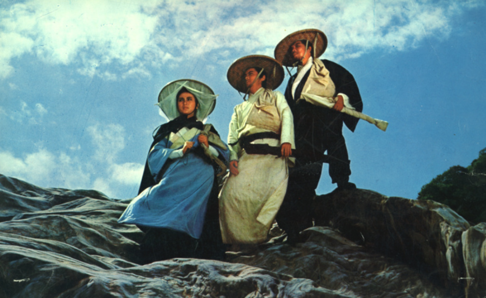
**4.《双旗镇刀客》1991**
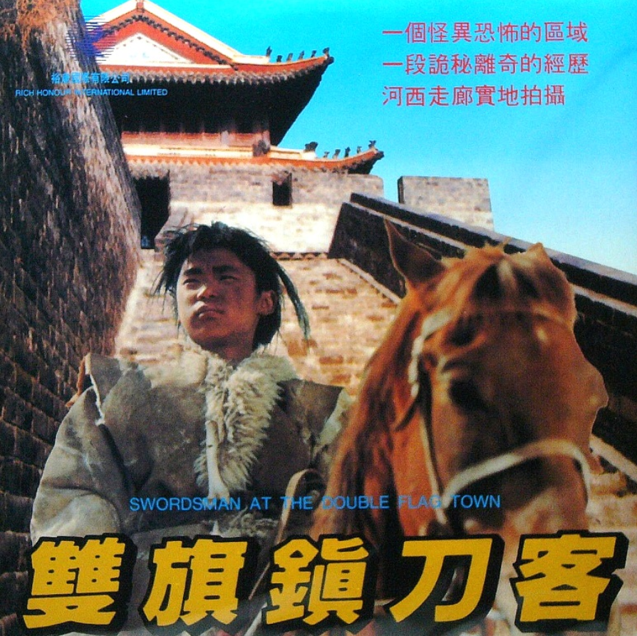
导演: 何平
主演: 高一玮 / 赵玛娜 / 常江 / 王刚
类型: 动作/冒险/武侠
评分：8.4分
**故事简介：**讲述了男孩“孩哥”前往双旗镇娶亲，途中遭遇土匪阻挠，最终凭借勇气和智慧为民除害的故事。电影以其独特的叙事风格和深刻的主题内涵，赢得了观众和影评人的一致好评。影片中的双旗镇是一个充满神秘和原始气息的地方，这里的人们生活简单而朴实，却也有着自己的生存法则。孩哥在这个小镇上的成长历程，展现了一个少年在面对困难和挑战时的勇气和担当，同时也揭示了人性的复杂与矛盾。
**精彩看点：中国西部武侠片的开山之作**
打破了武侠必在南方水乡或北方庙堂的空间定式。它证明了低成本同样可以创造类型突破，其去浪漫化的写实风格直接启发了《刀》《绣春刀》等后世作品，是90年代武侠新浪潮中极具先锋性的存在。
西部片外壳包裹武侠内核，双旗镇的黄沙漫天与刀客的一刀毙命，构成了极致的极简主义暴力美学。孩哥的成长叙事剥离了传统武侠的江湖门派体系，以快刀对决的仪式感替代冗长打斗，孩哥与好妹的纯真情感在血色荒漠中尤为动人。影片成本仅百万，却以粗粝质感营造出史诗气魄。
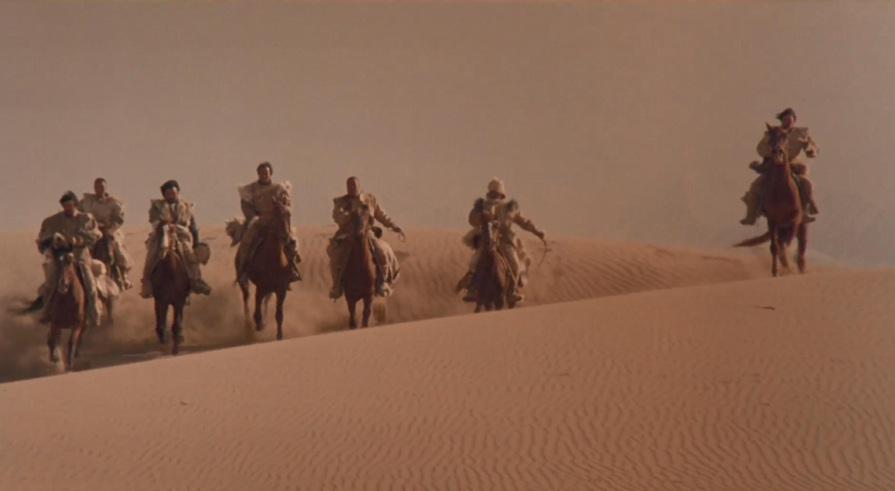
**5.《黄飞鸿》1991**
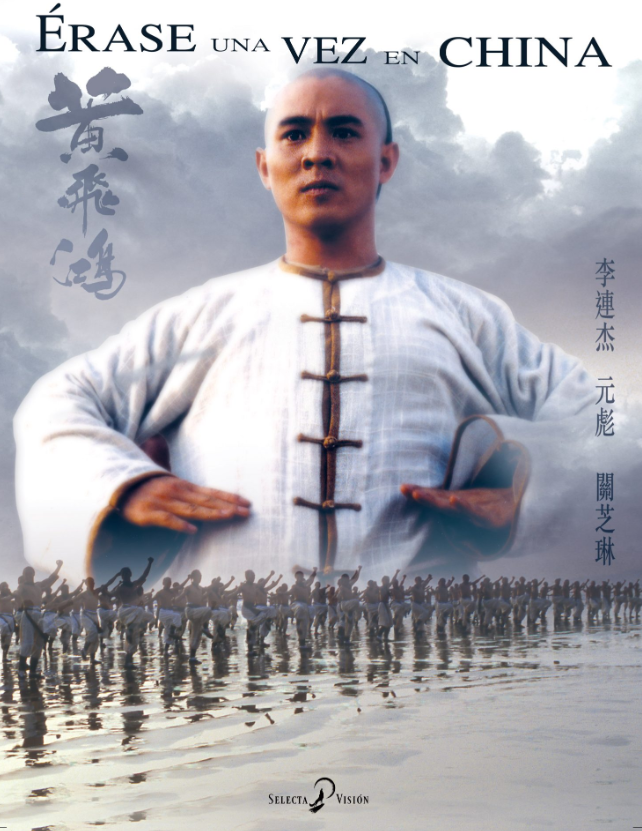
导演: 徐克
主演: 李连杰 / 元彪 / 关之琳 / 张学友
类型: 剧情/动作/武侠/古装
评分：8.4分
**故事简介：**该系列电影以清末民初为背景，展现了一代武术宗师黄飞鸿的传奇人生。影片中的黄飞鸿不仅武艺高强，更有着强烈的民族责任感和正义感，他在面对外敌入侵和社会不公时，总是挺身而出，用自己的武术和智慧维护正义。同时，电影中也不乏对师徒情、兄弟情和爱情的刻画，黄飞鸿与十三姨之间的爱情故事，以及他与徒弟们之间的师徒情谊，都让观众感受到了江湖中的温暖与真情。
**精彩看点：新武侠运动的开山之作，确立了功夫片向武侠片转型的美学范式。**
徐克以黄飞鸿系列重构近代中国武侠想象，将民族危亡、传统与现代的冲突注入武术叙事。李连杰的黄飞鸿儒雅刚毅，兼具宗师气度与时代困惑。影片以动作喜剧包裹家国情怀，黄飞鸿从保家到卫国的叙事升级，赋予武侠前所未有的历史纵深感。它让黄飞鸿从地方民间传说跃升为全球华人文化符号，李连杰由此成为继李小龙、成龙之后的第三代功夫巨星。此后数十部黄飞鸿衍生作品均无法超越徐克原版的叙事高度。
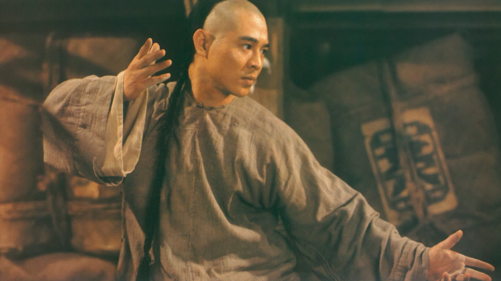
**6.《笑傲江湖》1990**
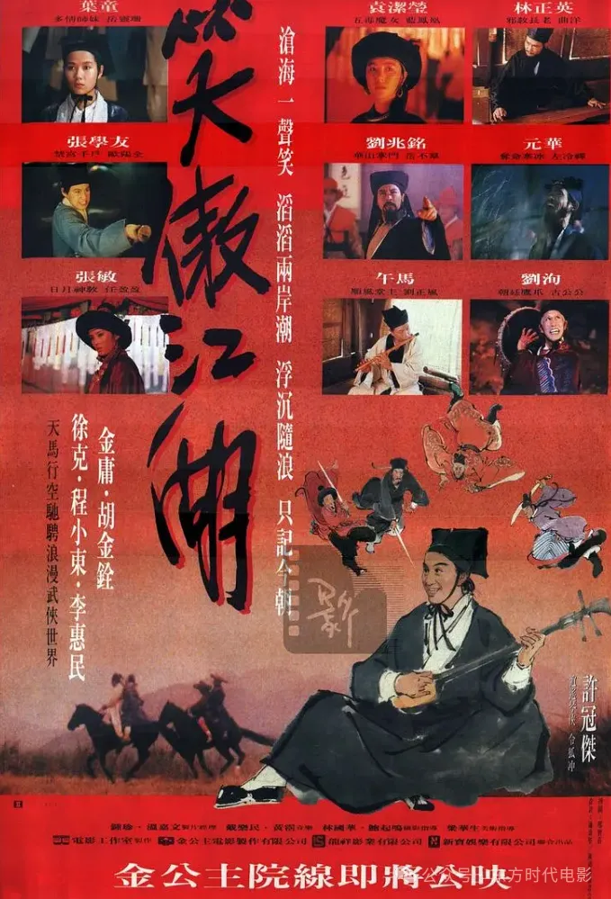
导演：胡金铨 / 徐克 / 李惠民 / 程小东
主演：许冠杰 / 叶童 / 张学友 / 张敏
类型：动作/武侠/古装
评分：8.1分
**故事简介：**沧海一声笑，这已经成为了不灭的经典，笑傲江湖，人生的境界，徐克程小东他们当年那一批作品，不但从电影艺术上开创了一个时代，同时也重新诠释了武侠的魅力。
**精彩看点：金庸武侠电影改编的巅峰**
胡金铨的文人底蕴与徐克的视觉狂想激烈碰撞，程小东的动作设计则赋予影片飘逸的舞蹈感。将金庸原著的江湖政治寓言升华为存在主义悲剧。影片以葵花宝典的隐喻解构权力欲望，竹林水战、绣花针破剑等场面兼具写意与暴力。
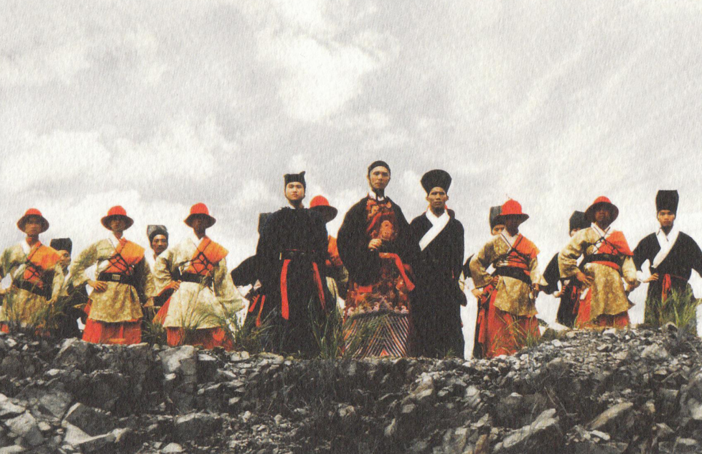
**7.《太极张三丰》1993**
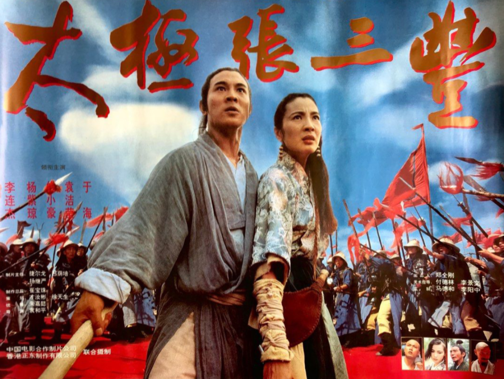
导演: 袁和平
主演: 李连杰/杨紫琼/钱小豪/袁洁莹
类型: 喜剧/动作/武侠/古装
评分：8.1分
**故事简介：**影片中，张君宝和董天宝原本是师兄弟，却因性格和理念的不同而分道扬镳，最终走向了对立的道路。电影通过他们之间的故事，展现了友情的珍贵和人性的复杂。同时，影片中的武打场面也十分精彩，太极拳的招式被展现得淋漓尽致，让观众感受到了中国武术的博大精深。
**精彩看点：武术指导袁和平的导演代表作**
袁和平将太极拳以柔克刚的哲学具象化为银幕动作美学，李连杰从君宝到张三丰的蜕变，完成了从外家拳到内家拳的武术叙事转换。影片以天宝的野心与君宝的淡泊形成镜像对照，探讨了权力腐蚀与人性坚守的永恒命题。它不仅是太极拳文化全球传播的重要媒介，更以张三丰这一真实历史人物为锚点，打通了武侠虚构与武术史实的边界。
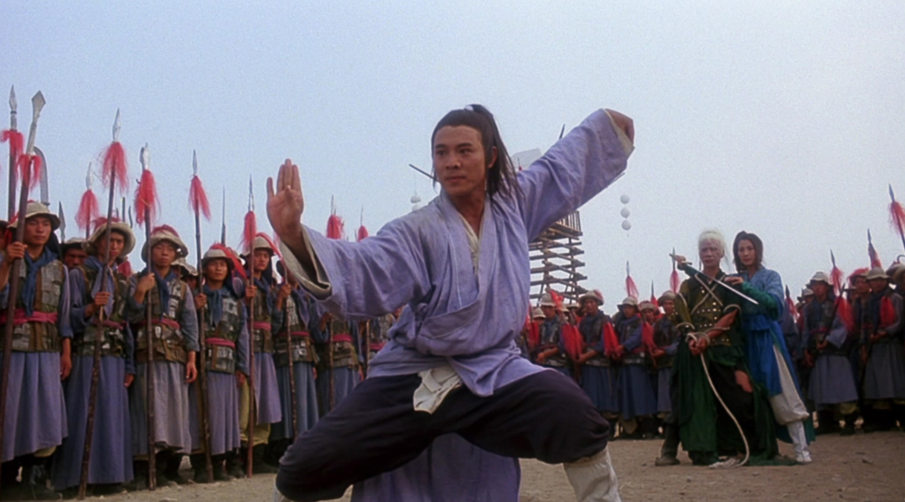
**8.《倩女幽魂》1987**
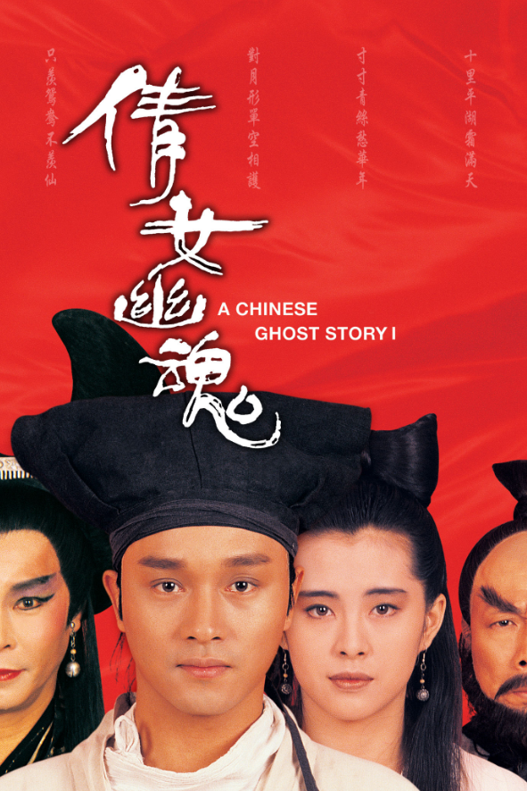
导演: 程小东
主演: 张国荣 / 王祖贤 / 午马 / 刘兆铭
类型: 爱情/奇幻/武侠/古装
评分：8.8分
**故事简介：**该片根据清代作家蒲松龄原著《聊斋志异》之《聂小倩》章节改编而成，讲述了猎妖师燕赤霞、狐妖聂小倩和书生宁采臣三人之间情感纠葛。该片是一部既具有东方韵味、又有国际共鸣的奇幻爱情电影。
**精彩看点：华语奇幻武侠片的奠基之作，开创了武侠+鬼片的跨界类型。**
以《聊斋》为底本，程小东将武侠、鬼怪、爱情熔于一炉，创造出独一无二的奇幻武侠类型。张国荣的宁采臣书卷气中见痴情，王祖贤的聂小倩凄艳绝伦，燕赤霞的道与魔之辩赋予影片哲学深度。将东方志怪美学推向极致，同时以人鬼恋的凄美内核超越了类型片的娱乐属性。
影片不仅让张国荣与王祖贤的古装扮相深入人心，而且喜剧与恐怖片的混搭也让古装鬼片重新成为港产片的顶尖潮流。王祖贤的聂小倩成为东方女鬼美学的终极范本，其影响力辐射至日本、韩国等东亚文化圈。影片证明武侠可以承载超现实想象，为后来《青蛇》《蜀山传》等视觉奇观型武侠片开辟了道路。
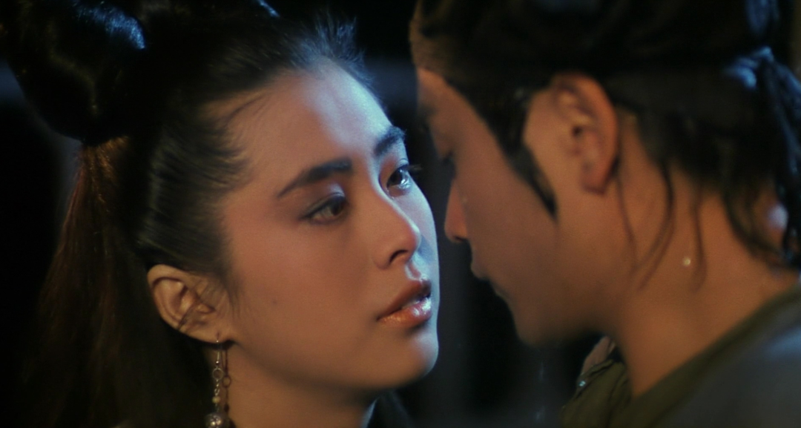
**9.《笑傲江湖之东方不败》1992**
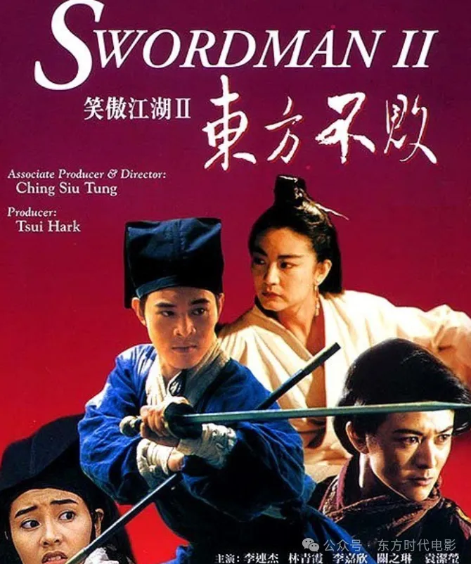
导演: 程小东
主演: 李连杰 / 林青霞 / 关之琳 / 李嘉欣 
类型: 剧情/爱情/武侠/古装
评分：8.5分
**故事简介：**影片改编自金庸的同名小说，却在原著的基础上进行了大胆的创新。林青霞饰演的东方不败一角成为了影史上的经典形象，她的男装英气逼人，女装则妩媚动人，将东方不败的复杂性和魅力展现得淋漓尽致。电影中的武打场面也极具观赏性，东方不败的葵花宝典武功威力惊人，与令狐冲等人的对决更是精彩绝伦，让观众大饱眼福。
**精彩看点：华语武侠片性别美学的革命性突破。**
程小东执导的这部续作，将前作的颠覆性推向极致。林青霞的东方不败从配角升格为绝对主角，构成影史最复杂的性别权力寓言。影片剥离了金庸原著的政治隐喻，以东方不败与令狐冲的禁忌情感为核心，将武侠叙事转化为存在主义悲剧。李连杰的令狐冲洒脱不羁，与林青霞的妖冶霸气形成致命吸引，水中饮酒一场戏将东方美学的暧昧与浪漫推向巅峰。林青霞的东方不败不仅重新定义了武侠片的角色塑造边界，更成为华语流行文化中雌雄同体美学的终极符号，其文化影响力远超电影本身，是类型片作者化表达的里程碑。

**10.《少林寺》1982**

导演: 张鑫炎
主演: 李连杰/于海 /于承惠/计春华
类型: 动作/武侠/古装
评分：8.4分
**故事简介：**讲述了隋唐年间，小虎为报父仇入少林习武的故事。它不仅展现了正宗的少林武术，更传递出惩恶扬善的侠义精神。电影中的武打场面真实而精彩，一招一式都充满了力量感，让观众感受到了中国功夫的博大精深。

**精彩看点：中国功夫片全球化的起点，**
以河南嵩山少林寺实景拍摄，摒弃香港武侠片的吊威亚与剪辑花招，全部由全国武术冠军真打实斗。李连杰的觉远和尚拳拳到肉，十八般兵器各显神通，醉拳、螳螂拳、少林棍等传统武术首次以完整形态呈现于银幕。影片以隋末乱世为背景，将十三棍僧救唐王的历史传说与朴素的民族复仇叙事结合，少林功夫由此从宗教秘传转化为全民文化符号。李连杰借此片横空出世，开启长达三十年的功夫巨星生涯。

张鑫炎导演的《少林寺》在改革开放初期横空出世，以每张票价一毛钱创下1.6亿票房的奇迹。电影摒弃威亚与替身，所有武打场面均由专业武术运动员实拍，三节棍对九节鞭、醉棍斗醉剑等经典对决至今仍是武术教科书。影片在嵩山实景拍摄，千年古刹的晨钟暮鼓与僧兵抗暴的传奇故事相得益彰，开创了"真功夫电影"的新纪元。

**11.《东邪西毒》1994**

导演: 王家卫
主演: 张国荣 / 林青霞 / 梁朝伟 / 张学友 / 张曼玉 
类型: 剧情/动作/爱情/武侠/古装
评分：8.6分
**故事简介：**该片取材于作家金庸小说《射雕英雄传》，主要讲述了欧阳峰与黄药师因比武未分胜负而结缘，后因情伤隐居沙漠开旅店，见证江湖恩怨；最终黄药师归隐桃花岛，欧阳峰重返白驼山，二人终成武林霸主的故事。
《东邪西毒》被称为华语武侠电影的另类高峰。《东邪西毒》是王家卫电影中的一则武侠寓言，改编于新派武侠小说，却以后现代主义的手法融入了对现代都市情感的寓言。
**精彩看点：华语作者武侠的哲学巅峰，也是武侠片去类型化的极致实验。**
王家卫以金庸《射雕英雄传》的人物为骨架，灌注存在主义哲学的血液，彻底解构了武侠的类型躯壳。张国荣的欧阳锋是沙漠中的记忆囚徒，梁朝伟的盲武士在桃花与桃花之间迷失，林青霞的慕容嫣在自我分裂中溺亡——所有人物都是时间的失败者。醉生梦死的酒、鸟笼的隐喻、桃花的执念，构成一部关于遗忘与记忆的散文诗。杜可风的摄影将大漠拍成心理的荒原，陈勋奇的音乐以弦乐编织出宿命的回响。它证明了武侠可以剥离打斗而成为纯粹的心理剧，虽然当年票房惨败，但经岁月沉淀已成为影史经典。

**12.《龙门客栈》1967**

导演: 胡金铨
主演: 上官灵凤 / 石隽 / 苗天 / 徐枫
类型: 动作/冒险/武侠/古装
评分：8.2分
**故事简介：**该片以明朝中期为背景，讲述了武林侠士为救助忠良之后，与以太监曹少钦为首的东厂高手在龙门客栈展开激烈拼杀的故事。《龙门客栈》开创了一种武侠片模式，人物的、叙事的、场景的、节奏的，让沉迷在邵氏假花假草摄影棚里的观众，看到另一种可能。武侠片从此得强化历史感，得讲究山水性情，得设计打斗的节奏，得参透时代精神作为它的时代立足点，并渐渐成为一种有诗意的电影产品。

**精彩看点：胡金铨客栈叙事美学的开山之作，也是华语武侠片从戏曲传统向电影现代性转型的关键节点。**
胡金铨以明代夺门之变为历史背景，在荒漠客栈的封闭空间中展开东厂与忠臣之后的生死博弈。影片以京剧程式为动作美学根基，一招一式皆有章法，客栈困兽的叙事模式由此确立。胡金铨以考据癖著称，明代服饰、兵器、礼仪的还原度极高，赋予武侠前所未有的历史质感。它直接启发了1992年徐克监制的《新龙门客栈》。影片1967年在台湾创下票房纪录，是胡金铨从邵氏出走后确立作者风格的重要标志，其以静制动的空间调度原则，成为后世武侠导演必修的美学功课。

**13.《黄飞鸿之男儿当自强》1992**

导演: 徐克
主演: 李连杰 / 关之琳 / 甄子丹 / 莫少聪
类型: 剧情/动作/爱情/武侠/古装
评分：8.3分
**故事简介：**影片借白莲教作乱暗喻民粹主义危险，严振东的"中国功夫敌不过洋枪"道出时代困局。黄飞鸿与孙文的对话戏份，让武侠宗师首次直面现代性命题，诊所中悬挂的"医者仁心"牌匾，暗示着救人与救国的双重使命。

**精彩看点：**徐克在续作中将黄飞鸿推向历史洪流的漩涡中心。李连杰饰演的黄飞鸿不再是单纯的武林高手，而是身处清末乱世、面对内忧外患的知识分子型英雄。影片最突出的武侠特点是武以载道——打斗场面兼具实战感与舞蹈美感，如李连杰与甄子丹的布棍对决堪称武侠片动作设计巅峰，两人在狭窄空间演绎出刚柔并济的哲学意境。既展示传统武术的精妙，又隐喻中西文化碰撞。影片将武侠从江湖恩怨提升到民族救亡的高度，赋予了武侠类型前所未有的历史厚重感与社会责任感。

**14.《空山灵雨》1979**

导演: 胡金铨
主演: 田丰 / 孙越 / 徐枫 / 秦沛
类型: 剧情/动作/武侠/古装
评分：8.4分
**故事简介：**该片故事情节改编自六祖慧能的生平事迹。该片讲述了明朝中叶，僧俗人等为三宝寺的镇寺佛经《大乘起信论》而勾心斗角、明争暗斗的故事。
**精彩看点：文人武侠的巅峰之作**

正如影片片名给人的感觉一样，功夫、武侠在片中只是点缀，参禅悟道才是精髓，该片传递的佛禅韵味，对后来的《卧虎藏龙》等武侠片都有深远影响。
影片以三宝寺镇寺佛经《大乘起信论》的归属之争为主线，将禅宗哲学融入武侠叙事。其武侠特点在于以静制动——大量运用空镜头、长镜头与留白，打斗场面克制而充满仪式感，如竹林对决一场，人物动作与环境融为一体，追求意境而非暴力快感。胡金铨以明代服饰考据与建筑美学著称，本片画面构图如古典山水画，将武侠片提升至诗电影的境界，开创了"禅意武侠"的独特美学范式。

**15.《武状元苏乞儿》1992**

导演: 陈嘉上
主演: 周星驰 / 张敏 / 吴孟达 / 徐少强 
类型: 喜剧/动作/武侠/古装
评分：8.2分
**故事简介：**该片讲述了广州提督之子苏灿为赢得心爱之人的喜欢，毅然赴京赶考武状元，但在考取武状元时被人设计陷害沦为乞丐，最后与爱人走到一起的故事。该片独具一格地展现了周星驰特有的无厘头风格，虽然挂着喜剧的招牌，但却深刻描绘了人生的喜怒哀乐，从而在同期的“新派武侠片”中独树一帜。
**精彩看点：**武侠喜剧的典范。其武侠特点在于以喜写悲，用无厘头风格解构传统武侠的严肃性，却又不失武侠精神内核。苏灿从纨绔子弟到丐帮帮主的蜕变，保留了落魄英雄习得绝世武功的经典武侠叙事，但加入大量荒诞桥段。影片将丐帮文化、科举制度与武术比拼熔于一炉，周星驰的表演使武侠动作兼具滑稽感与爆发力，最终落脚于乞丐中的霸主这一反讽式英雄形象，拓展了武侠类型的喜剧边界。

**16.《射雕英雄传之东成西就》1993**

导演：刘镇伟
主演：梁朝伟/ 林青霞/ 张国荣/王祖贤
类型：喜剧/奇幻/武侠/古装
评分：8.7分
**故事简介：**作为一部无厘头喜剧，影片融合了众多明星，以搞笑的剧情和夸张的表演成为经典。该片的神奇就在于明明拍摄周期很赶，整体效果看起来也有不少粗糙的地方，剧情中跳跃和不连接的感觉很多，但是精华段落却真的很好。
**精彩看点：**刘镇伟执导的这部贺岁片是武侠类型的彻底狂欢与解构。其武侠特点在于反武侠——借用金庸原著的人物关系，却完全颠覆其严肃叙事，将武侠世界变成荒诞喜剧的舞台。影片没有任何正经的武侠对决，取而代之的是张学友饰演的洪七公对王祖贤表白、梁朝伟饰演的欧阳锋的香肠嘴等经典笑料。武术在这里沦为视觉噱头，这种对武侠类型元素的拼贴与恶搞，既是对当时武侠片泛滥的自嘲，也展现了香港电影工业强大的类型混搭能力与娱乐精神。

**17.《刀》1995**

导演: 徐克
主演: 赵文卓/熊欣欣/桑妮/ 陈豪 
类型: 剧情/动作/武侠
评分：8.1分
故事简介：
该片讲述了炼锋号铸刀厂大弟子定安为爱堕下山崖，断手后拾得半本绝世刀谱，之后自创独臂断刀刀法，手刃了杀父仇人飞龙的故事。

**精彩看点：武侠创作中最具实验性的一部。**

《刀》是徐克的一次宣泄之旅，充满了强烈的个人气息。电影采用一种歇斯底里的方式，令人紧张屏息的明快叙事，干脆利落的节奏进程，鲜明刺目的画面表现，极度的暴力和大量洒落鲜血的画面，阴暗与鲜明色彩的对立。
其影片摒弃了传统武侠的诗意与浪漫，以近乎粗粝的视觉风格重构江湖。赵文卓饰演的黎定安在断刀后复仇的故事，充满了暴力、压抑与原始野性。徐克大量使用手提摄影、快速剪辑与倾斜构图，打斗场面血腥而残酷，如炼锋号铸刀坊的决斗，金属碰撞与血肉横飞交织。影片的武侠特点在于去浪漫化——江湖不再是侠客的逍遥之地，而是充满欲望、背叛与生存挣扎的修罗场。这种对武侠类型的暴力美学革新，虽在当时票房失利，却成为cult经典。

**18.《倚天屠龙记之魔教教主》1993**

导演: 王晶
主演: 李连杰 / 张敏 / 邱淑贞 /洪金宝 
类型: 动作/武侠/古装
评分：8.0分
**故事简介：**改编自作家金庸小说《倚天屠龙记》，主要讲述父母双亡的张无忌，在武当山被师兄弟孤立中长大，机缘巧合下习得九阳神功与乾坤大挪移，并在光明顶护教有功，随后与蒙古郡主赵敏一起面对江湖纷争的故事。该影片人物塑造与原著有一定差异，没有突出“正义感”，改编让角色性格更讽刺，表现出无厘头，成为很多观众心中难以超越的经典。
**精彩看点：**王晶执导的这部改编作品以颠覆性著称。影片将金庸原著的宏大叙事压缩为快节奏的江湖权力游戏，李连杰饰演的张无忌不再是优柔寡断的仁者，而是心机深沉、亦正亦邪的枭雄。其武侠特点在于戏谑化重构——王晶以商业片的精明，将武侠元素与无厘头喜剧、政治阴谋熔于一炉。动作设计兼具硬桥硬马的实战感与夸张的视觉奇观，如光明顶大战六大派，场面调度混乱却充满娱乐性。影片对原著人物性格的改写引发争议，但也展现了90年代香港武侠片在忠实原著与商业娱乐之间的张力。

**19.《鹿鼎记》1992**

导演: 王晶
主演: 周星驰 / 吴孟达 / 张敏 / 吴君如 / 邱淑贞 
类型: 喜剧/动作/武侠
评分：8.4分
**故事简介：**该片改编自金庸的同名小说，讲述了韦小宝前去应征清宫什役，被海公公指派刺探太后行动。小宝靠他的机智最终将假太后逼走，并将奸雄鳌拜绳之以法的故事。
**精彩看点：反武侠的极致类型**
影片彻底解构了金庸原著中侠之大者的传统价值观，周星驰饰演的韦小宝不会武功、贪财好色，却凭借机智与运气在江湖与朝堂间游刃有余。其武侠特点在于以无招胜有招——影片中的武功被彻底祛魅，化功大法变成搞笑桥段，陈近南的英雄形象被颠覆为功利主义者。武侠在这里不再是崇高的精神追求，而是被权力与利益渗透的荒诞场域。周星驰的表演将市井智慧提升为一种生存哲学，影片以喜剧外壳完成了对武侠神话最彻底的消解，开创了反英雄武侠的范式。

**20.《英雄》2003**

导演: 张艺谋
主演: 李连杰 / 梁朝伟 / 张曼玉 / 章子怡 / 陈道明
类型: 剧情/动作/武侠/古装
评分：7.7分
**故事简介：**《英雄》讲述战国末年，七雄并起，惟秦国最为强大，急欲吞并六国，秦王为一统天下，发动了对赵国等诸侯六国的讨伐战争。秦王野心，激起了各诸侯国侠士的强烈不满，以无名等人为首的各国侠客打算刺杀秦王嬴政，但在得知秦王统一天下的大志后为了百姓苍生的安宁而最终放弃的故事。

**精彩看点：**《英雄》是内地大片的开山之作，也为内地贺岁影片增加了一个新的类型，武侠大片，这在中国电影产业发展的历史上应当被浓浓地写上一笔。影片以刺秦故事为框架，通过无名与秦王的多重叙事，探讨天下与个体的哲学命题。其武侠特点在于形式即内容——张艺谋将武侠打斗升华为视觉仪式，动作设计由程小东完成，强调飘逸与写意，人物在山水间飞行打斗，追求意境而非物理真实。影片的争议在于主题表达的暧昧性，为了天下放弃刺杀的价值观被批评为权力美学服务，但其在武侠类型中注入的哲学深度与视觉震撼，无疑拓展了武侠电影的艺术边界。

**21.《方世玉》1993**

导演: 元奎
主演: 李连杰 / 萧芳芳 /李嘉欣/ 赵文卓 
类型: 喜剧/动作/武侠/古装
评分：8.1分
**故事简介：**该片讲述了乾隆皇帝命九门提督追寻“红花会”名册，而方世玉的父亲方德正正是红花会成员，一次，方德正为保护“红花会”名册，不慎被九门提督抓捕，为救父亲方世玉独闯刑场的故事。
**精彩看点：**影片以清代民间英雄方世玉为原型，将传统南拳功夫与青春偶像气质相融合，其武侠特点在于轻松写意——李连杰饰演的方世玉不再是严肃的大侠，而是带点叛逆与幽默的少年英雄，打斗场面兼具硬桥硬马的扎实功底与灵巧腾挪的杂技美感，将实战性与观赏性完美平衡。影片在武侠框架中注入家庭伦理喜剧元素，展现了香港武侠片将传统武术现代化、娱乐化的成熟路径。

**22.《新独臂刀》1971 **

导演: 张彻
主演: 姜大卫 / 狄龙 / 李菁 / 谷峰
类型: 动作/武侠/古装
评分：8.0分
**故事简介：**该片讲述了拥有“鸳鸯刀”绝技的少年雷力被龙异之使计陷害，自废右臂，在客栈中做店小二，并与封俊杰结为好友。封俊杰被龙异之杀害后，雷力为友复仇的故事。导演并没有阐释以暴制暴，除暴安良的思想，他只是客观反映了江湖的险恶和轮回。其浪漫色彩表现在复仇的母题、反暴力的倡导以及对侠义精神的赞扬。该片融合了暴力美学与浪漫主义，兼顾了豪情热血和风发意气。
**精彩看点：阳刚武侠美学的奠基之作。**
姜大卫饰演的雷力断臂复仇的故事，充满了张彻标志性的男性情谊与暴力美学。其武侠特点在于以残躯铸侠魂，独臂设定不仅是生理缺陷，更成为武侠精神超越肉体局限的象征。张彻摒弃了当时流行的戏曲化武打，采用更直接、血腥的写实风格，如客栈血战与最终对决，刀刀见肉的残酷感冲击观众视觉。影片将武侠从儿女情长转向兄弟情义与男性荷尔蒙的宣泄，断臂—复仇—殉道的叙事模式成为后世武侠片反复致敬的原型，深刻影响了香港武侠片的男性气质建构。

**23.《剑雨》2010**

导演: 苏照彬
主演: 杨紫琼 / 郑雨盛 / 王学圻 / 徐熙媛 / 余文乐
类型: 动作/爱情/武侠/古装
评分：7.7分
**故事简介：**影片的故事充满了悬疑和奇幻色彩，女杀手曾静在退出江湖后，因拥有江湖圣物而被卷入一场腥风血雨。电影中的武打场面独具特色，融合了剑术、暗器等多种元素，动作设计细腻而富有美感。同时，影片还深入探讨了人性、爱情和救赎的主题，曾静与江阿生之间的爱情故事，以及他们在江湖恩怨中的挣扎与抉择，都让观众感受到了江湖的无奈与温情。
**精彩看点：新世纪武侠片的类型融合实验。**
影片以女杀手细雨退隐江湖、易容改嫁寻常书生却难逃宿命的故事为主线，将武侠与悬疑、爱情、禅意熔于一炉。其武侠特点在于武侠即人生——影片前半段刻意消解武侠的宏大叙事，展现细雨作为曾静在柴米油盐中的平凡幸福；后半段江湖追杀来袭，武功成为守护日常生活的最后手段。剑法写实而凌厉，兼具实战感与舞蹈性。影片对放下屠刀，立地成佛的禅宗命题进行了武侠化诠释，赋予武侠类型罕见的温情与日常性。

**24.《洪熙官》1994 **

导演: 王晶
主演: 李连杰 / 谢苗 / 邱淑贞 / 叶德娴 
类型: 剧情/动作/冒险/武侠/古装
评分：8.0分
**故事简介：**该片讲述了清朝康熙年间，少林俗家弟子洪熙官携幼子洪文定将背上印有藏宝图的少林五祖安全送到天地会，最后与宿敌马宁儿交战大仇终于得报的故事。
**精彩看点：**影片以洪熙官携子洪文定反清复明的故事为主线，将家国大义与父子亲情紧密结合。其武侠特点在于以家喻国——李连杰饰演的洪熙官不再是孤胆英雄，而是背负血海深仇、必须在刀光剑影中保护幼子的父亲。动作设计由元奎与元德完成，洪拳的刚猛与夺命锁喉枪的狠辣被展现得淋漓尽致，如与马宁儿的最终对决，在铜人阵中的生死搏斗兼具力量感与悲壮感。

**25.《六祖慧能传》1987**

导
演: 李作楠
主演: 凌波 / 金汉 / 梁修身 / 孙国明
类型: 动作/奇幻/武侠/古装
评分：8.1分
**故事简介：**六祖出世有二僧人至府送名，上慧下能，慧能三岁丧父，家贫失学，以卖柴为生。一日送柴至张府，闻金刚经而开悟，遂别母至寺求佛，以粗重工作磨练心智。
**精彩看点：**影片以禅宗六祖慧能的悟道历程为主线，将佛门公案与江湖恩怨并置。其武侠特点在于以武入禅。武功在这里不是杀戮手段，而是修行障碍与悟道契机。打斗场面往往服务于禅宗机锋的呈现，如慧能以佛法化解武斗冲突，体现不战而屈人之兵的东方智慧。影片将武侠片的动作美学与佛教文化的空灵意境相结合，人物在山水禅院间的打斗追求动中守静的哲学意味，是对武侠类型进行宗教化、哲学化改造的罕见尝试，拓展了武侠电影的精神边界。
**26.《师父》2015**

导演: 徐浩峰
主演: 廖凡 / 宋佳 / 蒋雯丽 / 金士杰 / 宋洋
类型: 剧情/动作/武侠
评分：8.1分
**故事简介：**该片改编自徐浩峰创作的短篇小说集《刀背藏身》中的同名作品《师父》。讲述了民国年间，南派武人陈识为在天津武术界开馆立足，收当地青年耿良辰为徒代其踢馆，随后引发一场席卷天津武术界的巨变，师徒二人深陷其中的故事。
**精彩看点：**徐皓峰重塑了民国武行的真实生态。影片摒弃了飞檐走壁的神话套路，代之以窄巷茶馆中的短兵相接，每一招每一式都有出处，刀拳真碰真撞，不花哨、不炫技。廖凡饰演的陈识以踢八家馆开宗立派，却在规矩与利益的博弈中仓皇逃离。影片的武人不是快意恩仇的大侠，而是有底线、有尊严的绅士武者。徐皓峰以冷峻克制的镜头语言，记录了一个门派的消亡与一种规矩的消逝，被誉为中国的武士片开创者。

**27.《一刀倾城》1993**

导演: 洪金宝
主演: 狄龙 / 杨凡 / 杨丽菁 / 关之琳
类型: 武侠/古装
评分：8.2分
**故事简介：**影片取材于清末大刀王五的真实事迹，故事以戊戌变法为背景，讲述黑旗军大刀队队长王五刺杀日军失败后隐居，结识谭嗣同、袁世凯后重出江湖，却因袁背叛导致谭嗣同牺牲，最终独闯袁府复仇的历程。影片通过三人命运交织展现清末救国图景，融入黑旗军抗日等历史事件。
**精彩看点：**这是90年代港片中的异类，一部被严重低估的经典。影片以戊戌变法为背景，将正史与武侠深度融合，狄龙饰谭嗣同、杨凡饰大刀王五，家国情怀与个人命运交织。洪金宝的武戏硬桥硬马，开篇黑旗军夜袭日军营地，冷兵器在枪炮前的无力感震撼人心。台词悲怆激昂，至今令人动容。它追问的不是谁武功更高，而是侠者何为，在快意恩仇的武侠传统中注入了厚重的历史悲歌。

**28.《少年黄飞鸿之铁马骝》1993**

导演: 袁和平
主演: 甄子丹 / 王静莹 / 于荣光
类型: 喜剧/动作/武侠/古装
评分：7.7分
**故事简介：**该片讲述了大夫杨天淳眼见晚清官吏祸国，故夜间乔装飞贼“铁猴”，劫官济贫。京官大怒，派少林叛徒衍空和尚为钦差，通缉铁猴；黄麒英领子黄飞鸿北上，路见盗贼，黄出手教训盗贼，显其功夫不俗。官府以为民除害为名，以飞鸿为人质逼迫黄麒英助擒飞贼。黄麒英不明真相，两雄恶战连场。
**精彩看点：**堪称传统功夫片的巅峰之作。袁和平回归不停机拍摄的真实动作，甄子丹的快腿真实再现了佛山无影腿。片尾在烈火燃烧的木桩上的生死对决，考验的不仅是演员的武术功底，更是定力与胆识。影片虽在香港票房失利，却在北美大卖1469万美元，成为华语电影海外发行的传奇。

**29.《山中传奇》1979**

导演: 胡金铨
主演: 石隽 / 徐枫 / 张艾嘉 / 田丰 
类型: 剧情/奇幻/古装
评分：8.4分
**故事简介：**该片改编自宋人话本《西山一窟鬼》，讲述了书生何云青抄写据说能沟通阴阳两界的经书《大手印》，引来众鬼怪企图抢夺经书的故事。影片由行走段落开篇，借由着何云青的视点，大自然的壮美、灵韵飘然于影片的主体叙事线之外，在影片的前二十分钟内成为了真正的主角。尤其值得称道的是，山水之美与摄影机运动以及观众视点之间，达到了天人合一般的默契。

**精彩看点：胡金铨鬼禅电影的巅峰之作**
与《侠女》《空山灵雨》并称其艺术最高成就。影片融合鬼魅、爱情与武侠，胡金铨以功夫蒙太奇将京剧的板眼、锣鼓点融入电影节奏，画面古色古香，山林夕照、笛声悠扬，气派之大在当年台港电影中堪称首见。封闭空间中的动静冲突、人物神出鬼没的行者轨迹，以及对中国传统文化中道法自然哲学的追求，使其成为一部充满聊斋韵味与禅意的东方奇幻经典。

**30.《黄飞鸿之狮王争霸》1992**

导演: 徐克
主演: 李连杰 / 关之琳 / 莫少聪 / 熊欣欣
类型: 剧情/动作/武侠/古装
评分：8.2分
**故事简介：**该片讲述了黄飞鸿来北京看望父亲，却被京城恶少赵天霸欺压；后得知俄国人欲刺杀李鸿章，民族大义在前，毅然参加狮王大会，并成功救下李鸿章并说明治国策略的故事。
**精彩看点：**徐克黄飞鸿三部曲的收官之作，将武侠叙事推向更深的历史反思。影片以慈禧太后举办狮王争霸为引，表面是各路武馆的竞技，实则是清廷面子工程的荒诞写照。李连杰饰演的黄飞鸿从武林宗师蜕变为思想启蒙者，最终将金牌掷回李鸿章，发出“广开民智、智武合一”的醒世之声。 动作设计由元彬接手，将佛山无影脚发挥到极致，狮阵大战精彩纷呈。 影片展现了一个民族在屈辱中的觉醒，超越了传统武侠的江湖恩怨，成为一曲悲壮的民族史诗。

**31.《刺马》1973**

导演: 张彻
主演: 狄龙 / 姜大卫 / 陈观泰 / 井莉
类型: 剧情/动作/武侠/古装
评分：8.0分
**故事简介：**影片改编自清朝四大奇案之一的刺马案，于1973年2月24日在中国香港上映。该片以绿林兄弟张汶祥、黄纵与马新贻的结义为始，讲述马新贻为权势私通黄纵妻子米兰并设计杀害兄弟，最终被张汶祥刺杀复仇的故事。影片采用京剧叙事框架，结合刘家良设计的南派武术动作，通过三人权力欲望与情欲纠葛展现封建礼教对人性的压抑。

**精彩看点：张彻暴力美学的巅峰之作**
改编自清末刺马案，两江总督马新贻被结义兄弟张汶祥刺杀的真实历史。影片将兄弟情义与权力欲望的张力推向极致。张彻善用厚重的大刀与惨烈的死亡场面，以慢镜头、局部特写渲染英雄死亡时的艺术化瞬间，血浆喷涌、赤身肉搏，阳刚之气扑面而来。 影片最震撼之处在于对背"的冷峻审视——不是简单的正邪对立，而是权力腐蚀人性的悲剧。三兄弟从生死与共到反目成仇，张彻以近乎残酷的真实，拆解了武侠片中兄弟义气的浪漫神话，为后来的《投名状》埋下了深刻伏笔。

**32.《绣春刀》2014**

导演: 路阳
主演: 张震 / 刘诗诗 / 王千源 / 李东学
类型: 剧情/动作/武侠/古装
评分：7.7分
**故事简介：**这部电影以明朝末年为背景，讲述了锦衣卫沈炼、卢剑星和靳一川三兄弟在动荡时局中的命运沉浮。影片中的打斗场面主要采用了特写和快剪的手法，大大强化了场面的紧张感和冷峻感，展现了锦衣卫的冷酷与无情。同时，电影也深入探讨了兄弟情、人性和忠诚等主题，沈炼三兄弟之间的深厚情谊，以及他们在面对权力和利益时的挣扎与抉择，都让观众感受到了江湖的残酷与无奈。
**精彩看点：**路阳将武侠从江湖拉回朝堂，创造了不会飞檐走壁的实打风格。张震饰演的沈炼不是大侠，而是体制内的底层小人物，在权力碾压下挣扎求存。影片的武侠美学扎根于现实。没有飞天遁地，只有刀刀见血的冷兵器搏杀；没有快意恩仇，只有想活命，就得换个活法的无奈。路阳以悬疑叙事包裹武侠内核，在情节紧凑、节奏明快中展现了中国传统文化的魅力，被誉为武侠电影中的佳作。

**33.《黄河大侠》1988**

导演: 张鑫炎 / 张子恩
主演: 于承惠 / 靳德茂 / 淳于珊珊 / 计春华 
类型: 剧情/动作/武侠/古装
评分：7.9分
**故事简介：**讲述了唐朝末年藩镇割据时期，西北黄河流域的段、柳、李诸王互相攻伐，欲独霸天下，大侠马义身处三方纠葛之中，为奸人所害被毒瞎双眼，却凭一手高超剑法为民除害主持正义的故事。
**精彩看点：**张鑫炎继《少林寺》后打造的又一武侠经典，被誉为八十年代合拍武侠片最后的高峰。 影片以晚唐藩镇割据为背景，讲述盲人剑客马义在乱世中坚守侠道的故事。影片突破了《少林寺》式的功夫喜剧模式，基调悲壮沉郁，融入家国情仇与除暴安良的大义。马义从眼盲心盲到心明眼亮的转变，是对人性险恶的深刻讽刺。 虽然香港票房仅248万港元遭遇滑铁卢，但在内地创下1700万元发行收入的佳绩，成为一代人心中的旷世经典。

**34.《方世玉续集》1993**

导演: 元奎
主演: 李连杰 / 萧芳芳 / 李嘉欣 / 郭蔼明
类型: 喜剧/动作/武侠/古装
评分：7.9分
**故事简介：**该剧讲述了方世玉因武功高强、行侠仗义，受到红花会总舵主陈家洛的赏识，却遭到二号人物于振海的嫉妒与追杀。方世玉在执行任务中，意外卷入了一场关于陈家洛身世的阴谋。在经历了一系列的冒险和挑战后，方世玉击败了阴险的于振海，揭露了陈家洛的真实身份，最终选择退出江湖，与家人归隐山林的故事。
**精彩看点：**李连杰延续《黄飞鸿》中的潇洒身手，在木桩间上下翻飞，与未来丈母娘李小环的高台夺绣球极具观赏性。 影片最精彩的动作设计当属劫法场桥段，贡献了一场教科书级别的腿功大战。元奎巧妙融合无厘头喜剧元素，让萧芳芳饰演的苗翠花与李嘉欣饰演的雷婷婷成为亮点。影片轻松幽默的氛围缓解了武侠片的沉闷，动作场面与故事情节俱佳，是90年代香港新武侠电影中青春喜剧风格的代表作。

**35.《投名状》2007 **

导演: 陈可辛
主演: 李连杰 / 金城武 / 刘德华 / 徐静蕾 
类型: 剧情/动作/战争/武侠
评分：7.9分
故事简介：该片的故事大纲改编自清末四大奇案之一的刺马案，讲述了清末战乱时期，庞青云、赵二虎、姜午阳三兄弟因共同目标结义从军，历经战功，但随地位提升，野心与分歧也随之增大。在朝廷欺诈、官府黑暗背景下，三兄弟最终因野心和误会自相残杀的故事。
**精彩看点：**陈可辛对张彻《刺马》的颠覆性重构，彻底解构了武侠片中兄弟义气的浪漫神话。影片以青灰色调与写实风格，直面战争的残酷与血腥。黄沙狼烟、血肉横飞，暴力不再是舞蹈化的美学，而是令人本能厌恶的恐怖。 李连杰、刘德华、金城武饰演的三兄弟，从纳投名状时的不求同生，但求同死，到最终因欲望与权力的碾压而分崩离析。影片最震撼之处在于对江湖乌托邦的摧毁，欲望压倒了承诺，冠冕堂皇的理想不过是肮脏的阴谋。完成了对战争与人性的普遍化追问，被誉为“第一部从人性出发审视暴力的古装大片”。

**36.《忠烈图》1975 **

导演: 胡金铨
主演: 徐枫 / 白鹰 / 乔宏 / 韩英杰 / 洪金宝
类型: 动作/武侠/古装
评分：8.0分
**故事简介：**本片描述明朝一群忠义侠士，抵御倭寇入侵的故事，主要讲述明朝抗击倭寇名将俞大猷在江湖义士的帮助下勇敢抗击倭寇的故事。在胡金铨的年表中，《忠烈图》似乎恰成分水岭，此后他对影片中武打场面的经营渐渐递减，开始强调更多形而上的思维。最精彩处在于胡导大量以「棋盘」布阵的创意，藉以比喻敌我双方的对峙。
**精彩看点：**影片延续胡氏标志性的禅意武侠美学：竹林伏击、潮汐退敌、棋盘布阵，将兵法谋略融入动作设计。影片最动人处在于集体英雄主义——非个人炫技，而是渔民、僧侣、将士协同抗敌的史诗格局。胡金铨以明代服饰考据与山水构图闻名，本片是其历史厚重感与动作节奏平衡的最佳范例之一，也是华语武侠电影中罕见的海战武侠类型。

**37.《白发魔女传》1993**

导演: 于仁泰
主演: 张国荣 / 林青霞 / 吴镇宇 / 吕少玲 / 蓝洁瑛
类型: 动作/爱情/奇幻/武侠/古装
评分：7.7分
**故事简介：**该片改编自梁羽生的同名小说，讲述了武当弟子卓一航恋上了邪魔妖女练霓裳，两人的恋情波折重重，最后卓一航误会练霓裳，终酿成悲剧的故事。该片为《白发魔女传》一书注入一股浓厚现代感，卓一航是名门正派武当弟子，却恋上邪魔妖女练霓裳。两人的恋情波折重重，最后卓一航误会练霓裳，终酿成悲剧。
**精彩看点：**影片以浓烈悲情取代传统侠义，练霓裳一夜白头不仅是武功反噬，更是爱情信仰崩塌的隐喻。林青霞的白发造型凄艳绝伦，张国荣的卓一航懦弱与深情并存。动作设计融入西域异族风格，狼群袭击、悬崖对决场面宏大。影片最成功之处在于将武侠类型言情化——以武侠外壳包裹女性觉醒与爱情悲剧，BGM《红颜白发》至今传唱。它是90年代香港武侠片视觉奇观与情感浓度结合的标杆。

**38.《刺客聂隐娘》2015**

导演: 侯孝贤
主演: 舒淇 / 张震 / 周韵 / 妻夫木聪 / 阮经天
类型: 剧情/武侠/古装
评分：7.3分
**故事简介：**该片取材自唐代裴铏短篇小说集《传奇》里的《聂隐娘》一篇，讲述了中唐时期藩镇割据，身怀杀人技的聂隐娘奉师命踏入红尘，手刃多位重臣，当面对野心勃勃而又青梅竹马的魏博镇节度使田季安时，其道心渐乱，在杀与不杀之间艰难抉择的故事。侯孝贤以七年磨一剑的工匠精神，将唐代传奇淬炼成一部新武侠美学范本。每个镜头都如宋代院体画般考究，晨雾中的骡马商队、铜镜映照的梳妆场景，构建出唐代藩镇割据的沉浸式空间。
**精彩看点：侯孝贤的文人武侠巅峰，颠覆类型片所有惯例。**
舒淇饰演的聂隐娘几乎无言，以留白、空镜、自然声效构建唐代气韵。烛光、雾气、山林、鸟鸣，每一帧都是山水画。动作极简，一击必杀，无招式拆解，无飞天遁地。影片核心在孤独二字。聂隐娘技艺绝顶却无处归属，公主、道姑、田季安皆困于各自牢笼。侯孝贤以疏离的凝视取代戏剧冲突，观众需放弃类型期待，进入一种近乎冥想的状态。这是华语电影最接近道的武侠表达，也是最具国际艺术电影视野的东方武侠。

**39.《倩女幽魂2：人间道》1990**

导演: 程小东
主演: 张国荣 / 王祖贤 / 张学友 / 午马
类型: 爱情/奇幻/武侠/古装
评分：8.1分
**故事简介：**该片改编自清人蒲松龄所著《聊斋志异》中的《聂小倩》，讲述了宁采臣在诸葛卧龙相助下成功逃狱，之后他与道士知秋一叶在傅清风、傅月池的带领下一起拯救被陷害入狱的忠臣傅天仇，并铲除祸乱朝政的妖孽的故事。 
**精彩看点：**魔幻武侠的集大成者。续集将前作人鬼恋扩展为正邪对抗的宏大寓言，假佛祖、妖僧普渡慈航、朝廷腐败，暗讽政治荒诞。动作设计天马行空，特效与武术结合达到当时华语片巅峰。影片在恐怖、动作、喜剧、爱情间游刃有余，是徐克混乱美学的最佳载体，也是香港商业片想象力与娱乐性的黄金标本。

**40.《鹿鼎记2：神龙教》1992**

导演: 王晶
主演: 周星驰 / 邱淑贞 / 林青霞 / 李嘉欣 
类型: 喜剧/动作/武侠/古装
评分：8.2分
**故事简介：**该片是《鹿鼎记》的系列作品，改编自金庸小说《鹿鼎记》，讲述了韦小宝逃脱返回神龙教坛向教主请罪，以及奉命护送建宁公主出嫁并想尽办法阻挠这宗婚事的故事。
**精彩看点：**周星驰韦小宝的终极形态。影片完全抛弃金庸原著的历史厚重，将解构、戏仿、恶搞推向极致。东方不败与神龙教主的性别错位、陈近南的反清复明口号化、多隆的谄媚求生，皆是对武侠神话的祛魅。动作场面夸张卡通，笑点密集到令人窒息。林青霞饰演的龙儿兼具英气与妩媚，与周星驰的化学反应奇妙。这是港式商业片效率的典范——拍摄周期极短，却精准击中观众爽点。它代表一种反武侠的武侠，消解崇高、拥抱世俗，是90年代香港文化解构权威精神的缩影。

**41.《水浒传之英雄本色》1993**

导演: 陈会毅
主演: 王祖贤 / 梁家辉 / 徐锦江 / 刘青云
类型: 剧情/动作/武侠/古装
评分：7.4分
**故事简介：**影片讲述了八十万禁军教头林冲因其妻被太尉高俅之子高衙内看上，而被陷害，落草梁山的故事。梁家辉的演技，不是虚话。徐锦江将鲁智深与林冲之间的兄弟情表现得丝丝入扣。
**精彩看点：**影片最大亮点是梁家辉对林冲的颠覆性塑造，从隐忍教头到暴怒豹子头，八十万禁军教头的骄傲与憋屈层层递进。徐锦江的鲁智深粗中有细，倒拔垂杨柳、大闹野猪林等经典段落被赋予现代兄弟情义解读。动作设计由袁和平操刀，朴刀对战、风雪夜奔杀气凌厉。影片在忠义两难的主题上做了深刻挖掘，林冲被高俅迫害却不敢反抗体制，最终逼上梁山的悲剧性超越了一般武侠复仇叙事。是90年代香港武侠片中文学改编最扎实的作品之一。

**42.《十三太保》1970**

导演: 张彻
主演: 姜大卫 / 狄龙 / 金汉 / 李丽丽
类型: 剧情/动作/武侠/古装
评分：7.4分
**故事简介：**影片以唐末李克用率十三太保镇压黄巢起义为背景，聚焦沙陀军团内部的权力博弈。剧情围绕第十三太保李存孝遭同僚构陷展开，四太保李存信联合朱温设计暗杀李克用，引发连环血战。
**精彩看点：**张彻执导的硬派武侠经典，张彻美学尽显，男性裸体上身、血浆喷涌、慢镜死亡、兄弟情义高于生命。姜大卫的浪子形象潇洒不羁，狄龙的英雄刚烈悲壮，两人互补构成张彻理想的男性气质。动作设计以硬桥硬马的北派功夫为底，刀刀见血，没有花俏招式。影片结局十三太保尽数战死，集体殉道的惨烈震撼人心。这是邵氏武侠阳刚美学的极致表达，也是张彻以男性身体为图腾的作者印记最鲜明的作品之一。

**43.《生死决》1983**

导演: 程小东
主演: 徐少强 / 刘松仁 / 张天爱 / 张冲 
类型: 动作/武侠/古装
评分：7.6分
**故事简介：**该片讲述了中日武林之间的一场生死之战的故事。《生死决》中经典场面众多，程小东对于日本忍术的处理手法堪称一绝，效果远远超越日本电影中的表现手法。
**精彩看点：**影片讲述民族主义情绪与武士道精神激烈碰撞。程小东首次展现其标志性的飘逸武打风格：凌空三转、剑气纵横、飞身刺击，突破地心引力的动作设计颠覆传统武侠。中日两场对决——船舱夜战与富士山巅决战，节奏凌厉、杀气弥漫。影片更深层的主题是武者的宿命，中日双方皆被民族大义绑架，个人情义让位于国家荣誉，最终同归于尽的结局充满悲剧性。这是程小东从武指转型导演的风格奠基之作，也是80年代香港武侠片国际化视野的先声。

**44.《新天龙八部之天山童姥》1994**

导演: 钱永强
主演: 林青霞 / 巩俐 / 张敏 / 林文龙 / 徐少强 
类型: 动作/武侠/古装
评分: 7.6分
**故事简介：**该片改编自金庸小说《天龙八部》，讲述了阿紫和虚竹在武林中的一段奇遇，巫行云与李秋水为了童姥之名和灵鹫宫主之位，两人苦练邪功，相互攻击的故事。
**精彩看点：**金庸魔改奇幻片，影片完全脱离原著逻辑，将百合情愫与女权隐喻注入武侠框架：天山童姥（巩俐）与李秋水（林青霞）的百年恩怨实为爱情变质，阿紫（张敏）的刁蛮是父权压迫下的反抗。动作设计以女性舞蹈化武打为特色——绸带飞舞、花瓣暗器、凌波微步，视觉极尽唯美。影片最大价值在于三位女星的化学反应：林青霞的英气、巩俐的霸气、张敏的灵气，构成华语片罕见的全女性权力格局。也是90年代香港武侠片女性意识最超前的实验。

**45.《东方不败之风云再起》1993 **

导演: 李惠民 / 程小东
主演: 林青霞 / 王祖贤 / 王静莹 / 于荣光
类型: 动作/爱情/武侠/古装
评分：7.4分
**综合评价：王祖贤和林青霞的神韵无人替代。**
**故事简介：**该片主要讲述东方不败于黑木崖大战之后，殒然消失，群龙无首，武林进入了混乱时代，名方之士皆以东方不败之名自组势力，而东方不败之爱侣雪千寻再兴日月教，以图延续他东方不败的盛世，朝廷为平反，派锦衣卫顾长风及西班牙古烈大将军往寻东方不败身死之谜，顾对东心仪已久，他在崖底遇见了东方不败，说服了东方不败重出江湖，于是，引发了连场的武林杀戳，最后只剩东方不败独立船头，悄然而去。
**精彩看点：**徐克武侠宇宙的终章，影片彻底放弃叙事逻辑，将东方不败变为性别流动的符号，从《笑傲江湖》的枭雄到本片的教主归来，林青霞的扮相雌雄莫辨，与雪千寻（王祖贤）的关系暧昧迷离。动作设计极尽视觉狂欢，西班牙战船、海盗火枪、葵花宝典的漫天绣花针，东西方元素杂糅到荒诞。

**46.《迎春阁之风波》1973
**

导演: 胡金铨
主演: 李丽华 / 乔宏 / 田丰 / 徐枫
类型: 剧情 / 动作 / 悬疑 / 武侠 / 古装
评分：8.1分
**故事简介：**元朝未年，朱元璋率众反抗元朝统治，其部下沈天松企图将朱的布兵图献给蒙古王爷李察罕。李察罕率高手前往陕西接头，反元志士与陕西迎春阁客栈主人万人迷商量对策，并乔装打扮，严阵以待，准备捉拿内奸并夺回布兵图。李察罕也带人住进迎春阁客栈，沈天松献图后即被活捉。女侠黑牡丹前往李察罕 处盗取布兵图，却误取了另一文件；她的同党小辣椒在将文件放回原处时遭到杀害。李察罕查觉后亲自查看，双方斗智斗力，短兵相接，展开一场鏖战。
**精彩看点：经典客栈武侠类型**
影片将抗元义士、蒙古权贵、江湖侠女汇聚迎春阁，围绕军事布防图展开明暗较量。狭小客栈内，各方人马互相试探，暗流涌动，每一句对话、每一个眼神都暗藏机锋。本片最出彩的是鲜活的女性群像。八面玲珑的客栈老板娘万人迷，四位身怀绝技的女义士，还有英气冷冽的蒙古郡主李婉儿，打破武侠男性主导的传统格局。武打设计贴合空间，桌椅楼阁皆可为兵器，招式利落写实，没有花哨特效，尽显古典功夫的厚重。

**47.《镖人：风起大漠》2026**

导演: 袁和平
主演: 吴京 / 谢霆锋 / 于适 / 陈丽君 / 此沙 / 梁家辉 / 李连杰 
类型: 动作 / 武侠 / 古装
评分：7.4分**
**
**故事简介：**改编自国漫 IP，影片以隋末西域为背景，讲述镖客刀马受委托护送神秘人物知世郎远赴长安，随着护镖行程推进，刀马的过往身份与人物间的宿命纠葛逐步揭开，在大漠黄沙中上演江湖对决与信义抉择。
**精彩看点：最近10年最好的武侠电影**
影片最大看点是硬桥硬马的实拍动作戏，由袁和平担任武指，摒弃泛滥慢镜头，拳拳到肉，兵器种类丰富。沙尘暴激战、戈壁奔袭、油塘混战，实景大漠苍茫辽阔，营造雄浑苍凉的西部江湖质感。
故事跳出简单正邪对立，刀马身负过往创伤，行走大漠护送人质，在各方势力夹缝之中坚守底线。乱世之中，强权、部族、江湖人彼此纠缠，每个人都背负苦难与执念。影片塑造出彩的江湖群像，侠客并非完美圣人，在生存与道义之间艰难取舍，让侠不再是空洞口号。既保留冷兵器厮杀的热血，又探讨乱世里人的坚守，让沉寂已久的大漠江湖，再次燃起侠气。

**48.《策马入林》1984**

导演: 王童
主演: 马如风 / 张盈真 / 邓炳辰 / 古军
类型: 动作 / 冒险 / 武侠 / 古装
评分：7.7分
**故事简介：**该片讲述了唐末五代时期一股打家劫舍的土匪挟持了一个村长的女儿弹珠，想用她来作谈判的条件，威胁村民交出粮食的故事。
**精彩看点：**该片是王童导演集美术、视觉影像、写实风格之大成的创新“写实武侠片”。王童以感人的张力，演员自然的演技，考据历史、故事、服装、陈设，没有武侠片那样飞檐走避的花哨动作，和刀光血影的场面，表达了五代十国战乱中中国特有的侠义精神。整体制作甚至有不输《七武士》的地方，精细与粗粝同在，柔情而苍凉，华语武侠电影里被严重低估的遗珠。

**49.《绣春刀II：修罗战场》2017**

导演: 路阳
主演: 张震 / 杨幂 / 张译 / 雷佳音 / 辛芷蕾
类型: 剧情 / 动作 / 武侠 / 古装
评分：7.2分
**故事简介：**该影片为第一部《绣春刀》的前传故事，影片讲述明朝天启七年，北镇抚司锦衣卫沈炼在一次扫除乱党任务中陷入阴谋，为获得清白与画师北斋等人协力查明真相的故事。

**精彩看点：**续集在格局上全面超越前作，将政治阴谋与个体挣扎编织得更为紧密。沈炼（张震）不再是单纯的刀客，而是深陷党争漩涡的棋子——北斋（杨幂）的文人画、陆文昭（张译）的复社理想、信王的权谋算计，构成一张窒息之网。动作设计延续《绣春刀》系列的实战风格，没有飞天遁地，只有逼仄空间内的生死搏杀。影片最出色的是历史质感，晚明东林党争、阉党覆灭的背景不是装饰，而是吞噬个体的修罗场，这是华语武侠片中罕见的政治惊悚类型。

**50.《蜀山传》2001**

导演: 徐克
主演: 郑伊健 / 张柏芝 / 古天乐 /林熙蕾
类型: 剧情/动作/奇幻/武侠/古装
评分：7.0分
故事简介：徐克执导的这部电影是一部充满奇幻色彩的武侠巨制。打造了一个光怪陆离的仙侠世界。影片中，各大门派的弟子们为了对抗邪恶势力，纷纷施展法宝和仙术，展现出令人惊叹的视觉效果。从御剑飞行到法宝对决，每一个场景都充满了想象力，让观众仿佛置身于一个神秘而宏大的仙侠江湖之中。同时，影片也不乏对侠义精神和爱情的刻画，使观众在奇幻冒险的同时，也能感受到情感的共鸣。
**精彩看点：**影片以视觉奇观压倒叙事逻辑：日月金轮、天雷双剑、幽泉血魔，法宝满天飞，特效密度堪称华语片之最。徐克将还珠楼主的蜀山世界彻底影像化。悬空仙山、宇宙幻境、元神出窍，构建出前所未有的东方玄幻宇宙。然而剧情跳跃、人物扁平，大量设定靠旁白仓促交代。影片票房惨败却成为cult经典，其超前视觉想象力在二十年后仍被仙侠剧借鉴。这是徐克技术狂想与叙事失控的极端案例，也是华语电影工业特效野心的里程碑。

**爱电影爱文学的人都在关注**
**▲**[**最伟大的100部美国电影（收藏）**](https://mp.weixin.qq.com/s?__biz=MzcwMTE0NDE3NQ%3D%3D&mid=2247496908&idx=1&sn=bfec9ebdbab340a6ab3d1d4a00071a9c&scene=21#wechat_redirect)
**▲**[**最伟大的50部印度电影（收藏）**](https://mp.weixin.qq.com/s?__biz=MzcwMTE0NDE3NQ%3D%3D&mid=2247496421&idx=1&sn=8a95c469025797e276f56ca7fd8b9232&scene=21#wechat_redirect)
**▲**[**HBO最经典的50部大尺度神剧**](https://mp.weixin.qq.com/s?__biz=MzcwMTE0NDE3NQ%3D%3D&mid=2247497771&idx=1&sn=0c384935286027590e8da3fde389c0ff&scene=21#wechat_redirect)
**▲**[**Netflix最经典的30部大尺度神剧**](https://mp.weixin.qq.com/s?__biz=MzcwMTE0NDE3NQ%3D%3D&mid=2247495965&idx=1&sn=7b50d826411653f685e7f68570b6c164&scene=21#wechat_redirect)
**▲**[**韩国最经典的20部悬疑犯罪剧**](https://mp.weixin.qq.com/s?__biz=MzcwMTE0NDE3NQ%3D%3D&mid=2247486769&idx=1&sn=85925e61784934119919c4de2ddbe52e&scene=21#wechat_redirect)
