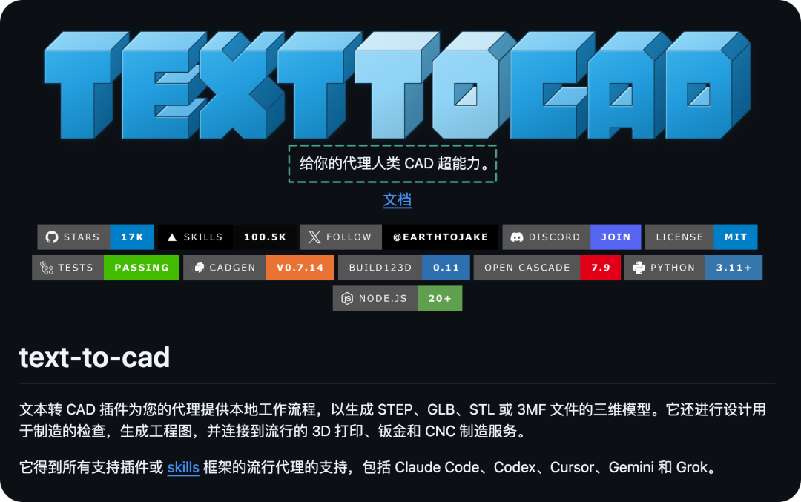
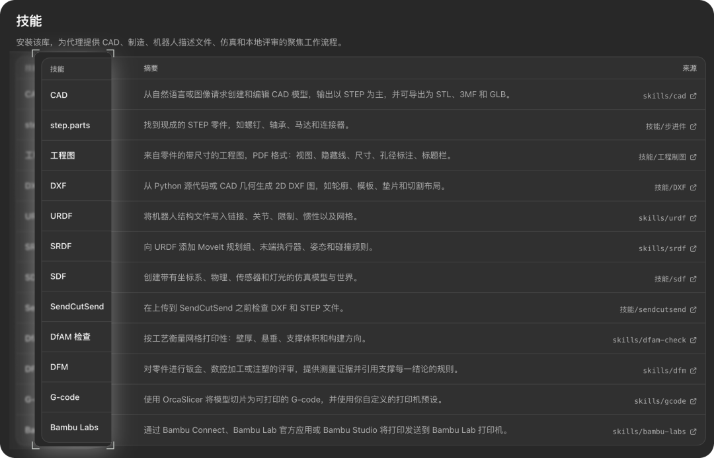

# 最近逛 GitHub ，挖到 3 个给力的开源项目，第一个比较硬核。
> 💡 备注属性未写入，可能是备注属性名称或者类型被修改了，建议将字段类型设置为 rich_text，可以在小程序-操作-修改文章数据库页面进行调整
> 💡 原文链接:[https://mp.weixin.qq.com/s?__biz=MzUxNjg4NDEzNA==&mid=2247537705&idx=1&sn=33d14b64d048e4941f677c6800ea90f3&chksm=f82cb874e0dc9a6fd877b38c37e7b76d36c3d408e7265846fc729571d22bcc519c9ab0e0741f#rd](https://mp.weixin.qq.com/s?__biz=MzUxNjg4NDEzNA%3D%3D&mid=2247537705&idx=1&sn=33d14b64d048e4941f677c6800ea90f3&chksm=f82cb874e0dc9a6fd877b38c37e7b76d36c3d408e7265846fc729571d22bcc519c9ab0e0741f#rd)
**01**
**给你的 Agent 赋予 CAD 超能力**

text-to-cad 给 Claude Code、Codex 等 Agent 工具**增加了 CAD 建模能力。**
CAD 就是用电脑设计工程图和三维模型，**机械专业大学生、机器人比赛团队、硬件工程师和三维打印爱好者经常会用这个东西。**
这个开源项目就是把建模、查看和导出等流程整理成了插件与 Skill。

你可以**描述零件的形状和尺寸，让 Agent 编写本地建模脚本，再生成三维文件。**
比如要做一个带安装孔的支架，可以说明整体尺寸、厚度、孔径和孔的位置。
后面想把支架加宽或者调整安装孔的位置，就修改对应参数，再重新生成。
模型源码也会保留下来，方便继续调整。


它生成的是三维模型文件，能接着进入后续设计和打印流程。
项目支持导出 STEP、STL、3MF 和 GLB。
STEP 适合继续在 CAD 软件里处理，STL 和 3MF 常用于三维打印，GLB 则方便三维展示。
配套查看器可以打开模型，让人检查形状，再给 Agent 提修改要求。
```javascript
开源地址：https://github.com/earthtojake/text-to-cad
```
**02**
**开源一支音乐视频 MV 制作方式**
pdoom-video 把一支音乐视频的**画面、歌词动画和渲染过程开源了。**
它为歌曲《I'm Upping My P(doom)》制作了一套视觉作品，画面由程序绘制，歌词逐词跟着人声变化。
也就是下面这个 MV：
这个视频里有图表、表格、三维房间和回形针等元素。
不同场景有各自的画风，又共用一套色彩和字体规则，画面切换与音乐节拍对齐。
开源项目里还保留了**视觉构思**和**分场景制作说明**，能看到这些设计是怎样落地实现的。

这个开源项目就是包括这个 MV 的完整制作细节。
还包含音频、逐词歌词时间和节拍分析数据。
视觉构思、歌词对齐、音频分析和场景实现，都是开发者通过与 Claude Code 对话协作完成。
对做动态设计、创意编程的人来说，这些文件能提供不少具体参考。
```javascript
开源地址：https://github.com/mexicat/pdoom-video
```
**03**
**Jev 聊天助手**

Jev 聊天助手是一个开源的安卓应用，**能在聊天界面里分析消息，帮你想几种回复方式。**
打开 QQ、飞书，屏幕上就会**出现一张可以拖动的小卡片。**
你可以展开看看分析，再挑一条回复填进输入框，改好之后自己点发送。
它会结合当前对话，推测对方想表达什么、希望你做什么，再据此起草回复。
你可以选择生成一条、两条或三条，生成三条时还会给候选排序。
觉得这一组不合适，可以点**换一组**重新生成。


你还可以手动添加笔记，给联系人写上关系和备注。
匹配到对应联系人，或聊天里出现笔记的标题、标签时，这些背景就能一起参与分析。
聊天历史也可以记录在手机本地，在后续分析时作为参考，这个功能默认关闭。
安卓端目前主要适配** QQ、X 私信和飞书。**

支持 Android 11 及以上，使用前需要配置模型接口和密钥，并开启无障碍、悬浮窗等权限。
大概的工作原理如下：

```javascript
开源地址：https://github.com/jev-chat/jev-chat-jarvis
```
**03**
**点击下方卡片，关注逛逛 GitHub**
这个公众号历史发布过很多有趣的开源项目，如果你懒得翻文章一个个找，你直接关注微信公众号：逛逛 GitHub ，后台对话聊天就行了：


## 摘要

（待补充）

## 我的笔记

（待补充）
