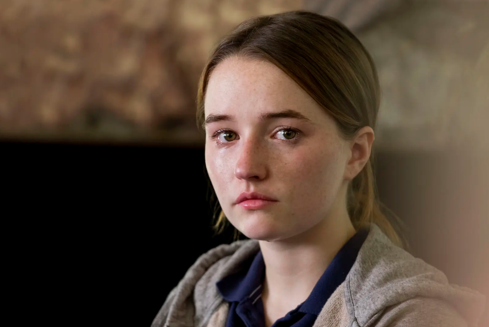
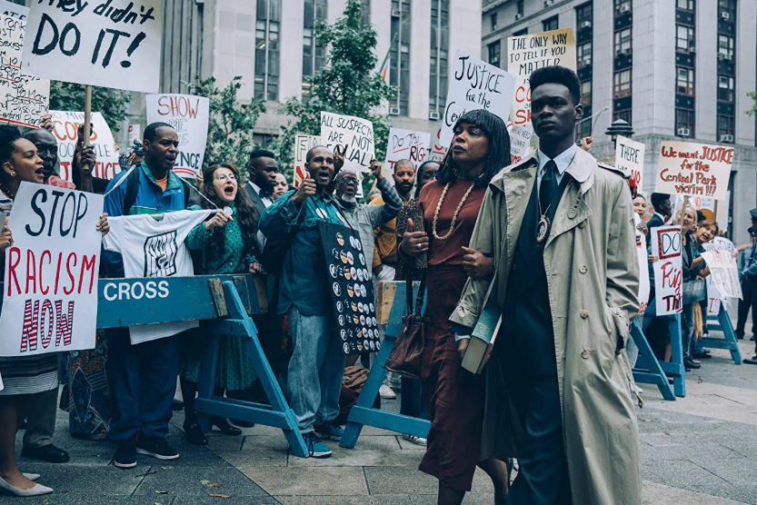
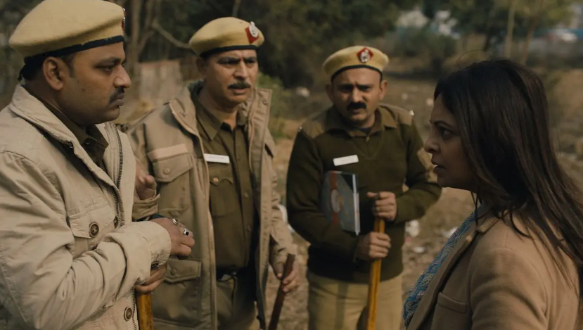
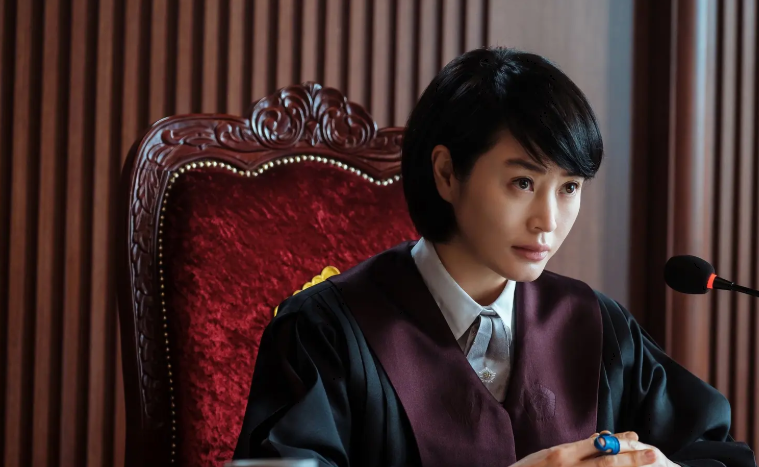
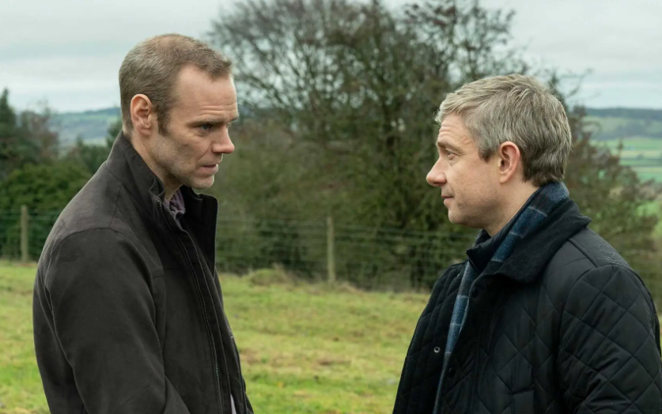
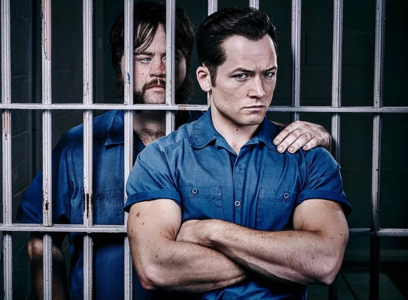
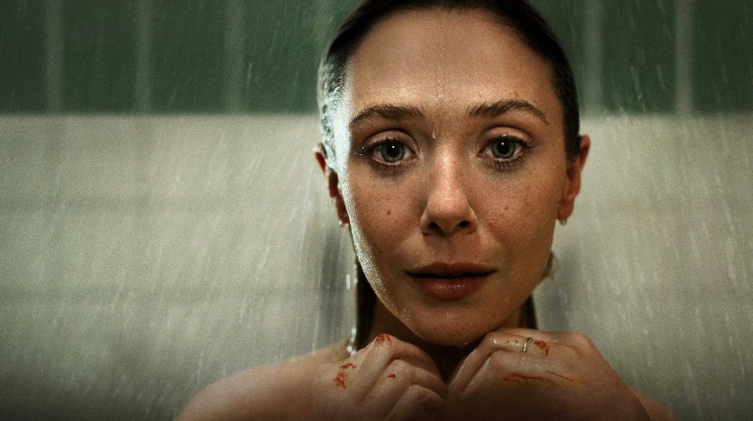
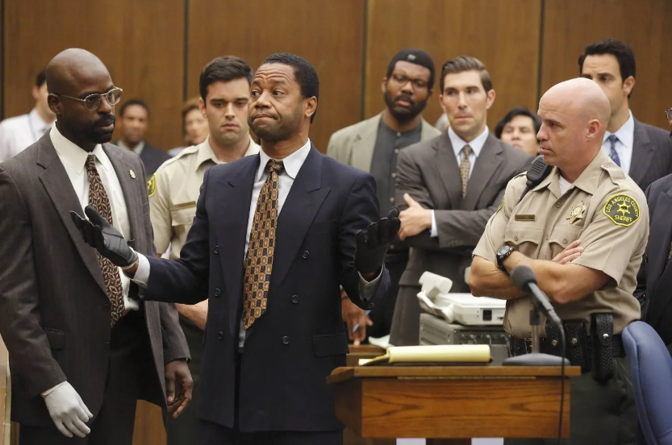
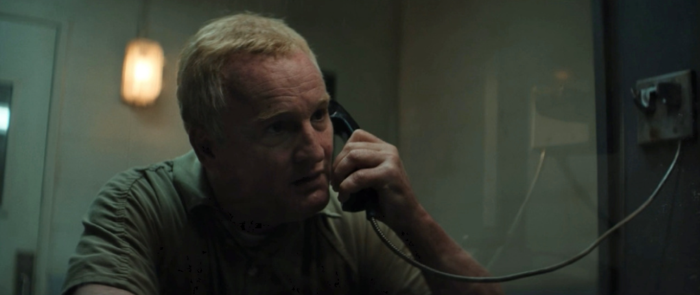

# 最高9.2分！推荐10部真实案件改编的犯罪剧集，后劲太猛！
> 💡 备注属性未写入，可能是备注属性名称或者类型被修改了，建议将字段类型设置为 rich_text，可以在小程序-操作-修改文章数据库页面进行调整
> 原文链接:[https://mp.weixin.qq.com/s/cKEMz08b7P8gK1jwj7dspw](https://mp.weixin.qq.com/s/cKEMz08b7P8gK1jwj7dspw)
看犯罪剧的时候，我们默认它是编的。
编剧写得多狠，我们都可以说一句“幸好是假的”。
**今天推荐10部高分犯罪剧集**，都是根据真实案件改编，这种真实感让人脊背发凉。
有些案件，甚至比剧集呈现的更为离奇。
## 1、《难以置信》（2019年）
集数：8集
评分：9.2分

**改编自普利策奖获奖报道：《令人难以置信的强奸事件》。**
2008年，华盛顿州18岁女孩玛丽，报案称被蒙面男子持刀强奸。
警方因为她的情绪不对，证词细节有出入，怀疑她在编故事，逼她改口承认报假警。
几年后，科罗拉多州两名女警探，在调查案件时，发现作案手法和玛丽描述的几乎一模一样。
她们跨区域合作，最终抓到了那个连环强奸犯。
## 2、《有色眼镜》（2019年）
集数：4集
评分：8.8分

Netflix四集限定剧，由黑人女导演艾娃·德约列自编自导。
**改编自1989年，纽约“中央公园慢跑者案”。**
一名白人女性，在中央公园夜跑时遭到袭击，险些丧命。
警方在没有证据的情况下，抓了五名14到16岁的黑人和拉丁裔少年，通过暴力和诱导，拿到了捏造的认罪供述。
直到2002年真凶自首，DNA证据出现，才证明他们全是清白的。
## 3、《德里罪案 第一季》（2019年）
集数：7集
评分：8.8分

**改编自2012年德里黑公交轮jian案。**
导演瑞奇·梅塔花了**5年**时间调研，大量细节直接来自德里警方的官方档案。
它跟着女警查图尔维和她的团队，从接到报案、追捕嫌疑人到最终定罪。
还原了警方在巨大的压力和社会愤怒中，如何在几天之内，锁定并逮捕所有施害者。
## 4、《少年法庭》(2022年）
集数：10集
评分：8.7分

剧中案件，**大多改编自韩国真实少年犯罪事件。**
金惠秀饰演的法官沈恩锡，对少年犯有着近乎冷酷的厌恶。
她走进少年法庭，面对的不是“可怜的孩子”，而是一群清楚知道自己未满14岁不用坐牢，所以什么都敢做的人。
通过5个案件，一层层剥开“少年之恶”背后，那些缺席的父母、失灵的制度。
## 5、《坦白》（2019年）
集数：6集
评分：8.8分

**改编自英国真实连环杀人案。**
凶手被捕后，主动坦白了另一起尘封多年的少女谋杀案，甚至亲自带队挖出尸体。
但因为办案警司，审讯时程序存在瑕疵，凶手主动交代的供词全部作废。
铁证如山的罪恶，差点被程序漏洞放走。
而一心挖出真相的警察，却因违规取证被追责、丢掉工作。
## 6、《黑鸟》（2022年）
集数：6集
评分：7.8分

**改编自詹姆斯·基内的真实犯罪回忆录《与魔鬼同在》。**
一个贩毒入狱的罪犯吉米·基内，以减刑为条件，被FBI派去当“卧底”。
她需要接近一名，涉嫌连环杀人，但证据不足的嫌疑人拉里·霍尔，从他口中套出真相。
霍尔患有严重人格障碍，他的律师曾以“被迫招供”为由，推翻检方指控。
## 7、《爱与死亡》（2023年）
集数：7集
评分：7.6分

**改编自德州一桩真实的杀人案件。**
**80年代德州小镇，一个“完美主妇”坎迪，在长期被婚姻忽视后，与朋友的丈夫发生了婚外情。**
**对方抽身回归家庭，坎迪被推回冷漠的婚姻，最终在对方妻子持斧攻击时反杀。**
**庭审揭示了这段关系，背后长期的情感无视，她最终被判无罪。
**
## 8、《美国犯罪故事 第一季》（2016年）
集数：10集
评分：8.7分

**改编自1994年震惊美国的辛普森杀妻案‌**，蓝本是杰弗瑞·图宾的畅销书《逃离人生》。
1994年，前橄榄球明星O.J.辛普森，被控谋杀前妻及其友人。
警方在辛普森家中，发现了血迹、血手套和血袜子，与案发现场吻合，鞋印也和他限量版球鞋一致。
全美关注这场审判，克林顿推开军机国务，股票交易额下滑了41%。最终辛普森被无罪释放。
## 9、《阶梯之间》（2022年）
集数：8集
评分：7.7分

**改编自美国“北卡三角区”彼得森案。**
2001年，美国北卡罗来纳州，小说家迈克尔·彼得森，报警称妻子凯瑟琳在楼梯间摔倒，大量失血。
最终凯瑟琳去世，他成为唯一嫌疑人。
这起案件从案发到最终落幕，持续了**16年**，是北卡历史上庭审时间最长的案件之一。
## 10、《默多家族：弑亲骇闻》（2025年）
集数：8集
评分：7.2分

**改编自南卡罗来纳州，默多法律世家真实案件。**
一个显赫的律师家族，从儿子醉酒驾船致人死亡，到父亲报警称妻儿在自家猎场被枪杀。
再到牵扯出，长达十年的巨额金融欺诈。
剧集基于，调查记者Mandy Matney的播客改编。
呈现一个“我们即法律”的特权家族，如何从内部崩塌。
全文完。
