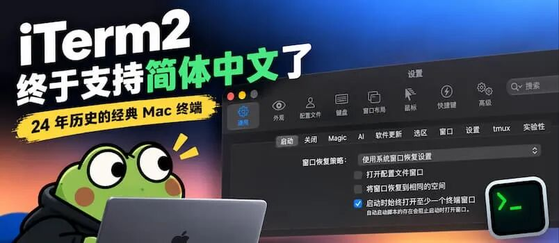
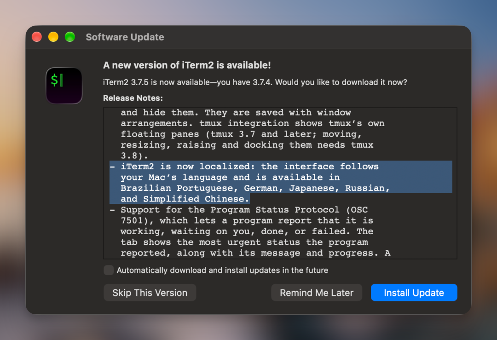
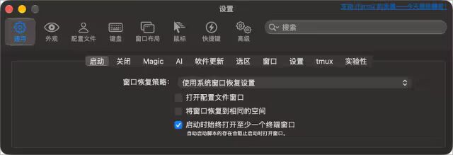
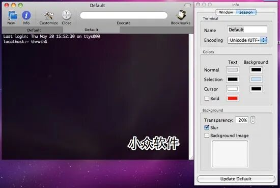
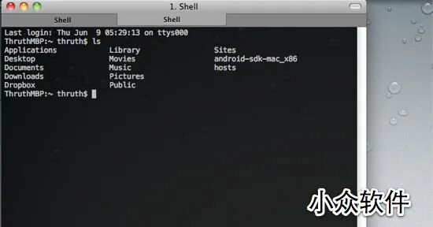
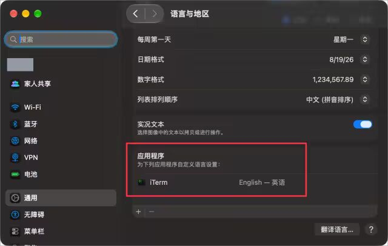
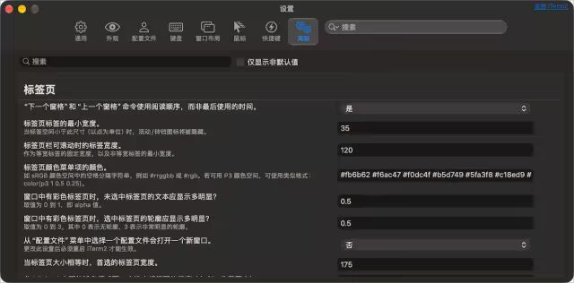
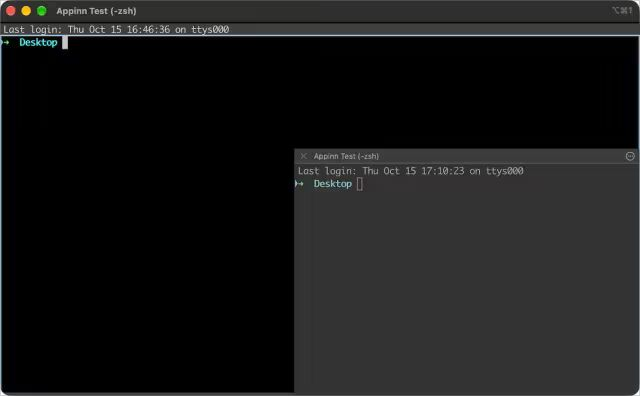
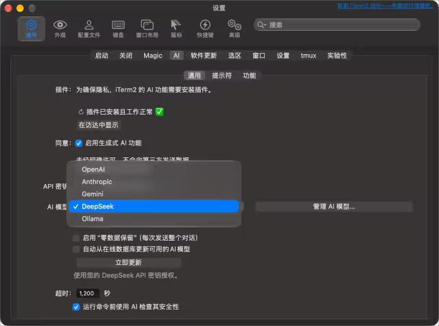
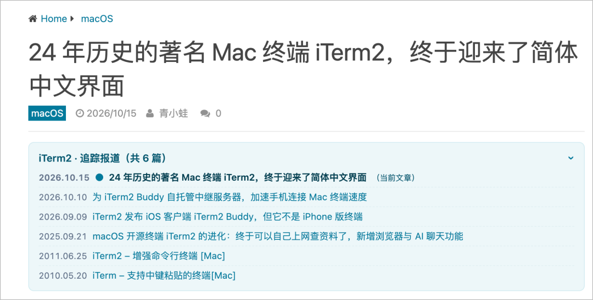

# 有24年历史的著名开源工具，为什么今天才添加简体中文界面？
> 💡 备注属性未写入，可能是备注属性名称或者类型被修改了，建议将字段类型设置为 rich_text，可以在小程序-操作-修改文章数据库页面进行调整
> 💡 原文链接:[https://mp.weixin.qq.com/s?__biz=MjM5NDMwMTI2MA==&mid=2651703268&idx=1&sn=3bf61303af752830053f980cebda4566&chksm=bc4c5d37680012427431a0d004c5c65e44923296fa20d3fa1cdc5a3ff12be8ae0774bf50313a#rd](https://mp.weixin.qq.com/s?__biz=MjM5NDMwMTI2MA%3D%3D&mid=2651703268&idx=1&sn=3bf61303af752830053f980cebda4566&chksm=bc4c5d37680012427431a0d004c5c65e44923296fa20d3fa1cdc5a3ff12be8ae0774bf50313a#rd)

著名的 macOS 开源终端应用 **iTerm2** 迎来了一次重要更新：在 2026 年 10 月 14 日发布的 3.7.5 正式版中，首次加入多语言界面支持，包括简体中文、日语、德语、俄语和巴西葡萄牙语。@Appinn

**在发布 24 年之后，iTerm2 终于再次支持简体中文界面了。**

对于一款拥有 20 多年历史的终端应用来说，在2026年加入多语言支持，似乎显得有点晚。
不过，有一件有趣的事情：**早在 20 年前，iTerm 就已经支持中文界面了。**
而就在一年前，iTerm2 开发者还曾表示，由于项目历史悠久，实现多语言支持非常困难，短期内可能无法完成。
如今，这个困扰项目多年的问题终于得到了解决。
（青小蛙猜测，这次又是 AI 立功了 😂）
### 目录
- • 24 年历史，iTerm 的中文界面曾经存在
- • 从 iTerm 到 iTerm2
- • 2025 年，开发者还认为短期内难以实现
- • 如何开启 iTerm2 简体中文界面？
- • 除了中文界面，这次更新还带来了什么？
• 浮动终端面板（Floating Panes）画中画功能
  • 原生支持 Ollama(本地模型)
  • 跟踪 Claude Code 和 Codex CLI 的任务状态
  • 防止 Mac 在执行任务时自动睡眠
- • 青小蛙觉得
- • 获取
### 24 年历史，iTerm 的中文界面曾经存在
**iTerm** 的历史可以追溯到 2002 年。而小众软件第一次接触到 iTerm，还是**二狗**同学在 2010 年的介绍：
- • [iTerm – 支持中键粘贴的终端Mac] 
-  https://www.appinn.com/iterm/

2010年的 iTerm 界面
最初的 iTerm 是一款面向 Mac OS X 的免费开源终端模拟器。相比系统自带的终端，它提供了标签页等实用功能，受到不少开发者的欢迎。
来自 SourceForge 的官方历史记录，2006 年 9 月 22 日，开发团队宣布，iTerm 已经拥有中文、法语、德语、日语和韩语等语言的本地化资源。
不过随着软件的复杂性增加，开发团队无暇顾及多语言翻译，最终决定只包含英文资源，其他语言则通过独立语言包提供，由社区维护。
### 从 iTerm 到 iTerm2
后来，原版 iTerm 的开发逐渐放缓，开发者 George Nachman 在 2010 年前后基于原项目继续开发，诞生了今天大家熟悉的 **iTerm2**。
二狗同学也在 2011 年推荐了：
- • [iTerm2 – 增强命令行终端 Mac]
-    https://www.appinn.com/iterm2/

早期 iTerm2 界面
iTerm2 延续了最初的定位，并逐渐发展出一系列高级功能。
例如，标签页与分屏、搜索历史输出、SSH 与 tmux 集成、Shell Integration、快捷键窗口，以及丰富的配置选项。
不过，一直没有中文界面，或者说，一直不提供多语言界面。
### 2025 年，开发者还认为短期内难以实现
这次更新还有一段有趣的故事。
2025 年 9 月 20 日，一位用户在 iTerm2 官方讨论组中发帖，希望开发者增加简体中文界面。

iTerm2 开发者 George Nachman 用中文回复：
> 很遗憾，这个项目已经有二十年的历史了，在这个阶段再增加对更多语言的支持会非常困难。虽然这是我一直想做的事情，但工作量实在太大，短期内可能无法实现。
> 
但事情很快有了转机。
**2026 年 4 月，又有用户在同一个讨论帖中询问本地化进展。**
这一次，George Nachman 的态度发生了变化：

从 2025 年 9 月到 2026 年 4 月，再到 2026 年 10 月正式发布多语言支持，仅仅过去了一年多。
### 如何开启 iTerm2 简体中文界面？
在最新的 **iTerm2 3.7.5** 中，应用界面会跟随 macOS 的语言设置（自动显示中文！）。
如果要单独设置，可以按以下步骤：
1. 1. 打开 macOS「系统设置」。
1. 2. 进入「通用 → 语言与地区」。
1. 3. 在「应用程序」语言设置中添加 iTerm2。
1. 4. 选择「简体中文」。
1. 5. 重新启动 iTerm2。

需要注意的是，中文化主要针对 iTerm2 的菜单、设置等应用界面。终端里运行的命令行程序、Shell，以及通过 SSH 连接的远程服务器，仍然使用各自的语言设置。

### 除了中文界面，这次更新还带来了什么？
#### 1. 浮动终端面板（Floating Panes）画中画功能
现在可以在原有终端窗口中创建浮动面板。这些面板可以自由拖动、调整大小，还可以重新停靠到分屏布局中。
堪称画中画功能：

注意，这个页面与 tmux 不同，它能用鼠标控制，很方便。
#### 2. 原生支持 Ollama
iTerm2 现在将 Ollama 列为正式支持的 AI 服务提供商，与 OpenAI、Anthropic、Gemini、DeepSeek 并列：

切换到 Ollama 之后，他会检测 `http://localhost:11434/api/chat` 的 Ollama 服务器。
#### 3. 跟踪 Claude Code 和 Codex CLI 的任务状态
新版 iTerm2 增强了终端任务状态管理功能。可以主动报告自己正在工作、等待用户输入、已经完成或者执行失败等状态。
其中，iTerm2 现在也支持跟踪 Codex CLI 的运行状态，不过目前还需要用户手动配置 Hook。
配合此前已有的 Claude Code 集成，用户可以更方便地了解多个 AI 编程任务的执行情况。
#### 4. 防止 Mac 在执行任务时自动睡眠
新版本还增加了防止系统自动睡眠的 Profile 设置，当指定终端会话存在时，可以让连接电源的 Mac 保持唤醒状态。
位于 设置 > 配置文件 > 会话，最下面。
配合 [iTerm2 Buddy](https://mp.weixin.qq.com/s?__biz=MjM5NDMwMTI2MA%3D%3D&mid=2651701825&idx=1&sn=644ab8a0154b0ae56b4d0f018d474039&scene=21#wechat_redirect)，出门在外也能继续工作，嗯，牛马。
### 青小蛙觉得
虽然终端一直以英文为主，但 iTerm2 的英文设置界面，对青小蛙来说依旧是天数，太多、太复杂了。
这下，终于可以一项一项慢慢研究了。
而**一个有着 24 年历史的老项目，终于重新拥有了简体中文界面。**
这人不禁好奇：其他因为历史包袱太重、维护成本太高而长期搁置的项目，是否会逐渐迎来新的机会？
### 获取
- • 官网 iterm2.com
- • GitHub github.com/gnachman/iTerm2
---

原文：www.appinn.com/iterm2-simplified-chinese
关于AI开发这件事，青小蛙深有感触，下面的追踪报道，是耗时1个小时开发的，目前已经在网站上线：

未来的内容，可以更好的与历史互动啦。

## 摘要

（待补充）

## 我的笔记

（待补充）
