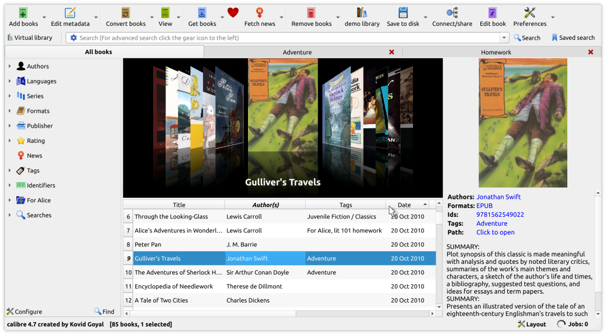

# 有人开源了一个电子书转换工具，把手里的电子书批量转成需要的格式
> 💡 备注属性未写入，可能是备注属性名称或者类型被修改了，建议将字段类型设置为 rich_text，可以在小程序-操作-修改文章数据库页面进行调整
> 💡 原文链接:[https://mp.weixin.qq.com/s?__biz=MzcwMDM5MzQzOQ==&mid=2247485213&idx=1&sn=eb39c651dc215cd783dae56865fa243a&chksm=f55613739ecbbe1eaf9d507972272c431247b463af3803dca7e1ef9adbb98ec2355de158ecb4#rd](https://mp.weixin.qq.com/s?__biz=MzcwMDM5MzQzOQ%3D%3D&mid=2247485213&idx=1&sn=eb39c651dc215cd783dae56865fa243a&chksm=f55613739ecbbe1eaf9d507972272c431247b463af3803dca7e1ef9adbb98ec2355de158ecb4#rd)
calibre 是一个开源的电脑电子书工具，可以把已有的电子书转换格式，再导出能单独保存的文件。
书能在电脑打开，换一台阅读器却不认格式；一套书逐本转换也容易漏掉。已有文件、想换格式，可以试这条路径。
> 🟢 **上手难度：双击就能用**。Windows 安装包 `calibre-64bit-9.16.0.msi` 约238.9 MB，安装后可直接添加文件和转换，不用搭Python环境。
> 
> 🌐 **界面语言：简体中文**。中文资源有效覆盖约94.1%，少量说明仍是英文。
> 

### 能拿它干什么
- • **把已有电子书转成需要的格式**。例如把无加密的MOBI转成EPUB，或把EPUB转成AZW3，输出类型按目标设备支持情况选。
- • **把同一套电子书成批转换完**。选中多本书，统一设置输出格式，交给任务队列处理。
- • **让同一本书保留几种格式**。原格式和转换结果归在同一条书目下，换设备时还有原件可用。
- • **按统一名称另存转换后的文件**。导出时按书名、作者等信息安排目录，文件可以直接拷走。
- • **向受支持的设备传送电子书**。识别出设备后可以发送，也可以另存文件后按设备说明传入。
### 它的做法不一样
- • **先转换内容，再生成目标格式**。它不是改文件扩展名，而是解析原书的正文、图片和目录，再按输出设置生成文件。复杂排版不保证原样保留。
- • **批量转换和书目资料分开处理**。可以先统一作者、书名，再选中一批转换；单本需要特殊设置时，也能单独处理，避免整套书反复重做。
- • **转换结果可以脱离软件保存**。导出的EPUB或AZW3是独立文件，阅读端不必同时安装calibre。转换是否合适，仍要在目标设备上看一遍。
### 要什么配置
- • **一句话**。一台符合系统要求的Windows电脑，加上能够转换的原文件即可。
- • **系统与安装包**。当前64位版本要求Windows 10 1809或更高，旧系统应走官网单列的历史版本，不直接套用本篇包名。
- • **文件与存储**。基础转换用于已有、可读取且无DRM加密的文件；书库副本、转换结果和另存文件都要占硬盘，先留好原件。
- • **不用什么**。本地转换不用账号、模型或显卡计算环境。下载包需要联网，更新检查、下载封面及网络共享属于另外的联网功能。
### 怎么跑起来
1. 1. 从官网下载对应安装包，装好后在初始向导选择界面语言和书库位置，先添加一本有权使用的测试书。
1. 2. 选中书目，点“转换书籍”，右上角选择输出格式。第一次先保留默认设置，等右下角任务结束。
1. 3. 打开转换结果，检查中文、目录、图片和章节顺序。确认无误后再选中多本书，使用批量转换。
1. 4. 用“保存到磁盘”把目标格式另存到普通文件夹。需要传阅读器时，先按该型号的官方说明确认格式与连接方法。
### 用之前先知道这几点
**仓库地址：https://github.com/kovidgoyal/calibre**

## 摘要

（待补充）

## 我的笔记

（待补充）
