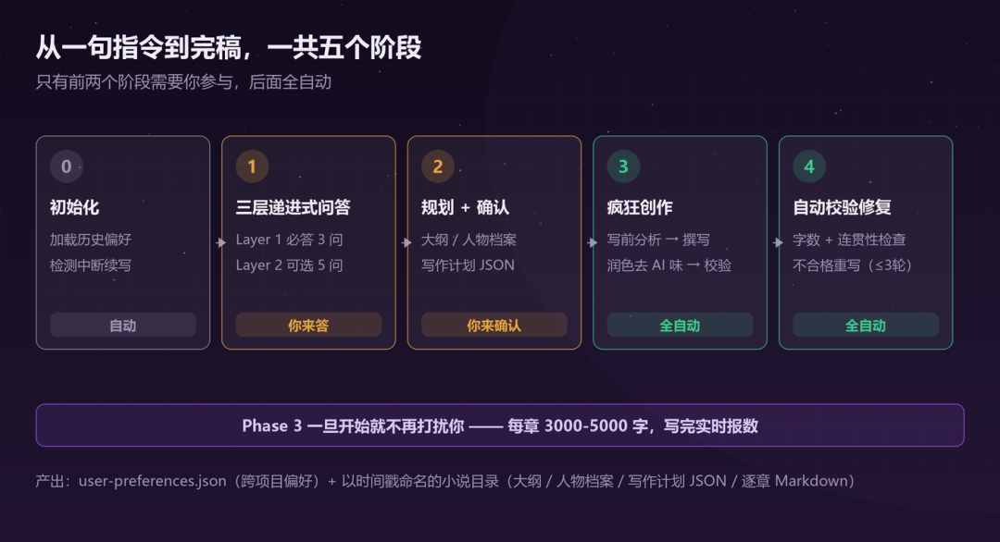

# 有人把 AI 写小说这件事，直接做成了流水线！
> 💡 备注属性未写入，可能是备注属性名称或者类型被修改了，建议将字段类型设置为 rich_text，可以在小程序-操作-修改文章数据库页面进行调整
> 💡 原文链接:[https://mp.weixin.qq.com/s?__biz=MzkxOTUyNzA1Mw==&mid=2247483953&idx=1&sn=9944e45479cf61c75ac1cbf32043f357&chksm=c0549c0344ce74c84970f01c4257c115ebf34774b6bf33736cfcbc76aac69386fff58e2e13b0#rd](https://mp.weixin.qq.com/s?__biz=MzkxOTUyNzA1Mw%3D%3D&mid=2247483953&idx=1&sn=9944e45479cf61c75ac1cbf32043f357&chksm=c0549c0344ce74c84970f01c4257c115ebf34774b6bf33736cfcbc76aac69386fff58e2e13b0#rd)
写小说最难的不是想出好点子，而是坚持写完。这个开源 Skill 从题材、人物、大纲一路规划到逐章创作，最后自动校验不合格的章节并重写，目标是 10 到 50 章的长篇。安装只一行命令。
### 一、它解决的是哪个问题
写小说最难的一步从来不是「想出好点子」，而是坚持把它写完。chinese-novelist-skill 就是冲着这个痛点去的开源 Skill（MIT 协议，主要用 Python），GitHub 上 3.7K Star、520 Fork。
作者在 README 里写得很直白：「写小说最难的是坚持写完。这个 Skill 专为解决这个痛点而生。」
所以它和「让 AI 帮我写一段文字」完全不是一个量级。它要做的**是一条完整的生产流水线**：题材选择 → 人物设定 → 故事大纲 → 章节创作 → 剧情衔接 → 悬念设计，一路走到底，最后还要回头检查、不合格就重写。
几个硬指标先摆出来：
- 能规划并生成 10～50 章的完整小说，不是写几段就停。
- 每章目标 3000～5000 字，开头抓人、结尾留钩子。
- 支持创作记忆、**中断续写**、多 Agent 并行写作、自动检查修改。
- 开源免费，适配主流的 coding agent。
### 二、怎么装、怎么开始
安装只一行命令：
```
npx skills add PenglongHuang/chinese-novelist-skill
```
装好之后，对 Agent 说一句就行：
```
使用 chinese-novelist 帮我写一部小说
```
如果你用的是 Claude Code，也可以手动把仓库目录放进它的 skills 目录：
```
~/.claude/skills/chinese-novelist/
```
仓库地址：github.com/PenglongHuang/chinese-novelist-skill
### 三、完整流程：从一句指令到完稿
整个流程被拆成 Phase 0 到 Phase 4 五个阶段，其中**只有前两个阶段需要你参与**，后面是全自动的。

完整流程：五个阶段，只有前两个要你参与
#### Phase 0：初始化
开跑之前，它会先自动加载你的历史偏好（存在 user-preferences.json 里），检测有没有没写完的项目可以续写，然后展示一段个性化欢迎。这一步不需要你做什么，但它决定了这次要问你多少问题。
#### Phase 1：三层递进式问答
这是 v2.0 最核心的改动：不一次性甩给你八个问题，而是分两层递进。
| **层级** | **问什么** | **必答吗** |
| **Layer 1 核心定位** | 题材创意、主角设定、核心冲突（共 3 问） | 必答 |
| **Layer 2 深度定制** | 世界观、叙事视角、核心主题、读者定位、章节数量（共 5 问） | 可选 |
三个关键问题里，每一个都支持随机生成——你也可以直接说「跳过」或者「都用默认」。这一点对「我只有一个模糊想法」的人特别友好：先让它跑起来，不满意再改。
#### Phase 2：规划 + 确认
问答结束，它会自动生成三样东西：大纲（7 列章节规划）、人物档案、写作计划 JSON，然后摆给你确认。回复「确认」之后才会继续。
这一步是整个流程里最值得花时间的地方。**大纲错了，后面几十章全是白写**；大纲对了，剩下的基本是执行问题。
#### Phase 2.5：选一种写作模式
确认大纲之后，会让你挑写作模式（下一节详细说）。选完就进入全自动阶段。
#### Phase 3：疯狂创作
进入这一步之后不再需要确认，你可以离开工作台。每一章都严格执行同一套动作：
```
写前分析 → 撰写（3000-5000 字）→ 润色去 AI 味 → 字数检查 → 更新摘要
```
完成一章会实时报数，长这样：
```
第1章完成（3247字）
第2章完成（3582字）
第3章完成（3412字）
```
注意里面那步「润色去 AI 味」——它被写进了固定流程，而不是可选步骤。
#### Phase 4：自动校验与修复
全稿写完之后不是直接交差，而是回头过一遍：字数检查 → 连贯性检查 → 不合格的章节自动重写，最多 3 轮。这一步同样是全自动的。
### 四、它凭什么能「写完」：四条核心法则
流程只是骨架。真正决定「一章能不能读下去」的，是它内置的四条写作法则——这四条被写死成硬性要求，每章都要过。

四条核心法则
| **法则** | **说明** |
| **展示而非讲述** | 用动作和对话表现，不要直接陈述 |
| **冲突驱动剧情** | 每章必须有冲突或转折 |
| **悬念承上启下** | 每章结尾必须留下钩子 |
| **开头即高潮** | 前 20% 必须极其吸引人 |
这四条不新鲜，网文作者大概都听过。但「知道」和「每章都做到」是两回事——**把它写成硬性检查项**，才是这个 Skill 真正有价值的地方。
### 五、三种写作模式怎么选
| **模式** | **怎么运作** | **适用场景** |
| **串行** | 主 Agent 逐章写 | 默认推荐，稳定可靠 |
| **子 Agent 并行** | 多个子 Agent 分批并行写 | 追求速度 |
| **Agent Teams** | Claude Code 多 Agent 协作 | 大型长篇 |
如果这是你第一次用，就从串行开始。并行写看起来更爽，但要让多个 Agent 写同一本书而人设和语气不崩，**靠的是大纲和人物档案写得足够细**——那是第二步才该操心的事。
### 六、产出的文件长什么样
它不是在聊天框里吐一堆字就完了，而是按项目落成一整套文件：
```
chinese-novelist/
├── user-preferences.json          # 你的偏好，跨项目共享
└── 20260412-143000-午夜列车/       # 以时间戳 + 书名命名的项目目录
    ├── 01-大纲.md                  # 故事概述 + 7 列章节规划
    ├── 00-人物档案.md              # 主角、反派、配角
    ├── 02-写作计划.json            # 机器可读的写作状态
    ├── 第01章-最后一班列车.md
    ├── 第02章-消失的乘客.md
    └── ...
```
这个结构有两个好处：一是每一章都是独立的 Markdown 文件，你自己想改哪章就改哪章，不需要跟聊天记录较劲；二是那份 02-写作计划.json，它让「写到第几章了、哪些设定已经出现过」变成机器可读的状态。
### 七、几个容易被忽略的实用细节
#### 偏好记忆：用得越久越省事
每完成一次创作，它会自动学习你的偏好——喜欢的题材类型、叙事风格、章节数量倾向、文字密度等等。下次再开新书，这些就不用重复问了。对打算写第二本、第三本的人来说，这个设计很实在。
#### 内置 16 份写作参考资料
仓库里带着一整套写作资料，分两类：
- **流程文档 7 份**：Phase 0 到 Phase 4 各自的执行说明，外加一份共享机制（偏好系统、黄金法则、字数脚本）。
- **写作指南 9 份**：章节写作、悬念设置、人物塑造、对话写作、情节结构、内容扩充，以及大纲 / 人物 / 章节三套模板。
其中两个数字值得单独拎出来：悬念设置那份整理了 13 种结尾钩子类型；对话写作那份讲到了节奏进阶和「权力博弈」。就算你不打算用这个 Skill 写小说，这两份文档本身也值得翻一翻。
#### 自带字数检查脚本
仓库里有一个 scripts/check_chapter_wordcount.py，专门用来验证每章是否落在 3000～5000 字的要求区间里。Phase 3 和 Phase 4 的字数检查都靠它。
### 八、上手前值得知道的三件事
| **事项** | **说明** |
| **它是个 Skill，不是独立软件** | 需要跑在支持 Skill 的 Agent 里（官方标注适配 Claude Code 等主流 coding agent），本身不带界面 |
| **产出是 Markdown 文件** | 分章落盘 + 大纲 + 人物档案 + 写作计划 JSON，方便你后续自己编辑和续写，但**不会直接给你一本排好版的电子书** |
| **建议先跑小体量** | 十章以上的长篇意味着长时间连续生成，**第一次用建议先按 10 章试水**，摸清它的风格和节奏再往上加 |
### 写在最后
这类工具真正值钱的地方，其实不是「替你写」——文案、情节、文笔，模型能给的是平均水平，做不了惊艳。它值钱的地方是**把「坚持」这件事外包出去**：你负责定方向、看大纲、改不满意的地方，剩下那几十章的重复劳动交给它。
所以用法上有个小建议：把最重的力气花在 Phase 2 的大纲确认上。那一步多改半小时，比后面返工二十章划算得多。
至于四条法则——展示而非讲述、冲突驱动、悬念承上启下、开头即高潮——它们既是这个 Skill 的质检标准，也是判断「这部小说能不能看下去」的通用尺子。工具会换，尺子不太会。
**文中地址（复制到浏览器打开）**
原文：https://ele.ac.cn/2347/
baoyu-skills：宝玉的 AI 创作工具箱 —— 同样是「把创作流程打包成 Skill」的思路，从配图到图文卡片：https://ele.ac.cn/2066/
FreeLLMAPI：把 34 家免费大模型聚合成一个接口 —— 长篇写作是典型的额度消耗大户，这篇能帮你把成本压下来：https://ele.ac.cn/2186/
muse-skills：300 条现成 AI 玩法 —— 看看 Skill 这种形态还能干哪些事：https://ele.ac.cn/2109/
公众号正文不支持外链，上面地址请复制使用；也可以扫码看原文，原文里的链接可以直接点。

扫码或点左下角「阅读原文」看完整版 · 含全部写作模式与实用细节
