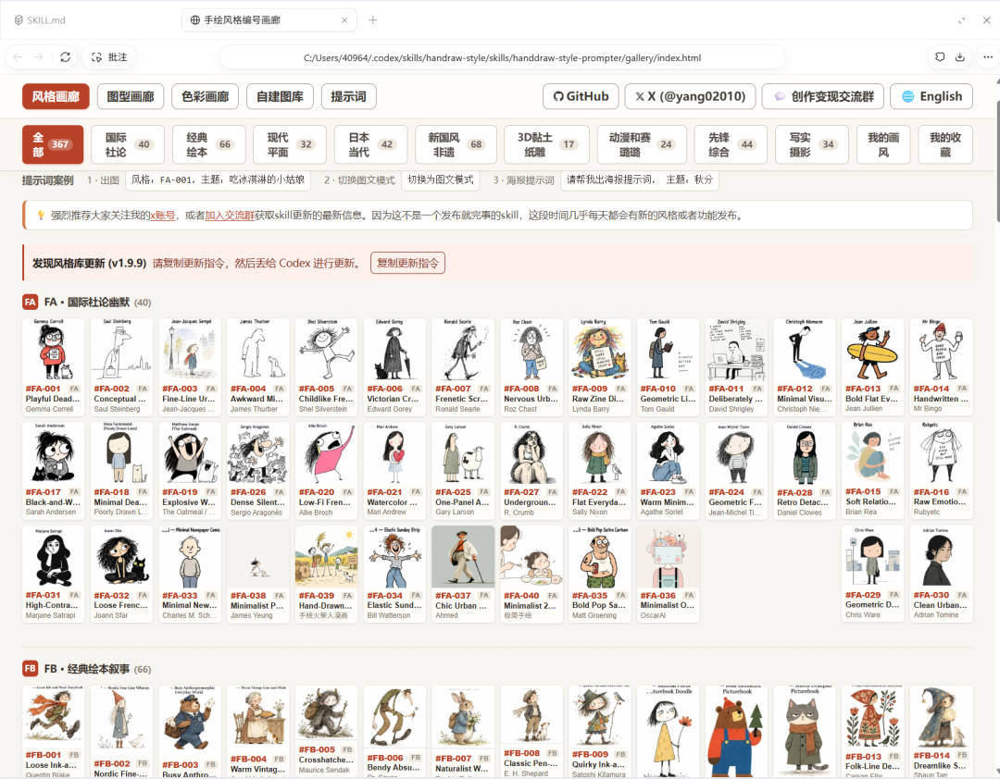
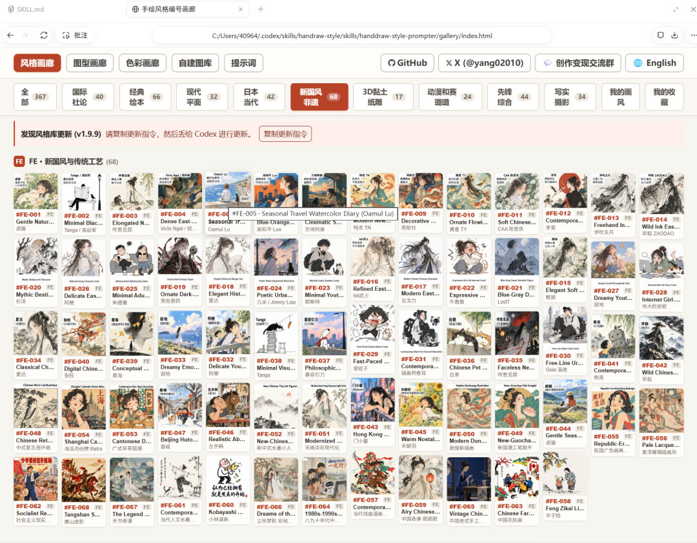
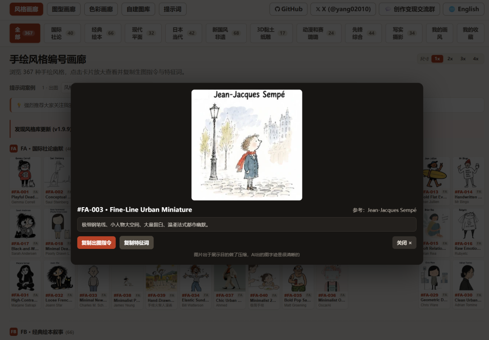
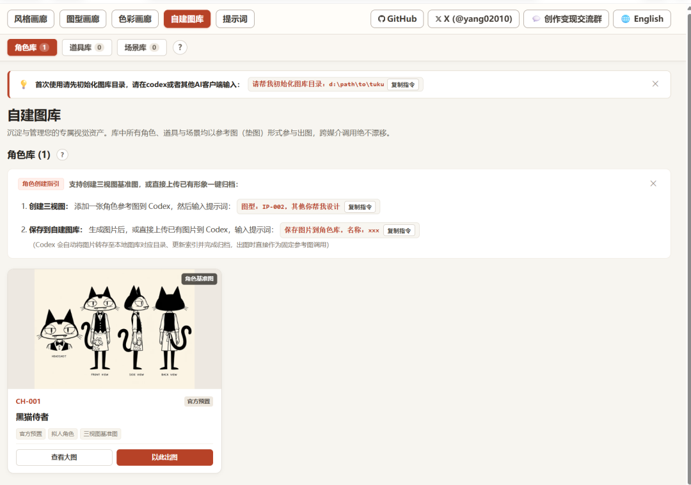
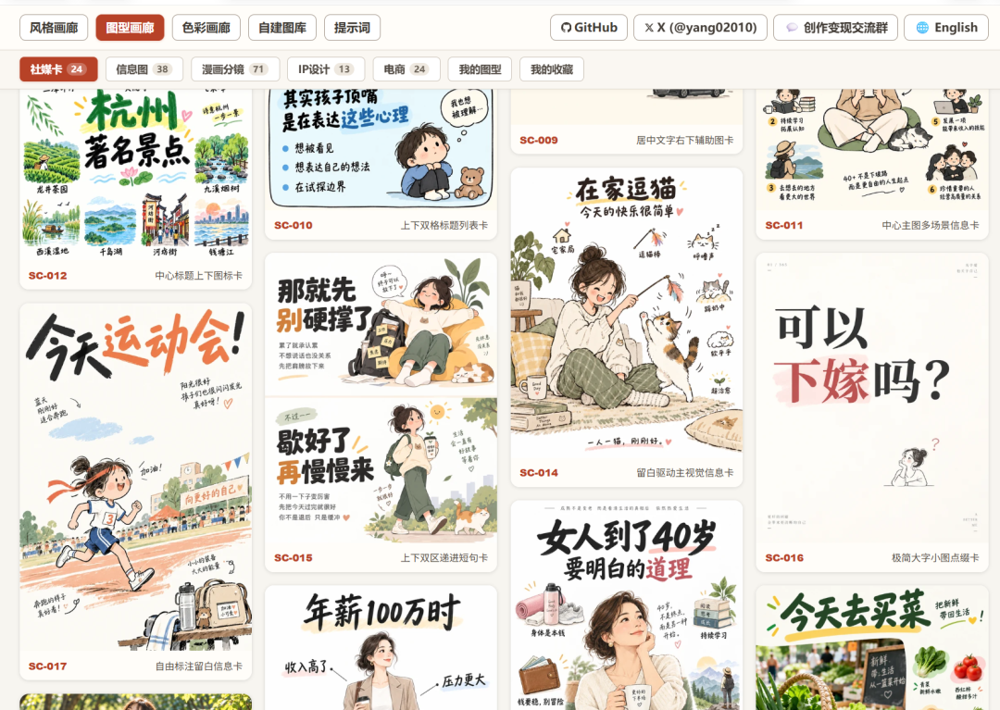
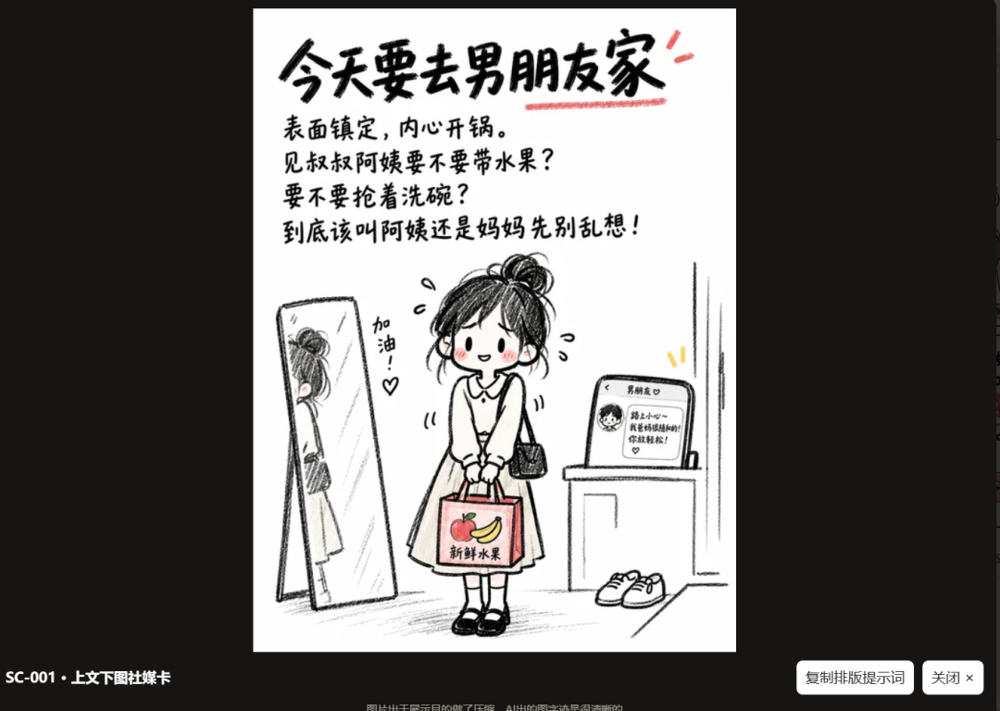

# 有人把300多种画风风格做成了菜单，直接看图选模板
> 💡 备注属性未写入，可能是备注属性名称或者类型被修改了，建议将字段类型设置为 rich_text，可以在小程序-操作-修改文章数据库页面进行调整
> 💡 原文链接:[https://mp.weixin.qq.com/s?__biz=Mzk2NDU4MzkwNw==&mid=2247484016&idx=1&sn=b49e3705ada8efaac9e492678f7c48cb&chksm=c5ca94cf492cd914fd21b903a0f9d6b2fcbf8fd07853a21082c69be880a84baf607362f87c6d#rd](https://mp.weixin.qq.com/s?__biz=Mzk2NDU4MzkwNw%3D%3D&mid=2247484016&idx=1&sn=b49e3705ada8efaac9e492678f7c48cb&chksm=c5ca94cf492cd914fd21b903a0f9d6b2fcbf8fd07853a21082c69be880a84baf607362f87c6d#rd)

点击蓝字 关注我们

如果你平时会收藏生图提示词，应该能理解这种感受：收藏的时候觉得张张都喜欢，
后面想要用的时候根本不知道收藏在哪
用反推提示词的skill还总是还原不出来原来的感觉
自己改提示词吧，改少了，不像自己的东西；改多了，又怕把原来喜欢的感觉一起改没了
所以我也一直想找一个合集类的，省的每次到处找
然后就发现了**handraw-style**
这个skill是我偶然发现的，看到这个skill的第一眼就被惊艳到了

— 风格选择

**handraw-style** 这种整理方式
它把画风、排版和颜色分开整理，你可以看着预览挑，再按自己的主题组合。
喜欢的是哪部分，就留下哪部分。 这个思路很适合日常做配图
下面详细介绍一下
**PART 01**
**01 先挑喜欢的样子**
handraw-style 是 yang0 做的开源项目，里面收录了 **300多种视觉风格**
不过，我觉得数量还在其次。真正有用的是，每种风格都有预览和编号，旁边还能展开看它的特点
比如 FA-003，图鉴给出的特征就是细钢笔线、小人物、大空间和大量留白

— FA-003
看到这张图，你可能不知道这种画法该叫什么，但“小小一个人，周围空空的”，一下就有画面了
拿来表达独处、散步、城市生活，就有了可以继续琢磨的方向。你要改的是人在做什么、身边有什么，而不必从“帮我画一张有氛围感的图”这种宽泛的需求开始
当然，图库里并不只有这一类清淡的插画。绘本、水墨、黏土、纸雕、动漫和写实摄影都有对应分类
**建议先翻图，别急着记编号**
看到喜欢的再留下就行。几百种风格都研究一遍，实在没必要；自己常用的，可能也就那么几套
更何况他还支持自己添加模板，下次看到想要的根据提示操作就能一键添加到自建模板库

— 示例
**PART 02**
**02 我更想推荐的，是它把排版也考虑进去了**
单纯找画风，其实已经有不少地方可以找。
但做公众号、小红书配图，经常还会遇到另一个问题：插画挺好看，字往哪儿放？
尤其是一张图既要有标题，又要有几句说明的时候。元素一多，很容易各占各的位置，最后哪个都不突出。
这个项目另外整理了 **170种排版**，可以和画风搭配。
举个简单的例子。
你想做一张“周末别安排太满”的文字卡，重点是这句话，下面只需要一个小小的人物。
那就可以看看 SC-016：大字为主、小图点缀、留白多

— sc016
如果想做一张出游攻略，文字之外还要展示公园、野餐垫和随身物品，上文下图的 SC-001 就是另一个起点

— sc001
同一个主题，不必总是让一张插画撑满整个画面。
这对我来说，比继续往提示词里加“精美”“高级”“大师作品”更有用。至少你知道自己在调整什么。
**PART 03**
**03 第一次用，直接拿一张想发的图来试**
它不要求你把风格、排版和颜色全部选好。
懒得挑，可以让它推荐；有明确喜好，就把编号告诉它。项目教程支持这两种用法。
比如下面这条，是可以拿来修改的使用示例：

text
帮我做一张适合发朋友圈的图文卡。
文案：周末别安排太满。
使用 SC-016 排版，
文字是重点，下方放一个很小的人物，
画面留白多一些。
风格和主题色你帮我选，
请生成完整的生图提示词。
这里得到的是提示词，再交给你常用的生图工具出图
我建议第一次就做这种内容简单、自己又确实想发的图。文字不多，主体也明确，出来以后比较容易判断：字够不够醒目，画面是不是太满，选的风格合不合适
哪里不对，再改哪里
等找到喜欢的组合，下次换文案、换主题时，还能从这组选择继续做。对经常更新同一个栏目的作者，这样积累下来，比每次重新找参考省事
**PART 04**
**04 怎么拿到，以及一件要说清楚的事**
项目在 GitHub 开源，入口放在下面
已经有Agent的话，可以把这句话发过去：

text
帮我安装这个 Skill：
https://github.com/yang0/handraw-style
PS:有不懂的欢迎留言讨论
它也提供本地网页画廊，方便浏览这些风格和排版。
不过，**这个库不附带生图模型、账号或密钥**。真正出图需要你自己的工具和对应权限，费用也取决于所用平台。
别把“提示词库开源”理解成“以后画图都免费”。它帮忙解决的，是怎么选、怎么描述；实际画出来，还要看模型的表现
**LAST ///**
**写在最后**
如果你已经有几条用得很顺手的提示词，偶尔配一张图，也没必要为了数量再收一大包。
但如果你经常做封面、图文卡片，或者总想换一种画法，又不知道该怎么描述，这个项目很适合存一份。
有时候，看见一个自己喜欢的构图，比对着输入框补十遍形容词，更能想清楚这张图到底要做成什么样。
**先挑一张你喜欢的，再把它变成自己的内容。**
我是 柒，持续分享 AI 工具、效率软件和实用黑科技。
**如果觉得有用，欢迎点赞、在看、转发三连。**
♡
点赞
◉
在看
★
星标
THANKS FOR READING
