# 有人把物理、化学、生物、数学、地理实验室，全搬进了浏览器：25 个三维实验，打开就能做
> 💡 备注属性未写入，可能是备注属性名称或者类型被修改了，建议将字段类型设置为 rich_text，可以在小程序-操作-修改文章数据库页面进行调整
> 💡 原文链接:[https://mp.weixin.qq.com/s?__biz=Mzg4Njg3OTg2NQ==&mid=2247486648&idx=1&sn=110b9a46837c164cafd1897965c5c79c&chksm=cec0504aaa789445131667245a2e193a69622f198fe7ff8f8a399c39ce6aaaeec802696c3229#rd](https://mp.weixin.qq.com/s?__biz=Mzg4Njg3OTg2NQ%3D%3D&mid=2247486648&idx=1&sn=110b9a46837c164cafd1897965c5c79c&chksm=cec0504aaa789445131667245a2e193a69622f198fe7ff8f8a399c39ce6aaaeec802696c3229#rd)
## 有人把物理、化学、生物、数学、地理实验室，全搬进了浏览器：25 个三维实验，打开就能做
> 💡 **电路实验、3D 等高线、大气环流、水循环、地球运动、显微镜、豌豆杂交……这些以前只能在课本上看的实验，现在全都搬进了浏览器。25 个三维交互实验，覆盖 6 个学科，打开网页就能动手做——不用装软件，不用注册，也不收费。
**
**先说一个让很多老师和家长都头疼的问题：实验课不好上。**
**物理的电路、化学的分子构型、生物的显微镜、地理的地球运动——**⁠这些东西光靠课本上的静态图和文字，⁠**学生是真看不懂。**⁠ 但真去实验室做一遍呢？⁠**设备不够、课时不够、危险实验还不能做。**
**于是有人干了一件事：把整间实验室，用三维和动画，重做了一遍，塞进了一个网页里。**
**它叫 **⁠**WeduLab**⁠**（WeduLab 教学工具集），作者署名"WY"。**
**打开就能用，不用安装、不用注册、不收一分钱。**⁠ 投屏能用，学生自己拿手机、电脑也能探索——⁠**看十遍课本，不如亲手做一次实验。**
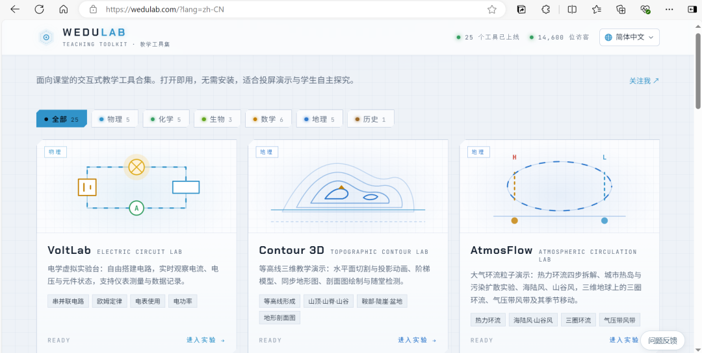
#### 它到底做了多少东西
**不是三五个 demo 凑数，而是把初高中要学的东西，成体系地做成了"能上手玩的实验"。**⁠ 目前一共 ⁠**25 个**⁠，分属 6 个学科：
| **学科** | **实验数** | **代表实验** |
| **物理** | 5 | 电学实验台、运动与力、光学实验台、振动与波、电场与磁场 |
| **数学** | 6 | 立体几何、圆锥曲线、函数图像、尺规作图、勾股定理、趣味数学 |
| **化学** | 5 | 元素周期表、反应机理、分子构型 VSEPR、原子轨道、化学反应微观世界 |
| **地理** | 5 | 等高线 3D、大气环流、地球运动、海陆变迁、水循环三维沙盘 |
| **生物** | 3 | 细胞三维结构、显微镜实验台、孟德尔豌豆杂交实验 |
| **历史** | 1 | 著名战役沙盘 |
> **小提示：你提到的"物理、化学、生物、数学、地理"五大类它都有，而且比你以为的还多了历史——以及数学一整类的 6 个实验。
> **
**下面挑几个最能打的，说说它到底做到什么程度。**
#### 物理：从电路到光学，全套实验台
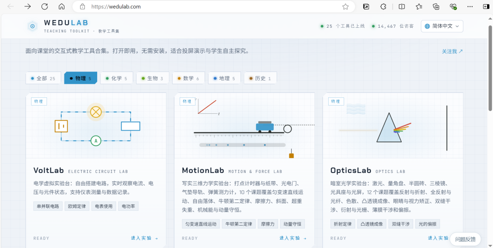
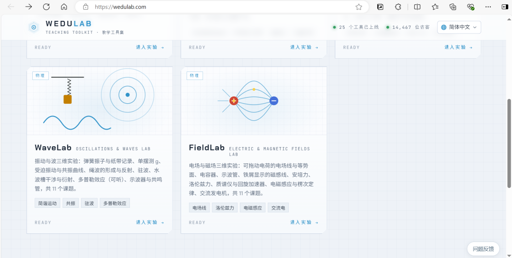
**这是最"重"的一类，每个都像一个真的实验台。**
- **VoltLab 电学实验台**⁠：自由搭电路，⁠**实时看电流、电压、元件状态**⁠，支持仪表测量和数据记录。串联并联、欧姆定律、电表怎么接、电功率——全在里面。
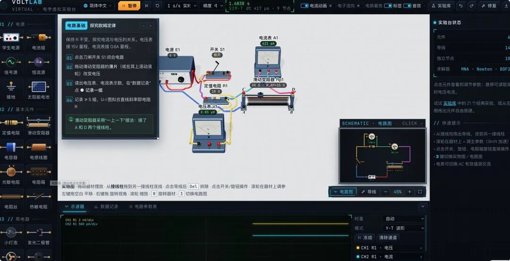
- **MotionLab 运动与力**⁠：写实三维力学台，⁠**打点计时器、纸带、光电门、气垫导轨、弹簧测力计**⁠一应俱全，10 个课题覆盖匀变速直线运动、自由落体、牛顿第二定律、摩擦力、超重失重、动量守恒。
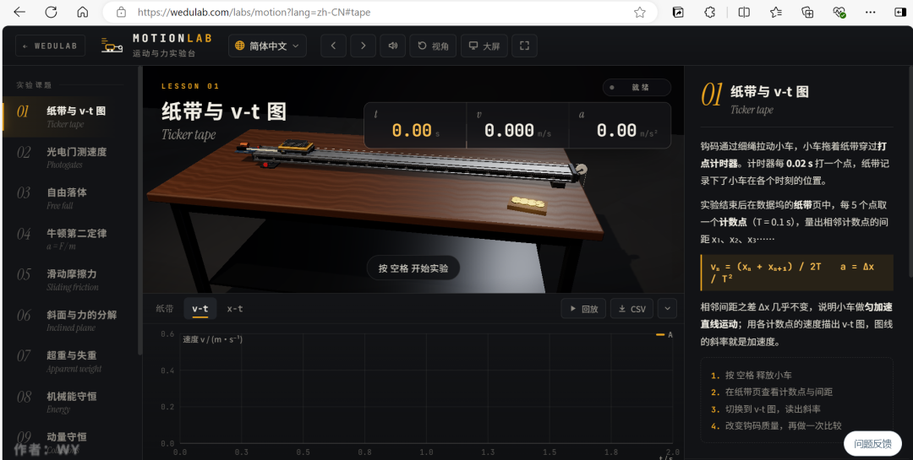
- **OpticsLab 光学实验台**⁠：一个⁠**暗室**⁠——激光、量角盘、半圆砖、三棱镜、光具座、光屏，12 个课题覆盖反射折射、全反射与光纤、色散、凸透镜成像、视力矫正、双缝干涉、衍射光栅、薄膜干涉和偏振。
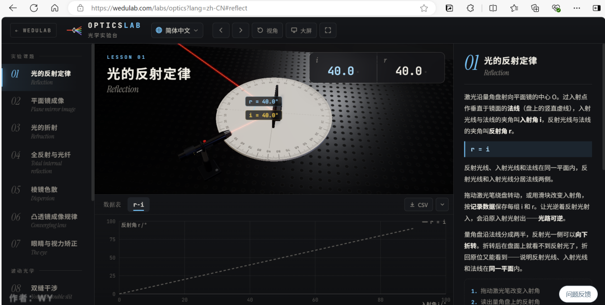
- **WaveLab 振动与波**⁠：弹簧振子、单摆测 g、受迫振动与共振、绳波、驻波、水波槽干涉衍射、⁠**能听的多普勒效应**⁠、示波器，共 11 个课题。
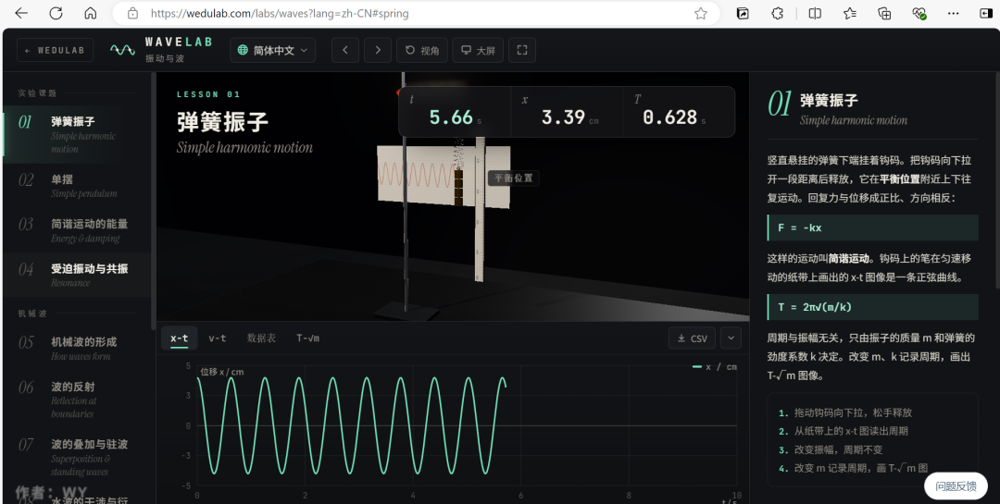
- **FieldLab 电场与磁场**⁠：⁠**可拖动的电荷**⁠看电场线与等势面、电容器、示波管、铁屑磁感线、洛伦兹力、质谱仪、回旋加速器、楞次定律、交流发电机，11 个课题。
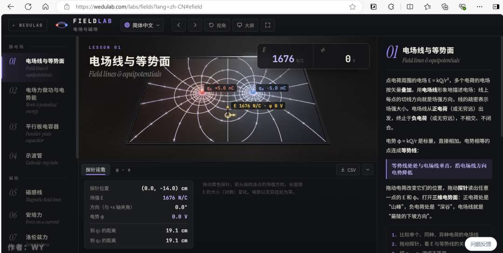
**注意那个"暗室"和"可拖动的电荷"——它不是给你看一段动画，是让你自己动手改参数、看结果。**
#### 地理：把"看图说话"变成"亲手切开"
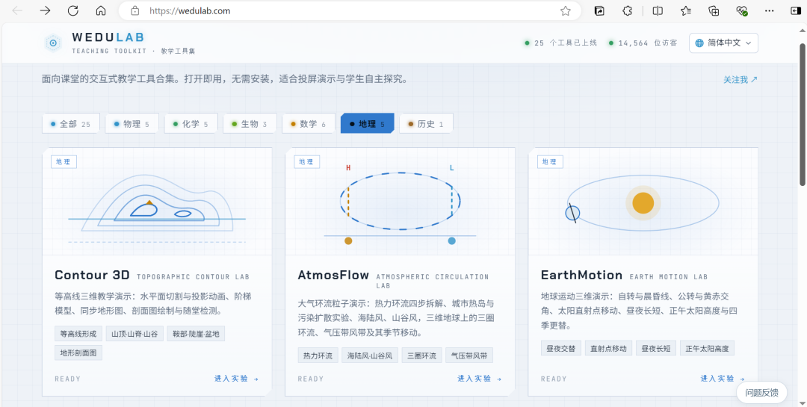
**地理最吃亏的地方就是：课本全是平面图，学生脑子里建不起三维。**⁠ 它这一块做得特别对症：
- **等高线 3D 课堂**⁠：用一个⁠**水平面去切山体**⁠，切口投影下去就是等高线，还配阶梯模型、同步地形图、剖面图绘制——⁠**"等高线是怎么来的"这个千年难题，一刀切明白。**
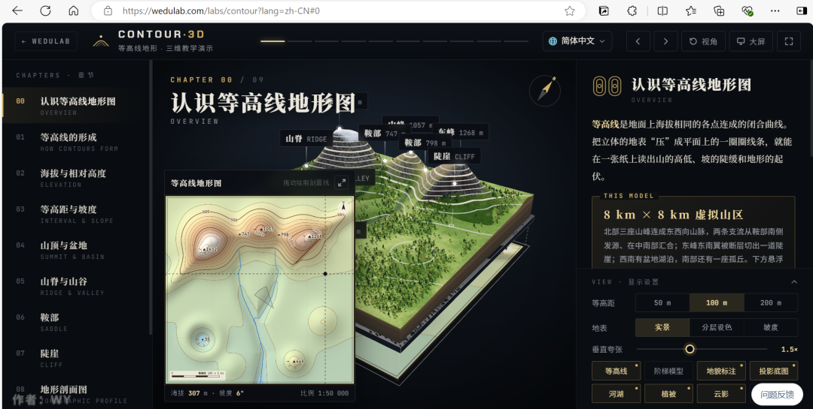
- **水循环三维沙盘**⁠：从海洋、城市、水库、高山到内陆湖的剖面地形，⁠**用粒子演示蒸发、水汽输送、降水、径流、下渗、地下径流**⁠，还带城市化与海绵城市、水量平衡。
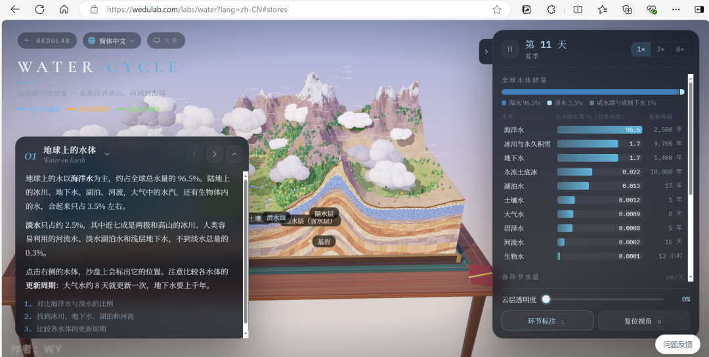
- **大气环流粒子课堂**⁠：热力环流四步拆解、城市热岛与污染扩散、海陆风山谷风，再到三维地球上的三圈环流、气压带风带及其季节移动。
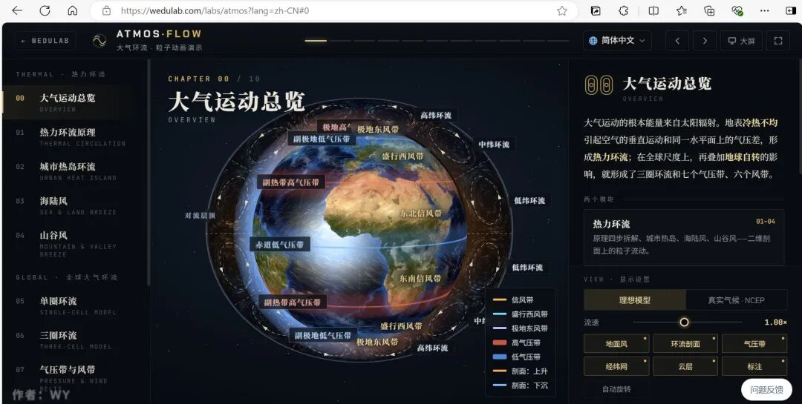
- **地球运动课堂**⁠：自转与晨昏线、公转与黄赤交角、太阳直射点移动、昼夜长短、正午太阳高度、四季更替。
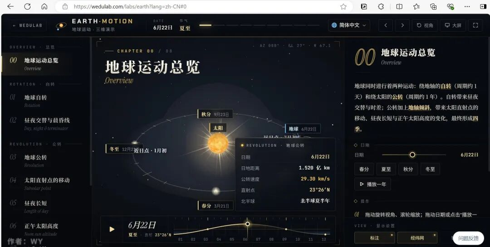
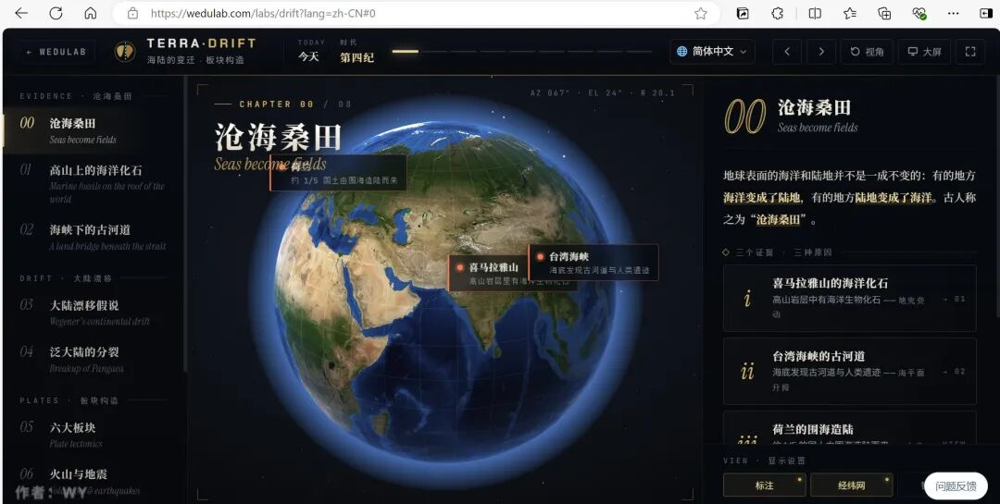

**你举的那几个例子——3D 等高线、大气环流、水循环、地球运动——全在这，而且是完整版。**
#### 生物：这是我最想让理科老师看的一类
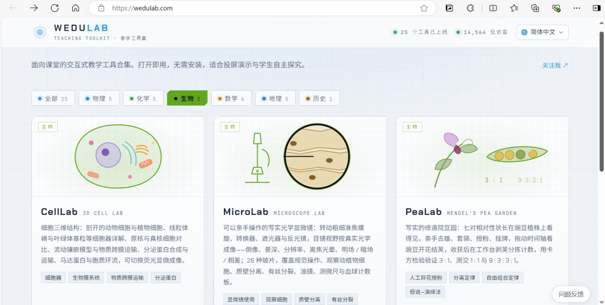
**生物的三个实验，个个都戳中痛点。**
- **显微镜实验台 MicroLab**⁠：⁠**不是动画，是一台能亲手转的光学显微镜。**⁠ 粗准焦螺旋、细准焦螺旋、转换器、遮光器、反光镜都能拧，目镜视野按真实光学成像——⁠**倒像、景深、分辨率、离焦光晕，明场 / 暗场 / 相差全有。**⁠ 26 种玻片，覆盖规范操作、观察动植物细胞、质壁分离、有丝分裂、油镜、测微尺、血球计数板。
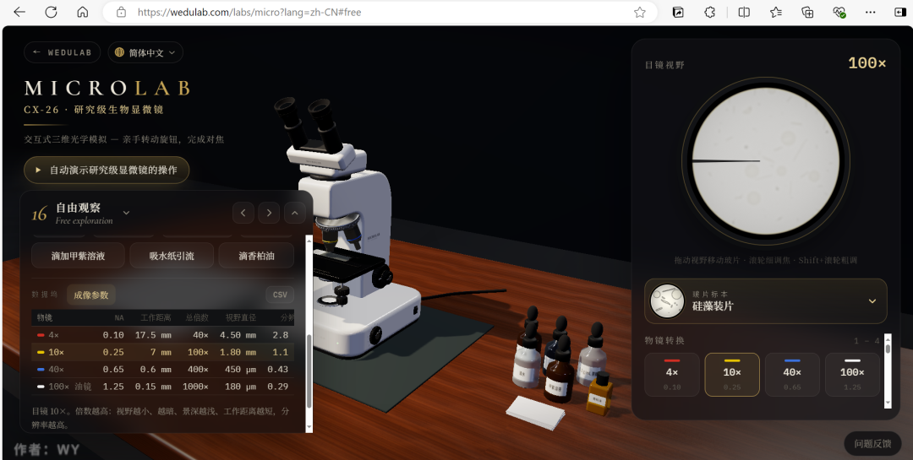
- **孟德尔豌豆杂交实验 PeaLab**⁠：一个写实的修道院豆园。七对性状长在植株上看得见，⁠**亲手去雄、套袋、授粉、挂牌**⁠，拖时间轴看开花结荚，收获后在工作台⁠**剥荚分拣计数**⁠，再用卡方检验验证 3:1、1:1、9:3:3:1。
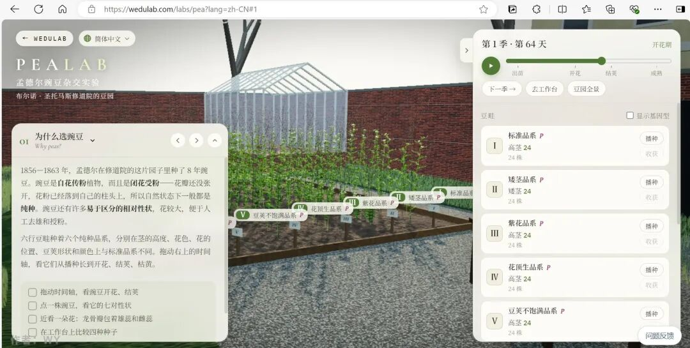
- **细胞 · 三维结构**⁠：剖开的动物 / 植物细胞、线粒体嵴与叶绿体基粒、原核真核对比、流动镶嵌模型与跨膜运输、分泌蛋白合成运输、马达蛋白与胞质环流，⁠**还能切换荧光显微成像。**
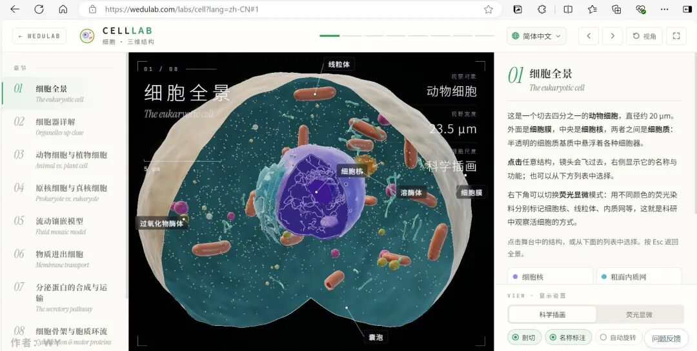
**"去雄、套袋、授粉、挂牌"这一套，真做一次要种几个月；在这里，几分钟走完一整个遗传学实验。**
#### 化学与数学：把抽象的东西"立起来"
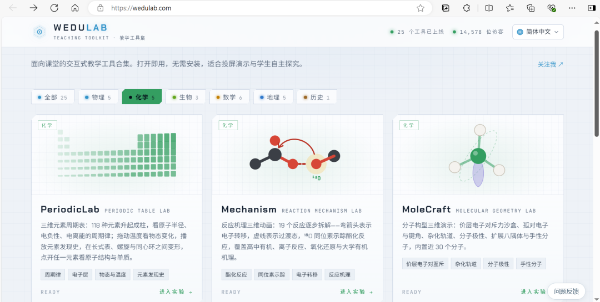

**化学最大的敌人是"看不见"。**⁠ 这几个实验专门治它：
- **元素周期表 PeriodicLab**⁠：⁠**118 种元素升起成柱**⁠，直观呈现原子半径、电负性、电离能的周期律；拖动温度看物态变化，播放元素发现史，在长式表、螺旋、同心环之间变形。

- **反应机理 · 分子动画**⁠：19 个反应逐步拆解，⁠**弯箭头表示电子转移、虚线表示过渡态**⁠，还用 ¹⁸O 同位素示踪酯化反应，覆盖高中有机、离子反应、氧化还原到大学有机机理。

- **原子轨道 · 电子云**⁠：电子云逐点"曝光"、s/p/d/f 轨道形状与相位、径向分布与节面、构造原理逐个填电子、1–36 号元素电子排布与量子数。

**数学这边，几乎个个都能"动手拼"：**
- **勾股定理 PythagoLab**⁠：亲手把碎片拼进斜边上的正方形，赵爽弦图、刘徽出入相补、欧几里得证明的剪切变换，⁠**还能转动水槽让 a² 和 b² 的水倒满 c²。**

- **尺规作图 ConstructLab**⁠：只用圆规直尺闯 12 关，交点自动生成，⁠**按步数评星，还能回放最少步数解法。**

- **圆锥曲线 ConicLab**⁠：用平面去截对顶圆锥，得到圆 / 椭圆 / 抛物线 / 双曲线，⁠**用 Dandelin 双球揭示"焦点"从哪来。**

- **函数图像 FuncLab**⁠：参数一拖，看图像怎么平移、伸缩、翻折；割线逼近切线、导函数与极值、二分法求零点、定积分的黎曼和。

- 还有⁠**立体几何 GeoSpace**⁠、⁠**趣味数学 WonderLab**⁠（谢尔宾斯基三角形、科赫雪花、莫比乌斯带、黄金分割）。

#### 连历史都想到了一块

**历史那个"著名战役沙盘 WarTable"，是个意外惊喜。**
**长平、巨鹿、官渡、赤壁、淝水，以及温泉关、高加米拉、坎尼、黑斯廷斯……**⁠ 它把这些战役放在⁠**真实高程地形**⁠上，用发光光点群推演兵团行军、交战与火攻夜袭，⁠**字幕逐句解说战局**⁠，还附兵力变化、战役概况、胜负原因和随堂检测。
**"以少胜多"到底怎么赢的，看一遍推演比背十遍书都清楚。**

#### 几条必须说清的边界
**第一，它是免费教学网站，不是开源仓库。**
**打开即用、不注册、不收费（官方 FAQ 明确写了"不需要，也不收费"）——但官网并没有明说是否开源，也没有公开的仓库地址。**⁠ 别把它当成 GitHub 项目来找源码，它就是一个做得很用心的⁠**在线教学工具站**⁠。
**第二，"学科数量"要更正一下。**
**你提到的是物理、化学、生物、数学、地理五类——实际上它有 6 个学科，多了一个历史；而且数学一整类有 6 个实验、物理和化学各 5 个，比"每科几个"要丰富。**⁠ 网上有些旧文章说它"4 类学科、16 个 demo"，⁠**那是过时信息，官网 FAQ 现在写的是 25 个实验。**
**第三，它是给"课堂"做的，学段集中在初高中。**
**官方定位是"面向课堂的交互式教学工具合集"，主要面向初中、高中；只有部分化学实验延伸到了大学有机化学和结构化学。**⁠ 小学生、或者想找大学普通物理的，可能不完全对口。
**第四，它替代不了真实验。**
**再逼真的三维模拟，也不是真的拧螺旋、接电路、闻试剂。**⁠ 它的价值在于⁠**"把看不见的变可见、把危险的变安全、把几个月的变几分钟"**⁠——是⁠**课前理解、课后复习、和没法做实验时的补位**⁠，不是替掉动手能力训练。
**第五，建议配合投屏 / 大屏用。**
**它明确说了"适合投屏演示"——**⁠很多实验在电脑投到大屏上，老师带着全班一起操作，效果最好。⁠** 手机也能开，但小屏做精细操作会有点憋屈。**
#### 写在最后
**这类工具最难得的，不是技术多惊艳，而是"真的懂教学"。**
**它没做一个炫技的 3D 场景了事，而是把每个学科最"讲不清"的那几个知识点，单独拎出来，做成一个能亲手操作的实验：**⁠等高线怎么来的、水循环走了哪几步、显微镜里到底什么样、勾股定理凭什么成立、以少胜多怎么赢……
**25 个实验，6 个学科，打开网页就能用。**⁠ 对老师，是投屏神器；对学生，是把课本"玩"懂的路子；对家长，是一个免费的、比刷题有意思得多的存在。
**如果你身边有初高中的老师、或者是正在被物化生数地折磨的学生，这个网站值得转给他们：**
- **网址**⁠：⁠wedulab.com
- **费用**⁠：免费，无需注册
- **语言**⁠：简体中文、繁体中文、日语、韩语、土耳其语、英语
> **觉得有用的话，点个赞 or 转给身边的老师、家长和还在啃理科的同学。
> **
_有人把物理、化学 · END_

## 摘要

（待补充）

## 我的笔记

（待补充）
