# 有人用AI重构了《史记》：57万字变成可交互“地铁图”，连司马迁笔下的矛盾都被扒出来了
> 💡 备注属性未写入，可能是备注属性名称或者类型被修改了，建议将字段类型设置为 rich_text，可以在小程序-操作-修改文章数据库页面进行调整
> 💡 原文链接:[https://mp.weixin.qq.com/s?__biz=Mzk3NTgzNjk4Ng==&mid=2247491207&idx=1&sn=be72355eaaa5a82027caa366943f6ac6&chksm=c56d5d0f5a3ca9c36c7a181d07330223662312f4f501671ba2c493ec14a21b355f5301a1049c#rd](https://mp.weixin.qq.com/s?__biz=Mzk3NTgzNjk4Ng%3D%3D&mid=2247491207&idx=1&sn=be72355eaaa5a82027caa366943f6ac6&chksm=c56d5d0f5a3ca9c36c7a181d07330223662312f4f501671ba2c493ec14a21b355f5301a1049c#rd)
 
AI李子 · 实测
**开源**SHIJI-KB

**五十七万字古文**
**画成一张地铁图**
一个学者加一套技能库，烧掉 55 亿+ Tokens
130 篇古文的脉络，如今能点着一步步走
**57.7 万字**
全文规模
**130 篇**
本纪列传
**3,198+**
历史事件
**如果像翻代码那样翻两千年前的《史记》，会是什么体验？**
57.7 万字古文被摆成一张能缩放、能拖拽的地铁图。人名、地名、官职各自带语法高亮，点一下直接跳到词条页，还能把不同篇章里对同一件事的记载摊在一起对照。
这个项目叫 shiji-kb（史记知识库），GitHub 上已经接近 4,000 Star。上一期聊过的江山时序反响不错，这篇算是同一条线上的续集：让历史资料从「能看」走到「能走」。
**往期回顾 · 江山时序地图**
[把 2400 年中国史装进一张网页：拖一下时间轴，看尽山河易主与古人平生](https://mp.weixin.qq.com/s?__biz=Mzk3NTgzNjk4Ng%3D%3D&mid=2247490960&idx=1&sn=b8415381c2ba239d9b0fa53bf0eb44c6&scene=21#wechat_redirect)

把 57 万字古文，变成一张知识地铁网
项目地址放在这里，仓库结构不复杂，README 写得比多数开源项目耐心：
**LINK**GitHub 仓库
https://github.com/baojie/shiji-kb
**01**
**MAP**
**把 57 万字古文，压成一张知识地铁网**
FROM TEXT TO TRANSIT MAP
项目由学者鲍捷发起，和 AI 编程工具 Claude Code 一起完成。阶段性统计里，整套工程累计消耗约55 亿 Tokens，人机协同了 120 小时。分工很干脆：AI 负责大规模标注、写代码、生成文档，人负责学术判断、审美和最后的质检校准。
传统的电子版古籍，多数只是把纸书搬上屏幕。这个项目多做了一层语义排版和知识抽取，把 130 篇、57.7 万字拆成 14,065+ 个实体词条和 3,198+ 个历史事件（**项目还在持续更新**）。
**规模**
**做到什么程度**
**57.7 万字**
130 篇 · 22 类
全书标注 126,441 次
**14,065+**
实体词条
4 轮反思修正约 2 万处
**3,198**
历史事件
98.7% 标注公元纪年
**7,637**
事件关系
9 种关系，1,876 条跨章
**20,830+**
Wiki 页面
1,246 篇 premium 精品页
**14+89**
技能总数
元技能 14 个、管线 89 个，863 页手册
注：原文属公有领域，结构化数据用 CC BY-NC-SA 4.0 协议开源，脚本为 MIT。
打开阅读器，古文立刻有了程序员熟悉的语法高亮。18 类名词、4 类动词各占一种颜色，点任意词汇跳进专属词条页，人物的生平、战役和原文出处串在一条时间线上。想安静读原文，点右上角齿轮关掉高亮即可。
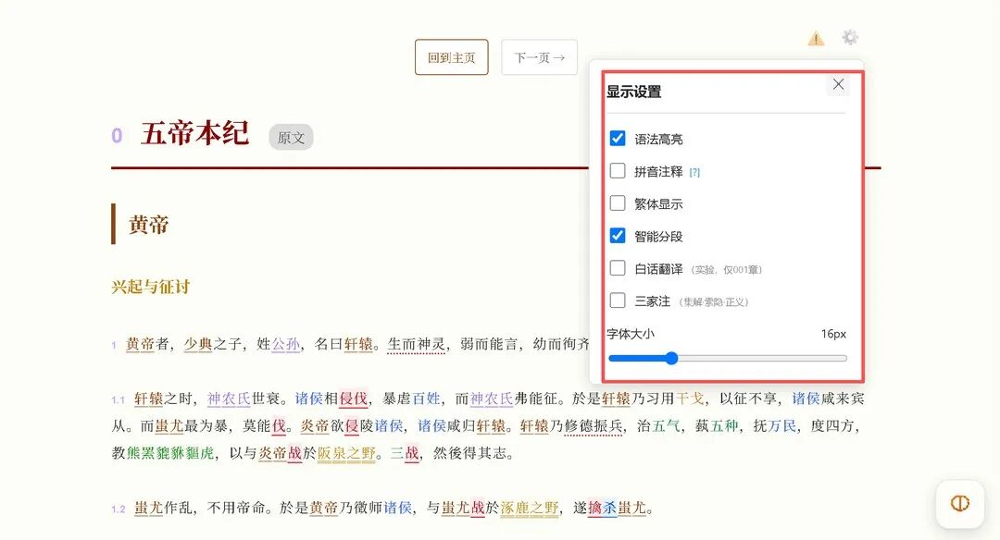
阅读器里的语法高亮：人名、地名、官职、邦国各自分色
更好玩的是内置的「史记地铁图」：130 篇对应 130 条线路，3,198 个核心事件做成站点，同一件事在不同篇章里出现，就成了线路交汇的换乘站。整张图可以自由缩放、拖拽，也能和时间线联动，编年史忽然有了一张交通网的脸。
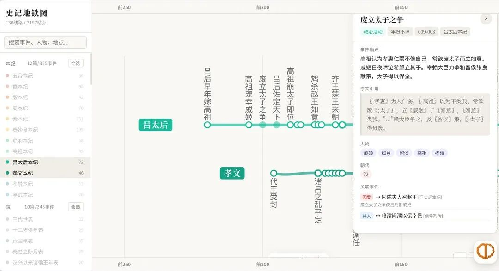
整张地铁图：每条线路对应一篇，节点是事件，交点即换乘
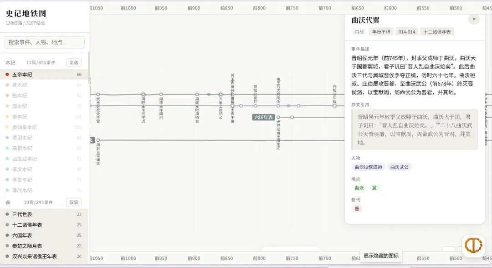
放大后的局部：站名、线路色、换乘关系都标得出来
每一段都带 Purple Numbers 编号（致敬超文本先驱 Doug Engelbart），引用和分享时能精确指到某一段，不必再靠「大概在中间那页」。
**划重点**
它把《史记》从一本要读的书，做成了一张可以走的图。130 条线路、3,198 个站点，每一次换乘都对应一件跨章发生的事。
**02**
**GUIDE**
**零门槛上手：两种打开方式**
TWO WAYS IN
**方式一网页端直接访问**
不用配置任何环境，浏览器打开就能玩。官方给了两个入口，访问都算顺畅：
**URL**GitHub 镜像 / 作者独立域名
https://baojie.github.io/shiji-kb
https://shiji.memify.wiki/
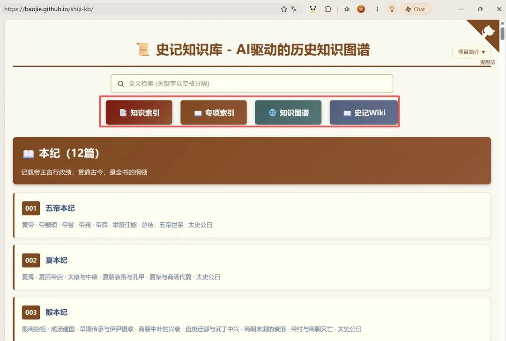
首页：顶上写着「AI 驱动的史记知识图谱」
网页版分成四块，各自解决一类问题：
**1**
**知识索引。**按人名、邦国、地名、身份等维度铺开的全局导航，找谁都能从这一页进去。
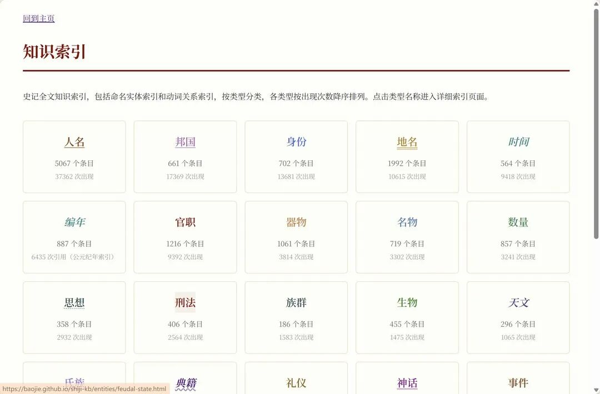
知识索引：人名、邦国、地名、身份、官职分栏
**2**
**专项索引。**围绕特定历史专题做的垂直分类，目前还在持续扩充。
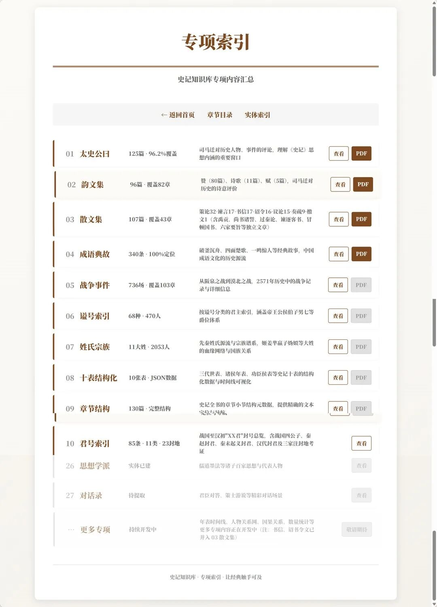
专项索引：按朝代与专题切分的目录
**3**
**知识图谱。**人物概念分类树已经上线，其余图谱模块在陆续补。
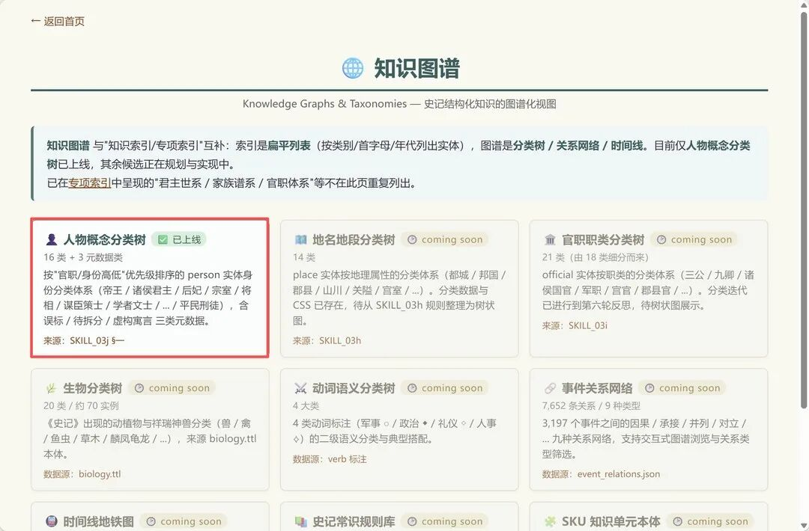
知识图谱：人物的概念分类树
**4**
**史记 Wiki。**整部《史记》彻底维基化，部分地名还匹配了谭其骧《中国历史地图集》的裁切图。点开「项羽」，生平轨迹、关联战役、原文引证聚在同一页。
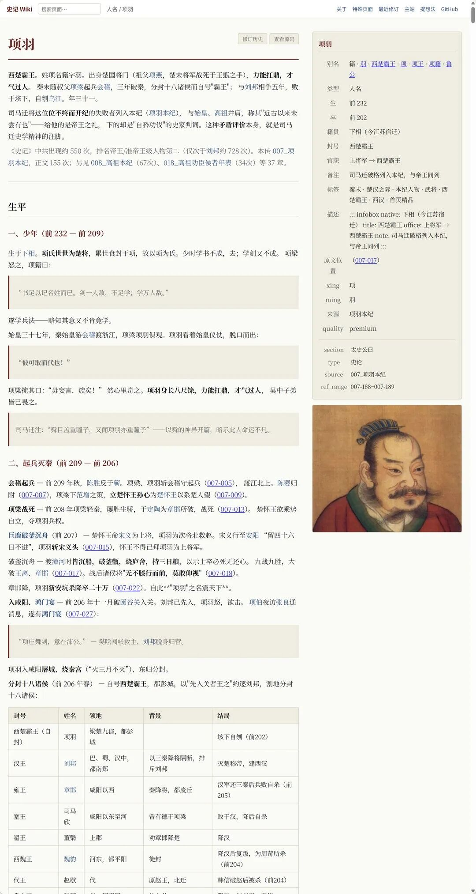
项羽词条：生平、战役、原文引证汇总在一页
**方式二本地部署，喂给自己的知识库**
喜欢折腾本地工作流的，把仓库拉到本地就行（需要 Python 环境）。仓库体积不小，建议浅克隆或者直接下 ZIP：
**SHELL**浅克隆，省带宽
git clone --depth 1 https://github.com/baojie/shiji-kb.git
cd shiji-kb
接着起一个静态服务：
**SHELL**本地静态服务
python -m http.server 8001 --directory docs
浏览器访问 localhost:8001，交互体验和官网一致。
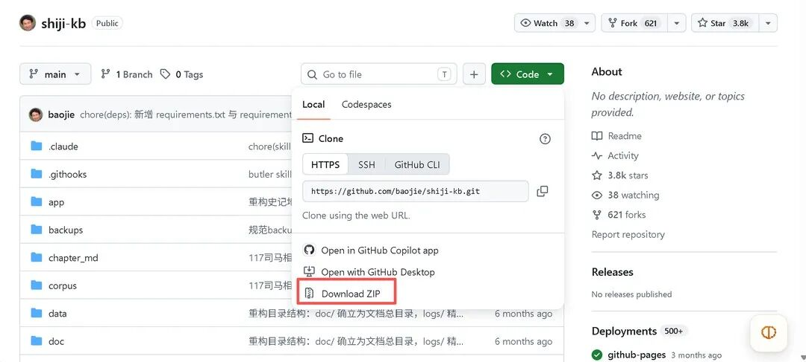
仓库结构：chapter_md 目录里就是清洗好的结构化 Markdown
本地部署真正的价值在数据。chapter_md/ 和 Wiki 文件都是干净的结构化 Markdown，可以直接喂给 NotebookLM 或者你自建的知识库。回答问题时能落在原文引证上，凭空编造的空间就小了很多。
**划重点**
不想折腾就用网页版，两个入口随便挑；想把数据据为己有，走本地部署，chapter_md 里的 Markdown 是现成的语料。
**03**
**INSIGHT**
**当 AI 读《史记》，挖出了哪些线索**
WHAT THE MACHINE FOUND
实体、时间和因果关系都变成可计算的数据之后，机器能看到的东西比人多一层。项目在构建过程中提炼出20 多条跨章节规律，比如「征服与治理倒转」（打天下的暴烈手段，往往成为治天下的最大障碍）、「边缘优势」（成功王朝大多起于文明边缘）、「宽恕悖论」（宽恕下属能换死忠，宽恕敌国常埋祸根）。
三个考据实验更值得看。
**●130 篇里，谁说了假话**
跨章矛盾检测：AI 把全书数据对齐以后，揪出多处隐蔽的记录冲突。《项羽本纪》和《高祖本纪》记东城之战，斩首数字差了上百倍；《晋世家》和《赵世家》记「下宫之难」，时间差了 14 年。同一支笔写下的两处记载，对不上的地方被算法直接摆到台面上。
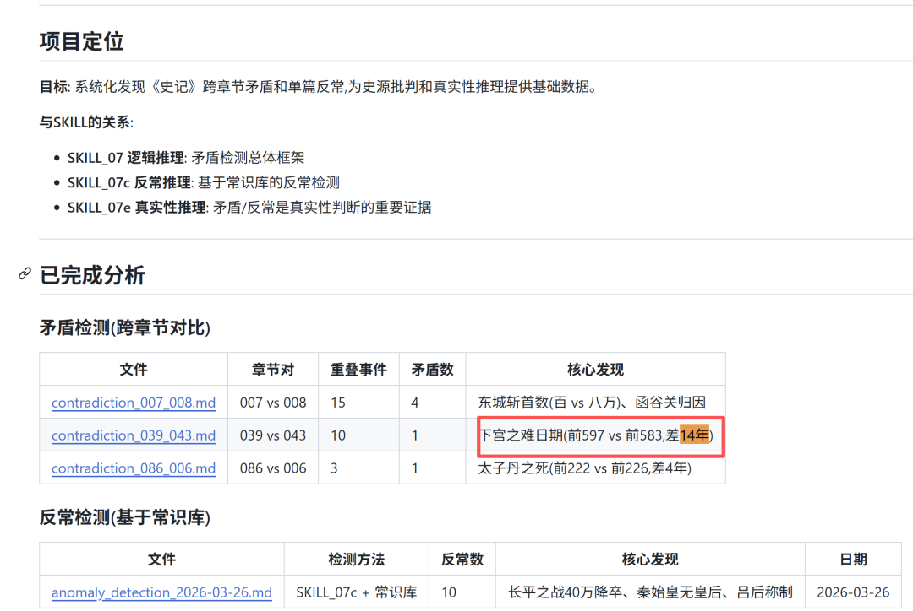
**●战国财政账本推理**
项目组照着李开元等史家的考据方法，用经济学视角重新算了一遍账。长平之战赵王临阵换下廉颇，未必只中了秦国的反间计：廉颇的长期坚守已经把赵国财政拖垮，国库见底之前，赵王只能换赵括赌一次速决。他们还精算了「冯谖烧券买义」背后的战国年利率与债务规模，还原孟尝君如何用 3,000 金买断薛地民心。
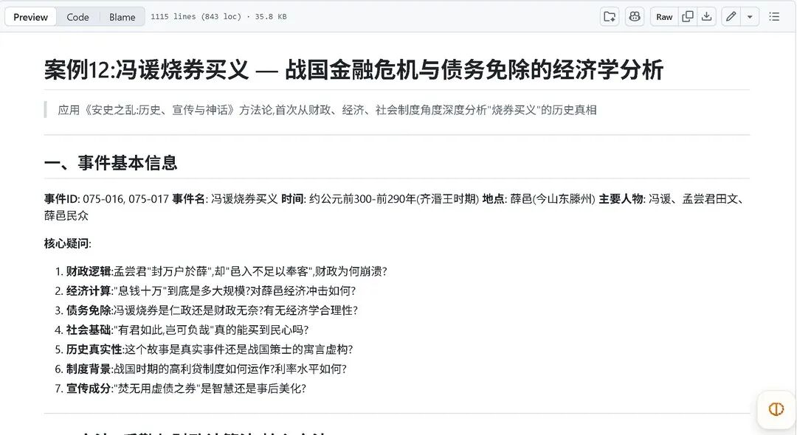
冯谖烧券买义：用利率和债务规模重算的一笔战国账
**●沙丘之谋的传播链**
赵高、李斯、胡亥在沙丘密谋时，外人都已退下，司马迁怎么知道细节？系统梳理出一条跨越 65 年、历经三代人的四层口述链：密谋三方知情，到子婴诛赵高后审讯党羽，再到秦宫遗民降汉流散口述，最后由太史公采访汇总。史料来源的合理性，就这样被一条链条解释清楚。
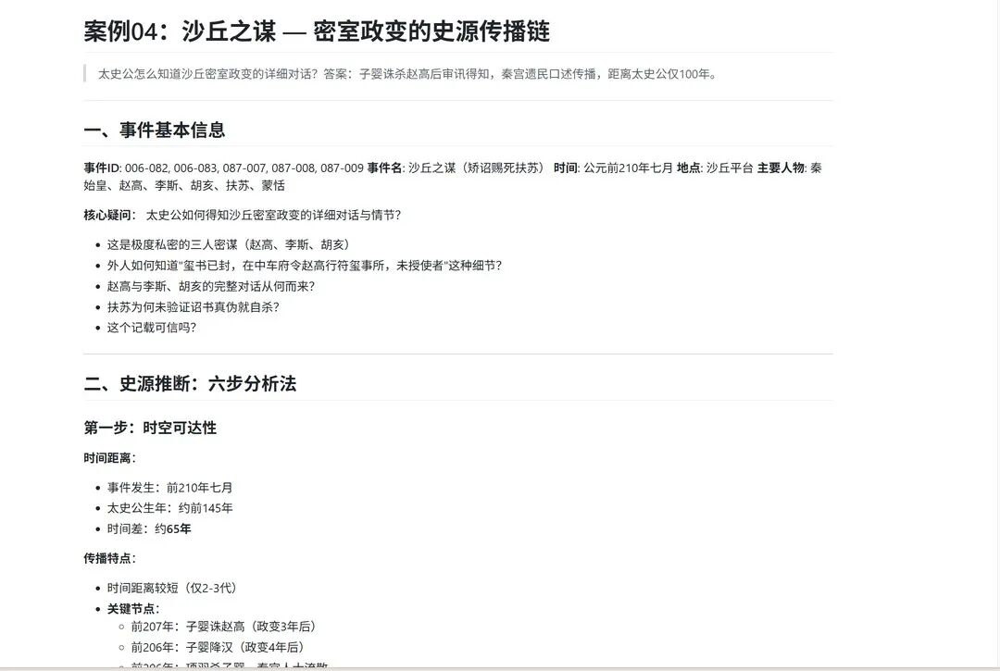
沙丘之谋：四层口述传播链的还原
支撑这些结论的是 7,637 条事件关系，9 种类型，其中 1,876 条跨章连接。关系网密到一定程度，反常识的结论才有立足点。
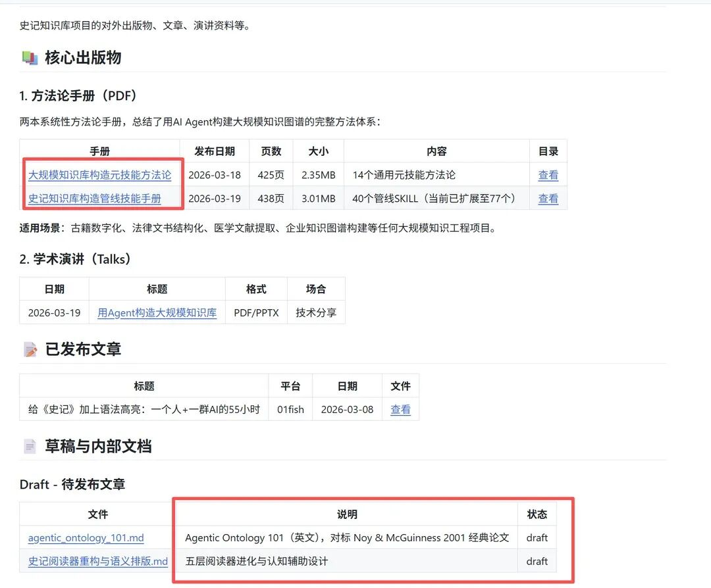
事件关系表：跨章连接的清单
**划重点**
三条线索的结论未必都成定论，方法倒是现成可复制的：先把史料变成结构化数据，再让机器去比对、去算账、去追传播路径。
**04**
**HOW**
**藏在背后的王牌：不写代码的技能驱动**
SKILL-DRIVEN ENGINEERING
对 AI 开发者和研究者来说，这个项目最硬核的贡献是提出并验证了Agentic Ontology（智能体本体工程）这套范式。

不写一行代码的技能驱动
2001 年斯坦福那套经典本体方法论，靠领域专家自上而下设计架构，迭代一轮动辄几周。鲍捷走的是自下而上的路：让 AI 直接从原始文本里提概念、提实例，本体结构跟着数据一起长，人只负责修剪和校准。项目为此专门写了一份对标经典的英文白皮书《Agentic Ontology 101》。
**PIPELINE**九步流水线
01 校勘 → 02 结构分析 → 03 实体构建→ 04 事件 / 05 关系 / 06 本体（并行）→ 07 逻辑推理 → 08 知识单元构造 → 09 应用构造
整个项目几乎没有从头写文本解析代码。每一步流水线对应一份 SKILL 文档：作者用结构化的自然语言写清输入标准、处理逻辑和验收规则，AI 自己读懂文档去干活。这套体系沉淀出 14 个元技能、89 个管线技能，汇总成两本共 863 页的 PDF 手册。
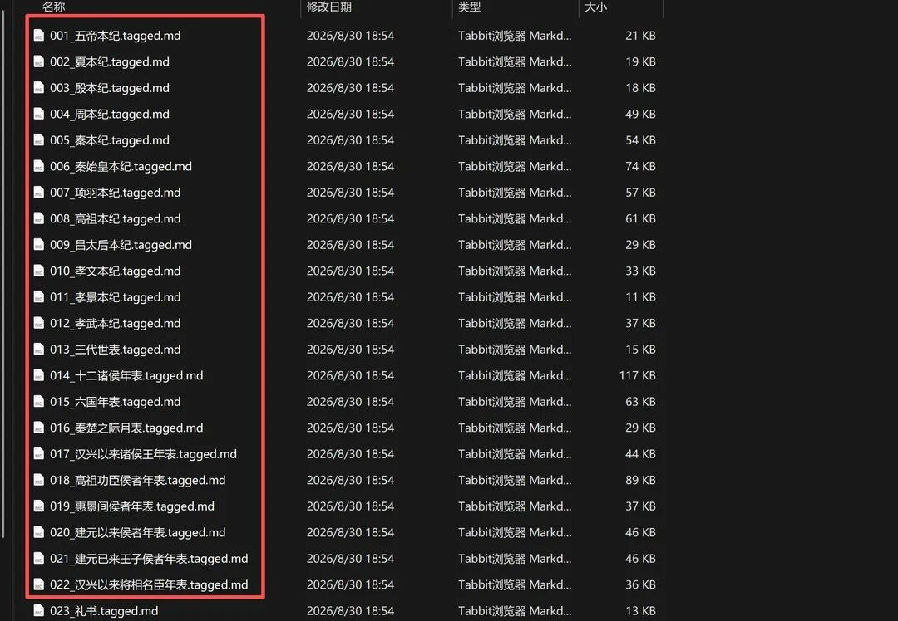
两列并排的 SKILL 文档，就是流水线的说明书
面对 57.7 万字的复杂语境，项目没打算一次做完美，而是设计了一套诚实的「Agent 反思循环」。以事件年代推断为例，AI 跑了 5 轮自我审查和交叉验证，错误数从第一轮的 1,010 处收敛到第五轮的 21 处；全库 Wiki 由自主运行的 Butler Agent 累计维护了 12,000 多轮。

反思循环：5 轮把错误从 1,010 压到 21
接下来的规划是《汉书》《资治通鉴》，再到 4,000 万字的《二十六史》。按团队的测算，复用现有技能库处理一部古籍的成本已经降到百元到千元级，长期看有机会成为《四库全书》这类 数十亿字工程的底层设施。

**划重点**
门槛低得反常：一份写得够清楚的 SKILL 文档，就能让 AI 接手一整段流水线。两本 863 页的 PDF 摆在仓库里，抄作业的成本比重新想一遍低得多。
**///**
**END**
**写在最后**
ONE LAST THING
《史记知识库》在不同人眼里价值不一样。历史爱好者拿到的是一本自带导航的交互读物；文史研究者看到的是机器辅助矛盾检测和史源考据的新路径；AI 从业者看到的是一份实战样本：一个人加一套严谨的自然语言技能库，照样能扛起百万字级的严肃知识工程。
对「AI 怎么做深度知识工作」感兴趣的话，仓库里那两本方法论 PDF 值得翻一翻。
**TAKEAWAY**
**两千年前的文字没变，变的是我们走进去的方式。**
收藏起来慢慢试，顺手转给爱读史的朋友。
我是 **AI李子**，热衷于分享 AI 干货。
**如果你觉得今天这篇有收获**
**欢迎点赞、转发、推荐三连，我们下篇见**

赞

转发

推荐
AI李子 · 实测笔记
