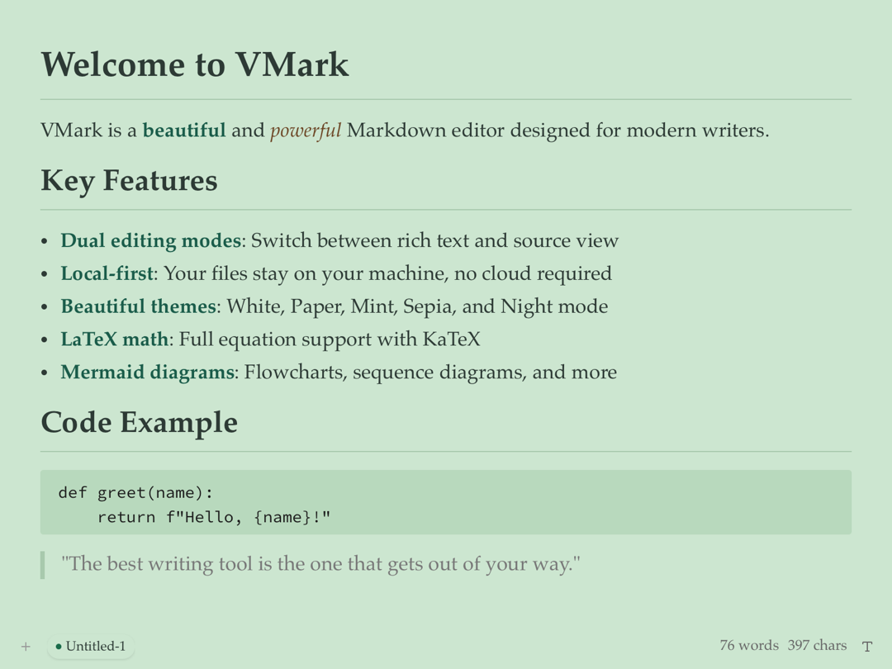
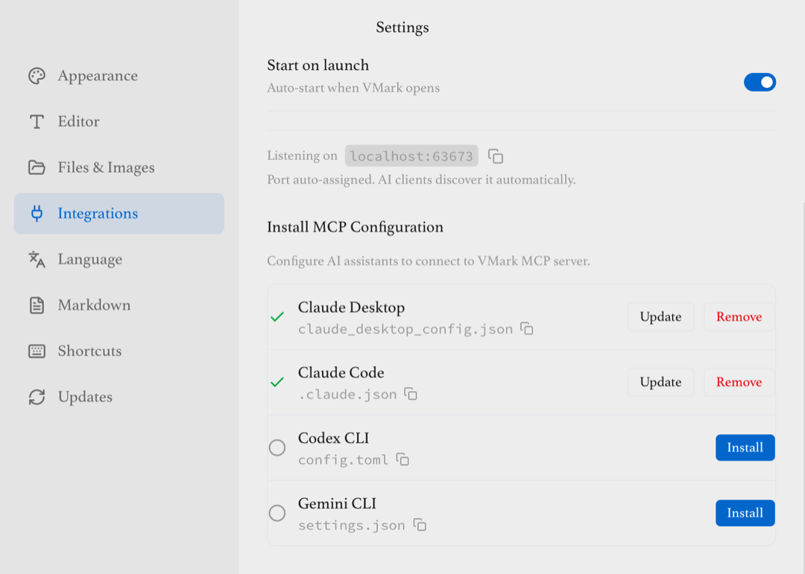
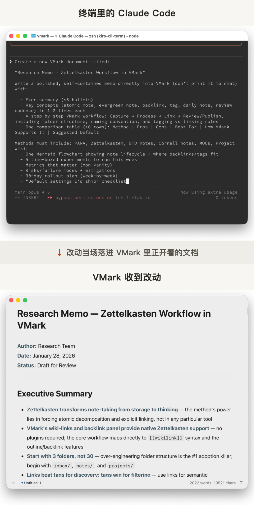

# 李笑来开源VMark：面向AI的Markdown编辑器
> 💡 备注属性未写入，可能是备注属性名称或者类型被修改了，建议将字段类型设置为 rich_text，可以在小程序-操作-修改文章数据库页面进行调整
> 💡 原文链接:[https://mp.weixin.qq.com/s?__biz=MzI2NjQ2MjI5OQ==&mid=2247484363&idx=1&sn=26b43417330a9129aab43e77afb99551&chksm=eb4ddcc7df5c425ae4b6c64d35b82ceb0533ae193ee7a0c26311060cb5877dce523f2cbc1979#rd](https://mp.weixin.qq.com/s?__biz=MzI2NjQ2MjI5OQ%3D%3D&mid=2247484363&idx=1&sn=26b43417330a9129aab43e77afb99551&chksm=eb4ddcc7df5c425ae4b6c64d35b82ceb0533ae193ee7a0c26311060cb5877dce523f2cbc1979#rd)
这年头，谁还缺一个 Markdown 编辑器。
Typora、Obsidian，很多人用了很多年；想换换口味，免费开源的一抓一把。
李笑来偏又做了一个，叫 VMark，免费，开源，挂在 GitHub 上。单看这个，确实没什么可聊的。多看两眼会发现，它给 AI 留的位置不太一样：不是编辑器里多了个 AI 按钮，是外面的 AI 直接连进来，改你正在写的那份文档。
AI 改的每一处都记着档：哪个客户端、哪次会话、改了什么，一条条列在面板里。你挨个看，想留的留下，不对的退回。
单纯从用户体验上讲，它是符合我习惯的：以前偷摸用 Typora，如今我用 VMark 平替了。它对中文内容的用户体验也非常友好，建议大家去官网看看介绍。
### 不缺编辑器的年代，他为啥还要做一个
先说人。李笑来当过新东方老师，早年因为区块链投资出了大名。这几年他是高产作者，书经常直接开源挂在 GitHub 上，《自学是门手艺》《人人都能用英语》都在那儿，今年还发了一部中篇小说《迟到》。我发现这两年他在干的事，其中一项就是拿 AI 做给自己用的软件。
2025 年 12 月底，他动手做 VMark。为什么是编辑器？他在 2026 年 2 月发的一篇长文里讲过理由。
第一条最直接。他说："我的确有很多'需求'未被现有的编辑器满足。"自己有需求，现成的东西满足不了，就自己做一个，这是最普通的动机。
第二条放在今天看更有意思。他的原话是："一个 Markdown 编辑器，不是什么新鲜东西，它的每个细节，AI 想了解的话，肯定比谁都更清楚。"翻译一下：编辑器不是尖端技术，没有哪一环是 AI 搞不定的。以前一个人想做软件，卡住他的不是想法，是"做不了"；现在这道门槛没了。
第三条最实在。动手做编辑器之前，他先给自己做了个 epub 和 PDF 阅读器，编辑器是把读写工具配齐。他自己的总结："一个是自己用的 Epub/PDF Reader，一个是自己用的 Markdown Editor，读写工具都有了。"写作本来就是他的主业，工具自己造。
对做出来的东西，他也有个标准："做出来之后只是给自己用的东西叫'玩具'，做出来之后能给很多人用的才叫'产品'或者'服务'。"
这次出品的方式，是整件事最像新闻的地方。他自己说，从头到尾一行代码没写，甚至没看过，只当 Producer，制作人。连软件的图标，都是让 Claude 指挥画图软件 Sketch 画的。
官网的致谢名单也是这么写的：Producer 是他，Coders 一栏列着三个 AI 的名字，Claude Code、Codex CLI、Gemini CLI。
一个人加三个 AI 码农，做出来的是不是玩具？看迭代记录就知道。
推进得也快。动手半个月有了雏形，一个月后，他就把版本名里的 alpha 换成了 beta。
仓库 3 月 24 日发出第一个正式版本，到 10 月 29 日发了 148 版；10 月 28 日一天连发三版；光 10 月一个月就有 17 版，平均下来一天半一个新版本。这些数字是我在 GitHub 的版本列表里数的。
**他做编辑器，不是手痒，是 AI 把"做"的门槛拆掉了，而写作本来就是他的主业。**
### 做出来的是个啥

官方的自我介绍有两层。GitHub 仓库的一句话是"An AI friendly markdown editor"，对 AI 友好的 Markdown 编辑器；README 的卖点列表里，还挂着一个更重的标签：AI-Native。
两层说的是同一件事：这个编辑器，也给 AI 预备了一份。
先说本职。免费，开源，文件全存在你自己的电脑上，没有云同步，没有账号，官方写明不做数据分析。官网中文版给自己的说法，是"恰到好处的 Markdown 编辑器"。编辑器该有的功能都有，连中日韩排版的细节都专门写了 20 多条规则。

重点是 AI 在这个产品里的位置，有两块。
一块向内，是内置 AI 助手，官方文档里叫"AI 精灵"。用法：选中一段文字，从 13 个内置模板里挑一个，比如润色、压缩、改语法，AI 给出建议，你预览，接受或拒绝，全程不用离开编辑器。模板也可以自己写。对这一块，李笑来 2026 年 2 月自己评过一句："说实话不太好用。"
另一块向外，是一个开放接口：外面的 AI 连上它，就能读你正在写的文档，也能改。
**内置助手是配角，这个开放接口才是主体。**
### 什么人该试一试
什么人该装一个试试？把 AI 当主力干活的写作者。
更具体一点：你平时写东西多，又在用 Claude Code、Codex 这类工具干活，习惯了把稿子丢给 AI 改一版，再自己过一遍。VMark 把这个来回，直接搬进了文档本身。
李笑来自己就是第一个样本。他在微博上说过，自己在 VMark 里用 Claude 调用各种自己写的技能和插件制作书籍。2026 年 5 月他写英文书 The Half Second 的复盘，里面说他当时就是在 VMark 里写的。
他的用法一句话：AI 写，人审，人当主编。这条路，他自己先跑通了。
代价也得摆出来。AI 每改一处你都得过目，对靠写作吃饭的人，逐条审下来可能比自己写还累；偶尔让 AI 润个色的轻度用户，这套规矩用不上，也感觉不到它的好。一周写不了两篇的，现有编辑器加个 AI 对话框，够用了。
想上手不难。官网 vmark.app，免费；macOS 敲一条命令就能装：`brew install xiaolai/tap/vmark`。要用开放接口，前提是你已经在用 Claude Code、Codex CLI 这类 AI 客户端。
Windows 和 Linux 的安装包，官方的说法是尽力而为；主力平台是 macOS。
实话也得说几句：
- • 用的人还很少。中文英文社区都几乎搜不到讨论，独立评测没有，能翻到的大多是转述。
- • 作者自己承认"还有大量的 bugs"。
- • 那套规矩到底好不好用，官方文档写得再细也不算数，得真上手的人说了算。
### 怎么让外面的 AI 进来干活
外面的 AI 怎么连进来？靠一个叫 MCP 的开放协议。可以把它想成一排标准插座：软件这边装上插座，AI 那边插上插头，两边按同一套标准对话。Claude、Codex 这些 AI 客户端，现在都支持它。
落到 VMark 上，接法简单得出奇。打开设置里的接入页，一排 AI 客户端，Claude Desktop、Claude Code、Codex CLI 都在，一键安装就接好，官网的说法是"无需插件，连接即协作"。名单之外的 Cursor 这类工具，也能手动配上。

接上之后是什么体验？打个比方，你在 VMark 里写一篇稿子，切到终端，对 Claude Code 说一句"把我开着的文档收紧一点"。它读完文档，动手改，改动当场落进你眼前的编辑器。不是另存一份文件让你粘回来，改的就是你屏幕上这一份。

用 Claude Code 的读者看到这里多半会问：它本来就能直接改我电脑上的文件，绕这个编辑器干什么？
差别在于摸到的文档不是同一份。AI 直接写文件，摸到的是磁盘上最后一次保存的版本；从接口进来，摸到的是你眼前正在写的这份活文档。
这两者经常对不上。你打了一段字还没保存，AI 直接去写文件，要么看不见这段，要么把你没保存的修改冲掉。从接口进来，读到的就包含你还没保存的内容，写回去也不会冲掉它。人和 AI 读写的是同一份纯文本，标题、表格、代码块都在里面，中间没有格式转换。
接口还有两个顺手的设计。
一个是可以只改选中的部分。改哪段，选哪段，不用把整篇丢给 AI 重写。官方文档给的理由很实在：整篇来回一遍，输入输出的 token 都按整篇算；AI 重写整篇时，还可能顺手动你根本没打算改的字。只改选中一段，两个问题一起防。
另一个是在文档里留评论。你选中一句话，批一句"这里太绕"，AI 能读到这条评论，回复，标记已处理，还能标注这次改动回应的是哪条。收尾的权力在人手里：一条评论算不算完结，AI 说了不算，你说了算。你跟它的来回讨论，都留在这份文档里，不用另开窗口。
这套接口一共 10 个工具、44 个动作，前面说的这些能力都从这儿走。
**AI 摸到的，是你眼前这份正在写的文档；你跟它的讨论，也留在这份文档里。**
### 凭什么敢让它改
让 AI 直接改你正在写的东西，多数人的第一反应是：它改坏了怎么办？
VMark 对 AI 的姿态，可以概括成对一位能干但不可全信的同事：活儿放手让它干，每一步都留下凭证。这一整套是 10 月 28 日的 0.9.104 版上线的。规矩拢共三条线。
第一条是留痕。AI 的改动先记档，再落地。历史面板里能看到每次改动的时间、用了哪个工具、来自哪个客户端的哪次会话，重启也不丢。有个边角处理得很诚实：极少数情况下，改动写进去了、档没记上，编辑器会把这类改动单独列一张清单，不装作没发生。
第二条是审查。历史面板把没审过的改动按客户端和会话分好组，你逐条过，每条留下，或者退回。退回有一条硬规矩：如果退回会覆盖你后来写的字，这条退回就不执行，你的字优先。
你一直不审，没审的越堆越多，一份文档堆满 500 条，编辑器就直接拒绝 AI 再往里写。不审查，就停工。这些历史还能整个导出成 Git 记录，一版一版留底。
第三条是边界，都是些细小的规矩：
- • 你正用输入法打字时，AI 的写入会被拒绝。人先，AI 后。
- • AI 每次写入前先核对文档版本号，对不上就拒写，重新读过再改。你刚打的字，不会被它覆盖。这条规矩人也得守：你在编辑器里退回一次，版本号照样更新，拿着旧版本的 AI 下次写入同样被拦下。
- • AI 客户端自报的名字只用来显示，认权限认的是接入时发的凭证。它说自己是谁，不算数。
- • AI 从网页抓回来的内容，一律只当数据，不当指令，防止网页里埋的话反过来指挥它。
- • AI 想开别的工作区、动浏览器，得你点头；执行网页脚本这类动作，每一次单独批，批完不记住。
这些规矩拆开看没有一条是新发明，权限、审计、版本核对，传统软件里都有。VMark 做的是把这一整套，原样搬到 AI 身上。
合起来管的是同一件事：**它改的每一步，你都查得到。**
### 这东西意味着什么
把镜头拉远一点，"开放给 AI"不是 VMark 一家的动作。Figma、Slack、Obsidian 这两年都在给外面的 AI 开口子，让 AI 工具直接操作自己的画布、消息、笔记库。Obsidian 给笔记库开命令行接口，和李笑来官宣 VMark 还是同一天。
软件正在分成两拨：一拨把 AI 装进产品里当助手，Notion、WPS、Word 走的是这条路；另一拨把自己交出去，让外面的 AI 把自己当工具使。两拨也不互斥，Notion 就是一边内置助手、一边留着开放接口。
**我认为 VMark 的价值在后一拨：它不只是把自己交了出去，还把"管住 AI"做成了产品功能。在 Markdown 编辑器里，把开放和管住同时做全的，我目前没见到第二个。**
当然，开放这件事迟早变成标配，VMark 独占不了。这个方向对不对，留给时间。
这年头，你还会装一个新的 Markdown 编辑器吗？评论区聊聊。
