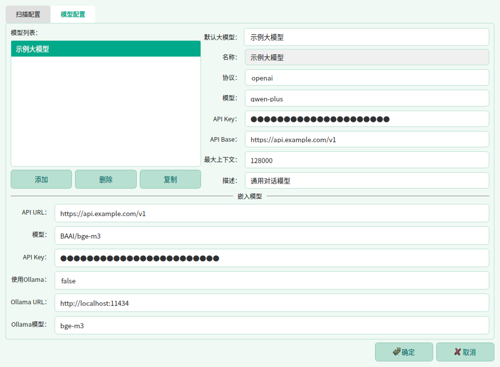

# 果壳文件检索工具重要升级，国产系统下完美替代 Everything / Listary
> 💡 备注属性未写入，可能是备注属性名称或者类型被修改了，建议将字段类型设置为 rich_text，可以在小程序-操作-修改文章数据库页面进行调整
> 💡 原文链接:[https://mp.weixin.qq.com/s?__biz=MzI2MDA4OTY0Mw==&mid=2247489833&idx=1&sn=fb8f6ed603d967ff40f4633ffa4c58aa&chksm=eb942fc0d37208dbcf3602ddb3dacc3daebd696abc2f340abb9a4a2fbd158c0ba8cc89254e2d#rd](https://mp.weixin.qq.com/s?__biz=MzI2MDA4OTY0Mw%3D%3D&mid=2247489833&idx=1&sn=fb8f6ed603d967ff40f4633ffa4c58aa&chksm=eb942fc0d37208dbcf3602ddb3dacc3daebd696abc2f340abb9a4a2fbd158c0ba8cc89254e2d#rd)

> 💡 Windows版的本地文件检索工具 Everything 和 Listary 很多人都用过，但适用于国产操作系统的文件检索工具却很缺乏。EveryFile 就是为了解决这个问题而生，它完美适配 Arm 和 x86 架构的麒麟系统和统信系统。

**EveryFile 从 1.04.10240901 版开始，新增双击Ctrl 和 Ctrl+G 热键功能，大幅提升操作便利性。**
EveryFile 热键功能介绍
**EveryFile 目前具备以下功能：**
1. 能对本地文件通过文件名进行关键词检索。
1. 能对主要文档型文件，如 wps、docx、doc、pptx、md、xls、xlsx、et、pdf（包括图片型pdf）、ofd、eml、txt 等，通过文件内容进行关键词检索。
1. 能根据您的问题，通过语义检索找到对回答问题最可能有帮助的文件。
1. 能根据检索到的文件内容回答您的问题，把本地文件盘活成高效的知识库。
1. 能对文件内容进行概括总结，帮您快速掌握文件要点。
1. 具备对标 Listary 的热键功能，快捷检索窗口呼之即来、挥之即去，随时响应您的召唤。
**同类工具横向对比简表**
| 工具 | 支持国产系统 | OFD支持 | 全文检索 | 本地语义检索 | 多架构一键安装 |
| EveryFile | 麒麟、统信 | ✅ | ✅ | ✅ | ✅ |
| Recoll | Linux（需编译） | ❌差 | ✅ | ❌ | ❌ |
| DocFetcher | 跨平台 | ❌ | ✅ | ❌ | ❌ |
| 系统自带搜索 | 麒麟、统信 | ❌ | 部分支持 | ❌ | ✅ |
| Listary | 仅Windows | ❌ | ❌ | ❌ | ❌  |
| Everything | 仅Windows | ❌ | 插件支持 | ❌ | ❌  |
EveryFile 主要功能介绍
## EveryFile 使用帮助
EveryFile（果壳文件检索工具）对本地磁盘文件建立索引，支持按**关键词**精确检索与按**语义**智能检索，并可在软件内预览文件内容、结合大模型对文件进行问答与总结。
目录
- 快速上手
- 界面导览
- 关键词检索
- 语义检索与智能问答
- 检索结果操作
- 快速搜索与系统托盘
- 索引维护
- 设置：扫描配置
- 设置：模型配置
- 常见问题
- 快捷键
- 关于与支持
### 
### 一、快速上手
1. 建立索引：软件启动后会自动扫描本机磁盘并建立文件索引。
1. 关键词检索：在顶部"文件路径和名称"或"文件内容"输入框输入关键词，输入过程中实时自动检索。
1. 语义检索：在"您的问题或要求"框用自然语言描述需求（如"去年的竣工验收报告"），按 或点击"语义检索"。
1. 查看结果：点击结果行可在右侧预览文件内容；双击行用系统默认程序打开文件；右键行可打开文件位置、复制文件等。
1. 智能回答：让大模型根据一个或多个文件内容回答您的问题；或让大模型直接回答您的问题。
1. 随时随地快速搜索：双击 弹出快速搜索小窗，输入即搜、回车打开；软件常驻系统托盘，主窗口可随时展开或收起。
**提示：**语义检索需要先在"设置 → 模型配置"中配置好嵌入模型，智能问答需要配置好大模型。
### 
### 二、界面导览

主界面：顶部关键词检索行与语义检索行，左侧结果列表，右侧内容预览
| 区域 | 说明 |
| 顶部标题栏 | 左侧为软件标题；右侧显示索引统计信息与主题切换（浅绿 / 绿色 / 浅灰 / 深色）。 |
| 关键词检索行 | "文件路径和名称"与"文件内容"两个输入框，输入后自动检索，右侧 × 一键清空。 |
| 语义检索行 | 自然语言输入框、"语义检索"与"直接回答"按钮、结果数量上限选择框。 |
| 路径栏 | 选中结果文件后显示其完整路径。 |
| 检索范围面板 | 窗口最左缘竖排"检索范围"按钮开/关。勾选目录可把检索限定在指定范围内。 |
| 结果列表（左） | 检索结果：序号、文件名称、大小、修改时间、文件类型。 |
| 内容预览（右） | 显示选中文件的提取内容，可"加载全部文字"或"复制"。 |
| 底栏 | 左侧三角形按钮展开/收起"索引维护"工具条；齿轮按钮打开设置；"记录数"显示当前结果条数。 |
| 状态栏 | 操作提示信息；右下角版本号可点击，弹出"帮助 / 检查更新 / 关于"菜单。 |
### 
### 三、关键词检索
#### 1.两个检索框
- 文件路径和名称：匹配文件名或文件所在路径。
- 文件内容：匹配文件的提取内容。
#### 2.检索规则
- 输入后自动开始检索，无需按回车；结果条数显示在底部"记录数"处。
- 用**空格分隔多个关键词**时，文件需**同时包含**所有关键词才会命中（AND 关系）。例如输入 竣工 验收只会找到同时含这两个词的文件。
- "文件内容"检索至少需要输入 2 个字符。
- 两个框可单独使用，也可组合使用（名称与内容同时满足）。
**提示：**点击窗口最左缘的竖排"检索范围"按钮，可在目录树上勾选，把检索限定在某些磁盘/文件夹内；勾选父目录后也可单独取消其中某些子目录。

检索范围面板：在目录树上勾选需要纳入检索的范围
### 
### 四、语义检索与智能问答
#### 1.语义检索
在"您的问题或要求"框中用自然语言描述，按语义相似度查找相关文件，不必记得文件名中的确切字词。
- Enter：执行语义检索；Shift+Enter：换行；Alt+Enter：直接回答。
- "最多显示前 N 个"控制返回文件数（3–100，默认 15），修改后立即生效。
- 语义检索依赖**嵌入模型**，未配置或不可用时按钮置灰（详见"设置：模型配置"）。

语义检索：用自然语言描述需求，结果按语义相关度返回
#### 2.智能回答
"智能回答"由大模型根据一个或多个文件内容回答您的问题。依赖**大模型**配置，不可用时按钮置灰。

智能回答：大模型的回答显示在右侧预览区，可复制
#### 3.直接回答
"直接回答"由大模型基于自身掌握的知识直接回答您的问题。依赖**大模型**配置，不可用时按钮置灰。

直接回答：大模型的回答显示在右侧预览区，可复制
#### 4.针对文件的智能操作
在结果列表中右键含有提取内容的文件，可使用（均需大模型可用）：
- 归纳总结文件内容：生成该文件的内容摘要。
- 结合文件内容执行新任务：让大模型围绕该文件完成您指定的任务。
- 回答文本框中您的问题：结合该文件内容回答语义输入框中的问题。
### 
### 五、检索结果操作
| 操作 | 方式 |
| 预览文件 | 单击结果行，右侧显示文件内容预览。 |
| 打开文件 | 双击结果行，用系统默认程序打开；目录行双击打开文件夹。 |
| 打开文件位置 | 右键 → "打开文件位置"（在系统文件管理器中定位该文件）。 |
| 复制文件 | 右键 → "复制文件"，或选中后按 `Ctrl+C`，之后可到文件管理器中粘贴。 |
| 拖拽 | 把结果行直接拖入系统文件管理器等支持的位置；多选后拖拽即拖全部选中项。 |
| 多选 | 与系统文件管理器一致：`Ctrl`点选、`Shift`范围选、表头复选框全选/全不选。左侧勾选框与行选中双向联动。 |
| 排序 | 点击表头（序号、大小、修改时间等）切换升/降序。 |
| 批量复制清单 | 多选后右键，可复制文件本身，或复制文件清单（含完整路径 / 仅文件名），方便粘贴到文档中。 |
#### 内容预览
- 预览默认显示扫描时提取的内容（超过"每文件提取字数上限"的部分被截断）。
- 点击**加载全部文字**可加载完整文本；点击**复制**可复制预览内容（保留格式、表格与图片）。
- 预览下方显示当前内容的字数统计。
### 
### 六、快速搜索与系统托盘
EveryFile 常驻系统托盘。无需切回主窗口，随时随地呼出一个悬浮小窗即可检索并打开文件——类似 Listary 的使用体验。
#### 1.呼出与收起
- 任意界面下**双击 ****`Ctrl`**或 Ctrl+G：在鼠标所在屏幕中央弹出快速搜索窗。
- 快速搜索窗显示时**再次双击 ****`Ctrl`**（或 Ctrl+G）：收起搜索窗，并同时调出 EveryFile 主窗口。
- 按 Esc，或点击其他窗口（搜索窗失去焦点）时，搜索窗自动收起。

快速搜索小窗：顶部为应用图标、搜索框与检索模式下拉；绿色高亮为当前选中结果，文件名下方灰色小字为大小与路径
#### 2.检索模式
搜索窗右侧下拉框可选择检索模式，与主窗口的检索方式一致：
| 模式 | 说明 |
| 文件名检索 | 按文件名或路径匹配关键词，输入过程中自动实时检索。 |
| 内容检索 | 按文件提取内容匹配关键词（至少 2 个字符）。 |
| 语义检索 | 用自然语言描述要找的文件，按语义相似度返回。需嵌入模型可用（不可用时该选项置灰），输入停顿后自动开始检索。 |
#### 3.语义检索的筛选条件（mc: / nr:）
仅凭一句自然语言有时检索不到最相关的文件，可在问题后面附加筛选条件缩小范围：
- (mc: 关键词1 关键词2)：按**文件名**筛选；
- (nr: 关键词1 关键词2)：按**文件内容**筛选。
例如：`上季度营收情况 (mc: 报告 2026) (nr: 营收)`。书写规则：
- 括号与冒号**全角、半角均可**，如 （mc：报告）与 (mc:报告)等价；
- 多个关键词用空格分隔，需**同时包含**才算命中（AND）；
- 筛选块可写在问题中的任何位置，同类筛选块可出现多次，关键词会合并；
- 只写筛选条件、不写问题时，直接执行关键词检索。
#### 4.结果操作
| 按键 | 功能 |
| `↑`/ `↓` | 上下选择结果。 |
| `Enter` | 用系统默认程序打开选中的文件。 |
| `Ctrl+Enter` | 打开文件所在文件夹，并自动选中该文件。 |
| `Alt+Enter` | 弹出任务输入框，让大模型参考文件内容执行任务。 |
| 双击结果行 | 同 `Enter`。 |
#### 5.调用大模型执行任务
- 选中结果后按 Alt+Enter：弹出任务输入框，大模型将**结合该文件内容**执行您输入的任务（需已提取文件内容），弹窗下方显示将提交的文件名。
- 未选中任何文件按 Alt+Enter：同样弹出任务输入框，大模型**直接执行任务**，不引用文件。
- 当前为"语义检索"模式时，您在搜索窗输入的描述会自动填入任务输入框（筛选条件不会带入），减少重复输入。
- 任务输入框内：Enter或 Alt+Enter等同点击"确定"提交任务；Shift+Enter换行；Esc等同点击"取消"关闭弹窗。

任务输入弹窗：可从"最近的任务"下拉快速复用历史任务，底部提示将提交给大模型的文件名
**提示：**调用大模型需先在"设置 → 模型配置"中配置好大模型。
#### 6.系统托盘
- 最小化到托盘：点击主窗口右上角 ×，或主窗口聚焦时按 Esc，主窗口隐藏到托盘（首次会有气泡提示"EveryFile 仍在运行"）。
- 托盘菜单：右键托盘图标可选择"快速搜索"或"退出"（退出才真正结束程序）。
- 唤起主窗口：单击/双击托盘图标。
- 快速呼出：双击 Ctrl/ Ctrl+G随时呼出快速搜索窗。

托盘图标与右键菜单：可快速呼出搜索窗、显示主窗口或真正退出程序
### 
### 七、索引维护
点击窗口**左下角三角形按钮**展开"索引维护"工具条（默认收起）。

索引维护工具条：扫描、向量维护与冗余清理入口
| 按钮 | 作用 |
| 扫描本地文件 | 重新扫描磁盘并更新文件索引，包括收录文件名和文件路径、提取文件内容、对文件内容进行分块向量化（仅更新新增/修改的文件，不自动清除已删除文件的索引）。 |
| 维护向量数据 | 手动启动为纳入内容索引的文件生成/更新向量数据，供语义检索使用。新增或修改嵌入模型配置后建议执行。 |
| 清除冗余索引 | 清理文件已不存在的过期索引记录。 |
| 清除冗余向量 | 清理已无对应索引记录的孤立向量数据。 |
| 停止 | 中止正在进行的扫描/维护任务。 |
**自动维护：**距上次扫描超过 24 小时后，软件会自动启动一次扫描（后台静默进行）。
### 
### 八、设置：扫描配置
点击底栏**齿轮按钮**打开设置，"扫描配置"页控制索引的收录范围与内容提取。

设置：扫描配置页
| 配置项 | 说明 |
| 用户数据目录 | 索引数据库的存储位置，留空使用默认位置。修改后旧索引不会自动迁移，需重新扫描。 |
| 索引线程数 | 1–8。线程越多扫描越快，但更占内存与 CPU。 |
| 可收录文件类型 | 逗号分隔的扩展名（如 doc, docx, pdf, txt）。只有这些类型会被纳入索引。 |
| 扫描根目录 | 多个路径逗号分隔。Windows 下在扫描所有盘符的基础上追加这些目录（支持网络共享路径）；Linux/麒麟下则替代默认扫描根。留空按默认行为。 |
| 内容提取文件类型 | 内置列表（只读）；"自选纯文本类型"可在其基础上**追加**纯文本类型（如 csv、log、ini），只增不减。需同属"可收录类型"才会真正纳入内容索引。 |
| 每文件提取字数上限 | 1万–100万字，默认 3万，超出部分截断。修改后重启程序生效（修改后只对新增/更新文件生效，已提取内容文件不会重新提取）。 |
| 单文件大小上限 | 100–1024 MB，默认 200 MB。超过上限的文件跳过内容提取（仍收录文件名）。下次转换立即生效。 |
| 排除关键词 | 逗号分隔。路径中含关键词的目录不纳入扫描。 |
| 例外目录 | 逗号分隔。这些目录不受排除关键词影响，强制扫描。 |
### 
### 九、设置：模型配置

设置：模型配置页（大模型与嵌入模型）
#### 1.大模型（LLM）
- 左侧模型列表支持添加 / 删除 / 复制；"默认大模型"决定"直接回答"等功能使用哪个模型。
- 常用字段：协议（openai）、模型名称、API Key、API Base、最大上下文。
- "直接回答"与右键的归纳总结、内容问答等均依赖大模型可用。
#### 2.嵌入模型
- 用于语义检索的向量化，支持 OpenAI 兼容接口和 Ollama 接口。
- 未配置或不可用时"语义检索"按钮置灰。
- 修改嵌入模型配置后，建议执行"索引维护 → 维护向量数据"重建向量。
**注意：**API Key 属敏感信息，请妥善保管，不要将配置文件分享给他人。
### 
### 十、常见问题
#### 1. 检索不到某个文件？
- 该文件类型是否在"设置 → 扫描配置 → 可收录文件类型"中？
- 是否已被"排除关键词"排除？（可用"例外目录"强制收录）
- "检索范围"面板是否勾选了更小的范围？
- 文件是否是最近新增/修改的？请先执行"扫描本地文件"。
#### 2. "语义检索"按钮是灰的？
嵌入模型未配置或不可用。请到"设置 → 模型配置 → 嵌入模型"填写接口地址、模型名称与 API Key，保存后重试。
#### 3. "直接回答"按钮是灰的？
大模型未配置或不可用。请到"设置 → 模型配置"检查默认大模型的协议、模型名称、API Key 与 API Base。
#### 4. 某些文件按内容搜不到？
- 该类型是否在"内容提取文件类型"中？（可在"自选纯文本类型"追加纯文本类型）
- 文件是否超过"单文件大小上限"（默认 200 MB）？超限文件只收录文件名、不提取内容。
- 内容是否超过"每文件提取字数上限"被截断？截断不影响已提取部分的检索。
#### 5. 预览内容不完整？
预览默认显示扫描时提取的部分内容（受提取字数上限约束），点击"加载全部文字"即可查看全文。
#### 6. 首次扫描很慢？
首次扫描需遍历全盘并转换/提取文件内容，耗时与文件数量、大小及"索引线程数"有关，请耐心等待。之后增量扫描会快很多。
#### 7. 如何更新软件？
点击状态栏右下角版本号，选择"检查更新"；软件启动时也会自动检查。版本号菜单中还可查看"关于"与开源许可声明。
#### 8. 双击 Ctrl 没有反应？
- 检查其他软件是否占用了"双击 Ctrl"或 Ctrl+G全局热键。
- Linux 下全局热键默认通过键盘设备监听实现，需要当前用户有输入设备读取权限。权限不足时会自动退化为显示服务器监听，个别 Wayland 环境下可能失效；可将当前用户加入 input组（sudo usermod -aG input $USER，注销重新登录后生效）。
### 
### 十一、快捷键
| 快捷键 | 作用位置 | 功能 |
| `F1` | 全局 | 打开本帮助窗口 |
| 双击 `Ctrl` | 全局 | 呼出快速搜索窗；已显示时收起并调出主窗口 |
| `Ctrl+G` | 全局 | 同"双击 Ctrl" |
| `↑`/ `↓` | 快速搜索窗 | 上下选择结果 |
| `Enter` | 快速搜索窗 | 打开选中的文件 |
| `Ctrl+Enter` | 快速搜索窗 | 打开所在文件夹并选中该文件 |
| `Alt+Enter` | 快速搜索窗 | 调用大模型执行任务（选中文件时结合其内容） |
| `Esc` | 快速搜索窗 | 收起窗口 |
| `Esc` | 主窗口 | 最小化到系统托盘 |
| `Enter` | 语义输入框 | 执行语义检索 |
| `Shift+Enter` | 语义输入框 | 换行 |
| `Alt+Enter` | 语义输入框 | 直接回答 |
| `Enter`/ `Alt+Enter` | 任务输入框 | 等同点击"确定"提交任务 |
| `Shift+Enter` | 任务输入框 | 换行 |
| `Esc` | 任务输入框 | 等同点击"取消"关闭弹窗 |
| `Ctrl+C` | 结果列表 | 复制选中的文件/文件夹 |
| `Ctrl`/ `Shift`+ 单击 | 结果列表 | 多选（点选 / 范围选择） |
| 双击 | 结果列表 | 打开文件（目录行打开文件夹） |
EveryFile 使用说明
---
在国家推行国产化替代的大背景下，与其抱怨国产操作系统比不上 Windows，不如投身其中，为国产终端打造好用实用的软件。也许这些软件刚开始时还不完美，但只要用户真正使用，开发者真诚对待每一条反馈意见，积沙成塔，聚水成涓，国产软件一定会越来越好！
EveryFile 获取方法：关注微信公众号《果壳里的星辰》，然后发送“文件检索”4个字，将会收到安装包的下载链接。
如果有使用问题和意见建议，欢迎留言，或扫码加开发者微信（Butterfly_of_Amazon），邀您进群交流。
