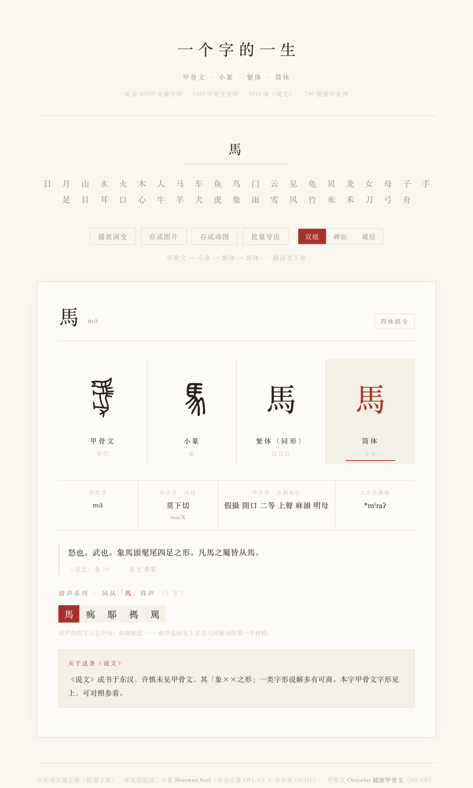
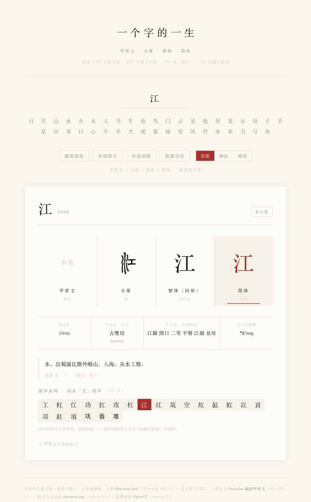
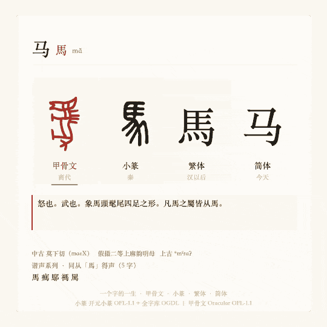
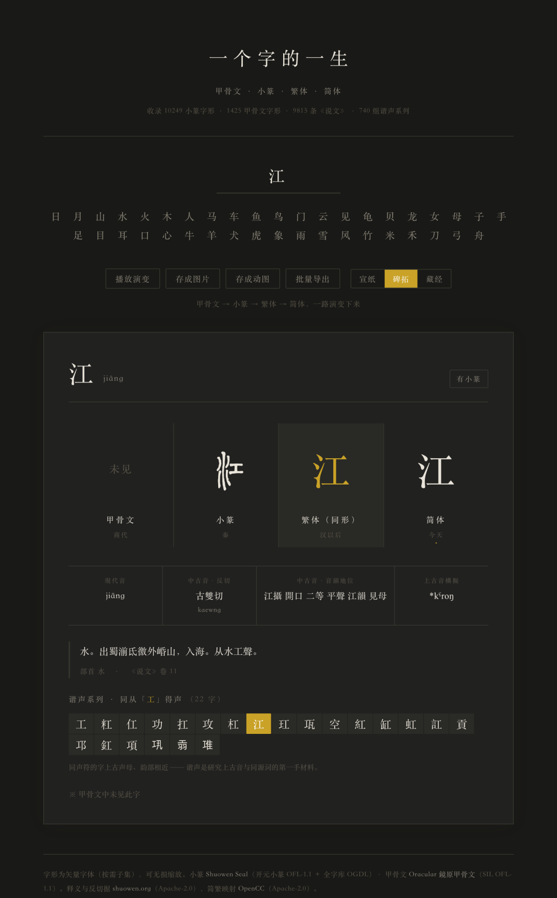

# 查一个字的来历，不用再翻字典——10249 个小篆、1425 个甲骨文，排成一条时间轴
> 💡 备注属性未写入，可能是备注属性名称或者类型被修改了，建议将字段类型设置为 rich_text，可以在小程序-操作-修改文章数据库页面进行调整
> 💡 原文链接:[https://mp.weixin.qq.com/s?__biz=MzAxNDIzNzc4MQ==&mid=2649401237&idx=1&sn=0bcfed0aac4b1ff35f87a2aa3b85d9d1&chksm=82fa31d218feded9676d5d933e484110afed7af9cff7fcf51d09ceda572fd68da7be04e92cb4#rd](https://mp.weixin.qq.com/s?__biz=MzAxNDIzNzc4MQ%3D%3D&mid=2649401237&idx=1&sn=0bcfed0aac4b1ff35f87a2aa3b85d9d1&chksm=82fa31d218feded9676d5d933e484110afed7af9cff7fcf51d09ceda572fd68da7be04e92cb4#rd)
你一天要写几百个字，没几个真正看清过。
小学课本上写着，「马」是象形字，像一匹马。然后呢？然后就没有然后了。从商代刻在龟甲上的那一笔，到你刚才手指划出来的那个「马」，中间隔着三千年。
这段路，大部分人这辈子没看过。

一句话说清：有人做了张网页，输入任意一个汉字，把它的形、音、义、族摊在一条时间轴上——甲骨文、小篆、繁体、简体，从商代一路排到今天。查不到的地方一律显示横杠，不编。
地址先放这儿，省得你等会儿翻：
- GitHub：https://github.com/Ivan666jjj/yigezi
- 在线版：https://ivan666jjj.github.io/yigezi/
### 查一个字，过去有多麻烦
想弄清一个字的来历，你的选择其实很少。
买本甲骨文字典，几百块，竖排，查起来像在做学问。上汉典，信息是全的，但甲骨、小篆、《说文》、音韵散在四个板块里，得你自己拼。去翻《说文》原书，更劝退——反切看不懂，部首还得先学一遍。
最要命的是这一点：《说文》是东汉人写的。许慎一辈子没见过甲骨文，所以他对不少字的解释，从析字形这一步就错了。
可绝大多数人查字源，翻到《说文》就停下了。把错的当成对的，记进脑子里。
yigezi 想解决的就是这件事：四样东西放同一页，一次看完。
### 它把什么东西装进去了
README 上的数字我数过一遍，没虚标（后面细说）：
- **10249** 个小篆字形
- **1425** 个甲骨文字形
- **9815** 条《说文解字》释义，带反切、部首、卷次、重文
- **740** 组谐声系列，同声符的字能点着往下走
- **7964** 条中古音、**3163** 条上古音构拟
技术上没什么花哨的。单页 HTML，无框架、无依赖，字体用 `pyftsubset` 按需子集（完整字体 25.8MB 压到 8.5MB woff2）。
GIF 编码器是自己写的。浏览器原生不支持 GIF 编码，想做演变动图，只能自己实现一遍 GIF89a。
### 谁做的
一位学汉语言文学的朋友，和舍友聊天聊出来的点子。
没有融资，没有团队。动机朴素得有点可爱：电脑里已经有小篆和甲骨文字体了，能不能做一个「查一个字，就能看到它怎么来的」页面，好分享、又够专业。
数据全是从公开学术库里搬的：开元小篆、鏡原甲骨文、shuowen.org、CNRS 的 PHONO-ML 中古音库、Baxter & Sagart 的上古音构拟。每一条都在 `THIRD_PARTY_NOTICES.md` 里标了来源和授权。
把散在各处的学术数据库，收拾成一个你两秒钟就能上手的东西——这事儿本身就有价值。
### 我实际跑了一遍
我把仓库 clone 下来，用本地服务打开。三个文件（`index.html` + `seal.woff2` + `orac.woff2`）放同一目录就行，没装任何依赖。
体积先说清楚：`index.html` 1.6MB，`seal.woff2` 8.3MB，`orac.woff2` 0.4MB，加起来 **10.3MB**。在线版第一次打开要等一会——这是它最明显的短板。
然后我把内联数据抠出来数了一遍：说文条目 9815、小篆 10249、甲骨 1425、谐声系列 740 组（含 6304 个字）、中古音 7964、上古音 3163。
和 README 完全一致。很多项目的文档数字是兜底估的，这个没有。
接下来是三个我没料到的坑。
**一是甲骨文的覆盖率，远低于直觉。** 10249 个小篆字里，只有 1269 个能同时找到甲骨形，12.4%；2151 个常见简体字里，只有 293 个查得到甲骨，13.6%。
我随手打了「爱、汉、书、国、语、说」，甲骨文那一格全是「未见」。这不是作者偷懒——已释甲骨文总共就一千六百来个字，是客观上限。
**二是查「学」。** 甲骨文有小篆有，往下一翻，《说文》那一栏写着「《说文》未收此字」。
横杠就是横杠。这一点反而让我信它。
**三是谐声系列按繁体字头建的。** 查「请」，跳出一族 17 个字，都从「青」得声；查「妈」是空的——《说文》本来就没收这个后起俗字。

最让我意外的是「古文字纠正」这个功能。它直接告诉你：「甲骨文从『又』从『象』，会以手牵象劳作之意。《说文》训『母猴也』，是未见甲骨文而致误」（为）；「甲骨文像手拉弓搭箭之形。《说文》析为『从矢从身』，于古文字无据」（射）。
然后我数了一下——全站只有 **10 条**。
这是最精彩、也最「不够」的一块。它证明这条路走得通，但离够用还差得远。
顺手验了下导出。页面藏了个自检钩子，地址栏加上 `#selftest` 就跑：单字 JPG 通过；演变 GIF 也通过，540×540、4 帧、46458 字节的 GIF89a，它自己写的编码器吐出来的。我把文件转出来看了一遍，甲骨文、小篆、繁体、简体，四帧依次切过去。

### 怎么用
**完全不想折腾的**：直接开在线版，输入一个字，两秒出结果。**会一点技术的**：`git clone` 下来，三个文件放一起，本地起个服务，离线也能用。**教语文、讲汉字的**：单字导出成图片，讲「六书」的时候直接投屏。**做内容的**：单字导 JPG，演变导 GIF，都是现成素材。**只想分享某个字**：地址后面加 `#z=字`，比如 `#z=江`，直接打开那一页。
配色有三种：宣纸、碑拓、藏经。碑拓是深色底，最有味道。

### 最后浅谈下缺点
甲骨文只有 1425 字，这是硬上限，换任何字体都突破不了。
中古音和上古音没覆盖全部字（7964 / 3163），多音字只取一个主要读音。谐声系列靠《说文》里「从××聲」自动归并，个别字会因为释文异文归错。
最要提醒的一条：上古音构拟和中古音转写都是**学术构拟**，不是古人真的那么念。别把它当成「三千年前的人这么说话」。
代码 MIT，数据各有各的授权，要再分发就把 `THIRD_PARTY_NOTICES.md` 一起带走。
我最近在写的这类「把老东西盘活」的项目，已经攒了好几个。你要是也吃这一口，这个号可以常来看看。
---
**GitHub**：https://github.com/Ivan666jjj/yigezi**在线版**：https://ivan666jjj.github.io/yigezi/
打开它，搜**你自己名字里的一个字**。看看三千年前，它长什么样。
许慎一辈子没见过一片甲骨，我们现在两秒钟就能把这两样对上。只是很少想起来看。
——
觉得有意思，点个在看、分享给有需要的朋友。

## 摘要

（待补充）

## 我的笔记

（待补充）
